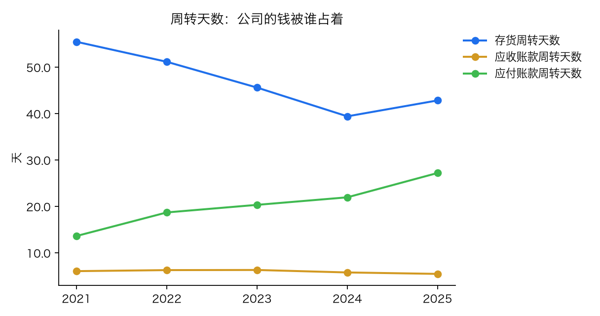

# 中国食品（00506.HK）2025 年报深度解读

## 一页纸

**三句话：220.70 亿元收入只留下 8.62 亿元归母，利润表薄得经不起一格波动；同一年的经营现金流是 32.29 亿元，净现比 3.75 倍；两者的差额里，只有厂房设备折旧 8.07 亿元这一块能年年重复。** 营业收入 220.70 亿元（P97）、经营活动现金流量净额 32.29 亿元（P102），同一家公司、同一套资产，两张表的体量相差 3.75 倍。读它的次序必须倒过来：先看现金从哪来，再看利润为什么这么薄，最后才问这份现金值多少钱。

**净利率 3.91% 是五年里的次高点，但结构比比率更值得看。** 毛利 81.83 亿元、毛利率 37.08%，分销及销售支出 59.49 亿元、行政支出 4.72 亿元，营业利润 19.79 亿元，所得税 5.51 亿元，净利润 14.28 亿元（P97）。从毛利到营业利润，被渠道吃掉六成以上；从营业利润到归母，又被税与少数股东各切一刀。

**五个数：220.70、8.62、32.29、5.66、45.49。** 分别是营业收入、归母净利润、经营现金流、少数股东损益、货币资金（P97、P102、P98）。前三个数决定这门生意赚不赚钱，第四个决定赚到的钱归谁，第五个决定它在坏年份能不能不求人。

**现金比利润厚，厚在两处，只有一处能重复。** 折旧与摊销 8.07 亿元（P101）是会计扣减，不掏现金，明年还是这个量级；合约负债从 8.66 亿元升到 13.08 亿元、应付账款从 8.04 亿元升到 10.35 亿元（P98），是渠道与供应商在一年里给出的无息资金，做完了就没有第二次。把这两块分开，32.29 亿元才不会被误读成常态。

**利润里有近四成不是股东的。** 净利润 14.28 亿元，少数股东损益 5.66 亿元，归母 8.62 亿元（P97）；少数股东权益 36.65 亿元，归母权益 68.96 亿元（P99）。合并报表的规模是完整的，处置权不是——用合并利润给这家公司定价，会系统性高估。

**底牌是整张表没有有息负债。** 短期借款、长期借款两个科目都不存在，货币资金 45.49 亿元（P98），筹资活动里最大的一笔偿债支出 0.53 亿元是租赁负债（P103）。需求走弱时它不会被银行催着还钱，管理层可以照年景调费用，不必为还本付息预留现金——这也是行政支出能压到 4.72 亿元、五年最低的前提。

**最该追的三件事：毛利率、合约负债、资本开支。** 毛利率从 37.79% 退到 37.08%（P97），退的原因是水品类占比上升与铝价高位（P24），两条都不由公司决定；合约负债 13.08 亿元（P98）五年在 8.66 亿元到 15.81 亿元之间摆动，是渠道情绪的体温计；资本开支 10.49 亿元（P103）已是五年最高，而厂房设备折旧只有 8.07 亿元（P101），扩产正在加速，收入却只增了 2.7%。

**有一件事这份年报答不了：分品类的毛利与商誉减值的底数。** 附注 5 只按商品类型拆收入（P148），附注 6 明确只有单一经营分部、不列报分部资料（P148），所以「汽水更赚钱还是果汁更赚钱」无法回答；无形资产 35.42 亿元（P98）的减值测试只写了一句「可收回金额远高于账面值」（P163），没有给可收回金额与敏感性区间。这两处不影响对它现在的判断，但会影响它在坏年份的判断。

| 指标 | 2021 | 2022 | 2023 | 2024 | 2025 |
| :--- | ---: | ---: | ---: | ---: | ---: |
| 营业收入（亿元） | 197.84 | 209.68 | 214.46 | 214.92 | 220.70 |
| 归母净利润（亿元） | 5.72 | 6.60 | 8.33 | 8.61 | 8.62 |
| 毛利率 | 35.69% | 35.76% | 35.18% | 37.79% | 37.08% |
| 净利率 | 2.89% | 3.15% | 3.88% | 4.00% | 3.91% |
| ROE | 11.10% | 11.95% | 13.84% | 13.32% | 12.50% |
| ROIC | 12.14% | 12.94% | 13.53% | 13.47% | 13.08% |
| 经营活动现金流（亿元） | 10.74 | 11.41 | 24.30 | 28.47 | 32.29 |
| 自由现金流（亿元） | 3.60 | 2.59 | 18.02 | 21.35 | 21.80 |
| 净现比 | 1.88 倍 | 1.73 倍 | 2.92 倍 | 3.31 倍 | 3.75 倍 |
| 资产负债率 | 44.69% | 41.17% | 40.30% | 42.05% | 42.56% |
| 分红率 | —（不可得） | —（不可得） | —（不可得） | —（不可得） | —（不可得） |

红旗判定：清单共 32 项，命中 0 项，数据不足 20 项（数据不足不等于没问题）。

## 生意：钱是怎么赚的

**收入是五块拼起来的，但只有一块决定方向。** 汽水 166.85 亿元、果汁 30.28 亿元、水品类 9.29 亿元、功能饮料 3.20 亿元、其他 11.09 亿元（P148），合计 220.70 亿元（P97）。汽水占 75.60%，其余四块加起来不到四分之一。把这家公司说成「饮料公司」不算错，但会漏掉真正的结构：一门生意里四分之三的收入挂在同一个品类、同一批品牌、同一套装瓶线上。

**分品类只有收入，没有毛利，「哪块更赚钱」在这份年报里无解。** 附注 5 只按商品类型拆收入（P148），附注 6 明确集团只有单一经营分部、因此不列报分部资料（P148）。分品类毛利率、分部资产、分部现金流一概没有。毛利率 37.08%（P97）是五块业务混在一起的平均数，水品类占比一变，这个平均数就跟着变——2025 年正是这样退的（P24）。

**每 100 元收入，先被成本拿走 62 元上下，再被渠道拿走 27 元，管理拿走 2 元，落到营业利润这一层不到 9 元。** 营业成本 138.87 亿元、分销及销售支出 59.49 亿元、行政支出 4.72 亿元、营业利润 19.79 亿元（P97）。毛利率 37.08%、销售费用率 26.96%、管理费用率 2.14%，三个比率一层层剥下去，剩下的空间只有个位数。这就是这门生意的单位经济：规模能摊薄固定成本，摊不薄渠道费用。

**成本这一端，公司几乎没有定价权。** 前五名供应商合计占采购 58%，最大一家占 44%（P77），且年报在董事会报告里明确中粮本身就是五大供货商之一（P77）。营业成本 138.87 亿元（P97）里，浓缩液来自品牌方，铝罐与瓶坯跟着大宗走，糖与代糖由市场定价。年报把 2025 年毛利率下行的第二个原因写成「铝价高位震荡带动易拉罐采购成本上升」（P24），这句话本身就是承认：涨价传不下去，只能自己吞。

**销售费用不是可选项，是这门生意的租金。** 分销及销售支出 59.49 亿元（P97），五年从 53.56 亿元抬到 59.49 亿元，与收入同速；前五名客户合计不足 4%（P77），没有哪个客户能替公司分摊这笔钱。渠道要靠一家家经销商、一台台冰柜、一场场促销买下来，买完还得每年续费。行政支出 4.72 亿元（P97）是五年最低，可压出来的那点空间，在 59.49 亿元面前不构成变量。

**重资产是授权的形状，不是技术的形状。** 固定资产 56.08 亿元、无形资产 35.42 亿元（P98）；无形资产五年从 35.30 亿元走到 35.42 亿元，几乎没有动过。资本开支 10.49 亿元、厂房设备折旧 8.07 亿元（P103、P101）。钱花在罐线、厂房、冰柜与区域授权上，不花在研发上——年报里找不到研发投入的科目，也没有资本化率可算。

**这门生意的底色：用区域授权换货架，用合资结构分摊资本，赚一份效率钱。** 授权覆盖 19 个省级行政区域、10 大品类、25 个品牌（P21）；核心装瓶主体 65% 持股、35% 归少数股东（P183）；员工 18,349 人（P33）。区域、品类、价格带都由授权划定，公司能自己决定的只有周转、费用执行与产能节奏，这也解释了为什么 ROE 12.50%（P97、P98–P99）五年只在 11.10% 到 13.84% 之间移动。

**三个可以证伪上面判断的观察点。** 毛利率若在铝价平稳的年份继续下行，说明费用对毛利的挤压已经制度化，不再是原料问题；合约负债若掉头向下，说明经销商不愿为下一季备货，渠道推力在减弱；资本开支若连续高于折旧而收入不动，说明新增产能已经找不到买主。

| 品类 | 2025 | 占营业收入 |
| :--- | ---: | ---: |
| 汽水收入 | 166.85 | 75.6% |
| 果汁收入 | 30.28 | 13.7% |
| 其他收入 | 11.09 | 5.0% |
| 水品類收入 | 9.29 | 4.2% |
| 功能飲料收入 | 3.20 | 1.5% |
| **合计** | 220.70 | 100.0% |

本次没有触发结构化判断。

## 五年账

**五年里收入从 197.84 亿元走到 220.70 亿元，归母却从 5.72 亿元走到 8.62 亿元，两条线的斜率差了一倍多。** 收入四年年均不到 3%，归母年均一成上下（P97）。差额不能全部归给经营改善：归母的两次抬升各有一次性来源，而且在年报上都能指出来。

**第一级台阶在 2023 年：归母从 6.60 亿元跳到 8.33 亿元，而毛利只从 74.98 亿元走到 75.44 亿元。** 同年其他收入、收益及亏损净额从 1.39 亿元升到 3.28 亿元（P97），是五年最高。毛利几乎没动而净利跳了一大步，差额主要落在这一行——这不是渠道效率的胜利，是营业外的一笔。

**第二级台阶在 2024 年：收入只从 214.46 亿元走到 214.92 亿元，毛利率却从 35.18% 升到 37.79%。** 毛利 75.44 亿元到 81.21 亿元（P97），同期成本从 139.03 亿元降到 133.71 亿元（P97）。收入不动而成本下降，最可能的解释是原料价格回落叠加品类结构改善，这两件事都不由公司安排。

**2025 年两级台阶同时用完，归母从 8.61 亿元到 8.62 亿元，几乎原地。** 收入增了 2.7%、销量增了 2.8%（P24），毛利率却退到 37.08%（P97）；其他收益回到 2.22 亿元（P97），不再贡献增量。一家公司在收入创新高的年份利润不增，说明这一轮的利润弹性主要来自前两年的一次性因素，而不是可持续的经营杠杆。

**现金那条线的转折点更早，也更陡：2023 年经营现金流从 11.41 亿元跳到 24.30 亿元（P102），当年净利润只从 12.10 亿元到 13.86 亿元（P97）。** 多出来的十几亿元不可能来自利润，只能来自营运资本与应付项目。此后 2024 年 28.47 亿元、2025 年 32.29 亿元，净现比 1.88 倍、1.73 倍、2.92 倍、3.31 倍、3.75 倍（P102、P97）一路上行——这条线反映的是占款能力在变强，不是盈利在变强。

**资本开支的形状与利润恰好相反：先压后放。** 2021 年 7.14 亿元、2022 年 8.82 亿元、2023 年压到 6.27 亿元、2024 年 7.12 亿元、2025 年跳到 10.49 亿元（P103）。前四年在 6.27 亿元到 8.82 亿元之间摆动，2025 年一步抬到五年最高，而当年的厂房设备折旧只有 8.07 亿元（P101）。折旧是过去投资的回声，资本开支是未来折旧的预告——2026 年的折旧一定会比 8.07 亿元高。

**回报率的形状是「先升后平」，而且平的原因是分母在胀。** ROE 从 11.10% 升到 2023 年的 13.84%，再退到 13.32%、12.50%（P97、P98–P99）；归母权益同期从 51.57 亿元增到 68.96 亿元（P99）。分子没怎么动，分母每年多出几亿元留存，ROE 只能往下走。ROIC 12.14%、12.94%、13.53%、13.47%、13.08% 是同一件事的另一个说法。

**五年账读下来，一句话：这是一门收入缓慢爬坡、利润靠一次性因素跳两级、现金靠占款变厚的生意。** 三次跳升分别来自其他收益、毛利率与营运资本，没有一次来自量的持续扩张或价的持续提升。要推翻这个判断，只需要看到收入增速回到高位的同时毛利率不再退——那才说明经营杠杆真的存在。

| 项目 | 2021 | 2022 | 2023 | 2024 | 2025 |
| :--- | ---: | ---: | ---: | ---: | ---: |
| 营业收入（亿元） | 197.84 | 209.68 | 214.46 | 214.92 | 220.70 |
| 毛利（亿元） | 70.61 | 74.98 | 75.44 | 81.21 | 81.83 |
| 营业利润（亿元） | 13.98 | 15.88 | 18.49 | 18.66 | 19.79 |
| 归母净利润（亿元） | 5.72 | 6.60 | 8.33 | 8.61 | 8.62 |
| 经营活动现金流（亿元） | 10.74 | 11.41 | 24.30 | 28.47 | 32.29 |
| 自由现金流（亿元） | 3.60 | 2.59 | 18.02 | 21.35 | 21.80 |
| ROE | 11.10% | 11.95% | 13.84% | 13.32% | 12.50% |
| 净利率 | 2.89% | 3.15% | 3.88% | 4.00% | 3.91% |

*数据来源：公司年度报告原文（页码见正文引用），金额为合并报表口径。*

### 杜邦分解

| 项目 | 2021 | 2022 | 2023 | 2024 | 2025 |
| :--- | ---: | ---: | ---: | ---: | ---: |
| ROE | 11.10% | 11.95% | 13.84% | 13.32% | 12.50% |
| 净利率 | 2.89% | 3.15% | 3.88% | 4.00% | 3.91% |
| 总资产周转率（次） | 1.30 倍 | 1.39 倍 | 1.32 倍 | 1.22 倍 | 1.20 倍 |
| 权益乘数（倍） | 2.94 倍 | 2.73 倍 | 2.70 倍 | 2.72 倍 | 2.67 倍 |

## 利润表：从毛利到归母

**毛利 81.83 亿元，最后只剩 8.62 亿元归母：五道切口依次是渠道、管理、税、少数股东，加上一次可正可负的其他收益。** 分销及销售支出 59.49 亿元、行政支出 4.72 亿元、金融资产减值净额 0.04 亿元、其他收入收益及亏损净额 2.22 亿元（P97），得出营业利润 19.79 亿元。这条链条上没有任何一环是厚的，任何一环多挪一步，归母那一层都会明显走样。

**销售费用吃掉了毛利的 72.7%，这是利润表上唯一真正重要的比率。** 59.49 亿元对 81.83 亿元（P97），销售费用率 26.96%，五年从 53.56 亿元抬到 59.49 亿元。2025 年销售支出从 58.71 亿元走到 59.49 亿元，慢于收入的 2.7%（P97、P24）；费用率退到 26.96%，毛利率退得更多，两者对冲之后营业利润才从 18.66 亿元挪到 19.79 亿元。

**行政支出 4.72 亿元是五年最低，但它能贡献的只有小数点后一位。** 从 5.38 亿元降到 4.72 亿元（P97），省下的钱不到销售支出的一个零头；管理费用率 2.14%（P97）也是五年最低。把管理费用当成利润调节阀是错位的：它的绝对量只相当于销售费用的十分之一，压到极限也换不回毛利率退的那一步。

**其他收益 2.22 亿元（P97）里既有政府补助与利息收入，也扣掉了厂房与无形资产的减值，是一条最不可预测的线。** 它在 2023 年曾是 3.28 亿元、2024 年掉到 1.62 亿元（P97），一年振幅超过一亿元；2025 年回到 2.22 亿元（P97），相当于营业利润的 11%。这条线里没有一条是公司能年年安排的——补贴看项目，利息看存款，减值看产线命运。

**从营业利润到税前几乎是一条直线，说明这家公司没有财务杠杆可谈。** 融资成本 0.03 亿元（P97）全部是租赁负债利息（P150），应占联营公司业绩 0.03 亿元（P97）；除税前溢利 19.79 亿元（P97），与营业利润只差几分钱。没有利息支出、没有汇兑损益的大额扰动——这是没有有息负债在利润表上的样子。

**税是 2025 年最容易被忽略的一处恶化：所得税 5.51 亿元，有效税率 27.83%，五年最高。** 前四年的有效税率是 24.47%、25.03%、24.86%、23.78%（P97）。年报把增量的原因写得很直白：若干附属公司响应当地税务机关通知开展自查，缴回以前期间所得税（P31）。这笔钱不是当期经营变差，但它确实从归母口袋里出去了。

**归母只拿到净利润的六成，剩下近四成归少数股东。** 净利润 14.28 亿元，少数股东损益 5.66 亿元，归母 8.62 亿元（P97），少数股东占 39.6%。这个比例五年基本没变：2021 年是 5.02 亿元对 5.72 亿元（P97）。装瓶合资的结构决定了利润表永远要分两半读，任何按合并净利润估值的算法都会高估四成。

**利润表能自己决定的只有两处：其他收益与税率，而这两处 2025 年都不帮忙。** 毛利率由原料与品类结构决定，销售费用由渠道竞争决定，少数股东分成由股权结构决定。剩下的两个变量一个回落到 2.22 亿元、一个升到 27.83%，方向都是负的。这就是为什么收入创新高的年份，归母只从 8.61 亿元挪到 8.62 亿元。

### 三项费用与销售投入

| 项目 | 2021 | 2022 | 2023 | 2024 | 2025 |
| :--- | ---: | ---: | ---: | ---: | ---: |
| 销售费用（亿元） | 53.56 | 55.39 | 54.70 | 58.71 | 59.49 |
| 管理费用（亿元） | 4.96 | 5.06 | 5.30 | 5.38 | 4.72 |

*数据来源：公司年度报告原文（页码见正文引用），金额为合并报表口径。*

### 研发与人员

| 项目 | 2021 | 2022 | 2023 | 2024 | 2025 |
| :--- | ---: | ---: | ---: | ---: | ---: |
| 在职员工（人） | —（不可得） | —（不可得） | —（不可得） | 17,533 | 18,349 |

研发投入未资本化（附注资本化金额为空），故不列资本化率。

## 资产负债表：钱在哪、欠谁

**183.85 亿元的资产里，三成是厂房罐线、四分之一是现金、近两成是无形资产，剩下的是存货与应收——这是一张看得懂的资产表。** 流动资产 81.07 亿元、非流动资产由固定资产 56.08 亿元与无形资产 35.42 亿元撑起（P98），资产总计 183.85 亿元（P199）。没有在建工程长年不转固，没有对外投资的大坑，商誉与特许权之外也没有并购留下的残渣。

**货币资金 45.49 亿元占总资产 24.75%，是这张表上最厚的一块。** 上年 40.14 亿元（P98），一年增了 5.35 亿元。受限部分只剩二十万元级的冻结存款（P98、P169），几乎全部可用。年报同时披露，其中一部分存在中粮财务这家关联方非银行金融机构（P169）——这不影响可用性，但它把现金的安全性从「银行体系」挪到了「集团体系」，是个该记住的口径。

**应收与应付极不对称，公司在用供应商的钱做自己的周转。** 应收账款 3.30 亿元、周转 5.5 天，应付账款 10.35 亿元、周转 27.2 天（P97、P98）。应收账龄几乎全部落在六个月以内（P167），说明对下游是款到发货；应付账龄则集中在三个月内（P170），对上游的账期被拉长到了五年最高的 27.2 天（从 13.6 天起）。这 27.2 天不是免费得来的，它同时意味着上游议价关系在变。

**存货 16.30 亿元、周转 42.8 天，是五年里第一次掉头向上。** 从 19.33 亿元一路降到 2024 年的 14.43 亿元，2025 年又回到 16.30 亿元（P98）；周转天数也从 39.4 天回到 42.8 天（P97）。存货里制成品占八成（P167），也就是已经灌装、等着卖出去的成品——这个结构比原料涨价更值得担心，因为它对应的是渠道消化速度。

**无形资产 35.42 亿元五年几乎不动，因为里面绝大部分不摊销。** 35.30、35.32、35.44、35.45、35.42 亿元（P98），五年的变动不到 0.2 亿元；装瓶特许权与商誉合计占了这块资产的绝大部分，两者都被定为不摊销、每年只做减值测试（P146、P161）。换句话说，35.42 亿元这个数字不是「用掉多少、剩多少」，而是「账面挂着多少、假设值多少」。

**减值这一年动了两笔，一笔很小、一笔不小。** 金融资产减值净额 0.04 亿元（P97），是应收与其他应收的常规计提；物业、厂房及设备减值 0.64 亿元（P101、P149），对应的是被判定不再产生足够现金流的产线。后者说明产能布局在调整，也说明 10.49 亿元资本开支（P103）里有一部分是替换而不是扩张。

**负债端 78.24 亿元，其中流动 74.65 亿元、非流动只有 3.60 亿元，结构上没有任何一处是借钱。** 流动负债里应付账款 10.35 亿元、合约负债 13.08 亿元（P98），其余主要是其他应付款项及应计负债（P98）——营销费用计提、冰箱押金、应付工资这些经营性项目。非流动负债 3.60 亿元里是递延税项、租赁负债与递延收入（P99），没有一笔银行借款，资产负债率 42.56%（P97、P199）。

**表外承诺很小，流动性也不算宽裕：资本承担 0.12 亿元（P173），流动比率 1.09 倍（P97、P98）。** 流动比率五年从 0.75 倍修到 1.09 倍，一直在 1 倍边缘；靠的是现金堆上去，而不是负债结构改善。这也是这张表真正的软处：现金 45.49 亿元看着厚，但它同时要应付 74.65 亿元的流动负债，能自由动用的余量没有绝对值看起来那么大。

### 资产端

| 项目 | 2021 | 2022 | 2023 | 2024 | 2025 |
| :--- | ---: | ---: | ---: | ---: | ---: |
| 货币资金（亿元） | 15.92 | 10.37 | 22.93 | 40.14 | 45.49 |
| 应收账款（亿元） | 3.28 | 3.60 | 3.70 | 3.39 | 3.30 |
| 存货（亿元） | 19.33 | 18.88 | 17.37 | 14.43 | 16.30 |
| 流动资产合计（亿元） | 48.49 | 45.66 | 59.75 | 72.73 | 81.07 |
| 固定资产（亿元） | 50.61 | 52.35 | 55.93 | 54.51 | 56.08 |
| 无形资产（亿元） | 35.30 | 35.32 | 35.44 | 35.45 | 35.42 |
| 资产总计（亿元） | 151.68 | 150.63 | 162.26 | 175.98 | 183.85 |

### 负债与权益

| 项目 | 2021 | 2022 | 2023 | 2024 | 2025 |
| :--- | ---: | ---: | ---: | ---: | ---: |
| 应付账款（亿元） | 4.75 | 6.90 | 7.74 | 8.04 | 10.35 |
| 合约负债（亿元） | 15.81 | 9.87 | 12.84 | 8.66 | 13.08 |
| 短期借款 | —（不可得） | —（不可得） | —（不可得） | —（不可得） | —（不可得） |
| 长期借款（亿元） | —（不可得） | —（不可得） | —（不可得） | —（不可得） | —（不可得） |
| 流动负债合计（亿元） | 64.68 | 58.63 | 59.60 | 70.37 | 74.65 |
| 归母权益（亿元） | 51.57 | 55.20 | 60.15 | 64.62 | 68.96 |
| 少数股东权益（亿元） | 32.32 | 33.42 | 36.72 | 37.36 | 36.65 |
| 所有者权益合计（亿元） | 83.89 | 88.62 | 96.87 | 101.98 | 105.61 |

*数据来源：公司年度报告原文（页码见正文引用），金额为合并报表口径。*

## 现金流量表：利润变成了什么

**三段现金：经营 +32.29 亿元、投资 -10.64 亿元、筹资 -16.30 亿元，净增 5.35 亿元。** 货币资金从 40.14 亿元走到 45.49 亿元（P103、P98）。经营端一个顶两个，投资与筹资都没能把它吃掉一半——这是「现金奶牛」最朴素的形态，也是最容易被误读的形态，因为筹资端那 16.30 亿元里有很大一部分是分红而非还债。

**净现比 3.75 倍，比五年均值高出一截，而高出来的部分有明确出处。** 净利润 14.28 亿元、经营现金流 32.29 亿元（P97、P102）；中间的差额先由厂房设备折旧 8.07 亿元（P101）填上——这是装瓶厂每年都要扣一次利润却不掏现金的部分。剩下的才是营运资本与应付项目。把 3.75 倍当成「利润被低估」的证据，等于把一次性的占款当成永久的现金流。

**营运资本这一年给了三类贡献，方向一致，来源不同。** 合约负债增加带来 4.42 亿元（P102），对应合约负债从 8.66 亿元升到 13.08 亿元（P98）；应付账款从 8.04 亿元升到 10.35 亿元（P98），对应现金流入；存货则反向，从 14.43 亿元升到 16.30 亿元（P98），增加部分占用 1.92 亿元（P102）。前两项是「借来的钱」，第三项是「压在货上的钱」，净额仍然为正。

**投资端最值得注意的不是 10.49 亿元资本开支，而是另外两笔。** 购买物业、厂房及设备支出 10.49 亿元（P103），已是五年最高，上年 7.12 亿元；同一年还向同一控制下公司提供贷款 3.90 亿元（P103），并收到联营公司减资款与股息（P103、P164）。资本开支是投自己的产线，贷款是投集团内的兄弟公司，两笔钱的性质完全不同，但它们都从同一口锅里舀出去。

**筹资端 16.30 亿元的构成，决定了股东这一年实际拿到了多少。** 已付股息 4.28 亿元、偿还租赁负债 0.53 亿元（P103），其余主要是付给非控股权益的股息。归母股东的现金回报是 4.28 亿元，对应归母净利润 8.62 亿元（P103、P97），不到一半；少数股东拿走的现金则超过他们当年应占的 5.66 亿元利润（P103、P97）。这套结构下，现金流量表比利润表更能说明「谁拿走了钱」。

**自由现金流 21.80 亿元，五年从 3.60 亿元一路升上来，但成分在变。** 2021 年靠的是低资本开支，2025 年靠的是高经营现金流：资本开支 10.49 亿元（P103）已经比 2021 年的 7.14 亿元高出四成，自由现金流却仍在增长，这只能说明经营端的增量更大。问题在于这个增量里有多少来自占款，而不是来自赚到的钱。

**要判断 32.29 亿元能不能重复，只需要看两个数：合约负债与应付天数。** 合约负债五年在 8.66 亿元到 15.81 亿元之间摆动，没有趋势（P98）；应付天数从 13.6 天拉到 27.2 天（P97），空间已经用了大半。两条都到顶之后，经营现金流会回到「净利润 + 折旧」这个量级——那才是这门生意真实的现金产出（P97、P101）。

| 项目 | 2021 | 2022 | 2023 | 2024 | 2025 |
| :--- | ---: | ---: | ---: | ---: | ---: |
| 经营活动现金流（亿元） | 10.74 | 11.41 | 24.30 | 28.47 | 32.29 |
| 投资活动现金流（亿元） | -8.47 | -8.51 | -5.64 | -5.61 | -10.64 |
| 筹资活动现金流（亿元） | -4.96 | -8.44 | -6.10 | -5.65 | -16.30 |
| 资本性支出（亿元） | 7.14 | 8.82 | 6.27 | 7.12 | 10.49 |
| 自由现金流（亿元） | 3.60 | 2.59 | 18.02 | 21.35 | 21.80 |
| 净现比 | 1.88 倍 | 1.73 倍 | 2.92 倍 | 3.31 倍 | 3.75 倍 |

*数据来源：公司年度报告原文（页码见正文引用），金额为合并报表口径。*

## 附注深挖

**附注 5 把 220.70 亿元拆成五类商品，也顺手交代了这门生意怎么收钱。** 汽水 166.85 亿元占 75.60%、果汁 30.28 亿元占 13.72%、水品类 9.29 亿元占 4.21%、功能饮料 3.20 亿元占 1.45%、其他 11.09 亿元占 5.03%（P148）。同一页写着：收入全部在商品交付的「某个时间点」确认，且一般要求预付货款或货到付款，只有部分客户有授信。这解释了一件事——合约负债不是服务进度，是预收款。

**这份拆分改变了对「收入增 2.7%」的读法：量增 2.8%，价格贡献是负的。** 年报自己写的销量增速是 2.8%（P24），收入增速 2.7%（P97），两个数放在一起，单位价格这一年是往下走的。再往下看结构，功能饮料从 2.50 亿元升到 3.20 亿元、水品类升到 9.29 亿元，而果汁从 31.34 亿元退到 30.28 亿元（P148）——增量落在毛利率更低的两块上，这正是毛利率退 0.7 个百分点的来处（P24）。

**附注 28 的 13.08 亿元如果只看一年会读错，它是一条横盘五年的线。** 合约负债 15.81、9.87、12.84、8.66、13.08 亿元（P98），最高的一年是最低的一年的近两倍；附注 28 补了一句关键的话：2025 年 1 月 1 日的 8.66 亿元，在年内已全部确认为收入（P171）。也就是说，这笔钱一年之内一定结清，它衡量的是经销商愿意提前打多少钱，而不是生意变大了多少。

**它对 2025 年现金流的贡献是 4.42 亿元（P102），这是全年最好看的一块，也是最容易反转的一块。** 判断方法很简单：看它在 2026 年是继续升，还是掉回 8.66 亿元那一档；若掉回去，经营现金流大致退回 28.47 亿元的水平（P102），净现比 3.75 倍也就守不住。

**附注 34 解释了为什么净利润 14.28 亿元里只有 8.62 亿元归股东。** 核心装瓶主体中粮可口可乐由公司持 65%、少数股东持 35%（P183）；它一年的收入 209.54 亿元、净利 13.46 亿元、归母 12.00 亿元、拥有人应占权益 84.28 亿元（P184）。集团层面的少数股东损益是 5.66 亿元（P97），其中属于这一层 35% 的只有 4.20 亿元（P183），其余的在更下面一层的合资厂里——附注 34 特别注明，那张 35% 的表不含中粮可口可乐附属公司的非控股权益（P183）。

**这份附注同时暴露一个查不下去的地方：核心装瓶主体的税前利润没有披露。** 财务摘要只有收入 209.54 亿元、开支与净利 13.46 亿元（P184），没有所得税一行；集团 5.51 亿元税负（P97）因此无法按实体拆开。有效税率 27.83% 是怎么落到各主体的、往年自查补缴落在哪一家（P31），从这张表里读不出来。

**附注 4 的两条关键判断，一条定性、一条定量，篇幅都不长。** 定性的是装瓶特许权的使用寿命被定为不确定，依据是协议条款、续约记录与双方的战略互惠关系（P146）；定量的是商誉与特许权的减值测试（P147）。判断段落本身没有给出现金流与折现率，参数被推到附注 17：五年预测期、期后零增长、预算毛利率 37.34% 至 37.64%（P162）。

**这里有一处需要打问号：减值测试假设的毛利率比当年实际做出来的高。** 预算毛利率 37.34% 至 37.64%（P162），而 2025 年实际毛利率 37.08%（P97）；同一份年报里，测试用的假设比已实现的结果更乐观。更关键的是，附注 17 只写了一句「可收回金额远高于账面值」（P163），没有披露可收回金额本身，也没有给敏感性区间——35.42 亿元无形资产（P98）的支撑点，读者只能选择信或不信。

**附注 18 是一个正在消失的科目，而且它的消失方式比数字本身更有信息。** 联营投资账面只剩 0.11 亿元（P98），应占联营业绩 0.03 亿元（P97），而 2022 年这一项是 0.30 亿元（P199）；年内联营公司可口可乐装瓶商生产控股减资，集团收回一笔现金（P164）。与此对应，投资活动里多了一笔 3.90 亿元贷给同一控制下公司（P103）——钱从联营挪到了集团内部，收益性质也跟着从「分享别人经营」变成「收兄弟公司的利息」。

**附注目录今年多了两条、少了一条，指向同一件事：利润表的中间层被重新摊开。** 新增「其他收入、收益及亏损净额」与「除税前溢利」两条明细，「企业合并」今年没有（P149–P150）。前两条把毛利到营业利润之间的夹层单独列示，让 2.22 亿元的其他收益第一次可以直接对着 19.79 亿元营业利润读；后一条的缺席说明本期增长来自同一套资产，不是买来的。

**五个专题串起来是一条暗线：收入靠预收撑着，利润靠分账让出去，资产靠假设托着，联营在退场。** 220.70 亿元收入里 13.08 亿元是提前收的（P98、P171），14.28 亿元净利里 5.66 亿元要让给少数股东（P97），35.42 亿元无形资产里绝大部分不摊销、只做减值测试（P98、P146），联营贡献从 0.30 亿元降到 0.03 亿元（P199、P97）。这四件事都不在利润表的主线上，但每一件都能改写主线的读法。

| 附註 | 类型 | 页码范围 | 页数 | 要回答的问题 |
| :--- | :--- | :--- | ---: | :--- |
| 5 REVENUE | 金额型 | P148–P148 | 1 | 这个合并数拆开是什么结构，结构变了吗？ |
| 28 CONTRACT LIABILITIES | 金额型 | P171–P171 | 1 | 这个合并数拆开是什么结构，结构变了吗？ |
| 34 PARTICULARS OF SUBSIDIARIES OF THE | 交易型 | P177–P184 | 8 | 和谁做生意、按什么价、有没有对价之外的东西？ |
| 4 關鍵會計判斷和估計不確定 | 估计型 | P146–P147 | 2 | 这个数字建立在哪些假设上，假设松不松？ |
| 18 INVESTMENTS IN ASSOCIATES | 交易型 | P163–P164 | 2 | 和谁做生意、按什么价、有没有对价之外的东西？ |

**与上一年相比的附注增删。**
- 今年新增：OTHER INCOME, GAINS AND LOSSES, NET、PROFIT BEFORE TAX
- 今年没有：BUSINESS COMBINATION、PROFIT FOR THE YEAR

## 谁在分钱

**分钱的第一层不在报表里：74.10% 的股份在一个股东手里，流通盘只有 25.90%。** 中国食品（控股）有限公司持有这批股份，中粮集团（香港）有限公司与中粮集团被视为同一批股份的权益人（P81）。这决定了三件事：分红政策由大股东意志主导、小股东对资本配置几乎没有话语权、任何要约收购都要先解决这 74.10%。

**第二层才轮到利润表：14.28 亿元净利润里，5.66 亿元归少数股东、8.62 亿元归母（P97）。** 少数股东拿走近四成，这个比例五年几乎没变——2021 年是 5.02 亿元对 5.72 亿元。也就是说，公司规模在长大、利润在增加，但「每赚一元钱里有多少属于上市公司股东」这件事，五年没有改善。

**权益两半的走势比利润两半更不对称。** 归母权益从 51.57 亿元增到 68.96 亿元，少数股东权益从 32.32 亿元只走到 36.65 亿元（P99）。归母那一半五年多出 17.39 亿元，主要来自利润留存；少数股东那一半几乎只靠每年分到的 5.66 亿元原地滚动，还要被分红抽走一部分。权益比例 65% 对 35% 的格局，在可见的几年里不会变。

**第三层是分红：已付股息 4.28 亿元，相当于当年归母净利润的 49.7%。** 每股派息从 0.153 元加到 0.154 元（P157）；分配股利支付的现金五年从 2.49 亿元升到 4.28 亿元（P103）。分红率稳定在一半左右，剩下的留在账上——这也是为什么在没有有息负债的情况下，货币资金还能从 15.92 亿元一路堆到 45.49 亿元（P98）。

**报表上的 4.28 亿元与当年的 0.154 元不是同一笔钱，这一点常被读错。** 现金流量表里的已付股息 4.28 亿元，对应的是上一年度宣派的末期股息，且以港元支付（P157）；2025 年宣派的每股 0.154 元，要等到 2026 年 7 月才付出（P75、P157）。另外，公司被认定为中国居民企业，向非居民企业股东派息要代扣 10% 企业所得税（P75），同一股息的到手金额因股东身份而异。

**少数股东这一年拿走的现金，比他们账面上赚的还多。** 2024 年末还挂着 5.12 亿元应付非控股权益股息（P170），2025 年这笔款已清零；现金流量表上付给非控股权益的股息（P103），金额超过他们当年应占的 5.66 亿元利润（P97）。合资装瓶厂的分红节奏比利润节奏更快，这也是集团现金看起来比利润厚的一个来源。

**第四层是关联交易：向集团内公司采购 12.81 亿元，向合资方的非控股权益采购 49.75 亿元（P174）。** 前者从 17.58 亿元降下来、后者从 47.22 亿元升上去（P174），两个方向合起来说明上游的议价权正往合资方一侧移动。而前五名供应商占采购 58%、最大一家 44%（P77），年报在董事会报告里直接写明中粮就在这份名单里（P77）——分钱之前，钱先在采购环节过了一道。

**把四层叠起来，顺序很清楚：上游（含集团）先定价，渠道再分走毛利的一大半，税与少数股东各切一刀，最后 8.62 亿元里一半留在账上、一半按每股 0.154 元分给股东。** 归母权益 68.96 亿元（P99）是这套顺序五年累积的结果，它的增长速度由留存决定，而不是由股价决定。

| 项目 | 2021 | 2022 | 2023 | 2024 | 2025 |
| :--- | ---: | ---: | ---: | ---: | ---: |
| 归母净利润（亿元） | 5.72 | 6.60 | 8.33 | 8.61 | 8.62 |
| 少数股东损益（亿元） | 5.02 | 5.51 | 5.53 | 5.62 | 5.66 |
| 归母权益（亿元） | 51.57 | 55.20 | 60.15 | 64.62 | 68.96 |
| 少数股东权益（亿元） | 32.32 | 33.42 | 36.72 | 37.36 | 36.65 |
| 每股派息（元）（元/股） | —（不可得） | —（不可得） | —（不可得） | 0.153 | 0.154 |
| 分配股利支付的现金（亿元） | 2.49 | 2.97 | 3.37 | 4.14 | 4.28 |

## 红旗与跟踪清单

**风险一：成本的底线由别人定，而售价传不下去。** 前五名供应商占采购 58%、最大一家 44%（P77），营业成本 138.87 亿元（P97）里浓缩液来自品牌方、铝罐与瓶坯跟着大宗走。毛利率退到 37.08%（P97），年报把原因写成水品类占比上升与铝价高位（P24）。**要盯的是：** 铝价回落后毛利率能否回到 37.79%（P97）——回不去，说明退的不是原料，是结构。

**风险二：增长的含金量在下滑，量增价减。** 2025 年销量增 2.8%、收入增 2.7%（P24、P97），单价往下走；果汁收入退到 30.28 亿元（P148），低毛利的水与功能饮料在补位。**要盯的是：** 收入增速是否继续低于销量增速，以及汽水 166.85 亿元（P148）这块基本盘是否开始缩。

**风险三：营运资本的贡献不可重复，而它撑起了现金流的一大块。** 合约负债 13.08 亿元、应付账款 10.35 亿元（P98），应付天数 27.2 天（P97）已是五年最高；经营现金流 32.29 亿元对净利 14.28 亿元（P102、P97），净现比 3.75 倍。**要盯的是：** 合约负债是否掉回 8.66 亿元那一档（P98），应付天数是否停止上行——两者同时转向，现金流会回到 28.47 亿元以下。

**风险四：少数股东分走近四成利润，合并报表的成长性不等于股东的成长性。** 净利润 14.28 亿元里 5.66 亿元归少数股东（P97），权益 36.65 亿元对归母 68.96 亿元（P99）。**要盯的是：** 少数股东损益占净利的比重——2021 年是 5.02 亿元对 5.72 亿元，五年没有改善；比重再升，按合并利润给的估值就要再打一次折。

**风险五：35.42 亿元无形资产的支撑点是假设，参数披露不全。** 无形资产五年从 35.30 亿元到 35.42 亿元几乎不动（P98），特许权与商誉不摊销、只做减值测试（P161）；测试假设的毛利率 37.34% 至 37.64%（P162）高于当年实际的 37.08%（P97），可收回金额本身没有披露（P163）。**要盯的是：** 装瓶协议的续约条款，以及下一年减值测试的预算毛利率是否继续下调。

**风险六：税与自查的一次性影响还没完全过去。** 2025 年有效税率 27.83%（P97），五年最高；年报写明若干附属公司响应当地税务机关通知自查并缴回以前期间所得税（P31）。**要盯的是：** 2026 年税率能否回到 24% 附近（五年区间 23.78% 至 27.83%），以及是否还有新的自查事项。

**风险七：资本开支跳到五年最高，而折旧还在后面追。** 资本开支 10.49 亿元（P103），上年 7.12 亿元；厂房设备折旧 8.07 亿元（P101），资本开支占收入 4.75%（P97、P103）。**要盯的是：** 新增产能 2026 年能否带来收入增量；若资本开支继续高于折旧而收入停在 2% 附近，这笔钱就是替换而不是扩张。

**七条风险指向同一个结构：上游独家、下游分散、区域受限、四成利润归少数股东。** 能自己决定的只有效率——周转天数、费用执行、产能节奏。所以跟踪的重心不是「增长多少」，而是「效率还能不能挤出东西」，2025 年的答案是：能挤的已经挤过一轮。

**如果只能盯一个数，盯毛利率。** 37.08%（P97）同时装着原料成本、品类结构、促销强度与产能利用率，是所有风险的公共出口。它在收入增 2.7% 的年份仍然下行 0.7 个百分点（P97、P24），这是最该被记住的一个信号；若 2026 年继续下行而铝价平稳，前面关于「成本压力是阶段性的」这一判断就要整体推翻。

| 严重度 | 红旗 | 状态 | 观测值 |
| :--- | :--- | :--- | :--- |
| 高 | 毛利率显著高于同业且无法解释 | 数据不足 | 需人工核对（附注/公告原文） |
| 高 | 商誉占归母净资产过高 | 数据不足 | 商誉 / 归母权益 最近 1 期数据不全 |
| 高 | 商誉减值反复出现（挤牙膏式减值） | 数据不足 | 需人工核对（附注/公告原文） |
| 高 | 大存大贷：高额类现金与高额有息负债并存 | 数据不足 | 部分子条件数据不足：银行借款 / 资产总计 最近 1 期数据不全，且FY2025 货币资金/资产总计 = 24.75% |
| 高 | 其他应收款异常膨胀 | 数据不足 | 需人工核对（附注/公告原文） |
| 高 | 在建工程长期不转固 | 数据不足 | 需人工核对（附注/公告原文） |
| 高 | 研发资本化率异常抬升 | 数据不足 | 需人工核对（附注/公告原文） |
| 高 | 非经常性损益占利润过高 | 数据不足 | 需人工核对（附注/公告原文） |
| 高 | 审计意见非标准无保留 | 数据不足 | 需人工核对（附注/公告原文） |
| 高 | 关联采购占营业成本比例过高 | 数据不足 | 关联方采购金额 / 营业成本 最近 1 期数据不全 |
| 高 | 控股股东高比例质押 | 数据不足 | 需人工核对（附注/公告原文） |
| 高 | 收现比长期低于 1 | 数据不足 | 需人工核对（附注/公告原文） |
| 中 | 每年都有大额并购支出 | 数据不足 | 需人工核对（附注/公告原文） |
| 中 | 预付账款异常膨胀 | 数据不足 | 需人工核对（附注/公告原文） |
| 中 | 第四季度利润异常（亏损或占比畸高） | 数据不足 | 需人工核对（附注/公告原文） |
| 中 | 财务总监频繁更换 | 数据不足 | 需人工核对（附注/公告原文） |
| 中 | 递延所得税资产增速远超收入 | 数据不足 | 需人工核对（附注/公告原文） |
| 中 | 短期借款支撑长期资产（短债长投） | 数据不足 | 部分子条件数据不足：短期借款 / 银行借款 最近 1 期数据不全，且货币资金 / 短期借款 最近 1 期数据不全 |
| 中 | 折旧率明显低于同业 | 数据不足 | 需人工核对（附注/公告原文） |
| 中 | PE 被一次性收益压低 | 数据不足 | 需人工核对（附注/公告原文） |
