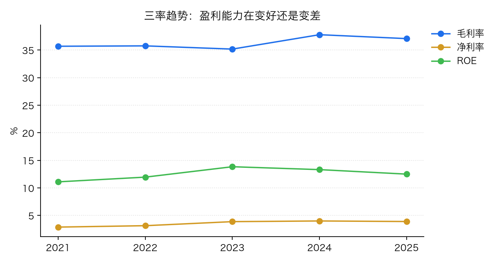
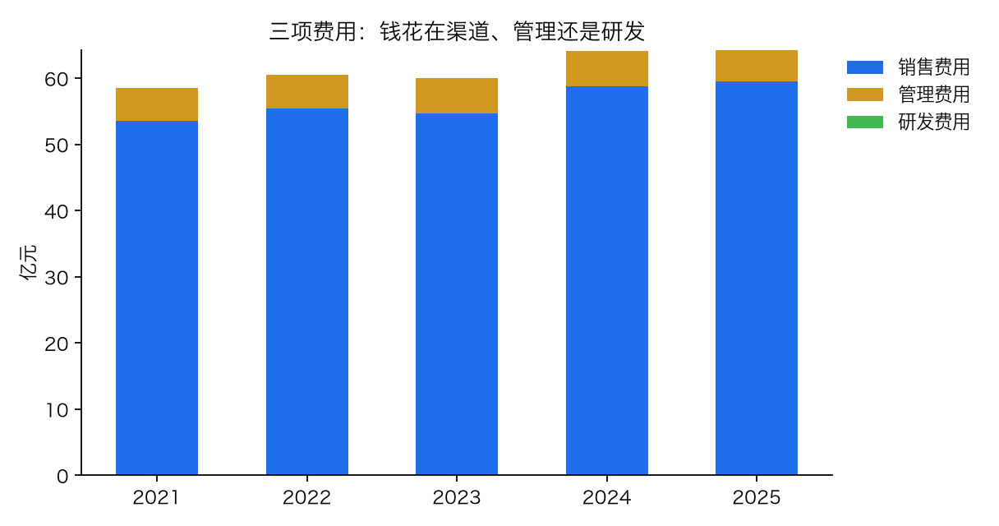

# 中国食品（00506.HK）2025 年报深度解读

## 一页纸

**三句话：220.70 亿元收入只留下 8.62 亿元归母，利润表薄得经不起一格波动；同一年的经营现金流是 32.29 亿元，净现比 3.75 倍；两者的差额里，只有厂房设备折旧 8.07 亿元这一块能年年重复。** 营业收入 220.70 亿元（P97）、经营活动现金流量净额 32.29 亿元（P102），同一家公司、同一套资产，两张表的体量相差 3.75 倍。读它的次序必须倒过来：先看现金从哪来，再看利润为什么这么薄，最后才问这份现金值多少钱。

**净利率 3.91% 是五年里的次高点，但结构比比率更值得看。** 毛利 81.83 亿元、毛利率 37.08%，销售费用 59.49 亿元、管理费用 4.72 亿元，营业利润 19.79 亿元，所得税 5.51 亿元，净利润 14.28 亿元（P97）。从毛利到营业利润，被渠道吃掉六成以上；从营业利润到归母，又被税与少数股东各切一刀。

**五个数：220.70、8.62、32.29、5.66、45.49。** 分别是营业收入、归母净利润、经营现金流、少数股东损益、货币资金（P97、P102、P98）。前三个数决定这门生意赚不赚钱，第四个决定赚到的钱归谁，第五个决定它在坏年份能不能不求人。

**现金比利润厚，厚在两处，只有一处能重复。** 折旧与摊销 8.07 亿元（P101）是会计扣减，不掏现金，明年还是这个量级；合同负债从 8.66 亿元升到 13.08 亿元、应付账款从 8.04 亿元升到 10.35 亿元（P98），是渠道与供应商在一年里给出的无息资金，做完了就没有第二次。把这两块分开，32.29 亿元才不会被误读成常态。

**利润里有近四成不是股东的。** 净利润 14.28 亿元，少数股东损益 5.66 亿元，归母 8.62 亿元（P97）；少数股东权益 36.65 亿元，归母权益 68.96 亿元（P99）。合并报表的规模是完整的，处置权不是——用合并利润给这家公司定价，会系统性高估。

**底牌是整张表没有有息负债。** 短期借款、长期借款两个科目都不存在，货币资金 45.49 亿元（P98），筹资活动里最大的一笔偿债支出 0.53 亿元是租赁负债（P103）。需求走弱时它不会被银行催着还钱，管理层可以照年景调费用，不必为还本付息预留现金——这也是管理费用能压到 4.72 亿元、五年最低的前提。

**最该追的三件事：毛利率、合同负债、资本开支。** 毛利率从 37.79% 退到 37.08%（P97），退的原因是水品类占比上升与铝价高位（P24），两条都不由公司决定；合同负债 13.08 亿元（P98）五年在 8.66 亿元到 15.81 亿元之间摆动，是渠道情绪的体温计；资本开支 10.49 亿元（P103）已是五年最高，而厂房设备折旧只有 8.07 亿元（P101），扩产正在加速，收入却只增了 2.7%。

**有一件事这份年报答不了：分品类的毛利与商誉减值的底数。** 附注 5 只按商品类型拆收入（P148），附注 6 明确只有单一经营分部、不列报分部信息（P148），所以「汽水更赚钱还是果汁更赚钱」无法回答；无形资产 35.42 亿元（P98）的减值测试只写了一句「可收回金额远高于账面值」（P163），没有给可收回金额与敏感性区间。这两处不影响对它现在的判断，但会影响它在坏年份的判断。

| 指标 | 2021 | 2022 | 2023 | 2024 | 2025 |
| :--- | ---: | ---: | ---: | ---: | ---: |
| 营业收入（亿元） | 197.84 | 209.68 | 214.46 | 214.92 | 220.70 |
| 归母净利润（亿元） | 5.72 | 6.60 | 8.33 | 8.61 | 8.62 |
| 毛利率 | 35.69% | 35.76% | 35.18% | 37.79% | 37.08% |
| 净利率 | 2.89% | 3.15% | 3.88% | 4.00% | 3.91% |
| ROE | 11.10% | 11.95% | 13.84% | 13.32% | 12.50% |
| ROIC | 12.14% | 12.94% | 13.53% | 13.47% | 13.08% |
| 经营活动现金流（亿元） | 10.74 | 11.41 | 24.30 | 28.47 | 32.29 |
| 自由现金流（亿元） | 3.60 | 2.59 | 18.02 | 21.35 | 21.80 |
| 净现比 | 1.88 倍 | 1.73 倍 | 2.92 倍 | 3.31 倍 | 3.75 倍 |
| 资产负债率 | 44.69% | 41.17% | 40.30% | 42.05% | 42.56% |
| 分红率 | —（不可得） | —（不可得） | —（不可得） | —（不可得） | —（不可得） |

红旗判定：清单共 32 项，命中 1 项，数据不足 18 项（数据不足不等于没问题）。

| 严重度 | 红旗 | 状态 | 观测值 |
| :--- | :--- | :--- | :--- |
| 高 | 关联采购占营业成本比例过高 | 命中 | FY2025 关联方采购金额/营业成本 = 45.05% |

## 生意：钱是怎么赚的

**收入是五块拼起来的，但只有一块决定方向。** 汽水 166.85 亿元、果汁 30.28 亿元、水品类 9.29 亿元、功能饮料 3.20 亿元、其他 11.09 亿元（P148），合计 220.70 亿元（P97）。汽水占 75.60%，其余四块加起来不到四分之一。把这家公司说成「饮料公司」不算错，但会漏掉真正的结构：一门生意里四分之三的收入挂在同一个品类、同一批品牌、同一套装瓶线上。

**分品类只有收入，没有毛利，「哪块更赚钱」在这份年报里无解。** 附注 5 只按商品类型拆收入（P148），附注 6 明确集团只有单一经营分部、因此不列报分部信息（P148）。分品类毛利率、分部资产、分部现金流一概没有。毛利率 37.08%（P97）是五块业务混在一起的平均数，水品类占比一变，这个平均数就跟着变——2025 年正是这样退的（P24）。

**每 100 元收入，先被成本拿走 62 元上下，再被渠道拿走 27 元，管理拿走 2 元，落到营业利润这一层不到 9 元。** 营业成本 138.87 亿元、销售费用 59.49 亿元、管理费用 4.72 亿元、营业利润 19.79 亿元（P97）。毛利率 37.08%、销售费用率 26.96%、管理费用率 2.14%，三个比率一层层剥下去，剩下的空间只有个位数。这就是这门生意的单位经济：规模能摊薄固定成本，摊不薄渠道费用。

**成本这一端，公司几乎没有定价权。** 前五名供应商合计占采购 58%，最大一家占 44%（P77），且年报在董事会报告里明确中粮本身就是五大供货商之一（P77）。营业成本 138.87 亿元（P97）里，浓缩液来自品牌方，铝罐与瓶坯跟着大宗走，糖与代糖由市场定价。年报把 2025 年毛利率下行的第二个原因写成「铝价高位震荡带动易拉罐采购成本上升」（P24），这句话本身就是承认：涨价传不下去，只能自己吞。

**销售费用不是可选项，是这门生意的租金。** 销售费用 59.49 亿元（P97），五年从 53.56 亿元抬到 59.49 亿元，与收入同速；前五名客户合计不足 4%（P77），没有哪个客户能替公司分摊这笔钱。渠道要靠一家家经销商、一台台冰柜、一场场促销买下来，买完还得每年续费。管理费用 4.72 亿元（P97）是五年最低，可压出来的那点空间，在 59.49 亿元面前不构成变量。

**重资产是授权的形状，不是技术的形状。** 固定资产 56.08 亿元、无形资产 35.42 亿元（P98）；无形资产五年从 35.30 亿元走到 35.42 亿元，几乎没有动过。资本开支 10.49 亿元、厂房设备折旧 8.07 亿元（P103、P101）。钱花在罐线、厂房、冰柜与区域授权上，不花在研发上——年报里找不到研发投入的科目，也没有资本化率可算。

**这门生意的底色：用区域授权换货架，用合资结构分摊资本，赚一份效率钱。** 授权覆盖 19 个省级行政区域、10 大品类、25 个品牌（P21）；核心装瓶主体 65% 持股、35% 归少数股东（P183）；员工 18,349 人（P33）。区域、品类、价格带都由授权划定，公司能自己决定的只有周转、费用执行与产能节奏，这也解释了为什么 ROE 12.50%（P97、P98–P99）五年只在 11.10% 到 13.84% 之间移动。

**三个可以证伪上面判断的观察点。** 毛利率若在铝价平稳的年份继续下行，说明费用对毛利的挤压已经制度化，不再是原料问题；合同负债若掉头向下，说明经销商不愿为下一季备货，渠道推力在减弱；资本开支若连续高于折旧而收入不动，说明新增产能已经找不到买主。

| 品类 | 2025 | 占营业收入 |
| :--- | ---: | ---: |
| 汽水收入 | 166.85 | 75.6% |
| 果汁收入 | 30.28 | 13.7% |
| 其他收入 | 11.09 | 5.0% |
| 水品类收入 | 9.29 | 4.2% |
| 功能饮料收入 | 3.20 | 1.5% |
| **合计** | 220.70 | 100.0% |

本次没有触发结构化判断。

## 五年账

**五年里收入从 197.84 亿元走到 220.70 亿元，归母却从 5.72 亿元走到 8.62 亿元，两条线的斜率差了一倍多。** 收入四年年均不到 3%，归母年均一成上下（P97）。差额不能全部归给经营改善：归母的两次抬升各有一次性来源，而且在年报上都能指出来。

**第一级台阶在 2023 年：归母从 6.60 亿元跳到 8.33 亿元，而毛利只从 74.98 亿元走到 75.44 亿元。** 同年其他收益从 1.39 亿元升到 3.28 亿元（P97），是五年最高。毛利几乎没动而净利跳了一大步，差额主要落在这一行——这不是渠道效率的胜利，是营业外的一笔。

**第二级台阶在 2024 年：收入只从 214.46 亿元走到 214.92 亿元，毛利率却从 35.18% 升到 37.79%。** 毛利 75.44 亿元到 81.21 亿元（P97），同期成本从 139.03 亿元降到 133.71 亿元（P97）。收入不动而成本下降，最可能的解释是原料价格回落叠加品类结构改善，这两件事都不由公司安排。

**2025 年两级台阶同时用完，归母从 8.61 亿元到 8.62 亿元，几乎原地。** 收入增了 2.7%、销量增了 2.8%（P24），毛利率却退到 37.08%（P97）；其他收益回到 2.22 亿元（P97），不再贡献增量。一家公司在收入创新高的年份利润不增，说明这一轮的利润弹性主要来自前两年的一次性因素，而不是可持续的经营杠杆。

**现金那条线的转折点更早，也更陡：2023 年经营现金流从 11.41 亿元跳到 24.30 亿元（P102），当年净利润只从 12.10 亿元到 13.86 亿元（P97）。** 多出来的十几亿元不可能来自利润，只能来自营运资本与应付项目。此后 2024 年 28.47 亿元、2025 年 32.29 亿元，净现比 1.88 倍、1.73 倍、2.92 倍、3.31 倍、3.75 倍（P102、P97）一路上行——这条线反映的是占款能力在变强，不是利润在变强。

**资本开支的形状与利润恰好相反：先压后放。** 2021 年 7.14 亿元、2022 年 8.82 亿元、2023 年压到 6.27 亿元、2024 年 7.12 亿元、2025 年跳到 10.49 亿元（P103）。前四年在 6.27 亿元到 8.82 亿元之间摆动，2025 年一步抬到五年最高，而当年的厂房设备折旧只有 8.07 亿元（P101）。折旧是过去投资的回声，资本开支是未来折旧的预告——2026 年的折旧一定会比 8.07 亿元高。

**回报率的形状是「先升后平」，而且平的原因是分母在胀。** ROE 从 11.10% 升到 2023 年的 13.84%，再退到 13.32%、12.50%（P97、P98–P99）；归母权益同期从 51.57 亿元增到 68.96 亿元（P99）。分子没怎么动，分母每年多出几亿元留存，ROE 只能往下走。ROIC 12.14%、12.94%、13.53%、13.47%、13.08% 是同一件事的另一个说法。

**五年账读下来，一句话：这是一门收入缓慢爬坡、利润靠一次性因素跳两级、现金靠占款变厚的生意。** 三次跳升分别来自其他收益、毛利率与营运资本，没有一次来自量的持续扩张或价的持续提升。要推翻这个判断，只需要看到收入增速回到高位的同时毛利率不再退——那才说明经营杠杆真的存在。

| 项目 | 2021 | 2022 | 2023 | 2024 | 2025 |
| :--- | ---: | ---: | ---: | ---: | ---: |
| 营业收入（亿元） | 197.84 | 209.68 | 214.46 | 214.92 | 220.70 |
| 毛利（亿元） | 70.61 | 74.98 | 75.44 | 81.21 | 81.83 |
| 营业利润（亿元） | 13.98 | 15.88 | 18.49 | 18.66 | 19.79 |
| 归母净利润（亿元） | 5.72 | 6.60 | 8.33 | 8.61 | 8.62 |
| 经营活动现金流（亿元） | 10.74 | 11.41 | 24.30 | 28.47 | 32.29 |
| 自由现金流（亿元） | 3.60 | 2.59 | 18.02 | 21.35 | 21.80 |
| ROE | 11.10% | 11.95% | 13.84% | 13.32% | 12.50% |
| 净利率 | 2.89% | 3.15% | 3.88% | 4.00% | 3.91% |

*数据来源：公司年度报告原文（页码见正文引用），金额为合并报表口径。*

### 杜邦分解

| 项目 | 2021 | 2022 | 2023 | 2024 | 2025 |
| :--- | ---: | ---: | ---: | ---: | ---: |
| ROE | 11.10% | 11.95% | 13.84% | 13.32% | 12.50% |
| 净利率 | 2.89% | 3.15% | 3.88% | 4.00% | 3.91% |
| 总资产周转率（次） | 1.30 倍 | 1.39 倍 | 1.32 倍 | 1.22 倍 | 1.20 倍 |
| 权益乘数（倍） | 2.94 倍 | 2.73 倍 | 2.70 倍 | 2.72 倍 | 2.67 倍 |

## 利润表：从毛利到归母

**毛利 81.83 亿元，最后只剩 8.62 亿元归母：五道切口依次是渠道、管理、税、少数股东，加上一次可正可负的其他收益。** 销售费用 59.49 亿元、管理费用 4.72 亿元、金融资产减值净额 0.04 亿元、其他收入收益及亏损净额 2.22 亿元（P97），得出营业利润 19.79 亿元。这条链条上没有任何一环是厚的，任何一环多挪一步，归母那一层都会明显走样。

**销售费用吃掉了毛利的 72.7%，这是利润表上唯一真正重要的比率。** 59.49 亿元对 81.83 亿元（P97），销售费用率 26.96%，五年从 53.56 亿元抬到 59.49 亿元。2025 年销售支出从 58.71 亿元走到 59.49 亿元，慢于收入的 2.7%（P97、P24）；费用率退到 26.96%，毛利率退得更多，两者对冲之后营业利润才从 18.66 亿元挪到 19.79 亿元。

**管理费用 4.72 亿元是五年最低，但它能贡献的只有小数点后一位。** 从 5.38 亿元降到 4.72 亿元（P97），省下的钱不到销售支出的一个零头；管理费用率 2.14%（P97）也是五年最低。把管理费用当成利润调节阀是错位的：它的绝对量只相当于销售费用的十分之一，压到极限也换不回毛利率退的那一步。

**其他收益 2.22 亿元（P97）里既有政府补助与利息收入，也扣掉了厂房与无形资产的减值，是一条最不可预测的线。** 它在 2023 年曾是 3.28 亿元、2024 年掉到 1.62 亿元（P97），一年振幅超过一亿元；2025 年回到 2.22 亿元（P97），相当于营业利润的 11%。这条线里没有一条是公司能年年安排的——补贴看项目，利息看存款，减值看产线命运。

**从营业利润到税前几乎是一条直线，说明这家公司没有财务杠杆可谈。** 财务费用 0.03 亿元（P97）全部是租赁负债利息（P150），应占联营企业业绩 0.03 亿元（P97）；利润总额 19.79 亿元（P97），与营业利润只差几分钱。没有利息支出、没有汇兑损益的大额扰动——这是没有有息负债在利润表上的样子。

**税是 2025 年最容易被忽略的一处恶化：所得税 5.51 亿元，有效税率 27.83%，五年最高。** 前四年的有效税率是 24.47%、25.03%、24.86%、23.78%（P97）。年报把增量的原因写得很直白：若干子公司响应当地税务机关通知开展自查，缴回以前期间所得税（P31）。这笔钱不是当期经营变差，但它确实从归母口袋里出去了。

**归母只拿到净利润的六成，剩下近四成归少数股东。** 净利润 14.28 亿元，少数股东损益 5.66 亿元，归母 8.62 亿元（P97），少数股东占 39.6%。这个比例五年基本没变：2021 年是 5.02 亿元对 5.72 亿元（P97）。装瓶合资的结构决定了利润表永远要分两半读，任何按合并净利润估值的算法都会高估四成。

**利润表能自己决定的只有两处：其他收益与税率，而这两处 2025 年都不帮忙。** 毛利率由原料与品类结构决定，销售费用由渠道竞争决定，少数股东分成由股权结构决定。剩下的两个变量一个回落到 2.22 亿元、一个升到 27.83%，方向都是负的。这就是为什么收入创新高的年份，归母只从 8.61 亿元挪到 8.62 亿元。

### 三项费用与销售投入

| 项目 | 2021 | 2022 | 2023 | 2024 | 2025 |
| :--- | ---: | ---: | ---: | ---: | ---: |
| 销售费用（亿元） | 53.56 | 55.39 | 54.70 | 58.71 | 59.49 |
| 管理费用（亿元） | 4.96 | 5.06 | 5.30 | 5.38 | 4.72 |

*数据来源：公司年度报告原文（页码见正文引用），金额为合并报表口径。*

### 研发与人员

| 项目 | 2021 | 2022 | 2023 | 2024 | 2025 |
| :--- | ---: | ---: | ---: | ---: | ---: |
| 在职员工（人） | —（不可得） | —（不可得） | —（不可得） | 17,533 | 18,349 |
| 关联方采购（亿元） | —（不可得） | —（不可得） | —（不可得） | 64.80 | 62.56 |

研发投入未资本化（附注资本化金额为空），故不列资本化率。

## 资产负债表：钱在哪、欠谁

**183.85 亿元的资产里，三成是厂房罐线、四分之一是现金、近两成是无形资产，剩下的是存货与应收——这是一张看得懂的资产表。** 流动资产 81.07 亿元、非流动资产由固定资产 56.08 亿元与无形资产 35.42 亿元撑起（P98），资产总计 183.85 亿元（P199）。没有在建工程长年不转固，没有对外投资的大坑，商誉与特许权之外也没有并购留下的残渣。

**货币资金 45.49 亿元占资产总计 24.75%，是这张表上最厚的一块。** 上年 40.14 亿元（P98），一年增了 5.35 亿元。受限部分只剩二十万元级的冻结存款（P98、P169），几乎全部可用。年报同时披露，其中一部分存在中粮财务这家关联方非银行金融机构（P169）——这不影响可用性，但它把现金的安全性从「银行体系」挪到了「集团体系」，是个该记住的口径。

**应收与应付极不对称，公司在用供应商的钱做自己的周转。** 应收账款 3.30 亿元、周转 5.5 天，应付账款 10.35 亿元、周转 27.2 天（P97、P98）。应收账龄几乎全部落在六个月以内（P167），说明对下游是款到发货；应付账龄则集中在三个月内（P170），对上游的账期被拉长到了五年最高的 27.2 天（从 13.6 天起）。这 27.2 天不是免费得来的，它同时意味着上游议价关系在变。

**存货 16.30 亿元、周转 42.8 天，是五年里第一次掉头向上。** 从 19.33 亿元一路降到 2024 年的 14.43 亿元，2025 年又回到 16.30 亿元（P98）；周转天数也从 39.4 天回到 42.8 天（P97）。存货里制成品占八成（P167），也就是已经灌装、等着卖出去的成品——这个结构比原料涨价更值得担心，因为它对应的是渠道消化速度。

**无形资产 35.42 亿元五年几乎不动，因为里面绝大部分不摊销。** 35.30、35.32、35.44、35.45、35.42 亿元（P98），五年的变动不到 0.2 亿元；装瓶特许权与商誉合计占了这块资产的绝大部分，两者都被定为不摊销、每年只做减值测试（P146、P161）。换句话说，35.42 亿元这个数字不是「用掉多少、剩多少」，而是「账面挂着多少、假设值多少」。

**减值这一年动了两笔，一笔很小、一笔不小。** 金融资产减值净额 0.04 亿元（P97），是应收与其他应收的常规计提；固定资产减值 0.64 亿元（P101、P149），对应的是被判定不再产生足够现金流的产线。后者说明产能布局在调整，也说明 10.49 亿元资本开支（P103）里有一部分是替换而不是扩张。

**负债端 78.24 亿元，其中流动 74.65 亿元、非流动只有 3.60 亿元，结构上没有任何一处是借钱。** 流动负债里应付账款 10.35 亿元、合同负债 13.08 亿元（P98），其余主要是其他应付款项及应计负债（P98）——营销费用计提、冰箱押金、应付工资这些经营性项目。非流动负债 3.60 亿元里是递延所得税、租赁负债与递延收入（P99），没有一笔银行借款，资产负债率 42.56%（P97、P199）。

**表外承诺很小，流动性也不算宽裕：资本承诺 0.12 亿元（P173），流动比率 1.09 倍（P97、P98）。** 流动比率五年从 0.75 倍修到 1.09 倍，一直在 1 倍边缘；靠的是现金堆上去，而不是负债结构改善。这也是这张表真正的软处：现金 45.49 亿元看着厚，但它同时要应付 74.65 亿元的流动负债，能自由动用的余量没有绝对值看起来那么大。

### 资产端

| 项目 | 2021 | 2022 | 2023 | 2024 | 2025 |
| :--- | ---: | ---: | ---: | ---: | ---: |
| 货币资金（亿元） | 15.92 | 10.37 | 22.93 | 40.14 | 45.49 |
| 应收账款（亿元） | 3.28 | 3.60 | 3.70 | 3.39 | 3.30 |
| 存货（亿元） | 19.33 | 18.88 | 17.37 | 14.43 | 16.30 |
| 流动资产合计（亿元） | 48.49 | 45.66 | 59.75 | 72.73 | 81.07 |
| 固定资产（亿元） | 50.61 | 52.35 | 55.93 | 54.51 | 56.08 |
| 无形资产（亿元） | 35.30 | 35.32 | 35.44 | 35.45 | 35.42 |
| 资产总计（亿元） | 151.68 | 150.63 | 162.26 | 175.98 | 183.85 |

### 负债与权益

| 项目 | 2021 | 2022 | 2023 | 2024 | 2025 |
| :--- | ---: | ---: | ---: | ---: | ---: |
| 应付账款（亿元） | 4.75 | 6.90 | 7.74 | 8.04 | 10.35 |
| 合同负债（亿元） | 15.81 | 9.87 | 12.84 | 8.66 | 13.08 |
| 短期借款 | —（不可得） | —（不可得） | —（不可得） | —（不可得） | —（不可得） |
| 长期借款（亿元） | —（不可得） | —（不可得） | —（不可得） | —（不可得） | —（不可得） |
| 流动负债合计（亿元） | 64.68 | 58.63 | 59.60 | 70.37 | 74.65 |
| 归母权益（亿元） | 51.57 | 55.20 | 60.15 | 64.62 | 68.96 |
| 少数股东权益（亿元） | 32.32 | 33.42 | 36.72 | 37.36 | 36.65 |
| 所有者权益合计（亿元） | 83.89 | 88.62 | 96.87 | 101.98 | 105.61 |

*数据来源：公司年度报告原文（页码见正文引用），金额为合并报表口径。*

## 现金流量表：利润变成了什么

**三段现金：经营 +32.29 亿元、投资 -10.64 亿元、筹资 -16.30 亿元，净增 5.35 亿元。** 货币资金从 40.14 亿元走到 45.49 亿元（P103、P98）。经营端一个顶两个，投资与筹资都没能把它吃掉一半——这是「现金奶牛」最朴素的形态，也是最容易被误读的形态，因为筹资端那 16.30 亿元里有很大一部分是分红而非还债。

**净现比 3.75 倍，比五年均值高出一截，而高出来的部分有明确出处。** 净利润 14.28 亿元、经营现金流 32.29 亿元（P97、P102）；中间的差额先由厂房设备折旧 8.07 亿元（P101）填上——这是装瓶厂每年都要扣一次利润却不掏现金的部分。剩下的才是营运资本与应付项目。把 3.75 倍当成「利润被低估」的证据，等于把一次性的占款当成永久的现金流。

**营运资本这一年给了三类贡献，方向一致，来源不同。** 合同负债增加带来 4.42 亿元（P102），对应合同负债从 8.66 亿元升到 13.08 亿元（P98）；应付账款从 8.04 亿元升到 10.35 亿元（P98），对应现金流入；存货则反向，从 14.43 亿元升到 16.30 亿元（P98），增加部分占用 1.92 亿元（P102）。前两项是「借来的钱」，第三项是「压在货上的钱」，净额仍然为正。

**投资端最值得注意的不是 10.49 亿元资本开支，而是另外两笔。** 购买固定资产支出 10.49 亿元（P103），已是五年最高，上年 7.12 亿元；同一年还向同一控制下公司提供贷款 3.90 亿元（P103），并收到联营企业减资款与分红（P103、P164）。资本开支是投自己的产线，贷款是投集团内的兄弟公司，两笔钱的性质完全不同，但它们都从同一口锅里舀出去。

**筹资端 16.30 亿元的构成，决定了股东这一年实际拿到了多少。** 已付分红 4.28 亿元、偿还租赁负债 0.53 亿元（P103），其余主要是付给少数股东权益的分红。归母股东的现金回报是 4.28 亿元，对应归母净利润 8.62 亿元（P103、P97），不到一半；少数股东拿走的现金则超过他们当年应占的 5.66 亿元利润（P103、P97）。这套结构下，现金流量表比利润表更能说明「谁拿走了钱」。

**自由现金流 21.80 亿元，五年从 3.60 亿元一路升上来，但成分在变。** 2021 年靠的是低资本开支，2025 年靠的是高经营现金流：资本开支 10.49 亿元（P103）已经比 2021 年的 7.14 亿元高出四成，自由现金流却仍在增长，这只能说明经营端的增量更大。问题在于这个增量里有多少来自占款，而不是来自赚到的钱。

**要判断 32.29 亿元能不能重复，只需要看两个数：合同负债与应付天数。** 合同负债五年在 8.66 亿元到 15.81 亿元之间摆动，没有趋势（P98）；应付天数从 13.6 天拉到 27.2 天（P97），空间已经用了大半。两条都到顶之后，经营现金流会回到「净利润 + 折旧」这个量级——那才是这门生意真实的现金产出（P97、P101）。

| 项目 | 2021 | 2022 | 2023 | 2024 | 2025 |
| :--- | ---: | ---: | ---: | ---: | ---: |
| 经营活动现金流（亿元） | 10.74 | 11.41 | 24.30 | 28.47 | 32.29 |
| 投资活动现金流（亿元） | -8.47 | -8.51 | -5.64 | -5.61 | -10.64 |
| 筹资活动现金流（亿元） | -4.96 | -8.44 | -6.10 | -5.65 | -16.30 |
| 资本性支出（亿元） | 7.14 | 8.82 | 6.27 | 7.12 | 10.49 |
| 自由现金流（亿元） | 3.60 | 2.59 | 18.02 | 21.35 | 21.80 |
| 净现比 | 1.88 倍 | 1.73 倍 | 2.92 倍 | 3.31 倍 | 3.75 倍 |

*数据来源：公司年度报告原文（页码见正文引用），金额为合并报表口径。*

## 附注深挖

**附注优先级。** 37 条附注，按这家公司自己的数字排队：先看金额占收入最大的，再看变动最剧烈的，最后是公司自己措辞最软的那几条。◆ 重点 24 条、◇ 常规 13 条。

| 序 | 附注 | 类型 | 层级 | 涉及金额（亿元） | 占收入 | 判断密度 | 页 |
| ---: | :--- | :--- | :--- | ---: | ---: | ---: | :--- |
| 1 | 5 营业收入 | 金额型 | ◆ | 220.70 | 100.0% | 0.0 | P148–P148 |
| 2 | 15 固定资产 | 金额型 | ◆ | 56.08 | 25.4% | 0.0 | P158–P159 |
| 3 | 17 无形资产 | 金额型 | ◆ | 35.42 | 16.1% | 0.9 | P161–P162 |
| 4 | 34 子公司明细 | 交易型 | ◆ | 36.65 | 16.6% | 0.0 | P177–P184 |
| 5 | 20 存货 | 金额型 | ◆ | 16.30 | 7.4% | 0.0 | P167–P167 |
| 6 | 28 合同负债 | 金额型 | ◆ | 13.08 | 5.9% | 0.7 | P171–P171 |
| 7 | 2 新准则及应用修订 | 政策型 | ◆ | — | — | 0.6 | P104–P106 |
| 8 | 4 重要会计判断与估计 | 估计型 | ◆ | — | — | 15.7 | P146–P147 |
| 9 | 32 资本承诺 | 承诺型 | ◆ | — | — | 0.0 | P173–P173 |
| 10 | 36 金融工具 | 风险型 | ◆ | — | — | 1.9 | P185–P196 |
| 11 | 25 应付账款 | 金额型 | ◆ | 10.35 | 4.7% | 0.0 | P169–P169 |
| 12 | 10 所得税费用 | 金额型 | ◆ | 5.51 | 2.5% | 2.2 | P151–P152 |
| 13 | 21 应收账款 | 金额型 | ◆ | 3.30 | 1.5% | 0.0 | P167–P167 |
| 14 | 18 长期股权投资 | 金额型 | ◆ | — | — | 2.5 | P163–P164 |
| 15 | 27 租赁负债 | 金额型 | ◆ | — | — | 0.7 | P171–P171 |
| 16 | 6 分部信息 | 金额型 | ◆ | — | — | 0.0 | P148–P148 |
| 17 | 7 其他收益 | 金额型 | ◆ | — | — | 0.0 | P149–P149 |
| 18 | 8 财务费用 | 金额型 | ◆ | — | — | 0.0 | P150–P150 |
| 19 | 16 使用权资产 | 金额型 | ◆ | — | — | 0.0 | P160–P160 |
| 20 | 19 递延所得税 | 估计型 | ◆ | — | — | 0.0 | P165–P166 |
| 21 | 24 受限资金 | 金额型 | ◆ | — | — | 0.0 | P169–P169 |
| 22 | 29 股本 | 金额型 | ◆ | — | — | 0.0 | P172–P172 |
| 23 | 33 关联方交易 | 交易型 | ◆ | — | — | 0.0 | P174–P176 |
| 24 | 31 离职后福利 | 估计型 | ◆ | 0.00 | 0.0% | 0.0 | P173–P173 |
| 25 | 23 以公允价值计量的金融资产 | 风险型 | ◇ | — | — | 0.0 | P168–P168 |
| 26 | 35 资本风险管理 | 风险型 | ◇ | — | — | 0.0 | P185–P185 |
| 27 | 3 财务报表编制基础及重 | 未归类 | ◇ | — | — | 1.6 | P107–P145 |
| 28 | 37 STATEMENT OF FINANCIAL POSITION OF | 未归类 | ◇ | — | — | 1.7 | P197–P198 |
| 29 | 1 公司基本情况 | 未归类 | ◇ | — | — | 0.0 | P104–P104 |
| 30 | 9 利润总额 | 未归类 | ◇ | — | — | 0.0 | P150–P150 |
| 31 | 11 DIRECTORS’ AND CHIEF EXECUTIVE’S | 未归类 | ◇ | — | — | 0.0 | P153–P155 |
| 32 | 12 薪酬最高的五名员工 | 未归类 | ◇ | — | — | 0.0 | P156–P156 |
| 33 | 13 分红 | 未归类 | ◇ | — | — | 0.0 | P157–P157 |
| 34 | 14 每股收益 | 未归类 | ◇ | — | — | 0.0 | P157–P157 |
| 35 | 22 PREPAYMENTS, DEPOSITS AND OTHER | 未归类 | ◇ | — | — | 0.0 | P168–P168 |
| 36 | 26 其他应付款及预提费用 | 未归类 | ◇ | — | — | 0.0 | P170–P170 |
| 37 | 30 现金流量表补充信息 | 未归类 | ◇ | — | — | 0.0 | P172–P172 |

**附注 5 营业收入：收入全在交付时点确认，没有跨期腾挪的口子。** 收入 220.70 亿元（P97），汽水 166.85 亿元、果汁 30.28 亿元、水 9.29 亿元、功能饮料 3.20 亿元、其他 11.09 亿元（P148），增量散在汽水与其他，果汁还在缩。确认只在货送达客户指定地点、控制权转手那一刻发生，无按进度确认的合约，也无跨期未履行义务要拆。可调的口子在渠道：多数客户预付或货到付款，合同负债 13.08 亿元（P98）是前置打款的蓄水池，收入要挪只能靠压货或催款。下一期盯汽水增速与合同负债是否同步，收入涨而预收降即渠道垫货。

**附注 15 固定资产：成本模式、全表无重估，年限未见拉长。** 固定资产 56.08 亿元（P98），占收入 25.4%；本期折旧 8.07 亿元（P101），购建支出 10.49 亿元（P103），资本开支仍高于折旧，产能在扩不在收。计量按成本模式、无重估增值，账面值只向下走，做过评估增值的同行不可比。年限按资产类别分段并每年复核，折旧随规模上升，没有延长年限压费用的迹象；本期减值来自工厂搬迁，搬走的资产被认定不再产生经济利益，等于承认部分产能布局收缩。下一期盯新增购建落在楼宇还是设备，以及年限政策有无调整。

**附注 17 无形资产：35.42 亿元几乎全是不摊销的商誉与特许权。** 无形资产 35.42 亿元（P98），商誉与可口可乐装瓶特许权被判为使用寿命不确定，只做年度减值测试、不作摊销，真正在摊销的只有其他无形资产。所以摊销年限的依据不落在合同时长上：特许权被认定到期必然续约、续约不需付代价，依据是续约记录与双方长期互惠关系。减值测试用使用价值法，以预算期现金流加永续零增长推算，本期折现率上调、收入增速与毛利率假设同步下调，缓冲在变薄。下一期盯折现率与续约条款，假设继续走弱而账面值纹丝不动，就是风险在累积。

**附注 34 子公司：利润大头在非全资平台，少数股东分得更重。** 净利 14.28 亿元（P97），归母仅 8.62 亿元（P97），少数股东权益分走 5.66 亿元（P97）；少数股东权益 36.65 亿元（P99）对归母 68.96 亿元（P99），分配向平台外倾斜。装瓶主体层层设在非全资控股平台下，收入几乎由这些实体产生，合并的是全额收入、摊出去的是少数股东应占部分。资金流更该看：向少数股东权益相关实体采购 49.75 亿元、向同一控制下公司采购 12.81 亿元（P174），定价决定那部分利润厚度。下一期盯少数股东损益与关联采购是否同步放大。

**附注 20 存货：增量全堆在成品端，跌价准备在报表里看不到影子。** 存货 16.30 亿元（P98），占收入 7.4%；拆开是原料在降、成品在增，堆的是做出来等卖的货而不是提前备的料，更像动销跟不上产能。报表只列原料与成品，没有单列跌价准备，等于判断可变现净值仍高于成本。相对营业成本 138.87 亿元（P97）的体量不算重，但饮料保质期短，渠道一旦压货，减记会来得又快又集中。下一期盯成品占比，以及跌价准备首次出现在附注里的时点。

**附注 28 合同负债：预收款在涨不在掉，问题在打款节奏不在渠道意愿。** 合同负债 13.08 亿元（P98），占收入 5.9%，全部是客户购货预付的押金，且上年末余额本期已全额转为收入，没有余额悬在账上。这直接否掉了预收下滑的猜测：预收在增且消化干净，收入确认没靠挂账拖延。要留意预收与发货的配合：预收涨得快说明在用政策换现金流；预收见顶而收入仍要增长，缺口只能由授信补，应收就会跟着走，而应收目前只有 3.30 亿元（P98）。下一期盯预收绝对值与授信客户范围。

**附注 2 新准则及应用修订：只落地无关实质的修订，可比性未被动过。** 本期首次强制应用的只有外币折算准则关于缺乏可兑换性的修订，董事明确其对本期及上期财务状况、表现与披露均无重大影响，政策与列报口径原样延续。真正会动结构的是尚未生效的财务报表列报与披露新准则：损益表要按指定类别和界定小计列报，附注要披露管理层自定业绩指标，且要求追溯应用，公司已表态不提前采用、仍在评估影响。将来某期利润表会被重新切分，经营利润这类小计的定义可能改变，跨期比较得先重述。下一期盯切换时的小计口径与重述说明。

**附注 4 重要会计判断与估计：最大的估计全押在特许权永不失效这个判断上。** 关键判断很集中：内地装瓶与分销特许权被判为使用寿命不确定，依据是装瓶协议条款、续约记录与双方战略互惠关系；估计不确定性的主要来源也在这里，商誉与无限寿命特许权的减值测试靠预期现金流与折现率撑起可收回金额。这部分合起来就是无形资产 35.42 亿元（P98）的主体，本期账面值与上年一致，既无摊销也无减值。判断本身没有表内证据可验证，只能靠续约能否持续、续约要不要付对价来证伪。下一期盯折现率与收入增速假设的方向，假设走弱而账面值不动，就是缓冲在被消耗。

**附注 32 资本承诺：已签未付的资本开支明显放大，转固后折旧压力有账可循。** 已订约但未在报表计提的长期资产支出本期明显高于上年，方向与本期 10.49 亿元（P103）的实际购建支出一致，扩产与搬迁仍在推进。这类承诺不计入负债、只作附注披露，资产负债表因此比真实负担轻；一旦转固就按现行政策开始计提，折旧会接力上升，而本期折旧已是 8.07 亿元（P101）。压力多大要看承诺对应的资产类别，楼宇与设备年限区间不同，同样金额摊进损益的速度差很远。下一期盯承诺余额是否继续放大，以及新增折旧能否被新产能收入盖住。

**附注 36 金融工具：没有银行有息借款，利率风险在资产端而非负债端。** 金融负债全部按摊余成本计量，构成为应付账款、其他应付金融负债、关联方欠款与租赁负债，没有银行借款科目；带息负债只剩租赁负债，本期偿还 0.53 亿元（P103），量级很小。集团反倒是净利息收入方：现金及现金等值 45.49 亿元（P98）按浮息计息，利率下行侵蚀利息收入，不加重利息支出。真敞口在外币货币资产与存于中粮财务的存款，前者有汇率敏感度测试，后者是关联方集中度，提取条件比利率更要紧。下一期盯利息收入随利率的回落幅度与关联方存款提取条件。

**附注 25 应付账款：10.35 亿元全是应付账款，票据归零说明结算方式变了。** 应付贸易账款及票据 10.35 亿元（P98），占收入 4.7%；拆开看票据已清零、只剩应付账款，上年还有过小额票据，结构从票据加账期退回纯账期。这多半来自票据池停用或供应商改收现金，实质是把融资环节从银行挪回自己身上，现金流是轻微收紧。相对营业成本 138.87 亿元（P97）只覆盖很小一截，没有靠占压上游资金做营运资本；叠上采购集中度偏高，议价权其实在供货方那边。下一期盯票据是否重现，以及应付款周转是否继续拉长。

**附注 10 所得税费用：税负高于法定税率，缺口来自补提往年计提与递延税转向。** 所得税 5.51 亿元（P97）对利润总额 19.79 亿元（P97），税负高于法定税率，差异不是优惠税率造成的，部分内地子公司还享受优惠税率。缺口主要来自补提以前年度计提不足，以及递延税从上年大额抵减转为本期费用，说明暂时性差异在释放而非累积。递延税资产靠未来应纳税所得转回，账上对应应计负债、未实现利润这类随规模滚动的项目，生意不缩就能逐年回补，反向的加速税项折旧则让递延税负债扩大。下一期盯补提往年计提的余量，以及递延税费用化的方向。

**附注 21 应收账款：账龄没有往长的方向走，计提松紧在这个体量上不构成风险。** 应收账款 3.30 亿元（P98），只占收入 1.5%，账龄几乎全部落在最短档，稍长档余额本期大幅收缩，没有向长账龄迁移的迹象。计提小幅上升且全部对应已发生信用减值的客户，未减值部分判断预期损失不重大、不计提，与客户高度分散的授信结构对得上。更关键的是没靠放宽账期换收入：收入 220.70 亿元（P97）而应收只有这么一点，绝大部分销售在发货前或发货时已收款。下一期盯授信客户范围是否扩大，应收从这点体量起跳就是渠道压力显性化。

**附注 18 长期股权投资：联营回来的现金多于利润，但那是资本返还，不是分红。** 年内最重要的事件是可口可乐装瓶商生产控股削减实收股本，集团按持股比例收回现金，数额远高于两家联营全年合共应占的利润，账面投资因此大幅缩水至近乎清零（P163）。靠经营分回来的分红规模有限，投资回报主要由一次性资本返还兑现（P164）。两家联营本身没有收入，只做投资控股与价格谈判，董事也认定其对集团并不重大（P164）。下一期要盯减资后剩余权益还派不派息，以及应收联营款是否继续收缩（P163）。

**附注 27 租赁负债：租约几乎全在一年内到期，关店的赔付敞口比看上去小。** 年内偿还租赁负债约 0.53 亿元（P103），余额随之下降，到期结构明显偏短：一年内到期的部分占主体，两年以上的长尾大幅收窄（P171）。合同本身只有半年到四年，多数租约在年内自然到期，提前关店主要是一次性协商成本，而不是多年租金的硬承诺（P160）。真正的退出成本落在装修与设备减值上，本期物业厂房设备减值已是主要拖累（P149）。下一期盯新签租约的节奏，若添置持续低于偿还，说明网点在收缩。

**附注 6 分部信息：单一分部，收入与成本对不上账。** 集团只认定一个经营分部，不披露分部利润，哪块赚钱无法从报表直接读出，只能靠收入拆分反推（P148）。汽水 166.85 亿元是绝对主体，果汁 30.28 亿元、水 9.29 亿元、功能饮料 3.20 亿元（P148）；增量来自水与功能饮料，果汁在退。收入 220.70 亿元对应的营业成本 138.87 亿元、销售费用 59.49 亿元都是合并口径（P97）。要看清结构只能等品类毛利披露，否则只能借少数股东损益 5.66 亿元侧写装瓶业务利润（P97）。

**附注 7 其他收益：利润越来越靠补助和利息补。** 其他收益 2.22 亿元（P97），由正的其他收入与负的其他收益及亏损两块拼成（P149）。结构明显变了：政府补助仍是最主要来源且大幅放大，利息收入随现金余额上升而增加，销售副产品及废料的净收入反而减少（P149）。亏损端处置资产已转为小额收益，但物业厂房设备减值大幅扩大，抵掉了收入端的部分好处（P149）。也就是说这一栏的改善来自补助与利息，不是来自经营改善。下一期盯政府补助能否延续，以及减值会不会连续第二年扩大。

**附注 8 财务费用：只有租赁利息，集团基本零有息负债。** 财务费用这一栏只剩租赁负债利息一项，没有银行借款利息，也没有票据贴现成本（P150）。这解释了现金 45.49 亿元（P98）与融资活动净流出 16.30 亿元之间的反差：流出几乎全是已付分红 4.28 亿元与偿还租赁负债 0.53 亿元，没有还本压力（P103）。结构没变，但含义变了，利润对利率不敏感、对租金敏感（P171）。下一期盯购买物业厂房设备 10.49 亿元（P103）是否改由借款支撑，一旦出现银行利息，这一栏的同比就不可比了。

**附注 16 使用权资产：长租换短租，资产在缩水而费用在前移。** 使用权资产以土地使用权为主体并在增加，租赁物业与租赁机器同步减少，说明门店与设备在收缩而不是扩张（P160）。添置额较上年大幅下降，短期租赁开支却在上升，公司正把长期租约换成更灵活的短租（P160）。折旧总额小幅回落，租赁现金流出总额同步下降，这一项对利润的拖累在减轻（P160）。下一期盯土地使用权证的剩余年限与短租占比，若短租继续替代长租，使用权资产会持续缩水，而租金费用更早落在当期损益里。

**附注 19 递延所得税：有效税率高于名义税率，差额靠暂时性差异撑着。** 所得税 5.51 亿元对利润总额 19.79 亿元（P97），实际税负明显高于内地与香港的名义税率，差额主要落在递延所得税上：加速税项折旧形成的负债持续扩大，而未实现利润、应计负债带来的资产已基本用满（P166）。递延税资产能否转回，取决于暂时性差异是否真的兑现：应计负债与递延收入要靠实际支付或确认收入才释放，可用的税项亏损额度很小且在减少（P166）。本期递延所得税整体是净支出，过去往后推的税负开始反转。下一期盯加速折旧口径与未确认税项亏损是否继续上升。

**附注 24 受限资金：风险不在"受限"，在集中度。** 现金及等价物 45.49 亿元（P98），拆分里两块最要紧：存放于中粮财务的存款规模与上年完全相同，是关联方资金归集的延续；受限存款已降到几乎可以忽略，只剩上年的一小部分（P169）。所以这一栏的名字会误导人，真正要评估的是大额资金放在集团旗下非银行金融机构的关联方信用暴露，以及这笔存款按存款利率计息是否划算（P169）。结构没变，比例也没变。下一期盯这笔存款的利息收入能否与市场水平对上，以及现金流表里的利息收入能否印证（P149）。

**附注 29 股本：股本两年零动作，每股指标干净。** 法定股数与已发行股数两年完全相同，没有增发、回购或注销，面值维持原样（P172）。所以每股指标的变化全部来自利润，不含摊薄；股东回报走现金不走股份，年内已付分红 4.28 亿元（P103）。这也意味着提升回报的空间只能来自提高派息率或特别分红，动不了股本这个杠杆。下一期盯回购授权是否被动用，以及每股 0.154 元的末期分红（P157）在利润下滑时能否守住。

**附注 33 关联方交易：关联采购一半靠共同商定定价。** 关联采购分两块：与同一控制下公司 12.81 亿元，与子公司及其他关联方少数股东权益 49.75 亿元（P174）。后者是主体，性质上向装瓶合资对手方买货，相对营业成本 138.87 亿元（P97）并非小数，披露却只写按各方共同商定条款执行，没有定价机制，也没有可比价格说明（P174）。硬约束来自外部供货结构：五名最大供货商约占采购 58%，最大一家约占 44%（P77）。下一期盯两块关联采购此消彼长的方向，以及关联方应付款是否跟随采购额摆动。

**附注 31 离职后福利：定额供款，没有表外缺口。** 香港是强积金加强制性公积金、按基本薪金供款且比例随年资上调，内地是统筹社保，集团义务仅限缴款，资产负债表上没有退休福利负债（P173）。雇员 18,349 名（P33）对应收入 220.70 亿元（P97），产出提升来自产能利用率与产品结构，不是靠压福利换来的。风险不在会计而在成本刚性：香港部分供款率随年资抬升，人工成本会随老员工占比缓慢上行。下一期盯退休供款占薪酬的比重，以及供款完全归属前的人员流失能否形成供款抵减（P173）。

**附注 23 以公允价值计量的金融资产：这一栏已清空，剩下的只是票据结算习惯。** 年末按公允价值计入其他全面收益的资产为零，上年仅应收票据一项，指定理由既收现金又把票据背书给供应商抵应付（P168）；波动跟着结算方式走，不构成实质估值判断，公司也没有需要交代的假设。

**附注 35 资本风险管理：整段是模板话，没有一个可对账的量化目标。** 公司只重申持续经营、降低资本成本与策略与上年不变，列出派息、发新股、卖资产三种手段，却不给任何杠杆或资本比率的目标区间（P185）；真正管住资本结构的是零有息负债与 45.49 亿元现金（P98），这两项比这段文字更有信息量。

**附注 3 财务报表编制基础及重要会计政策：政策空间没有被用足，报表是干净的成本模式。**报表按香港财务报告会计准则以历史成本编制，只有金融工具按公允价值计量，固定资产 56.08 亿元（P98）走成本减折旧与减值，没有重估增厚净资产的余地。政策段落长但少见选择权，下一期只需盯有无新准则或重估政策切入，一旦切入账面值会跳动。

**附注 37 母公司资产负债表：母公司是持股与分红通道，自身不产生经营现金。**母公司报表只装对子公司投资的成本与往来款，合并所有者权益合计 105.61 亿元（P99）远高于母公司口径净资产，利润与现金都留在子公司层面。年内已付分红 4.28 亿元（P103）向上分派，下一期要盯子公司分红节奏能否延续，以及应收子公司往来款的减值测试是否收紧。

**附注 1 公司基本情况：中粮体系内的单一装瓶平台，口径干净。**公司是中粮集团体系内加工、装瓶与分销汽水及不含气饮料的平台，收入 220.70 亿元（P97）全部来自这条产业链，没有跨行业并购带来的报表噪音。报表以人民币为功能货币直接列示，折算扰动有限；下一期要盯单一业务结构下原料与渠道费用的传导速度。

**附注 9 利润总额：没有新金额，只是把已进成本的折旧摊开。**折旧及摊销 8.07 亿元（P101）全部沉在销货成本 138.87 亿元（P97）里，毛利被重资产摊销压低。金融资产减值净额仅 -0.04 亿元（P97），减值不是利润的拖累项；下一期盯折旧增速与产能利用率是否同向。

**附注 11 董事及最高行政人员报酬：治理成本有一块不在本报表里。**非执行董事不在公司领薪，由控股公司支付且不作分摊，这部分治理成本不出现在利润表。执行董事花红与收入增长、利润、市场份额及质量指标挂钩，考核偏经营而非股价；年内席位新老交替，下一期要盯新任总经理的考核承诺能否落到利润上。

**附注 12 薪酬最高的五名员工：最高薪雇员的薪酬以浮动为主，不构成刚性负担。**最高薪雇员中非董事者的酬金以酌情花红为最大一项，花红随业绩回落而收缩，说明这部分是浮动成本而非刚性成本。对照全集团 18,349 名雇员（P33），高层薪酬集中度不高；下一期要盯花红回升是否先于利润修复。

**附注 13 分红：派息几乎原地踏步，靠经营现金流撑住。**末期分红定为每股 0.154 元（P157），较上年只微调，全年已付分红 4.28 亿元（P103）低于归母利润 8.62 亿元（P97），没有靠举债派息。拟派末期息不入本年负债，下一期要盯经营现金流 32.29 亿元（P102）能否继续覆盖这一派息水平。

**附注 14 每股收益：每股口径没有股本稀释这个变量。**公司没有持有或发行摊薄工具，基本每股收益与摊薄口径相同，变动就完全等于归母利润 8.62 亿元（P97）的变动。这是目前最干净的锚，下一期若出现股权融资或可转债，每股口径的同比就会失真。

**附注 22 预付款项、押金及其他应收款：钱更多前移到采购端，而不是押在保证金上。**这类款项里预付供应商款是最大一块且在增，按金及其他同期收缩，资金被前移到采购环节。信贷亏损计提只到象征水平，下一期要盯预付供应商款是否随采购集中度上升继续膨胀，前五大供货商已约占采购额 58%（P77）。

**附注 26 其他应付款及预提费用：渠道费用的蓄水池，不是真实债务。**这一栏以应计营销及促销费用、销售折扣为主，本质是费用确认与付款之间的时间差；应付少数股东权益分红归零，年内已把这笔钱付掉，融资活动现金净流出因此到 -16.30 亿元（P103）。下一期要盯应计营销与销售折扣是否随促销加码继续堆高。

**附注 30 现金流量表补充信息：融资活动负债只剩租约，且在净收缩。**融资活动负债变动表里只有租赁负债，年内偿还租赁负债 0.53 亿元（P103），新签租约只补回一部分，期末余额继续走低，属收缩而非扩张。集团带息负债基本就是租约，经营现金流 32.29 亿元（P102）覆盖这点利息没有压力；下一期盯新签租约额，它决定明年使用权资产与折旧的基数。

**按类型看分布。** 同一类附注问的是同一个问题；哪一类页数多、密度高，说明公司的判断就堆在那里。

| 类型 | 条数 | 页数 | 平均判断密度 | 最该看的一条 |
| :--- | ---: | ---: | ---: | :--- |
| 金额型 | 16 | 20 | 0.4 | 5 营业收入（P148） |
| 未归类 | 11 | 52 | 0.3 | 3 财务报表编制基础及重（P107） |
| 估计型 | 3 | 5 | 5.2 | 4 重要会计判断与估计（P146） |
| 风险型 | 3 | 14 | 0.6 | 36 金融工具（P185） |
| 交易型 | 2 | 11 | 0.0 | 34 子公司明细（P177） |
| 承诺型 | 1 | 1 | 0.0 | 32 资本承诺（P173） |
| 政策型 | 1 | 3 | 0.6 | 2 新准则及应用修订（P104） |

## 谁在分钱

**分钱的第一层不在报表里：74.10% 的股份在一个股东手里，流通盘只有 25.90%。** 中国食品（控股）有限公司持有这批股份，中粮集团（香港）有限公司与中粮集团被视为同一批股份的权益人（P81）。这决定了三件事：分红政策由大股东意志主导、小股东对资本配置几乎没有话语权、任何要约收购都要先解决这 74.10%。

**第二层才轮到利润表：14.28 亿元净利润里，5.66 亿元归少数股东、8.62 亿元归母（P97）。** 少数股东拿走近四成，这个比例五年几乎没变——2021 年是 5.02 亿元对 5.72 亿元。也就是说，公司规模在长大、利润在增加，但「每赚一元钱里有多少属于上市公司股东」这件事，五年没有改善。

**权益两半的走势比利润两半更不对称。** 归母权益从 51.57 亿元增到 68.96 亿元，少数股东权益从 32.32 亿元只走到 36.65 亿元（P99）。归母那一半五年多出 17.39 亿元，主要来自利润留存；少数股东那一半几乎只靠每年分到的 5.66 亿元原地滚动，还要被分红抽走一部分。权益比例 65% 对 35% 的格局，在可见的几年里不会变。

**第三层是分红：已付分红 4.28 亿元，相当于当年归母净利润的 49.7%。** 每股派息从 0.153 元加到 0.154 元（P157）；分配股利支付的现金五年从 2.49 亿元升到 4.28 亿元（P103）。分红率稳定在一半左右，剩下的留在账上——这也是为什么在没有有息负债的情况下，货币资金还能从 15.92 亿元一路堆到 45.49 亿元（P98）。

**报表上的 4.28 亿元与当年的 0.154 元不是同一笔钱，这一点常被读错。** 现金流量表里的已付分红 4.28 亿元，对应的是上一年度宣派的末期分红，且以港元支付（P157）；2025 年宣派的每股 0.154 元，要等到 2026 年 7 月才付出（P75、P157）。另外，公司被认定为中国居民企业，向非居民企业股东派息要代扣 10% 企业所得税（P75），同一分红的到手金额因股东身份而异。

**少数股东这一年拿走的现金，比他们账面上赚的还多。** 2024 年末还挂着 5.12 亿元应付少数股东权益分红（P170），2025 年这笔款已清零；现金流量表上付给少数股东权益的分红（P103），金额超过他们当年应占的 5.66 亿元利润（P97）。合资装瓶厂的分红节奏比利润节奏更快，这也是集团现金看起来比利润厚的一个来源。

**第四层是关联交易：向集团内公司采购 12.81 亿元，向合资方的少数股东权益采购 49.75 亿元（P174）。** 前者从 17.58 亿元降下来、后者从 47.22 亿元升上去（P174），两个方向合起来说明上游的议价权正往合资方一侧移动。而前五名供应商占采购 58%、最大一家 44%（P77），年报在董事会报告里直接写明中粮就在这份名单里（P77）——分钱之前，钱先在采购环节过了一道。

**把四层叠起来，顺序很清楚：上游（含集团）先定价，渠道再分走毛利的一大半，税与少数股东各切一刀，最后 8.62 亿元里一半留在账上、一半按每股 0.154 元分给股东。** 归母权益 68.96 亿元（P99）是这套顺序五年累积的结果，它的增长速度由留存决定，而不是由股价决定。

| 项目 | 2021 | 2022 | 2023 | 2024 | 2025 |
| :--- | ---: | ---: | ---: | ---: | ---: |
| 归母净利润（亿元） | 5.72 | 6.60 | 8.33 | 8.61 | 8.62 |
| 少数股东损益（亿元） | 5.02 | 5.51 | 5.53 | 5.62 | 5.66 |
| 归母权益（亿元） | 51.57 | 55.20 | 60.15 | 64.62 | 68.96 |
| 少数股东权益（亿元） | 32.32 | 33.42 | 36.72 | 37.36 | 36.65 |
| 每股派息（元）（元/股） | —（不可得） | —（不可得） | —（不可得） | 0.153 | 0.154 |
| 分配股利支付的现金（亿元） | 2.49 | 2.97 | 3.37 | 4.14 | 4.28 |

## 红旗与跟踪清单

**风险一：成本的底线由别人定，而售价传不下去。** 前五名供应商占采购 58%、最大一家 44%（P77），营业成本 138.87 亿元（P97）里浓缩液来自品牌方、铝罐与瓶坯跟着大宗走。毛利率退到 37.08%（P97），年报把原因写成水品类占比上升与铝价高位（P24）。**要盯的是：** 铝价回落后毛利率能否回到 37.79%（P97）——回不去，说明退的不是原料，是结构。

**风险二：增长的含金量在下滑，量增价减。** 2025 年销量增 2.8%、收入增 2.7%（P24、P97），单价往下走；果汁收入退到 30.28 亿元（P148），低毛利的水与功能饮料在补位。**要盯的是：** 收入增速是否继续低于销量增速，以及汽水 166.85 亿元（P148）这块基本盘是否开始缩。

**风险三：营运资本的贡献不可重复，而它撑起了现金流的一大块。** 合同负债 13.08 亿元、应付账款 10.35 亿元（P98），应付天数 27.2 天（P97）已是五年最高；经营现金流 32.29 亿元对净利 14.28 亿元（P102、P97），净现比 3.75 倍。**要盯的是：** 合同负债是否掉回 8.66 亿元那一档（P98），应付天数是否停止上行——两者同时转向，现金流会回到 28.47 亿元以下。

**风险四：少数股东分走近四成利润，合并报表的成长性不等于股东的成长性。** 净利润 14.28 亿元里 5.66 亿元归少数股东（P97），权益 36.65 亿元对归母 68.96 亿元（P99）。**要盯的是：** 少数股东损益占净利的比重——2021 年是 5.02 亿元对 5.72 亿元，五年没有改善；比重再升，按合并利润给的估值就要再打一次折。

**风险五：35.42 亿元无形资产的支撑点是假设，参数披露不全。** 无形资产五年从 35.30 亿元到 35.42 亿元几乎不动（P98），特许权与商誉不摊销、只做减值测试（P161）；测试假设的毛利率 37.34% 至 37.64%（P162）高于当年实际的 37.08%（P97），可收回金额本身没有披露（P163）。**要盯的是：** 装瓶协议的续约条款，以及下一年减值测试的预算毛利率是否继续下调。

**风险六：税与自查的一次性影响还没完全过去。** 2025 年有效税率 27.83%（P97），五年最高；年报写明若干子公司响应当地税务机关通知自查并缴回以前期间所得税（P31）。**要盯的是：** 2026 年税率能否回到 24% 附近（五年区间 23.78% 至 27.83%），以及是否还有新的自查事项。

**风险七：资本开支跳到五年最高，而折旧还在后面追。** 资本开支 10.49 亿元（P103），上年 7.12 亿元；厂房设备折旧 8.07 亿元（P101），资本开支占收入 4.75%（P97、P103）。**要盯的是：** 新增产能 2026 年能否带来收入增量；若资本开支继续高于折旧而收入停在 2% 附近，这笔钱就是替换而不是扩张。

**七条风险指向同一个结构：上游独家、下游分散、区域受限、四成利润归少数股东。** 能自己决定的只有效率——周转天数、费用执行、产能节奏。所以跟踪的重心不是「增长多少」，而是「效率还能不能挤出东西」，2025 年的答案是：能挤的已经挤过一轮。

**如果只能盯一个数，盯毛利率。** 37.08%（P97）同时装着原料成本、品类结构、促销强度与产能利用率，是所有风险的公共出口。它在收入增 2.7% 的年份仍然下行 0.7 个百分点（P97、P24），这是最该被记住的一个信号；若 2026 年继续下行而铝价平稳，前面关于「成本压力是阶段性的」这一判断就要整体推翻。

**附注口径的红旗读数。** 下面这几行主表看不到，全部来自附注：它们是「利润里有多少不是主业挣的」「商誉还剩多少没摊」「钱是不是真在账上」的直接答案，缺的那几行就是这家公司没披露、或我们的抽取还没拿下。

| 项目 | 2024 | 2025 |
| :--- | ---: | ---: |
| 关联采购占营业成本比例 | 48.46% | 45.05% |
| 其他收益占利润总额 | 8.68% | 11.20% |
| 折旧率 | 14.11% | 14.40% |

| 严重度 | 红旗 | 状态 | 观测值 |
| :--- | :--- | :--- | :--- |
| 高 | 关联采购占营业成本比例过高 | 命中 | FY2025 关联方采购金额/营业成本 = 45.05% |
| 高 | 毛利率显著高于同业且无法解释 | 数据不足 | 需人工核对（附注/公告原文） |
| 高 | 商誉占归母净资产过高 | 数据不足 | 商誉 / 归母权益 最近 1 期数据不全 |
| 高 | 商誉减值反复出现（挤牙膏式减值） | 数据不足 | 部分子条件数据不足：商誉减值损失 在最近 2 期数据不全，且商誉减值覆盖率 在最近 1 期数据不全 |
| 高 | 大存大贷：高额类现金与高额有息负债并存 | 数据不足 | 部分子条件数据不足：银行借款 / 资产总计 最近 1 期数据不全，且FY2025 货币资金/资产总计 = 24.75% |
| 高 | 其他应收款异常膨胀 | 数据不足 | 其他应收款 / 资产总计 最近 1 期数据不全 |
| 高 | 在建工程长期不转固 | 数据不足 | 在建工程占固定资产 在最近 2 期数据不全 |
| 高 | 研发资本化率异常抬升 | 数据不足 | 需人工核对（附注/公告原文） |
| 高 | 非经常性损益占利润过高 | 数据不足 | 需人工核对（附注/公告原文） |
| 高 | 审计意见非标准无保留 | 数据不足 | 需人工核对（附注/公告原文） |
| 高 | 控股股东高比例质押 | 数据不足 | 需人工核对（附注/公告原文） |
| 高 | 收现比长期低于 1 | 数据不足 | 销售商品、提供劳务收到的现金 / 营业收入 最近 3 期数据不全 |
| 中 | 每年都有大额并购支出 | 数据不足 | 需人工核对（附注/公告原文） |
| 中 | 预付账款异常膨胀 | 数据不足 | 预付款项 / 资产总计 最近 1 期数据不全 |
| 中 | 第四季度利润异常（亏损或占比畸高） | 数据不足 | 需人工核对（附注/公告原文） |
| 中 | 财务总监频繁更换 | 数据不足 | 需人工核对（附注/公告原文） |
| 中 | 递延所得税资产增速远超收入 | 数据不足 | 递延所得税资产 与 营业收入 的同比数据不足 |
| 中 | 短期借款支撑长期资产（短债长投） | 数据不足 | 部分子条件数据不足：短期借款 / 银行借款 最近 1 期数据不全，且货币资金 / 短期借款 最近 1 期数据不全 |
| 中 | PE 被一次性收益压低 | 数据不足 | 需人工核对（附注/公告原文） |
