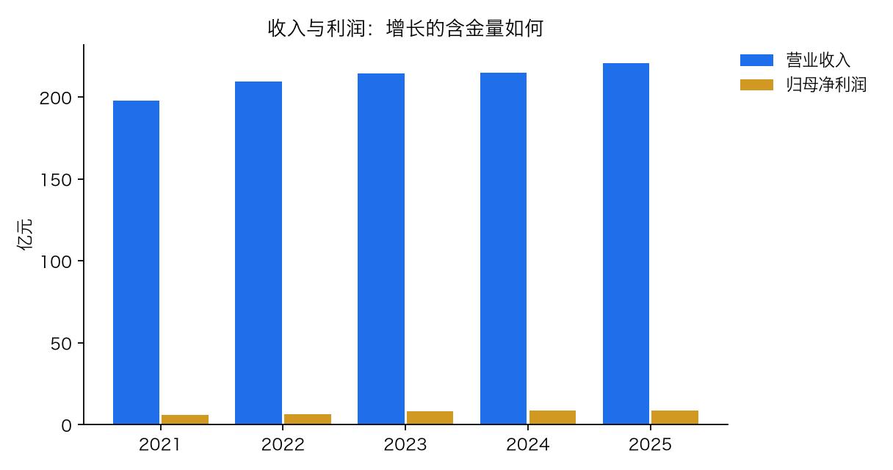
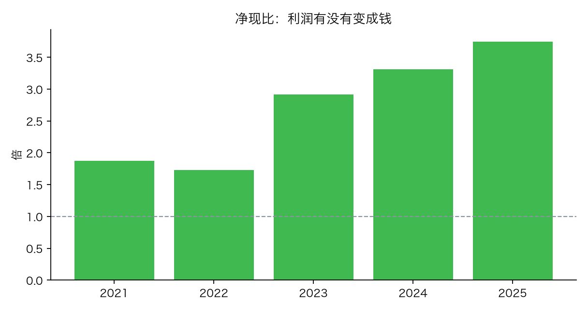

# 中国食品（00506.HK）公司分析

## 一页纸

**一句话：利润表很薄，现金流量表很厚，这家公司的价值全押在后一张表能不能重复。** 营业收入 220.70 亿元、营业成本 138.87 亿元、毛利 81.83 亿元（P97），落到归母只剩 8.62 亿元，净利率 3.91%（P97）。同一年的经营活动现金流量净额 32.29 亿元（P102），净现比 3.75 倍（P97、P102）。读它的次序必须倒过来：先看现金是怎么来的，再看利润为什么这么薄，最后才问这份现金值多少钱。

**收入的形状：汽水是绝对主体，其余四块加起来也远不及它。** 汽水 166.85 亿元、果汁 30.28 亿元、水品类 9.29 亿元、功能饮料 3.20 亿元、其他 11.09 亿元（P148），合起来构成 220.70 亿元的营业收入（P97）。这是一门单一品类定生死的生意：汽水决定收入方向，果汁决定价格韧性，水与功能饮料决定结构还能不能上移。把三件事并成一句「饮料」来读，年报真正在讲的东西就看不见了。

**毛利的去向不在管理，在渠道。** 81.83 亿元毛利里，分销及销售支出 59.49 亿元、行政支出 4.72 亿元（P97），剩下的才是营业利润 19.79 亿元（P97）。行政支出比上年 5.38 亿元还降了（P97），可压缩行政开支挤出来的几个基点，在销售费用面前不构成变量。货架、冰柜与终端陈列是买来的，买到之后还得年年续费——销售费用是这门生意真正的门槛，也是它不容易被替代的原因。

**现金好于利润，好在哪儿、能不能重复，必须拆开看。** 净利润 14.28 亿元对经营活动现金流量净额 32.29 亿元（P97、P102），差额的第一块是折旧与摊销 8.07 亿元（P101）：装瓶厂的重资产每年把利润扣掉一次，却不掏一分现金；第二块是营运资本净流入，合约负债从 8.66 亿元升到 13.08 亿元、应付账款从 8.04 亿元升到 10.35 亿元（P98–P99），渠道与供应商在这一年里共同给公司提供了一笔无息资金。折旧摊销会年年都在，营运资本的一次性释放不会。

**资产表干净得少见，但「干净」不等于「全归股东」。** 货币资金 45.49 亿元、应收账款 3.30 亿元、存货 16.30 亿元、资产总计 183.85 亿元（P98–P99），整张表没有银行借款科目，负债合计 78.24 亿元（P98–P99）。所有者权益 105.61 亿元，其中归母 68.96 亿元、少数股东 36.65 亿元（P98–P99）；少数股东权益少于归母权益，分走的利润 5.66 亿元对应归母净利润 8.62 亿元（P97、P98–P99）。权益少、分利多，说明在真正赚钱的那些装瓶子公司里，少数股东的位置排在前面。分红、回购、每股价值，都只能从归母那一半里出。

**议价结构的方向与直觉相反：对下游强势，对上游弱势。** 前五名客户销售额占比不足 4%，前五名供应商采购额占比 58%（P77）。客户端分散到几乎没有单一客户风险，供应商端却高度集中在少数几家手里——浓缩液由品牌方供应，这门生意的成本底线由别人的定价决定。应收账款周转 5.5 天、应付账款周转 27.2 天（P97、P98–P99），账期上赢来的那点空间，挡不住上游一次提价。这也是毛利率一年之内从 37.79% 退到 37.08%（P97）时，公司几乎无从抵抗的原因。

**治理底色与估值初判要一起读，因为折价来自同一处。** 股价之外还有两层约束：装瓶授权来自品牌方，股权与人事来自集团，员工 18,349 人（P33）的体系要同时满足两头的考核；落到股东这一端的是每股派息 0.154 元（P157），现金流量表口径的分配股利、利润或偿付利息支付的现金是 4.28 亿元（P103）。资本开支 10.49 亿元、自由现金流 21.80 亿元（P103、P102），资本开支占营业收入 4.75%（P97、P103），扩张是节制的、现金是留得住的。以现金流为锚，这家公司的价值远高于以归母利润为锚得到的结果；反向推算给出的现价隐含增速落在负值区间。差距只有三个可能的来源：少数股东在利润里占了更大份额、装瓶授权与治理结构本身该打的折、以及基期现金流被营运资本释放抬高。三条里只要有两条成立，「便宜」就只是账面印象而不是结论。

| 指标 | 2021 | 2022 | 2023 | 2024 | 2025 |
| :--- | ---: | ---: | ---: | ---: | ---: |
| 营业收入（亿元） | 197.84 亿元 | 209.68 亿元 | 214.46 亿元 | 214.92 亿元 | 220.70 亿元 |
| 归母净利润（亿元） | 5.72 亿元 | 6.60 亿元 | 8.33 亿元 | 8.61 亿元 | 8.62 亿元 |
| 毛利率 | 35.69% | 35.76% | 35.18% | 37.79% | 37.08% |
| 净利率 | 2.89% | 3.15% | 3.88% | 4.00% | 3.91% |
| ROE | 11.10% | 11.95% | 13.84% | 13.32% | 12.50% |
| ROIC | 12.14% | 12.94% | 13.53% | 13.47% | 13.08% |
| 经营活动现金流（亿元） | 10.74 亿元 | 11.41 亿元 | 24.30 亿元 | 28.47 亿元 | 32.29 亿元 |
| 自由现金流（亿元） | 3.60 亿元 | 2.59 亿元 | 18.02 亿元 | 21.35 亿元 | 21.80 亿元 |
| 净现比 | 1.88 倍 | 1.73 倍 | 2.92 倍 | 3.31 倍 | 3.75 倍 |
| 资产负债率 | 44.69% | 41.17% | 40.30% | 42.05% | 42.56% |
| 分红率 | —（不可得） | —（不可得） | —（不可得） | —（不可得） | —（不可得） |

红旗判定：清单共 33 项，命中 0 项，数据不足 20 项（数据不足不等于没问题）。

## 生意拆解

**第一层：收入结构——五块业务，一个主体。** 汽水 166.85 亿元、果汁 30.28 亿元、水品类 9.29 亿元、功能饮料 3.20 亿元、其他 11.09 亿元（P148），合起来是 220.70 亿元的营业收入（P97）。四块非汽水业务共用生产线、共用经销商、共用终端网点，所以真正的结构问题不是「哪块最大」，而是「哪块决定毛利」。

**单一经营分部：报表只给一条线，品类层面的费用与资本占用读不到。** 分品类收入进了附注（P148），分品类毛利率、分部资产、分部现金流都没有披露。任何「某个品类更赚钱」的说法在这份年报里没有数据支撑，只能从合并毛利率的变化方向去反推。

**毛利结构：37.08% 的毛利率，一年之内退了一步。** 毛利 81.83 亿元、毛利率 37.08%，上年 37.79%（P97）；营业成本从 133.71 亿元升到 138.87 亿元，营业收入只从 214.92 亿元走到 220.70 亿元（P97）。成本跑在收入前面，毛利率的下行不是某一项费用的偶发波动。

**量价：增长来自瓶数，不来自单瓶价格。** 收入在增而毛利率在降，只指向一种组合：卖出去的箱数增加，单箱价格与产品结构没有出力。装瓶商向品牌方买浓缩液、按授权区域和授权价格体系销售，出厂价的自主空间本来就窄，提价要品牌方点头。

**渠道与费用：先款后货的生意，却要拿费用养货架。** 分销及销售支出 59.49 亿元（P97）；应收账款 3.30 亿元、周转 5.5 天（P97、P98–P99），合约负债 13.08 亿元（P98–P99）——经销商打款在前、发货在后，这是对下游强势的一面。代价在另一面：陈列、冰柜、促销全由公司出，销售费用不是可选项。

**成本构成：能自己编的部分很少。** 138.87 亿元营业成本（P97）由三条线决定：浓缩液由品牌方供应，包装是瓶坯与罐，其余是糖与原辅料。前五名供应商采购额占 58%（P77），而且采购集中在极少数几家手里——第一条线就把成本的底线锁死了。

**每元收入是怎么留下来的。** 220.70 亿元收入，扣 138.87 亿元成本得 81.83 亿元毛利，再扣 59.49 亿元分销及销售支出与 4.72 亿元行政支出得 19.79 亿元营业利润，缴 5.51 亿元所得税得 14.28 亿元净利润，最后 8.62 亿元归母（P97）。净利率 3.91%（P97）说明这条链条上每一环都很薄，任何一环多挪一步，归母那一层就会明显走样。

**供应商集中的经营含义：成本权在别人手里。** 采购高度集中（P77）不是采购管理做得好，是没有第二家可选。传导路径极短：上游调价、营业成本上升、毛利率下降；而下游客户极度分散，涨价传不下去。毛利率一年退的这一步，就是这条路径的影像。

**客户分散带来的不是安全感，是持续的费用投入。** 前五名客户占比不足 4%（P77），货要靠大量经销商与终端一家一家铺出去，这也解释了应收账款为什么只有 3.30 亿元（P98–P99）。好处是没有单一客户风险，坏处是每一瓶都要公司自己付钱推上货架。

**少数股东权益在这门生意里的位置：合资装瓶的会计投影。** 少数股东权益 36.65 亿元、少数股东损益 5.66 亿元（P97、P98–P99），对归母权益 68.96 亿元、归母净利润 8.62 亿元（P97、P98–P99）。赚钱的装瓶厂是合资的，品牌方以少数股东身份分走一部分利润；合并报表的规模是完整的，处置权不是。分配股利、利润或偿付利息支付的现金 4.28 亿元（P103），是这套结构下才谈得上分配的结果。

**重资产的形状与开支节律。** 固定资产 56.08 亿元、无形资产 35.42 亿元（P98–P99）；资本开支 10.49 亿元、折旧与摊销 8.07 亿元（P103、P101），资本开支占营业收入 4.75%（P97、P103）。固定资产一年只净增一点，无形资产 35.42 亿元、上年 35.45 亿元（P98–P99），几乎不动——这是授权类资产的形状，不是自研技术的形状。

**生意属性的判断，和证伪它的三个观察点。** 底色是：用区域授权换货架，用渠道密度摊薄固定成本，用合资结构分担资本，赚一份 ROE 12.50%（P97、P98–P99）的辛苦钱。三个观察点——毛利率若在成本平稳的年份继续下行，说明费用对毛利的挤压已经制度化；合约负债若掉头向下，说明经销商不再愿意为下一季备货；资本开支若持续高于折旧摊销而收入不动，说明扩产已经不经济。

本次没有触发结构化判断。

## 行业与竞争位次

**行业格局：软饮料在中国的组织方式，是品牌与装瓶分离。** 品牌方掌握配方、商标与浓缩液，装瓶方出工厂、出渠道、出销售队伍，在划定的区域内生产与销售。这是一套特许经营式的授权装瓶体系，授权既是护城河，也是天花板——区域有多大，生意就有多大。同一品牌在不同区域由不同装瓶商覆盖，装瓶商之间很少直接对打，真正的竞争发生在品牌之间，以及货架与冰柜的争夺上。

**公司的位次：可口可乐在中国内地的装瓶平台之一，以区域授权换市场。** 单一经营分部，收入全部来自饮料的生产与销售（P148）。它的竞争位次不体现在份额排名上，而体现在授权覆盖区域的人口密度与渠道深度上；这也解释了为什么它的收入体量稳、毛利率薄：收入的上限由区域决定，价格的主动权由品牌方决定。

**护城河的来源之一：区域装瓶权。** 授权把竞争者挡在产地与渠道之外，同一区域内不存在第二家装同一品牌的装瓶厂。无形资产 35.42 亿元、上年 35.45 亿元（P98–P99），几乎没有变化，形态更接近不定期限的授权而不是需要摊销的技术——账面不承担授权到期的时间成本，是否续期这件事因此没有反映在损益表里。

**护城河的来源之二：渠道网络。** 前五名客户销售额占比不足 4%（P77），说明货不是靠几家大卖场卖出去的，而是靠一层层经销商与大量终端网点。这套网络的建设成本已经沉没在固定资产 56.08 亿元与历年分销及销售支出里（P97、P98–P99）；新进入者要进来，就得把这两笔钱重付一遍，并且还得先拿到授权。

**产能与扩张的节奏跟着生产线，不跟着份额。** 资本开支 10.49 亿元、折旧与摊销 8.07 亿元（P103、P101），资本开支占营业收入 4.75%（P97、P103）。装瓶体系扩产的方式是上生产线、铺冰柜，不是降价抢份额——这决定了这个行业的竞争很少以全线价格战的形态出现，更多以「谁先把冷链与冰柜铺到更下沉的市场」的形态出现。

**上游议价：卖方市场，这是全篇最脆弱的环节。** 前五名供应商采购额占 58%（P77），采购高度集中在少数几家手里。浓缩液只有品牌方能供，装瓶商没有替代来源，议价结构因此很不对称：对上游是价格接受者，成本上涨只能先自己消化一段，再用促销与结构去补。

**下游议价：买方市场，但账单要用费用付。** 客户高度分散（P77）、应收账款周转 5.5 天（P97、P98–P99）、合约负债 13.08 亿元（P98–P99）——先款后货，占款能力强。可这份强势有另一面：维持网点必须持续投放分销及销售支出 59.49 亿元（P97），渠道越分散，单位维护成本越高，这也是净利率只有 3.91%（P97）的原因。

**行业增长从哪来：量、结构、价，公司只有前两条路可走。** 软饮料的增长不外乎三条路：人均消费量提升、品类结构迁移、提价。装瓶商在提价上没有主动权，能吃到的是量增与结构改善；而结构改善要看水品类 9.29 亿元、功能饮料 3.20 亿元这些小体量业务能不能长大（P148）。

**结构改善还没有抵消成本与促销压力，这是本年最重要的行业事实。** 营业收入从 214.92亿元升到 220.70 亿元，毛利率却从 37.79% 退到 37.08%（P97）。水与功能饮料在长大，但没有长到能改变合并毛利率的地步；这一年的环境用一句话概括是「量在、价不在」。

**竞争强度：这是一场靠费用打的仗，不是靠产品的仗。** 销售费用 59.49 亿元、净利率 3.91%（P97）——拼的不是配方，是谁更愿意为冰柜、陈列与旺季档期付费。这种竞争形态不会因为一家对手退出而结束，它只会随旺季节奏与新品周期起伏。

**周期位置与公司能吃的那一份。** 营业收入 220.70 亿元与经营活动现金流量净额 32.29 亿元都在五年高位（P97、P102），毛利率却在退——「量在扩张、价在承压、现金在改善」的组合。公司能吃到的是确定的区域量与稳定的渠道，吃不到的是行业提价的超额收益，这决定了它的增长上限是温和的，而不是陡峭的。

**这套判断的证伪条件。** 其一，若水品类与功能饮料的收入继续上升而毛利率止跌回升，说明结构改善开始产生定价权；其二，若最大供应商占比继续上升，说明上游依赖在加深，成本问题正在变成经营问题；其三，若合约负债在旺季掉头向下，说明渠道信心先于报表恶化。

## 会计质量体检

**勾稽是干净的，两个年度都干净。** FY2025 资产总计 183.85 亿元等于负债合计 78.24 亿元加所有者权益 105.61 亿元；所有者权益 105.61 亿元等于归母权益 68.96 亿元加少数股东权益 36.65 亿元；净利润 14.28 亿元等于归母净利润 8.62 亿元加少数股东损益 5.66 亿元，又等于利润总额 19.79亿元减所得税费用 5.51 亿元（P97、P98–P99）。FY2024 的同四组关系同样零差异（P97、P98–P99）。算术上没有可挑的错，但这只说明问题不在算术上。

**利润表的形状：营业利润与利润总额同为 19.79 亿元。** 两个科目在这一年完全相等（P97），意味着营业外收支没有参与利润的形成。其他收益 2.22 亿元、上年 1.62 亿元（P97）落在营业利润之内，它不属于主营，也不属于一次性减值，更像逐年发生、与日常经营无直接关系的政策性收入——净利率 3.91%（P97）里的这部分，需要单独看待。

**现金流与利润的背离：方向健康，幅度要解释。** 经营活动现金流量净额 32.29 亿元对净利润 14.28 亿元（P97、P102），净现比 3.75 倍、上年 3.31 倍（P97、P102），已是连续第三年抬升（P97、P102）。差额有两块来源：折旧与摊销 8.07 亿元（P101）进了成本不进现金，是结构性的；营运资本变动是时序性的。两块的可持续性完全不同，混在一起看就会把一次性的东西当成常态。

**营运资本这一块，本年贡献得格外扎实。** 合约负债从 8.66 亿元升到 13.08 亿元、应付账款从 8.04 亿元升到 10.35 亿元（P98–P99），两项把资金往公司体内拉；同时存货从 14.43 亿元升到 16.30 亿元、应收账款从 3.39 亿元降到 3.30 亿元（P98–P99），存货在往外压现金。净效果是流入，但流入的形态是「渠道提前打款加供应商账期拉长」，不是「利润变多了」。

**最需要保持怀疑的一处就在这里。** 净现比对净利润的倍数从上年的 3.31 倍抬到 3.75 倍（P97、P102），而分母一侧的归母净利润 8.62 亿元比上年 8.61 亿元几乎没动（P97）。合约负债与应付账款都不会无限上抬：前者取决于经销商的备货意愿，后者取决于供应商还愿不愿意继续给账期。把这一年的现金流当作估值基期，等于把一次营运资本释放当成永久能力。

**应收账款与存货周转：一个快到极限，一个在变慢。** 应收账款周转 5.5 天（P97、P98–P99），接近现款现货，说明报表收入里没有多少「赊出来的增长」。存货周转 42.8 天、上年 39.4 天（P97、P98–P99），存货 16.30 亿元比上年 14.43 亿元增加（P98–P99）——旺季前的备货能解释一部分，剩下的要看下一期能不能消化掉。

**应付账款周转 27.2 天、上年 22.0 天（P97、P98–P99），连续多年拉长。** 占用上游资金的时间变长，对现金流是好事，对成本未必：供应商在账期上让步，通常会在价格上要回来，而这门生意的毛利率本来就是被上游锁定的。营业成本 138.87 亿元（P97）里能自己编的部分很少，账期这条线的松弛，可能是成本压力的前兆。

**合约负债的含义比金额更重要。** 13.08 亿元（P98–P99）是渠道对下一季的投票：它高，说明经销商愿意提前打款锁货；它低，说明货压在他们手里。这个科目从上年的 8.66 亿元回到 13.08 亿元（P98–P99），波动幅度大于收入本身，说明它更多反映渠道节奏，而不是终端需求的强弱。

**减值科目规模很小，不构成风险源，但也没有被检验过。** 信用减值损失 -0.04 亿元、上年 -0.08 亿元（P97），对应应收账款 3.30 亿元（P98–P99），量级上不成问题。无形资产 35.42 亿元五年几乎不动（P98–P99），这类以授权与商标为主的资产占了资产总计 183.85 亿元（P98–P99）里相当的分量，却从未在损益表上被检验过减值——守得住是好事，守不住则是没有人提前收到过信号。

**无借款的资本结构，是这份报表最硬的底牌。** 整张表没有短期借款、长期借款与债券科目，负债合计 78.24 亿元主要是经营性负债（P98–P99）；货币资金 45.49 亿元、流动资产合计 81.07 亿元、流动负债合计 74.65 亿元（P98–P99），流动比率 1.09（P98–P99），偿还债务支付的现金 0.53 亿元（P103），量级上与租赁类负债的偿付相称，谈不上银行债务的还本。没有利息侵蚀，也没有再融资风险，在净利率 3.91%（P97）的行业里这是稀缺品。

**少数股东口径决定了你怎么读这张表。** ROE 12.50%、净利率 3.91%（P97、P98–P99）是归母口径，而资产周转 1.20 次、45.49 亿元货币资金（P97、P98–P99）是合并口径。混用会读到「现金充裕、回报优秀」，实际可分配的是归母 8.62 亿元（P97）那一支；权益乘数 2.67（P97、P98–P99）也在提示，ROE 里有一部分来自负债与合资结构，不是纯粹的资产回报。

**一句话的会计质量判断。** 报表算术干净、资本结构无懈可击、现金流的方向是真实的；不清白的地方只有一处——现金流与利润之间的差距被营运资本释放放大了，而这个动作不可能年年重复。基期现金流该不该打折，是读这份年报唯一真正需要下判断的地方，也是后面估值部分全部争论的起点。

### 三表勾稽

| 年度 | 检查项 | 结论 | 差异明细 |
| :--- | :--- | :--- | :--- |
| 2024 | 资产 = 负债 + 所有者权益 | 通过 | 左 17,598,367,000.00 vs 右 17,598,367,000.00，差异 0.00（相对 0.0000%） |
| 2024 | 所有者权益 = 归母权益 + 少数股东权益 | 通过 | 左 10,198,216,000.00 vs 右 10,198,216,000.00，差异 0.00（相对 0.0000%） |
| 2024 | 净利润 = 归母净利润 + 少数股东损益 | 通过 | 左 1,422,577,000.00 vs 右 1,422,577,000.00，差异 0.00（相对 0.0000%） |
| 2024 | 净利润 = 利润总额 − 所得税费用 | 通过 | 左 1,422,577,000.00 vs 右 1,422,577,000.00，差异 0.00（相对 0.0000%） |
| 2024 | 毛利率互校（上游 vs 自算） | 跳过 | 上游值或自算值缺失 |
| 2024 | 资产负债率互校（上游 vs 自算） | 跳过 | 上游值或自算值缺失 |
| 2024 | ROE 互校（上游加权口径 vs 自算期末口径） | 跳过 | 上游值或自算值缺失 |
| 2025 | 资产 = 负债 + 所有者权益 | 通过 | 左 18,385,358,000.00 vs 右 18,385,358,000.00，差异 0.00（相对 0.0000%） |
| 2025 | 所有者权益 = 归母权益 + 少数股东权益 | 通过 | 左 10,561,195,000.00 vs 右 10,561,195,000.00，差异 0.00（相对 0.0000%） |
| 2025 | 净利润 = 归母净利润 + 少数股东损益 | 通过 | 左 1,428,047,000.00 vs 右 1,428,047,000.00，差异 0.00（相对 0.0000%） |
| 2025 | 净利润 = 利润总额 − 所得税费用 | 通过 | 左 1,428,047,000.00 vs 右 1,428,047,000.00，差异 0.00（相对 0.0000%） |
| 2025 | 毛利率互校（上游 vs 自算） | 跳过 | 上游值或自算值缺失 |
| 2025 | 资产负债率互校（上游 vs 自算） | 跳过 | 上游值或自算值缺失 |
| 2025 | ROE 互校（上游加权口径 vs 自算期末口径） | 跳过 | 上游值或自算值缺失 |

勾稽结论：14 项检查中 0 项不通过、0 项存疑。

### 红旗逐条判定

| 严重度 | 红旗 | 状态 | 观测值 |
| :--- | :--- | :--- | :--- |
| 高 | 毛利率显著高于同业且无法解释 | 数据不足 | 需人工核对（附注/公告原文） |
| 高 | 商誉占归母净资产过高 | 数据不足 | 商誉 / 归母权益 最近 1 期数据不全 |
| 高 | 商誉减值反复出现（挤牙膏式减值） | 数据不足 | 需人工核对（附注/公告原文） |
| 高 | 大存大贷：高额类现金与高额有息负债并存 | 数据不足 | 部分子条件数据不足：银行借款 / 资产总计 最近 1 期数据不全，且FY2025 货币资金/资产总计 = 24.75% |
| 高 | 其他应收款异常膨胀 | 数据不足 | 需人工核对（附注/公告原文） |
| 高 | 在建工程长期不转固 | 数据不足 | 需人工核对（附注/公告原文） |
| 高 | 研发资本化率异常抬升 | 数据不足 | 需人工核对（附注/公告原文） |
| 高 | 非经常性损益占利润过高 | 数据不足 | 需人工核对（附注/公告原文） |
| 高 | 审计意见非标准无保留 | 数据不足 | 需人工核对（附注/公告原文） |
| 高 | 关联采购占营业成本比例过高 | 数据不足 | 关联方采购金额 / 营业成本 最近 1 期数据不全 |
| 高 | 控股股东高比例质押 | 数据不足 | 需人工核对（附注/公告原文） |
| 高 | 收现比长期低于 1 | 数据不足 | 需人工核对（附注/公告原文） |
| 中 | 每年都有大额并购支出 | 数据不足 | 需人工核对（附注/公告原文） |
| 中 | 预付账款异常膨胀 | 数据不足 | 需人工核对（附注/公告原文） |
| 中 | 第四季度利润异常（亏损或占比畸高） | 数据不足 | 需人工核对（附注/公告原文） |
| 中 | 财务总监频繁更换 | 数据不足 | 需人工核对（附注/公告原文） |
| 中 | 递延所得税资产增速远超收入 | 数据不足 | 需人工核对（附注/公告原文） |
| 中 | 短期借款支撑长期资产（短债长投） | 数据不足 | 部分子条件数据不足：短期借款 / 银行借款 最近 1 期数据不全，且货币资金 / 短期借款 最近 1 期数据不全 |
| 中 | 折旧率明显低于同业 | 数据不足 | 需人工核对（附注/公告原文） |
| 中 | PE 被一次性收益压低 | 数据不足 | 需人工核对（附注/公告原文） |

## 财务表现与回报

**五年收入与利润率，是一幅慢慢爬坡又滑一下的图。** 营业收入从 197.84 亿元（P97）走到 220.70 亿元（P97），五年里没有一年下滑；毛利从 70.61 亿元升到 81.83 亿元（P97）。毛利率 35.69%、35.76%、35.18%、37.79%、37.08%（P97）——FY2024 是高点，FY2025 掉了回来。薄利生意的利润率本来就没有缓冲，一个百分点的回摆就吃掉前面全部的改善。

**利润的路径比收入更陡，也更早停下。** 经营溢利从 13.98 亿元升到 19.79 亿元（P97），归母净利润从 5.72 亿元升到 8.62 亿元（P97）；但 FY2024 的 8.61 亿元到 FY2025 的 8.62 亿元（P97），基本没有动。前四年是修复，第五年是平台。

**净利率的天花板写在成本结构里。** 净利率 2.89%、3.15%、3.88%、4.00%、3.91%（P97）。五年里最低一年的毛利率是 35.18%（P97），那道落差全部落在分销及销售支出 59.49 亿元（P97）与行政支出4.72 亿元（P97）上。这门生意的利润率不是定价决定的，是渠道效率决定的。

**合并口径与归母口径差了将近一半。** 净利润 14.28 亿元（P97），其中少数股东损益 5.66 亿元（P97），归母净利润 8.62 亿元（P97）。看合并利润会觉得这是一门年赚十四亿的生意，看归母才知道股东拿到的是八亿多。两个口径都真实，但估值只能用后者。

**ROE 的形状与 ROIC 几乎重合。** ROE 11.10%、11.95%、13.84%、13.32%、12.50%（P97、P99），ROIC 12.14%、12.94%、13.53%、13.47%、13.08%（P97、P99）。两者只差一个杠杆的距离，原因简单：资产负债表上没有银行借款科目（P98–P99），权益乘数从 2.94 降到 2.67（P98–P99）。这是一门不借钱也能赚到 13.08% 资本回报的生意，也是它的上限。

**ROIC 高于资本成本，这条多头论据成立但有条件。** 13.08%（P97、P99）说明即使收入不增长，公司仍在创造经济利润。条件在资本开支：capex_to_revenue 从 2.93% 回到 4.75%（P103、P97），投入一旦抬头，回报就往下走，而装瓶业的生产线投资是周期性的、不是可选的。

**资产周转在变慢。** 总资产周转率 1.30、1.39、1.32、1.22、1.20（P97、P98），资产总计从 151.68 亿元（P199）涨到 183.85 亿元（P199）。资产增长快于收入，回报率就只能靠利润率硬撑，这也是 ROE 从13.84% 回落到 12.50% 的算术原因。

**周转天数是这篇里最好看的部分。** 存货天数从 55.5 天压到 42.8 天（P97、P98），应收天数从 6.0 天到 5.5 天（P97、P98），应付天数从 13.6 天拉长到 27.2 天（P97、P98）。三项合起来是同一件事：存货 19.33 亿元降到 16.30 亿元（P98），应付账款 4.75 亿元升到 10.35 亿元（P98）——公司把自己的钱腾出来，把供应商的钱用起来。

**净现比是这份报表最强的信号，也是最该怀疑的信号。** 1.88、1.73、2.92、3.31、3.75（P102、P97）。经营活动现金流量净额从 10.74 亿元升到 32.29 亿元（P102），而归母净利润只从 5.72 亿元升到 8.62 亿元（P97）。现金涨得比利润快得多，缺口只有三个来源：折旧摊销、营运资本、一次性项目的节奏。

**自由现金流在 FY2023 跳了一个台阶。** 3.60 亿元、2.59 亿元、18.02 亿元、21.35 亿元、21.80 亿元（P102、P103）。从 FY2022 到 FY2023，经营活动现金流量净额从 11.41 亿元到 24.30 亿元（P102），资本开支从 8.82 亿元降到 6.27 亿元（P103）。两个方向都在帮忙，但量级差得远：现金流的增量远大于开支的减少。

**这个台阶不能用资本开支解释，这一条直接决定后面估值的可信度。** FY2025 的资本开支 10.49 亿元（P103）已经高过 FY2022 的 8.82 亿元（P103），而 FY2025 的自由现金流 21.80 亿元（P102、P103）仍是FY2022 的 2.59 亿元（P102、P103）的许多倍。开支既没有系统性下降，台阶就不可能来自投资端。

**剩下的解释只有一个：营运资本。** 应付账款从 4.75 亿元到 10.35 亿元（P98），应付天数从 13.6 天到27.2 天（P97、P98）；合约负债 15.81 亿元、9.87 亿元、12.84 亿元、8.66 亿元、13.08 亿元（P98）在区间内反复摆动。折旧与摊销 8.07 亿元（P101）稳定，解释不了台阶；能解释台阶的是占用上下游资金这件事在 FY2023 之后变成了常态净流入。

**营运资本的释放有硬上限。** 应付天数已经 27.2 天（P97、P98），再拉长取决于供应商的容忍度，而采购端的集中度恰恰是最脆弱的一环（P77）。合约负债 13.08 亿元（P98）随渠道备货波动，明年可能反向。所以 FY2023 之后的自由现金流里，有一块不该当成可持续的基期。

**现金的去向说明公司自己也没打算再投。** 货币资金从 15.92 亿元升到 45.49 亿元（P98），筹资活动净额 −16.30 亿元（P103），其中分配股利 4.28 亿元（P103）；报告期没有取得借款，还偿还债务 0.53 亿元（P103）。不借钱、还还债、现金越攒越多，资本配置的取向是留安全垫，而不是扩产能。

**判断：现金比利润好看得多，但好看的部分不可外推。** 收入五年从 197.84 亿元到 220.70 亿元（P97），归母净利润从 5.72 亿元到 8.62 亿元（P97），自由现金流从 3.60 亿元到 21.80 亿元（P102、P103）——三个增速之间的落差，就是过去三年把营运资本挤出来的幅度。拿最近三年自由现金流均值当基期，等于把一次性的资金占用当成永久的盈利能力。

**证伪与跟踪。** 若应付天数停止上行、合约负债回落而经营现金流仍在增长，说明台阶来自真实经营改善，基期可以上调；若应付天数继续拉长而毛利率同步下滑，说明公司是在用供应商的钱补贴促销，那条路有尽头。下一个披露窗口先看三个口径：经营活动现金流量净额（P102）、资本开支（P103）、应付账款（P98）。

### 收入与利润的十年轨迹

*数据来源：公司年度报告原文（页码见正文引用），金额为合并报表口径。*

*数据来源：公司年度报告原文（页码见正文引用），金额为合并报表口径。*

### 杜邦分解

| 项目 | 2021 | 2022 | 2023 | 2024 | 2025 |
| :--- | ---: | ---: | ---: | ---: | ---: |
| ROE | 11.10% | 11.95% | 13.84% | 13.32% | 12.50% |
| 净利率 | 2.89% | 3.15% | 3.88% | 4.00% | 3.91% |
| 总资产周转率（次） | 1.30 倍 | 1.39 倍 | 1.32 倍 | 1.22 倍 | 1.20 倍 |
| 权益乘数 | 2.94 倍 | 2.73 倍 | 2.70 倍 | 2.72 倍 | 2.67 倍 |

### 现金流与投入

| 项目 | 2021 | 2022 | 2023 | 2024 | 2025 |
| :--- | ---: | ---: | ---: | ---: | ---: |
| 营业收入 | 197.84 亿元 | 209.68 亿元 | 214.46 亿元 | 214.92 亿元 | 220.70 亿元 |
| 营业利润 | 13.98 亿元 | 15.88 亿元 | 18.49 亿元 | 18.66 亿元 | 19.79 亿元 |
| 归母净利润 | 5.72 亿元 | 6.60 亿元 | 8.33 亿元 | 8.61 亿元 | 8.62 亿元 |
| 经营活动现金流 | 10.74 亿元 | 11.41 亿元 | 24.30 亿元 | 28.47 亿元 | 32.29 亿元 |
| 资本性支出 | 7.14 亿元 | 8.82 亿元 | 6.27 亿元 | 7.12 亿元 | 10.49 亿元 |
| 自由现金流 | 3.60 亿元 | 2.59 亿元 | 18.02 亿元 | 21.35 亿元 | 21.80 亿元 |

*数据来源：公司年度报告原文（页码见正文引用），金额为合并报表口径。*

## 治理与股东回报

**控股股东是产业资本，不是财务投资人。** 中粮集团通过旗下平台持有本公司控股权，公司是可口可乐在中国内地的装瓶平台之一。这层身份对治理的含义是双向的：一方面，装瓶权、浓缩液供应、品牌授权都不在上市公司手里，重大经营决策的边界由合资协议与授权协议划定；另一方面，控股股东有动力维持这个平台的稳定，因为它是中粮饮料资产的唯一上市出口。读这家公司的治理，先要把「谁是股东」和「谁掌握上游」分开。

**少数股东不是财务跟投，是产业对手方。** 少数股东权益 36.65 亿元（P99），少数股东损益 5.66 亿元（P97），同期净利润 14.28 亿元（P97）、归母净利润 8.62 亿元（P97）。合并口径下四成利润归少数股东，归母权益 68.96 亿元（P99）对少数股东权益 36.65 亿元（P99），比例接近二比一。这不是一个可以被忽略的尾数，而是这门生意结构本身的一部分。

**这个结构决定了「谁在为增长付钱」。** 装瓶合资公司的另一方是可口可乐体系，它同时是品牌与浓缩液的提供方。于是同一笔钱在报表上出现两次：一次是上市公司向关联方采购的成本，一次是少数股东分走的利润。只看归母净利润会低估这门生意的实际体量，只看合并净利润会高估股东能拿到的部分。

**分红是这家公司最确定的股东回报形式。** 每股派息 0.154 元（P157），上一年度 0.153 元（P157）；现金流量表口径分配股利 4.28 亿元（P103）；按快照日股价计的股息率是 4.08%。分红规模对归母净利润8.62 亿元（P97）而言接近一半，属于稳定但不满额的分配——留下的钱变成了资产负债表上的现金。

**资本配置的取向是「留现金」，这一点没有歧义。** 资产负债表没有银行借款科目（P98–P99），货币资金45.49 亿元（P98），报告期没有取得借款、偿还债务 0.53 亿元（P103），资本开支 10.49 亿元（P103）。一门不需要借钱、现金流充沛、分红只分一半的生意，账上趴着四十五亿元现金，只有两种解释：为授权续期与产线更新留出弹药，或者确实没有更好的再投资去处。两种解释对估值的含义完全不同，而年报不会替人选边。

**关联交易的两个方向必须分开看。** 报告期与同一控制下公司的交易 12.81 亿元（P174），与附属公司及其他关联方之非控股权益的交易 49.75 亿元（P174）。后者规模大得多，指向的正是可口可乐体系一侧——这与供应商集中度的事实彼此印证：前五名供应商占采购 58%、其中最大一家占 44%（P77）。

**供应商集中度是治理问题，不只是采购问题。** 前五名供应商合计占采购 58%（P77）、最大一家 44%（P77），意味着浓缩液这一项几乎没有替代方案。在这种结构下，关联交易的定价机制不是「公平不公平」的判断题，而是「上市公司还剩多少议价权」的事实题。年报就持续关连交易安排独立非执行董事审阅、并由核数师天职香港会计师事务所出具无保留意见函件（P97）——程序齐全，但程序审的是过程合规，不是价格水平。

**客户端则是完全相反的图景。** 前五名客户合计不足 4%（P77）。客户极度分散，说明公司没有大客户依赖，也说明它在终端没有谈判对手、只有无数个谈判对手。这种结构把议价能力从上市公司手里拿走，交回给渠道与消费者；治理层面的意义是，管理层对收入的掌控力其实比报表看起来更弱。

**审计与质押这两项，披露口径要如实说明。** 审计意见类型、股权质押比例这两项，年报未就抽取口径披露，本文不对其作判断。可以确认的是：财务报表由天职香港会计师事务所审计，其就持续关连交易出具的函件为无保留意见（P97）。这两句话的区别值得留意——前者缺失，后者是有条件的正面结论。

**人力资本是这家公司最实的资产。** 在职员工 18,349 人（P33），上一年度为 17,533 人（P33）。对一家收入 220.70 亿元（P97）的装瓶企业，员工规模意味着配送、拜访、陈列这些动作都是人做出来的，治理上的对应要求是激励与稳定，而不是精简。

**管理层的可打分承诺很少，这是治理观察的一个缺口。** 年报里能被事后明确判对错的管理层数字不多，分红是最硬的一个：每股派息 0.154 元（P157）已经连续给到，股息率 4.08%。除此之外，收入目标、费用目标这类承诺在抽取口径里缺失，只能靠逐年对比收入 214.92 亿元到 220.70 亿元（P97）这种事后痕迹去推断管理层做到了什么。

**股东回报的真实约束不是意愿，是授权期限。** 装瓶权与品牌授权都有期限，续期条件不掌握在上市公司手里。这决定了治理评价的落脚点：一家把一半利润分掉、账上留四十五亿元现金（P98）、不借钱的装瓶平台，其长期价值高度依赖「这门生意还能做多久」，而不是「今年多分了几分钱」。

**判断：治理结构干净，但股东能决定的事很少。** 无有息负债、无质押数据可查、关联交易程序完备、分红稳定，这些都是加分项；扣分项在于上市公司的经营边界被上游授权与合资结构框住，少数股东还要分走四成利润（P97、P99）。对这样的结构，治理折价是应该给的，问题只是给多少。

**证伪条件。** 第一，若每股派息跌破 0.154 元（P157）或分配股利明显低于 4.28 亿元（P103），说明现金优先用途已经改变，需要重新评估资本配置取向；第二，若关联采购规模相对营业成本 138.87 亿元（P97）明显上升而毛利率同步下滑，定价机制的疑问从「无法核对」变成「可以质疑」；第三，若少数股东损益相对净利润的比重继续抬升，归母口径的含金量下降；第四，若账上现金长期维持在 45.49 亿元（P98）量级而不分红也不再投资，闲置资本本身就是治理问题。

## 费用与研发

**三条费用先看总量。** 分销及销售支出 59.49 亿元（P97）、行政支出 4.72 亿元（P97），对应毛利81.83 亿元（P97）。销售支出对毛利的比值高到七成以上，行政支出只占很小的零头。这个结构说明一件事：这家公司的费用几乎全部花在「把货卖出去」上，管理与研发的费用量级都不构成观察重点。

**销售费用是渠道的租金。** 59.49 亿元（P97）里装的是配送、人员、陈列、促销与进场条件。它随渠道覆盖的广度走，不随总部决策走：多一个县城网点就多一份配送成本，多一次终端陈列就多一笔费用。这也解释了为什么它的绝对额逐年抬升——53.56 亿元、55.39 亿元、54.70 亿元、58.71 亿元、59.49 亿元（P97），五年间一路向上，中间只有 FY2023 一年小幅回头。

**费用率的走向要看分子分母的相对速度。** 营业收入 197.84 亿元到 220.70 亿元（P97），销售支出53.56 亿元到 59.49 亿元（P97）。收入的增量与费用的增量接近同一个量级，费用率因此没有明显改善——这是一门规模不带来费用摊薄的生意，因为服务更多消费者就要更多人和更多车。

**行政支出是唯一真正在收缩的一项。** 4.96 亿元、5.06 亿元、5.30 亿元、5.38 亿元、4.72 亿元（P97）。FY2024 到 FY2025 的回落幅度在五年的费用数据里最醒目。它的规模只有 4.72 亿元（P97），即使归零也改不了净利率的量级，所以这项收缩的信号价值大于金额价值：说明总部层面的开支是可以被压的。

**费用的刚性主要来自人力，人数是它的锚。** 在职员工 18,349 人（P33），上一年度 17,533 人（P33）。装瓶生意的成本结构里，人是不可压缩项：生产随产线走，配送随网点走，拜访与陈列随终端数走。收入下滑时这些动作不能停，停了货架就没了，所以人工成本的实际弹性远低于账面观感。

**渠道结构决定了促销是常态而不是意外。** 前五名客户合计不足 4%（P77），客户极度分散，意味着公司面对的是无数个分散的终端与经销商，而不是几个可以坐下来谈年度协议的大客户。分散的对手方加上同质化的品类，价格只能靠促销维持销量，这部分支出天然落在销售费用里，不会消失。

**研发在数据里是缺口，这一点要如实说明。** 研发费用年报未就抽取口径披露，研发资本化金额同样未披露。这不是「没有研发」，而是「抽取口径没有取到」，所以本篇不对研发强度下判断，也不拿行业均值去填。

**装瓶生意的研发本来就不在上市公司这一层。** 品牌、配方、浓缩液由授权方掌握，装瓶企业做的是灌装、配送与销售，工艺改进发生在设备与产线，而不是实验室。研发费用如果真的大额出现，反而会是一个异常信号——那意味着公司在往上游走，而那不是它的授权范围。

**其他收益是经营溢利的一块补丁，评价费用效率时要剔开。** 其他收益 2.22 亿元（P97），上一年度1.62 亿元（P97）。经营溢利 19.79 亿元（P97）里含着它。看费用端的改善，必须把这部分和政府补助、资产处置之类的非经营性项目分开，否则会把一次性收入误读成成本控制能力。

**减值是费用表上很小但方向性的一项。** 金融资产减值净额 0.04 亿元（P97），上一年度 0.08 亿元（P97）。金额可以忽略，但它的存在提示应收账款的质量问题始终在，只是规模很小——应收天数 5.5 天（P97、P98）也支持这个判断：公司对下游基本是现款或短账期。

**折旧在成本端，不在费用端，这是理解毛利率的关键。** 折旧与摊销 8.07 亿元（P101）主要计入营业成本138.87 亿元（P97），而不是行政支出。所以毛利率的下滑有两个可能来源：原料涨了，或者产能利用率降了。FY2025 毛利率从 37.79% 回落到 37.08%（P97），资本开支却从 7.12 亿元升到 10.49 亿元（P103）——新产线投产初期的折旧摊薄还没跟上，这条线索比费用率更值得盯。

**费用端还剩多少空间：行政有，销售几乎没有。** 行政支出 4.72 亿元（P97）已经压到五年最低，继续压缩的空间存在但金额有限；销售支出 59.49 亿元（P97）绑在渠道覆盖与人力上，压缩等于主动放弃货架与网点，短期增厚利润、中期损伤份额。真正的空间不在「少花钱」，而在「同样的钱换更多销量」，那是毛利率与周转的问题，不是费用率的问题。

**判断：费用结构是这门生意的定性证据。** 一家把七成以上毛利花在分销与销售上、行政支出只有4.72 亿元、研发在报表上找不到的公司，其竞争力只能来自网络密度与执行效率，不能来自技术或品牌溢价。这条判断一旦成立，费用端就不该被当成利润的调节阀，而应被当成生意的成本底座。

**证伪条件。** 第一，若销售支出增速连续快于收入增速而毛利率同步下滑，说明促销在买销量而不是买份额，费用投入的效率已经恶化；第二，若行政支出反弹回 5.38 亿元（P97）以上，说明总部的成本纪律松动；第三，若研发费用在某一年突然出现并具规模，说明业务边界在变化，需要重新理解这门生意；第四，若员工人数在收入下滑时仍上升，人工刚性会从特征变成负担。

### 三项费用与销售投入

| 项目 | 2021 | 2022 | 2023 | 2024 | 2025 |
| :--- | ---: | ---: | ---: | ---: | ---: |
| 销售费用 | 53.56 亿元 | 55.39 亿元 | 54.70 亿元 | 58.71 亿元 | 59.49 亿元 |
| 管理费用 | 4.96 亿元 | 5.06 亿元 | 5.30 亿元 | 5.38 亿元 | 4.72 亿元 |

*数据来源：公司年度报告原文（页码见正文引用），金额为合并报表口径。*

### 研发与人员

| 项目 | 2021 | 2022 | 2023 | 2024 | 2025 |
| :--- | ---: | ---: | ---: | ---: | ---: |
| 在职员工（人） | —（不可得） | —（不可得） | —（不可得） | 17,533 人 | 18,349 人 |

研发投入未资本化（附注资本化金额为空），故不列资本化率。

## 风险与跟踪清单

中国食品的报表目前是干净的：没有有息负债，现金 45.49 亿元（P98），经营现金流 32.29 亿元（P102），归母净利润 8.62 亿元（P97）。所以风险清单的重点不是「现在哪里难看」，而是「哪些条件一旦变化，这份干净会同时失效」。下面每条写清三件事：风险是什么、在报表上留下什么痕迹、下一个披露窗口核对哪个数。

**风险一：最大供应商占采购 44%，浓缩液没有替代方案。** 前五名供应商合计占采购 58%，其中最大一家44%（P77），与之呼应的是与关联方之非控股权益的交易 49.75 亿元（P174）。风险不在单价高低，而在「独家供应 + 有期限授权」这个组合：装瓶权与浓缩液供应一旦重新谈判，成本结构与经营边界会同时改写。**报表痕迹与跟踪数：** 毛利率（P97）、前五名与最大一家供应商占比（P77）、关联采购规模（P174）。若最大供应商占比上升而毛利率下行，这条从结构风险变成当期风险。

**风险二：客户极度分散，终端竞争把促销变成常态开支。** 前五名客户合计不足 4%（P77）。分散意味着没有大客户依赖，也意味着没有任何一方能替公司稳住价格；同质化品类打的是货架与冰柜，价格由促销决定，而促销的钱记在分销及销售支出 59.49 亿元（P97）里，五年从 53.56 亿元一路抬上来（P97）。**报表痕迹与跟踪数：** 营业收入 214.92 亿元到 220.70 亿元（P97）对销售支出 58.71 亿元到 59.49 亿元（P97），若销售支出增速明显快于收入而毛利率同时下滑，说明促销在买销量而不是买份额。

**风险三：糖、瓶坯与包装的成本波动，直接穿透到毛利率。** 营业成本 138.87 亿元（P97），毛利率37.08%（P97）。装瓶的成本几乎全是原料与包材，价格由大宗商品决定，公司只能被动接受——它没有提价空间，单价一提量就流向更便宜的品牌。**报表痕迹与跟踪数：** 毛利率五年 35.69%、35.76%、35.18%、37.79%、37.08%（P97），在 35.18% 到 37.79% 之间摆动，而净利率只有 3.91%（P97）。要区分原料涨与产能利用率降：前者会回落，后者不会自动修复，对应资本开支 10.49 亿元（P103）的新增产能在爬坡。

**风险四：少数股东分走四成利润，归母口径才是股东的钱。** 净利润 14.28 亿元（P97），少数股东损益5.66 亿元（P97），归母净利润 8.62 亿元（P97），少数股东权益 36.65 亿元（P99）。合并报表的成长性与股东能拿到的成长性不是一回事，按合并利润算估值会系统性偏高。**报表痕迹与跟踪数：** 少数股东损益从 5.02 亿元升到 5.66 亿元（P97）、少数股东权益（P99）、归母净利润（P97）。该比重下降是归母含金量上升的信号，反向变化则应下调归母估值权重。

**风险五：营运资本释放不可持续，现金流的好看有一部分是借来的。** 净现比 3.75（P102、P97），应付天数 27.2 天（P97、P98），应付账款 10.35 亿元（P98），合约负债 13.08 亿元（P98）。把供应商账期从13.6 天拉到 27.2 天（P97、P98）是一次性动作，做完就没有第二次；合约负债随渠道备货摆动，明年可能反向。**报表痕迹与跟踪数：** 经营活动现金流量净额 32.29 亿元（P102）对归母净利润 8.62 亿元（P97）。若应付天数停止上行、合约负债回落而现金流仍在这一量级，说明增量来自真实经营；反之基期必须打折。

**风险六：港元报价、人民币经营，汇率是股东回报里被忽略的一段。** 报表以人民币列示（P97），股票在港交所以港元报价；每股派息 0.154 元（P157）是人民币，股息率 4.08% 是按港元股价折算的结果。同一门生意，报表利润不动，港元股东的实际回报仍会随汇率变化——它不改任何一行损益，改的是把人民币利润换成港元回报的系数。**跟踪数：** 每股派息（P157）、股息率、港元对人民币汇率。若汇率贡献为负，报表上的稳定会变成账户里的波动。

**风险七：装瓶权的区域限制，决定了收入的天花板。** 单一分部，汽水 166.85 亿元、果汁 30.28 亿元、水品类 9.29 亿元、功能饮料 3.20 亿元、其他 11.09 亿元（P148），合计 220.70 亿元（P148）。汽水一门占去绝大部分，而销售区域由授权划定，公司既不能在区域外卖，也不能随意加品类。**报表痕迹与跟踪数：**营业收入 197.84 亿元、209.68 亿元、214.46 亿元、214.92 亿元、220.70 亿元（P97），增量集中在前段，后三年几乎是平的；看分部结构（P148）里水品类与功能饮料的合计占比能否连续上升。

**七条指向同一个结构。** 上游独家、下游分散、区域受限、四成利润归少数股东。在这个结构里公司能自主决定的只有效率——周转天数、费用执行、产能节奏。所以跟踪的重心不是「增长多少」，而是「效率还能不能挤出东西」。

**下一份年报先看什么。** 按优先级六个，每个都能在一页报表里找到，且都能直接推翻上面某条判断：

- 毛利率（P97）：低于 FY2025 的 37.08% 且非原料因素，风险三与风险七同时触发；
- 分销及销售支出（P97）：增速快于收入而毛利率下滑，风险二成立；
- 应付天数与合约负债（P97、P98）：应付天数停止上行、合约负债回落，风险五要重估方向；
- 经营活动现金流量净额与资本开支（P102、P103）：现金流下滑而开支回升，基期不可信；
- 少数股东损益（P97）：占净利润比重上升，归母口径的估值权重下调；
- 前五名与最大一家供应商占比（P77）：最大一家占比上升，风险一从结构问题变成当期问题。

**如果只能盯一个数，盯毛利率。** 37.08%（P97）同时装着原料成本、产能利用率、促销强度与品类结构四件事，是所有风险的公共出口。它若在 FY2026 继续下行而收入不增，本篇关于「效率改善、现金充沛」的正面判断需要整体重估，这也是所有证伪条件里最先能观察到的一条。
