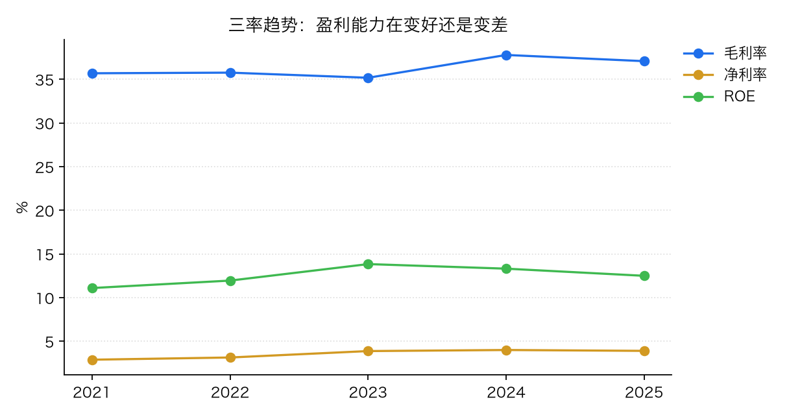

# 中国食品（00506.HK）估值分析

## 一页纸

**一句话：现价 3.23 元站在价值区间 9.49–17.35 元的下方，概率加权中枢 13.37 元，安全边际 75.83%，判定「低估」；但这个数字真正说明的是这套估值与市价不在同一个坐标系里，而不是价格很快会向中枢靠拢。**

**三个数先对齐口径。** 现价 3.23 元是 3.795 港元按 1 港元 = 0.85171 元折成人民币的结果；报表与现金流都以人民币列示，不比到同一币种，市盈率与安全边际都会悄悄混进一层汇率。区间下沿 9.49 元来自熊市情景：消费降级压住装瓶毛利，WACC 9.50%、永续增长 1.50%、显式期增速 1.0%、1.0%、1.5%、1.5%、2.0%；上沿 17.35 元来自牛市情景：品类结构上移带动利润率，WACC 7.80%、永续增长 3.00%、显式期增速 6.5%、5.5%、5.0%、4.0%、3.5%；中间的 13.33 元是基准情景，WACC 8.50%、永续增长 2.50%、增速 4.5%、4.0%、3.5%、3.0%、2.5%，按 25%、50%、25% 加权得中枢 13.37 元。

**最脆弱的一块放在前面：终值占企业价值 75.4%，结论对远期假设高度敏感。** 基准情形下企业价值 364.70 亿元，其中显式期现值 89.57 亿元，终值现值 275.12 亿元——价值的大头来自第五年之后。这有两层含义：一是 13.33 元对 WACC 与永续增长率的组合极其敏感，二是这套模型的产出天然是区间，任何把 13.33 元当成精确值的用法，都超出了它能回答的范围。

**模型与市价之间的差距，是这份估值里信息量最大的一个数。** 基准 DCF 给 13.33 元，现价 3.23 元，反向 DCF 反解出的现价隐含五年均匀增速是 -27.44%——落在搜索区间的下界，是一个边界解，含义是「在 8.50% 折现、2.50% 永续下，现价要求未来五年现金流连续收缩，而模型能表达的收缩幅度到此为止」，真实隐含值只会更低。差距只有三个来源：少数股东在利润里占的份额、装瓶授权与治理结构该打的折、基期现金流被营运资本释放抬高。三者只要有两条成立，13.37 元就不是目标价，而是「假设全对时价值在哪」的坐标。

**基期 20.39 亿元取的是 FY2023–FY2025 三年均值，这个起点比看上去软。** 三年自由现金流 18.02 亿元、21.35 亿元、21.80 亿元（P102、P103），与 FY2021 的 3.60 亿元、FY2022 的 2.59 亿元（P102、P103）之间隔着一次跳台阶。台阶出现在 FY2023，当年资本开支从 8.82 亿元降到 6.27 亿元（P103），不足以解释；到 FY2025 资本开支 10.49 亿元（P103）已经高过 FY2022，自由现金流仍站在 21.80 亿元，抬升只能来自营运资本——应付账款从 4.75 亿元升到 10.35 亿元（P98），应付天数从 13.6 天拉到 27.2 天（P97、P98）。这块贡献不会有第二次。

**从企业价值走到股权价值用两步，方向相反，都不能省。** 企业价值 364.70 亿元加回净负债 -44.81 亿元（负数即净现金，现金及现金等值项目 45.49 亿元占绝大部分，有息负债只剩租赁负债），再扣少数股东权益 36.65 亿元（P99），得股权价值 372.86 亿元，除以 27.97 亿股是每股 13.33 元。漏掉加回净现金会系统性低估，漏掉扣少数股东权益会系统性高估；两笔量级相近、方向相反，恰好抵掉一部分。若只记一条，记扣少数股东的那条：合并报表的规模是完整的，处置权不是。

**「低估」这个判定的真实含义，是差距没有被解释掉，不是价格必然回升。** 75.83% 的安全边际按 13.37 元相对 3.23 元的折价幅度计算，是「相对合理价的折价率」，不是「相对区间下沿 9.49 元还有多少下跌空间」。它挂着三个前提：永续增长 2.50% 成立、少数股东权益按 36.65 亿元一次性扣减就够、基期现金流不含一次性营运资本释放。第三个最容易被推翻——把那部分贡献剔掉，每股价值会明显下移。所以 9.49–17.35 元应当读成「假设成立时价值可能落在哪」，而不是股价的目标区间；要判断它有没有被推翻，盯应付账款 10.35 亿元与合约负债 13.08 亿元（P98）这两项下一年的方向。

| 项目 | 数值 |
| :--- | ---: |
| 当前股价（港元） | 3.79（折合 3.23 元，1 港元 = 0.8517 元） |
| 熊 / 基准 / 牛（元/股） | 9.49 / 13.37 / 17.35 |
| 安全边际（基准，%） | +75.8 |
| 结论 | 低估 |
| 终值占企业价值（%） | 75.4 |
| 现价隐含的均匀增速（%） | -27.4 |

口径提示：

- 终值占企业价值 75.4%，结论对远期假设高度敏感
- 股价按 1 HKD = 0.8517 CNY 折算（欧洲央行参考汇率 2026-11-25（1 港元 = 0.85171 人民币，frankfurter.dev 转发））；汇率变动会直接改变安全边际
- 区间来自三套情景假设，不对应任何单点目标价

证伪条件：

- 经营活动现金净额连续两年低于归母净利润，说明利润质量恶化，基期 FCF 假设过乐观。
- 毛利率连续两年下滑超过 1 个百分点，且不是由原料价格一次性冲击解释，说明装瓶议价能力在削弱。
- 前五大供应商集中度继续上升、最大供应商占比突破 50%，供应链依赖从成本问题变成经营风险。
- 资本开支重新抬头到经营现金净额的 50% 以上，自由现金流被打回 15 亿元以下。
- 出现大额分红超出自由现金流、同时开始举债的情形，说明股东回报不可持续。
- 港元兑人民币汇率波动超过 ±5%，使以港元计价的回报与以人民币计价的经营结果明显背离。

## 能不能估值

**结论：可以做 DCF，但不能只看 DCF。** 装瓶业务的现金流形态与这家公司的资产结构都适合折现，FY2021– FY2025 五个年度也撑得起一个基期；麻烦全在口径上——少数股东权益要扣、港元报价要折、净负债得手工给数。逐条摊开。

**现金流可预测性：过关，但要说清它靠什么成立。** 单一经营分部，收入只来自汽水、果汁、水品类、功能饮料与其他五类（P148），没有跨行业、跨币种的经营块；客户极度分散，前五名客户销售额占比不足 4%（P77），单个客户流失改不了收入曲线。经营活动现金流量净额从 FY2021 的 10.74 亿元走到 FY2025 的 32.29 亿元（P102），五年没有一年为负。折现模型怕的不是年际波动，是结构性为负与无法预测的拐点，这一条不构成障碍。

**脆弱点在采购端，不在销售端。** 前五名供应商采购额占比 58%、最大一家 44%（P77）；浓缩液由品牌方供应，成本底线不由公司定。这不动摇 DCF 的可算性，但决定折现率要给多少——假设表里 WACC 那层加码，针对的正是授权依赖与港股中小市值标的的流动性。

**资本结构是这份估值里最干净的一块：现金多、借款零。** 货币资金 45.49 亿元、资产总计 183.85 亿元、负债合计 78.24 亿元（P98–P99、P199），整张财务状况表没有银行借款科目（P98–P99），负债端几乎全是应付账款、其他应付款与合约负债这类经营性科目。对折现有利的一面是没有大额净负债要在桥上扣；不利的一面是账上现金 45.49 亿元同时说明资本没有回到业务里——市场给折价不是因为算不清，而是因为看不清这些钱会怎么用。

**少数股东权益占权益三成以上，这是口径上最容易错的一处。** 所有者权益 105.61 亿元里归母 68.96 亿元、少数股东 36.65 亿元（P99）；净利润 14.28 亿元里少数股东损益 5.66 亿元、归母 8.62 亿元（P97）。企业价值对应整个集团，股权价值必须扣掉少数股东那一份，否则每股价值系统性偏高。这里没有折中的余地，也不能「按比例」糊过去：合并报表的收入与利润是完整的，股东能处置的只有归母那一半。

**币种错配是第二处必须写清的口径。** 报表以人民币列示（P97），股票在港交所以港元报价；现价 3.795 港元要先按 1 港元 = 0.85171 元折成 3.23 元，才能与人民币现金流相比。汇率不进入经营价值，只影响港股股东的换算结果，但安全边际这个数字会随它动。倍数取自行情接口：市盈率 10.145 倍、市净率 1.297 倍、股息率 4.08%；其中股息率是行情接口口径，现价与每股派息币种不同、自算会失真，每股派息 0.154 元（P157）是人民币，两个口径不能混着用。

**净负债这项派生指标，这家公司天然取不到。** 标准链路是「有息负债减货币资金」，而这张表一笔银行借款都没有：短期借款、长期借款、应付债券在事实层不是 0，是缺口（P98–P99 无对应科目）。取不到就不许补 0——补 0 等于凭现金余额一路加回，每股价值会被系统性抬高。处理办法是在假设表里显式给出净负债 -44.81 亿元，口径是租赁负债减现金及现金等值项目 45.49 亿元（P98），并把它作为一条独立假设披露：这个数不来自抽取，是人工给定的，读者有权知道它的来源与边界。

**历史年度够用，但不够厚。** FY2021–FY2025 五个完整年度，自由现金流 3.60 亿元、2.59 亿元、18.02 亿元、21.35 亿元、21.80 亿元（P102、P103），基期取后三年均值 20.39 亿元。五年足以判断现金流的量级与形态，不足以覆盖一个完整的产能周期，也不足以验证营运资本的一次性释放会不会反向——装瓶线投产的节奏与渠道备货的节奏都比五年长，所以结论按区间给，不按点位给。

**做不到的三样，要提前说清。** 一是分部估值：只有分部收入（汽水 166.85 亿元、果汁 30.28 亿元、水品类 9.29 亿元、功能饮料 3.20 亿元、其他 11.09 亿元，P148），没有分部资产与资本占用，硬拆等于编数字。二是同业对照与历史分位：没有可比公司与历史估值数据源，倍数只能自己跟自己比。三是精确到分的每股价值：终值占企业价值 75.4%，远期假设一挪，结果就换档。

**所以答案是：能估，但三个口径必须一起读。** 正向 DCF 给区间 9.49–17.35 元与中枢 13.37 元；反向 DCF 给「现价 3.23 元要求了 -27.44% 的五年均匀增速」，落在搜索区间下界，属边界解，只能当方向不能当精度；相对估值给落差参照——合理价对应的市盈率 42.0x、市净率 5.37x，而现价是 10.145 倍与 1.297 倍。三者并排，才看得出差距落在假设上：单看 DCF 会读成「严重低估」，单看 10.145 倍市盈率又会觉得不算便宜。任何单一方法给出的结论都不能单独成立，币种口径也必须跟着写清。

## 历史基本面还原

**五年画出一条线，但这条线有两段：FY2021–FY2022 一段，FY2023 之后是另一段。** 分界不在收入，也不在利润，而在现金流——取哪一段做基期，决定后面所有的估值数字。

**收入：一路向上，后三年几乎走平。** 营业收入 197.84 亿元、209.68 亿元、214.46 亿元、214.92 亿元、220.70 亿元（P97），五年没有一年下滑；增量集中在前半段，FY2024 到 FY2025 只从 214.92 亿元走到 220.70 亿元（P97）。

**毛利在爬坡，毛利率在原地打转。** 毛利 70.61 亿元、74.98 亿元、75.44 亿元、81.21 亿元、81.83 亿元（P97），毛利率 35.69%、35.76%、35.18%、37.79%、37.08%（P97）。FY2024 的 37.79% 是五年高点，FY2025 退了一步：营业成本从 133.71 亿元升到 138.87 亿元（P97），跑在收入前面。薄利生意没有缓冲，一个百分点回摆就抵掉前面全部改善。

**利润的路径更陡，也在 FY2025 停住。** 经营溢利 13.98 亿元升到 19.79 亿元（P97），归母净利润 5.72 亿元、6.60 亿元、8.33 亿元、8.61 亿元、8.62 亿元（P97）——前四年在修复，第五年基本没动；净利率 2.89%、3.15%、3.88%、4.00%、3.91%（P97）同步见顶。

**合并利润与归母利润之间隔着一层少数股东。** 净利润 10.75 亿元升到 14.28 亿元（P97），其中少数股东损益 5.02 亿元升到 5.66 亿元（P97），归母只从 5.72 亿元走到 8.62 亿元（P97）；少数股东权益 32.32 亿元、33.42 亿元、36.72 亿元、37.36 亿元、36.65 亿元（P99），对应归母权益 51.57 亿元升到 68.96 亿元（P99）。用合并口径读成长性，曲线会比股东实际所得更陡；估值必须把少数股东权益 36.65 亿元扣掉。

**经营现金流涨得比利润快得多。** 经营活动现金流量净额 10.74 亿元、11.41 亿元、24.30 亿元、28.47 亿元、32.29 亿元（P102），净现比 1.88、1.73、2.92、3.31、3.75（P102、P97）；同期营业收入只从 197.84 亿元走到 220.70 亿元（P97）。这两条速度之间的落差，就是这篇要解释的全部问题。

**资本开支没有系统性下降，自由现金流却在 FY2023 跳了一个台阶。** 资本开支 7.14 亿元、8.82 亿元、6.27 亿元、7.12 亿元、10.49 亿元（P103），资本开支强度 3.61%、4.21%、2.93%、3.31%、4.75%（P103、P97）；自由现金流 3.60 亿元、2.59 亿元、18.02 亿元、21.35 亿元、21.80 亿元（P102、P103）。FY2023 的 6.27 亿元是五年低点，可 FY2025的 10.49 亿元已是五年最高——装瓶线的投产节奏是波浪，单年低点不能外推。

**台阶的成因不是资本开支，是营运资本。** FY2025 的资本开支 10.49 亿元（P103）已经高过 FY2022 的 8.82 亿元（P103），自由现金流仍是 21.80 亿元（P102、P103）；折旧与摊销 8.07 亿元（P101）稳定上行，也解释不了。剩下的是营运资本：应付账款从 4.75 亿元升到 10.35 亿元（P98），应付天数从 13.6 天拉到 27.2 天（P97、P98）；合约负债 15.81 亿元、9.87 亿元、12.84 亿元、8.66 亿元、13.08 亿元（P98）在区间里摆动，FY2022 掉到 9.87 亿元那年正是自由现金流最低的一年。FY2023 之后，占用上下游资金从「随渠道波动」变成了「常态净流入」。

**资本回报稳定在两位数，而且不靠杠杆。** ROE 11.10%、11.95%、13.84%、13.32%、12.50%（P97、P99），ROIC 12.14%、12.94%、13.53%、13.47%、13.08%（P97、P99）；资产负债率 44.69% 降到 42.56%（P199、P98–P99）。ROIC 始终高于 8.50% 的折现率，这是永续增长给到 2.50% 仍站得住的基础；但 FY2025 的 13.08% 比高点低，方向已经变了。

**周转天数是五年里最实在的改善。** 存货天数 55.5 天压到 42.8 天、应收天数 6.0 天到 5.5 天、应付天数 13.6 天拉到 27.2 天（P97、P98）；存货 19.33 亿元降到 16.30 亿元（P98）。存货与应收的改善是效率；应付的拉长是把供应商的钱用起来，两者可持续性不同。

**资产表在变厚，厚在现金上。** 资产总计 151.68 亿元走到 183.85 亿元（P199），货币资金 15.92 亿元升到 45.49 亿元（P98），负债合计 67.79 亿元升到 78.24 亿元（P199），所有者权益 83.89 亿元升到 105.61 亿元（P99）。筹资活动现金流量净额 -16.30 亿元（P103），其中分配股利 4.28 亿元（P103）、偿还债务 0.53 亿元（P103），报告期没有取得借款。不借钱、还还债、现金越攒越多，资本配置的取向是留安全垫，不是扩产能。

**基期 20.39 亿元是乐观还是公允，答案就在营运资本那一段。** 三年均值能削掉资本开支节奏的干扰—— FY2023 的低开支与 FY2025 的高开支互相抵消——却削不掉营运资本这条线。把 FY2023 之后应付账款与合约负债带来的净流入从自由现金流里剔出去，现金流会回到更接近 FY2021–FY2022 的量级，DCF 的每股价值也会明显下移。这是历史还原里最需要读者自己判断的一处：相信应付账期的拉长是永久的结构变化，20.39 亿元偏公允；相信它只是一次性占用，20.39 亿元就偏乐观，13.37 元的中枢也要跟着下修。

**下一份年报先看三个数。** 应付天数（P97、P98）是否停止上行、合约负债（P98）是否回落、经营活动现金流量净额（P102）是否仍在 32.29 亿元附近。三项同时向好说明台阶来自真实经营；应付天数继续拉长而毛利率同时下滑，则说明在用供应商的钱补贴促销，这条路有尽头。

| 项目 | 2021 | 2022 | 2023 | 2024 | 2025 |
| :--- | ---: | ---: | ---: | ---: | ---: |
| 营业收入 | 197.84 亿元 | 209.68 亿元 | 214.46 亿元 | 214.92 亿元 | 220.70 亿元 |
| 归母净利润 | 5.72 亿元 | 6.60 亿元 | 8.33 亿元 | 8.61 亿元 | 8.62 亿元 |
| ROIC | 12.14% | 12.94% | 13.53% | 13.47% | 13.08% |
| 自由现金流 | 3.60 亿元 | 2.59 亿元 | 18.02 亿元 | 21.35 亿元 | 21.80 亿元 |
| 资本开支强度 | 3.61% | 4.21% | 2.93% | 3.31% | 4.75% |

*数据来源：公司年度报告原文（页码见正文引用），金额为合并报表口径。*

## 三法交叉

三条路径问的是三个不同的问题：现金流折现问「按这套假设它值多少」，反向 DCF 问「现价已经替市场假设了什么」，相对估值问「现价与现金流结论在倍数上是否自相矛盾」。三者的精度、依赖的信息都不同，不能互相替代，也不该投票取多数。分工留在最后一段说。

**一、现金流折现：基准情景每股 13.33 元。** 基期自由现金流取 FY2023–FY2025 均值 20.39 亿元，显式期五年，增速 4.5% → 4.0% → 3.5% → 3.0% → 2.5%，折现率 8.50%，永续增长率 2.50%。桥接如下。

| 项目 | 金额 |
| :--- | ---: |
| 显式期现值 | 89.57 亿元 |
| 终值现值 | 275.12 亿元 |
| 企业价值 | 364.70 亿元 |
| 加：净负债（负数为净现金） | −44.81 亿元 |
| 减：少数股东权益 | 36.65 亿元 |
| 股权价值 | 372.86 亿元 |
| 每股价值（总股本 27.97 亿股） | 13.33 元 |

**这张表的重心不在前五年。** 终值现值 275.12 亿元占企业价值 364.70 亿元的 75.4%，显式期五年只补上不到四分之一。13.33 元与其说是「未来五年现金流折出来的价」，不如说是「第六年以后那段永续现金流的价」。永续增长率 2.50% 与折现率 8.50% 因此比任何一年历史增速都更关键——DCF 给出的绝对区间，实质是一条关于远期假设的区间。

**桥接那两行是这门生意最容易被读错的地方。** 净负债是负数，−44.81 亿元：整张财务状况表没有银行借款科目（P98–P99），有息负债只剩租赁负债，现金及等价物 45.49 亿元（P98），把净现金加回企业价值，等于承认这门生意的价值里有一块是账上的钱。少数股东权益 36.65 亿元（P99）又要从企业价值里全额扣掉，它占所有者权益 105.61 亿元（P99）的三成半。一加一减之后，股权价值 372.86 亿元反而高过企业价值 364.70 亿元——净现金的分量大于少数股东的份额，这是净现金公司的典型形状，也是读这家公司倍数时最容易被忽略的一处。

**二、反向 DCF：现价 3.23 元隐含五年均匀增速 −27.44%。** 折现率 8.50%、永续增长率 2.50%、五年显式期全部固定，反解出让每股价值等于现价的增速，得到 −27.44%。这个解贴着搜索下界−30%，属于边界解：它表达的是「要让现价等于估值，未来五年自由现金流必须逐年大幅萎缩」，而这样的路径在现实里没有对应物。所以这个数不能当成增速预测引用，只能定性读作一句话—— **现价没有为任何增长付费，市场给的是零增长甚至负增长的定价。**

**三、相对估值：PE 10.15 倍、PB 1.30 倍、股息率 4.08%。** 三项都是现价口径的读数。同一套假设给出的合理价 13.37 元，对应 PE 42.00 倍、PB 5.37 倍。这两个倍数不是目标倍数，而是把现金流结论翻译成市场语言之后的对照值：现价的 10.15 倍 PE 是「稳态薄利、几乎不增长」的定价，42.00 倍是「现金流被长期低估」的定价。股息率 4.08% 站在同一侧——每股派息 0.154 元（P157）被现价折成了相当高的静态回报，而市场并不打算为增长付钱。

**三项倍数的用法只有一条：确认缺口的方向。** 若现价倍数与合理价倍数只差一两成，那还可能是参数取值不同造成的；差到这个程度，就不是倍数口径能解释的了，只能回到现金流假设上找原因。倍数在这里的作用是把「差距有多大」摆出来，不是判断谁对。

**三条路径各自的短处，写在明面上。** 第一，DCF 的结论由终值主导（占 75.4%），它对第六年以后那段永续假设的敏感度，远高于对任何一年历史数据的敏感度。第二，反向 DCF 的解触到边界，只能定性，不能当增速预测引用，也无法回答「差多少才算合理」。第三，相对估值的同业中位数与自身历史分位都是空的——没有可比公司清单，也没有估值序列——所以这三项倍数只能纵向与自己的现金流结论对照，不能横向与同行比贵贱。「十倍在港股饮料同业里算不算便宜」这个问题，这里没有数据回答，也不回答。

**三法是否一致：方向一致，落点不一致。** DCF 给出 9.49–17.35 元的区间与 13.37 元的中枢；反向 DCF 说现价连零增长都不要求；相对估值说现价的倍数体系与合理价的倍数体系不在同一个故事里。三者没有一处互相矛盾——不存在「现金流说贵、倍数说便宜」这种情形——但也没有一处互相加固。三套方法用三种语言说了同一件事：现价的定价结构与这套现金流假设对不上。

**不一致时以 DCF 为主。** 以 DCF 的区间作结论，是因为它同时给出方向与幅度，且每条参数都能被逐条复核；反向 DCF 只负责定义「现价假设了什么」，供结论那一节解释缺口时用；相对估值只在自己的框架里做一致性检查，不越位去定价。真正需要解释的不是三法之间的差异，而是三法与现价之间那段距离——三条路径没有一条支持现价的定价，这段距离本身才是结论。

### 反向 DCF：现价已经假设了什么

- 预测期 5 年，WACC 8.5%，永续增长 2.5%
- 现价隐含的自由现金流均匀增速：-27.4%

### 相对估值

| 指标 | 当前 | 同业中位 | 自身历史分位 | 说明 |
| :--- | ---: | ---: | ---: | :--- |
| PE(TTM) | 10.14 | — | — | 情景加权合理价 13.37 元对应 PE 42.0x |
| PB | 1.30 | — | — | 情景加权合理价对应 PB 5.37x |
| 股息率 | 4.08 | — | — | 行情接口口径：现价与每股派息币种不同，自算会失真，故直接采用行情接口值 |

## 假设与敏感性

这套估值只有八条假设，每条都能一句话说清「为什么取这个值」，也都能一句话说清「错了会错在哪一边」。按假设表的顺序过一遍，最后交代敏感性网格怎么读。

**基期自由现金流 20.39 亿元（FY2023–FY2025 均值）。** 三个年度分别是 18.02 亿元、21.35 亿元、21.80 亿元（P102、P103），算法是经营活动现金流量净额减购建物业厂房设备支出。取均值而不是最新一年，是因为装瓶业的资本开支随生产线投产节奏起伏：FY2025 的资本开支 10.49 亿元（P103）已经高过 FY2022 的 8.82 亿元（P103），单年值会把基期抬到不可持续的高度。**错在哪一边：** 错在高估这一边，而且最难被察觉——这三年现金流是在应付账款从 4.75 亿元涨到 10.35 亿元（P98）、应付天数从 13.6 天拉到 27.2 天（P97、P98）的过程里挤出来的，释放只发生一次。

**净负债 −44.81 亿元，负数即净现金。** 口径是租赁负债减现金及等价物，两端分别落在财务状况表的租赁负债行与现金行（P98–P99）。这条要单独说明方法——报表没有为它准备一行，整张财务状况表既无短期借款也无长期借款科目（P98–P99），不存在一条「有息负债」可以照抄；缺失不等于零，也不该拿一个估出来的数悄悄填上。所以它显式写在假设表里，标明口径与页码（P98–P99），可以被逐条复核。**错在哪一边：** 错在高估净现金这一边。若现金及等价物 45.49亿元（P98）里有受限部分不能动用，或租赁负债之外还有未入表的融资安排，净现金就算多了，每股价值系统性偏高。方向明确、幅度有限——它一次性在企业价值上加减，不参与增长故事。

**总股本 27.97 亿股。** 它只干一件事：把股权价值 372.86 亿元折成每股价值 13.33 元。快照日没有回购注销、没有增发，所以视为不变。**错在哪一边：** 两边都可能错，方向取决于资本动作——注销式回购或私有化会让股数下降，同样的股权价值对应更高的每股价值；增发则相反。这条假设最容易过期：每次重算都要用最新股本核对一遍，不要沿用上一期。

**折现率 8.50%。** 构造是自下而上的：无风险利率取 2.0% 附近，股权风险溢价 6.0%，装瓶业务现金流稳定、贝塔按 0.8 计，权益成本落在 6.8%；净现金结构下债务项几乎为零，加权之后还要再加一层——港股中小市值标的的流动性折价，以及单一客户与有期限授权的依赖。**错在哪一边：** 这是全表最危险的一条，因为终值占企业价值 75.4%，而折现率同时作用在显式期与终值上。它动 50bp就足以让每股价值换一档；把 8.50% 当成精确值来引用，是误用。

**永续增长率 2.50%。** 软饮料人均消费量仍有提升空间，但人口与渠道渗透已经过了高速期；2.50% 里包含提价与品类结构升级，不给份额扩张的额外加成。**错在哪一边：** 高估这一边更容易被忽略。装瓶业务的量由渠道密度与授权区域决定，长期名义增长要落在 2.50% 上，需要每年都完成结构升级；做不到的时候，2.50% 与 1.50% 之间的差别会直接从终值上扣下去。

**显式期首年增速 4.5%，五年路径 4.5% → 4.0% → 3.5% → 3.0% → 2.5%。** 依据是收入端与现金端的落差：营业收入从 214.92 亿元到 220.70 亿元（P97），经营活动现金流量净额从 28.47 亿元到32.29 亿元（P102）——现金端走得比收入端快，渠道效率与营运资本改善确实存在；但装瓶毛利率受瓶坯、糖价与产品结构三重挤压，毛利率一年内从 37.79% 掉到 37.08%（P97），说明结构改善还没抵消成本与促销压力，路径因此逐年递减回永续增长率。**错在哪一边：** 错在高估这一边，但这条假设失败的形式不是「调低 1 个百分点」，而是「换成熊市情景」——增速 1.0% 起步，折现率抬到9.50%，永续压到 1.50%，每股价值换到 9.49 元。

**估值基准价 3.23 元。** 快照日港股收盘 3.795 港元，按 0.85171 折成人民币。它只进两个地方：安全边际与反向 DCF 的反解，不参与任何现金流假设，也不代表目标价。**错在哪一边：** 价格变动不改变合理区间，只改变「现价站在区间什么位置」；拿现价去倒推假设，是最常见的误用。

**港元兑人民币汇率 0.85171。** 上一交易日欧洲央行参考价，用途单一：把港元市价折到与报表同一币种。**错在哪一边：** 汇率不在这套假设的判断范围里，但它改的是股东回报的换算系数——报表利润不动，汇率变 5% 就能把安全边际吃掉一格。这一条不解释估值，只解释「人民币口径便宜」与「港元口径赚钱」为什么可以同时成立。

**敏感性网格怎么读。** 横轴折现率 7.50%–9.50%，纵轴永续增长 1.50%–3.50%，各五档，二十五个格子，每格都是同一套五年路径下只换这两条参数的读数。

**横轴每走一格（50bp），每股价值换一档。** 永续增长固定在 2.50% 时，折现率从 7.50% 走到9.50%，每股价值依次是 15.94 元、14.52 元、13.33 元、12.32 元、11.46 元；折现率固定在 8.50%、永续增长从 1.50% 走到 3.50%，依次是 11.84 元、12.53 元、13.33 元、14.28 元、15.41 元。两行摆在一起，横轴摆幅明显大于纵轴：**结论对折现率比对永续增长率更敏感**，因为折现率同时压显式期与终值两段，永续增长只压终值那一段。

**四角给出边界。** 折现率 7.50%、永续增长 3.50% 是全格最高 19.18 元；折现率 9.50%、永续增长1.50% 是最低 10.39 元；另外两角 13.78 元与 12.90 元。二十五个格子里没有一格接近现价 3.23 元。

**中心格就是基准价。** 折现率 8.50%、永续增长 2.50% 那一格读到 13.33 元，与基准情景的13.33 元完全重合——两处用的是同一座桥：企业价值加净现金、再扣少数股东权益 36.65 亿元（P99）、最后除以 27.97 亿股。把网格和基准价并排放在一起读是对的，读者可以随手验算中心格。

**网格回答不了的，是起点。** 敏感性不动基期自由现金流：基期 20.39 亿元换个数，二十五个格子整体平移，这是这套估值最大的单一风险，而它不在网格里。

| 编号 | 假设 | 取值 | 依据 | 理由 |
| :--- | :--- | :--- | :--- | :--- |
| A-01 | 基期自由现金流（FY2023–FY2025 均值） | 20.39亿元 | D-FY2023-fcf、D-FY2024-fcf、D-FY2025-fcf | 经营活动现金净额减购建物业厂房设备支出：FY2023 18.02 亿、FY2024 21.35 亿、 FY2025 21.80 亿，三年均值 20.39 亿。取均值而不是最新一年，是因为装瓶业务的 资本开支随生产线投产节奏起伏，单年会误导基期。 |
| A-02 | 净负债（租赁负债 − 现金及等价物，FY2025） | -44.81亿元 | E-012 | 负数即净现金。公司无银行借款，有息负债只剩租赁负债（流动 3,958.7 万 + 非流动 2,868.8 万，合计 0.68 亿），现金及等价物 45.49 亿。把租赁负债计入是必要的： 新租赁准则下它就是有息负债，忽略它会系统性高估股权价值。 |
| A-03 | 总股本 | 27.97亿股 | Q-shares_total | 用于把股权价值折成每股价值；无回购注销与增发时视为不变。 |
| A-04 | 折现率 WACC | 8.5% | 方法设定（WACC = 权益成本 × 权益权重 + 税后债务成本 × 债务权重） | 人民币现金流折人民币：无风险利率取 2.0% 附近，股权风险溢价 6.0%，装瓶业务现金流 稳定、贝塔约 0.8，权益成本约 6.8%；净现金结构下债务项几乎为零，但港股中小市值 标的流动性折价与单一客户依赖（可口可乐授权）要求再加一层，故取 8.5%。 |
| A-05 | 永续增长率 | 2.5% | 方法设定（长期通胀 + 行业量增的保守估计） | 软饮料人均消费量仍有提升空间，但人口与渠道渗透已过高速期，给长期名义增长 2.5% 已包含提价与品类结构升级，不给份额扩张外的额外加成。 |
| A-06 | 显式期自由现金流增速（首年） | 4.5% | E-061、E-018、D-FY2025-roic | 五年路径 4.5% → 4.0% → 3.5% → 3.0% → 2.5%，递减到永续增长率。依据是 FY2025 收入增长 2.7% 而经营现金净额增长 13.4%，渠道效率与营运资本的改善快于收入端， 但装瓶毛利率受瓶坯、糖价与产品结构约束，不宜线性外推。 |
| A-07 | 估值基准价（人民币） | 3.23元 | Q-price | 快照日港股收盘 3.795 港元，按 0.85171 折成人民币 3.23 元。仅用于计算安全边际与 反向 DCF，不代表目标价。 |
| A-08 | 港元兑人民币汇率 | 0.85171元/港元 | 欧洲央行参考汇率 2026-11-25 | 上一交易日欧洲央行参考价。用它把市价折到与报表同一币种；汇率是外部变量， 不在本报告的能力范围内做方向判断，只在结论里提示它对港元回报的影响。 |

### 敏感性：WACC × 永续增长（元/股）

| 永续增长 \ WACC | 7.50% | 8.00% | 8.50% | 9.00% | 9.50% |
| :--- | ---: | ---: | ---: | ---: | ---: |
| 1.50% | 13.78 | 12.74 | 11.84 | 11.07 | 10.39 |
| 2.00% | 14.76 | 13.55 | 12.53 | 11.65 | 10.89 |
| 2.50% | 15.94 | 14.52 | 13.33 | 12.32 | 11.46 |
| 3.00% | 17.38 | 15.67 | 14.28 | 13.11 | 12.12 |
| 3.50% | 19.18 | 17.09 | 15.41 | 14.04 | 12.90 |

基准情形每股价值 13.33 元；显式期现值 89.57 亿元，终值现值 275.12 亿元。

## 情景与概率加权

**三套情景是三组可以分别被验证的假设，不是「乐观、中性、悲观」的修辞。** 每一套都换了增速路径，同时换了折现率与永续增长率，所以差别不在「同一个模型换个参数」，而在「三条不同的生意故事」。哪一条成立，取决于报表上能看到的几件事。

**熊市：消费降级压装瓶毛利，每股 9.49 元，概率 25%。** 增速路径 1.0% → 1.0% → 1.5% → 1.5% → 2.0%，折现率由基准的 8.50% 上调到 9.50%，永续增长压到 1.50%；显式期现值 81.03 亿元，终值现值 176.17 亿元。它对应的现实情形是价格战延续、渠道库存高企，装瓶量与单价同时受压，自由现金流基本走平，能见度下降又要求更高的风险补偿。报表上的痕迹会是：毛利率 37.08%（P97）继续下行，分销及销售支出 59.49 亿元（P97）不肯让，汽水这条 166.85 亿元（P148）的主干既不能提价也丢不起量。**这一情景的关键不是它有多低，而是它仍远高于现价**——熊市不是「跌到现价」的情景，是「跌破基准」的情景。

**基准：量增与效率改善并行，每股 13.33 元，概率 50%。** 增速路径 4.5% → 4.0% → 3.5% → 3.0% → 2.5%，折现率 8.50%，永续增长 2.50%；显式期现值 89.57 亿元，终值现值 275.12 亿元。它对应的是「什么都不发生」：收入回到中低个位数增长，经营现金流维持在 32.29 亿元（P102）这个量级，资本开支随产能饱和回落，自由现金流温和扩张。果汁 30.28 亿元、水品类 9.29 亿元（P148）慢慢长大，汽水被缓慢稀释，毛利率守在 37.08%（P97）附近。这一套拿到一半权重，正因为它假设的事情最少——不外推结构升级，也不假设需求崩塌。

**牛市：品类结构上移抬高利润率，每股 17.35 元，概率 25%。** 增速路径 6.5% → 5.5% → 5.0% → 4.0% → 3.5%，折现率降到 7.80%，永续增长给到 3.00%；显式期现值 95.38 亿元，终值现值 381.69亿元。它对应的现实情形是功能饮料与即饮咖啡这类高价品类占比提升，毛利率随之上行，费用率被规模摊薄，自由现金流增速快于收入。支点落在结构而不是总量上：功能饮料 3.20 亿元、水品类9.29 亿元（P148）的基数都小，只要增速快于主干，占比就能往上走。反对它的证据同样清楚——毛利率从 37.79% 掉到 37.08%（P97），说明这条路一年前还没有走通。

**25/50/25 的分配理由，说到底是「触发条件有多快」。** 基准拿一半，因为它是唯一不需要新增证据的情景。熊市与牛市各四分之一，而没有按习惯给递减的尾部权重：下行的触发条件是促销强度与原料价格，这两件事在每个季度的毛利与销售费用里都能看到，反应快；上行的触发条件是品类结构，慢，而且要连着几个报告期才能确认。可观测且更快的风险，理应拿到与上行同等的权重，把它压到尾部反而会让这份已经很宽的区间进一步向乐观侧偏。

**加权中枢 13.37 元为什么不等于基准情景的 13.33 元。** 概率对称，期望值却不在中间那条故事上，原因是两侧偏离不对称：牛市 17.35 元相对基准 13.33 元高出的幅度，大于熊市 9.49 元相对基准低走的幅度。上行那一侧拉得更远，期望值就被拉上去一点。所以 13.37 元的真实含义不是「比基准更乐观」，而是「结论对上行尾部更敏感」：若认为牛市拿不到 25%，中枢会立刻回落到接近 13.33 元；若认为熊市概率被低估，中枢则往 9.49 元靠。

**区间 9.49–17.35 元的宽度说明什么。** 它不是误差带，而是三套增长故事之间的价差：从「量价齐跌、现金流走平」到「结构升级、利润率上台阶」，中间隔着的是整套故事，不是几个百分点的增速差别。换句话说，这门生意的价值对「量能不能增长、品类能不能上移」高度敏感，对一两年的成本波动反而没那么敏感。宽度还有第二个含义：它提醒读者不要用单点目标价——把区间收窄成一个加减百分比，等于假装上面那两个问题已经有了答案。

**三套情景的排序不依赖现价。** 9.49 元、13.33 元、17.35 元的差距来自增速路径与折现率，不是来自股价；现价 3.23 元只做一件事，就是标出这套区间与市场定价之间的距离。三套情景没有一套接近现价，这个事实本身就是下一节要解释的东西——它不在情景之内，而在情景之外。

| 情景 | 关键假设 | 每股价值（元） | 概率 | 说明 |
| :--- | :--- | :--- | ---: | :--- |
| 熊市：消费降级压装瓶毛利 | 显式期增速 1.0%、1.0%、1.5%、1.5%、2.0%；WACC 9.50%；永续增长 1.50%；显式期现值 81.03 亿元；终值现值 176.17 亿元 | 9.49 | 25% | 软饮料价格战延续、渠道库存高企，装瓶量与单价同时受压；FCF 基本走平，折现率 上调 100bp 反映可见度下降。此情景下现价已充分，安全边际消失。 |
| 基准：量增与效率改善并行 | 显式期增速 4.5%、4.0%、3.5%、3.0%、2.5%；WACC 8.50%；永续增长 2.50%；显式期现值 89.57 亿元；终值现值 275.12 亿元 | 13.33 | 50% | 收入回到中低个位数增长，经营现金流维持 22 亿元上下，资本开支随产能饱和回落， FCF 温和扩张。 |
| 牛市：品类结构上移带动利润率 | 显式期增速 6.5%、5.5%、5.0%、4.0%、3.5%；WACC 7.80%；永续增长 3.00%；显式期现值 95.38 亿元；终值现值 381.69 亿元 | 17.35 | 25% | 功能饮料与即饮咖啡等高价品类占比提升，毛利率随之上行，费用率被规模摊薄， FCF 增速快于收入；折现率下调 70bp。 |

## 结论与纪律

**结论：低估。** 合理区间 9.49–17.35 元，概率加权后的中枢 13.37 元，现价 3.23 元，安全边际75.83%。三个数放在一起只说得出一句话：现价与价值之间的距离，大到不像一次定价误差。

**安全边际的口径先写明，否则容易被读成别的东西。** 75.83% 是加权中枢相对现价的折价率—— 13.37 元与 3.23 元之差除以 13.37 元，含义是「按这套假设，现价比中枢价便宜 75.83%」。它**不是**「相对区间下沿 9.49 元的安全垫」：换成那个口径，同一个价格会显得便宜得少一些，而那是另一句话，也更容易被误读成「跌到 9.49 元还有垫子可踩」。

**这个幅度不是建模误差，它大到必须解释。** 折现率动 50bp、永续增长动半个百分点、基期现金流换一年，在敏感性网格里都只挪动一档，挪不出 75.83%。能把结论推动到这个量级的东西，必须是一个结构性判断，而不是一个参数取值。候选只有三个，下面逐个过。

**解释一：市场对授权续期与少数股东结构打了极深的折价。** 装瓶权有期限、按区域划定，浓缩液由最大供应商供应——前五名供应商合计占采购 58%，其中最大一家 44%（P77）；少数股东损益5.66 亿元（P97）占净利润 14.28 亿元（P97）的四成，少数股东权益 36.65 亿元（P99）占所有者权益 105.61 亿元（P99）的三成半。「这门生意的边界与利润归属都不完全由公司自己决定」，市场若据此给一个长期折价，方向是成立的。

**解释二：基期现金流被营运资本释放抬高。** 净现比 1.88、1.73、2.92、3.31、3.75（P102、P97），经营现金流是归母净利润的三倍多；应付账款从 4.75 亿元升到 10.35 亿元（P98），应付天数从13.6 天拉到 27.2 天（P97、P98），合同负债 13.08 亿元（P98）随渠道备货摆动。这块释放只发生一次。若把它当成永久盈利能力，基期 20.39 亿元就偏高，而基期一偏高，显式期与终值会同时虚高。

**解释三：港股中小市值流动性折价。** 市值小、成交薄、无有息负债，现金 45.49 亿元（P98）躺在账上不分出去，每股派息 0.154 元（P157）对应的股息率 4.08%。这类标的在港股通常拿不到完整估值，折价可以持续很多年，而且不需要任何坏消息来维持。

**三个解释里，倾向第二个：它能被定位、被量化、也被推翻。** 应付天数 27.2 天（P97、P98）已经贴近这类生意的上限，再拉长取决于供应商的容忍度，而采购端恰恰是最脆弱的一环（P77）。反过来验证：若基期回到 FY2022 的 2.59 亿元（P102、P103）那个量级，整套估值会掉到现价以下，不需要折现率或永续假设配合——在 75.83% 的差距里，基期现金流是最有解释力的单一变量。

**第一个解释方向成立，但它解释的是折价为什么存在，不是折价为什么这么大。** 授权与合资结构是常态，不是新闻；把它当成唯一原因，等于承认市场愿意对同一件常态事实给出任意深的折价。**第三个解释压得动倍数、压不动现金流**——它能解释 10.15 倍 PE 与 1.30 倍 PB 为什么偏在低位，解释不了13.37 元与 3.23 元之间的落差。

**六条证伪条件，每条都带观测口径与触发后的动作。** 任一条成立，结论要重算，而不是微调参数。

1. **经营活动现金净额连续两年低于归母净利润。** 观测口径：经营活动现金流量净额（P102）对
归母净利润（P97），FY2025 是 32.29 亿元对 8.62 亿元，离阈值还很远。触发后怎么办：利润质量恶化意味着基期假设过乐观，改用更早年份或对基期直接打折重算，只调折现率是自欺。
2. **毛利率连续两年下滑超过 1 个百分点，且不是原料价格一次性冲击。** 观测口径：毛利率从
FY2024 的 37.79% 到 FY2025 的 37.08%（P97）。触发后怎么办：装瓶议价能力在削弱，基准情景整体换成熊市——增速 1.0% 起步、折现率 9.50%、永续 1.50%，中枢下移到 9.49 元。
3. **前五大供应商集中度继续上升、最大一家突破 50%。** 观测口径：前五名供应商采购占比 58%、
最大一家 44%（P77）。触发后怎么办：供应链依赖从成本问题变成经营风险，永续增长这条假设不再适用，估值重心要从终值移回显式期，区间上沿同步下调。
4. **资本开支重新抬头到经营现金净额的 50% 以上。** 观测口径：资本开支 10.49 亿元（P103）对
经营活动现金流量净额 32.29 亿元（P102），以及在建工程与购建支出的附注。触发后怎么办：自由现金流被打回 15 亿元以下，基期 20.39 亿元失效，DCF 的分子要整体重建。
5. **大额分红超出自由现金流，同时开始举债。** 观测口径：分配股利 4.28 亿元（P103）对自由
现金流 21.80 亿元（P102、P103），以及资产负债表上是否出现借款科目（P98–P99 目前没有）。触发后怎么办：股东回报不可持续，净现金这条桥同时作废，净负债要重新给数。
6. **港元兑人民币汇率波动超过 ±5%。** 观测口径：0.85171 这个折算率。触发后怎么办：以港元计价
的回报与以人民币计价的经营结果显著背离，结论要按币种拆成两句话，安全边际重算一遍。

**最容易被忽略的一条是第一条。** 它不需要任何坏消息，只需要现金流的形态回到「跟利润同步」，就足以让基期 20.39 亿元失去依据——而这一条在下一个年报窗口就能看到，不需要等三五年。

**最后是纪律。** 区间下沿 9.49 元仍高于现价 3.23 元，这个组合不能读成买入信号，只能读成「市场给出的价格与这套假设之间有一个尚未被解释的缺口」。解释它的工作——核对授权期限、核对应付账款的可持续性、核对少数股东结构的稳定性——都还没有做完，缺口也还没有被量化到可以下注的程度。在这一点上，正确的动作是继续研究，而不是买入。

- 基准每股价值 13.37 元，区间 9.49–17.35 元，当前价 3.79 港元（折合 3.23 元）。
- 安全边际 +75.8%。

推翻结论的条件：

- 经营活动现金净额连续两年低于归母净利润，说明利润质量恶化，基期 FCF 假设过乐观。
- 毛利率连续两年下滑超过 1 个百分点，且不是由原料价格一次性冲击解释，说明装瓶议价能力在削弱。
- 前五大供应商集中度继续上升、最大供应商占比突破 50%，供应链依赖从成本问题变成经营风险。
- 资本开支重新抬头到经营现金净额的 50% 以上，自由现金流被打回 15 亿元以下。
- 出现大额分红超出自由现金流、同时开始举债的情形，说明股东回报不可持续。
- 港元兑人民币汇率波动超过 ±5%，使以港元计价的回报与以人民币计价的经营结果明显背离。
