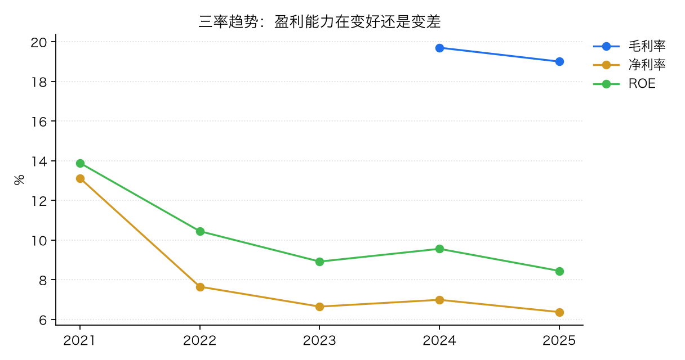
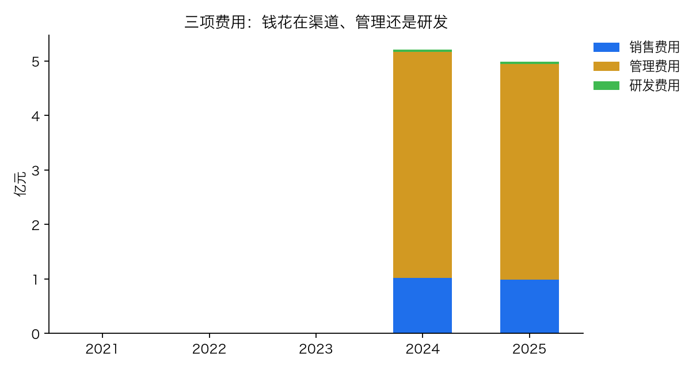
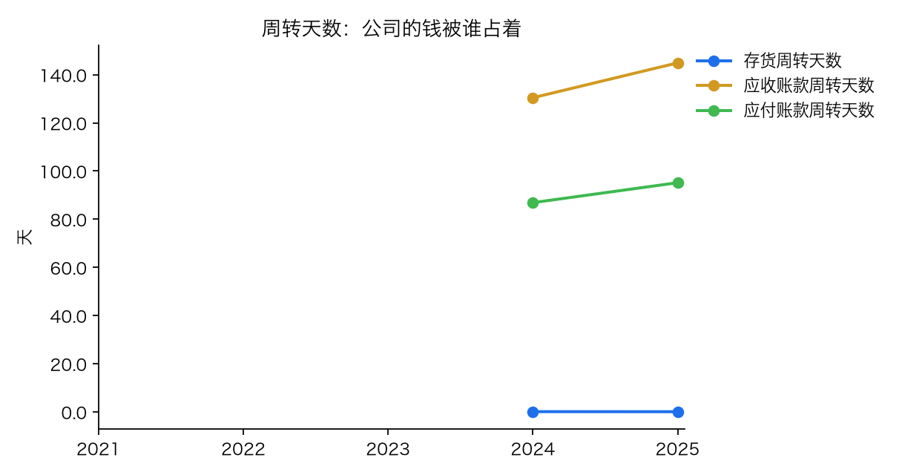
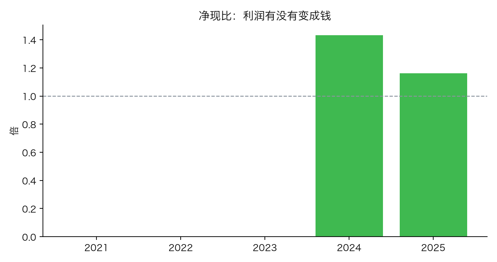

# 永升服务（01995.HK）2025 年报深度解读

## 一页纸

**收入 68.66 亿元只换来 4.37 亿元归母净利润，经营现金流同时从 6.85 亿元降到 5.09 亿元，收入、利润与现金一年里朝同一个方向走。** 收入同比只增 0.37%（P26）；归属于母公司股东的净利润 4.37 亿元、比上年 4.78 亿元少 8.48%（P92）；经营活动现金流净额 5.09 亿元、比上年少 25.73%（P97）。收入停在原地、利润退一格、现金跟着退，三者同向说明这不是某一笔费用偶发，而是赚钱效率在同一时间被压了几层。

**净利率 8.01%、归母口径 6.37%、净现比 1.16 倍，利润还在赚，但赚得更薄，收现也开始跟不上利润。** 合并净利润 5.50 亿元（P92）除以收入 68.66 亿元是 8.01%，按归母 4.37 亿元算是 6.37%；经营现金流 5.09 亿元已经低于合并净利润，净现比（经营现金流除以归母净利润）从上年 1.43 倍退到 1.16 倍（P97、P92），换用合并净利润 5.50 亿元做分母则不足一倍。压力落在回款上：应收账款 27.26 亿元（P93），周转天数由 130.45 天拉长到 144.93 天（P93、P92），信用减值计提比上年多出四成半（P92）——利润不是假的，但它换回的现金比以前少。

**四条业务线只有一条在长：物业管理服务 54.51 亿元、增 7.07%，社区增值 7.96 亿元、降 7.67%，对非业主增值 3.82 亿元、降 36.21%，城市服务 2.33 亿元、比上年 2.86 亿元少（P136、P10）。** 合约面积与在管面积的同比增速都在 1% 以内（P16），物管收入跑在面积前面，增量来自单位面积收入而不是接管更多项目；退得最急的是与开发商开发节奏绑定的前端服务，收入结构正在向刚需物业费收窄。

**五个数串起来看这家公司：收入 68.66 亿元、归母净利润 4.37 亿元、经营现金流 5.09 亿元、合并净利率 8.01%、应收账款 27.26 亿元（P26、P92、P97、P93）。** 前三个说它一年做出多少、留下多少、收回多少，第四个说每 100 元收入留下 8.01 元净利，第五个说还有 27.26 亿元挂在外面没收回来——这个数比全年归母净利润多出五倍以上，是这份报表最需要盯住的一格。

| 指标 | 2021 | 2022 | 2023 | 2024 | 2025 |
| :--- | ---: | ---: | ---: | ---: | ---: |
| 营业收入（亿元） | 47.03 | 62.76 | 65.37 | 68.41 | 68.66 |
| 归母净利润（亿元） | 6.17 | 4.80 | 4.34 | 4.78 | 4.37 |
| 毛利率 | —（不可得） | —（不可得） | —（不可得） | 19.70% | 19.00% |
| 净利率 | 13.12% | 7.65% | 6.65% | 6.99% | 6.37% |
| ROE | 13.88% | 10.45% | 8.92% | 9.56% | 8.45% |
| ROIC | —（不可得） | —（不可得） | —（不可得） | —（不可得） | —（不可得） |
| 经营活动现金流（亿元） | —（不可得） | —（不可得） | —（不可得） | 6.85 | 5.09 |
| 自由现金流（亿元） | —（不可得） | —（不可得） | —（不可得） | 6.61 | 4.78 |
| 净现比 | —（不可得） | —（不可得） | —（不可得） | 1.43 倍 | 1.16 倍 |
| 资产负债率 | 35.43% | 39.92% | 40.95% | 41.56% | 41.60% |
| 分红率 | —（不可得） | —（不可得） | —（不可得） | 68.89% | 58.58% |

红旗判定：清单共 32 项，命中 2 项，数据不足 11 项，其中 12 项已翻原文核实（数据不足不等于没问题）。

| 严重度 | 红旗 | 状态 | 观测值 |
| :--- | :--- | :--- | :--- |
| 高 | 其他应收款异常膨胀 | 命中 | 押金及其他应收款（附注 37 口径）账面总值 1,064,031 千元、减值准备 64,266 千元，净额 999,765 千元，其中独家销售代表协议按金 705,372 千元，占资产总计一成以上。这笔钱的用途是替关联方收取停车场、储藏室与零售店铺的销售款，售出后才退还，无抵押、免息，回收取决于车位与商铺的去化进度；预计损失率只有 4.3%，低于应收账款整体的一成二，风险被低估。（P186、P188） |
| 高 | 控股股东高比例质押 | 命中 | 控股股东层面的股份已被用于融资担保安排：Spectron（旭辉控股旗下）就 406,820,000 股（占已发行股份 23.54%）向 LMR 授出预付认购期权，并「作为信贷增强」把该批股份转让给 LMR、由 LMR 提供总回报互换，Able Legend 另就同一批股份授出认沽期权；林中、林峰、林伟各自被视同承担 142,387,000 股（8.24%）淡仓。年报未使用「质押」一词，但股份已被用于信贷增强与衍生品交易，经济实质等同于控股股东持股受限。（P71、P73、P74） |

## 生意：钱是怎么赚的

**这是一门替业主管楼、按月收物业费的生意：68.66 亿元收入里 54.51 亿元来自物业管理服务、占 79.39%，社区增值 7.96 亿元、对非业主增值 3.82 亿元、城市服务 2.33 亿元三块加起来只相当于物管收入的四分之一（P26、P136）。** 服务对象是住宅小区、商场写字楼与公建项目，覆盖内地 100 座城市（P15）；收费按在管面积与合同约定的单位费率向业主或业委会逐月结算，收入的可预测性来自在管面积而不是单一大客户——前五大客户合计只占收入 11.70%（P62）。这是一门人力密集、单价低、按月结算的生意，规模就是面积，利润就是费率减去人工与分包成本。

**四块业务里只有物业管理服务在涨，另外三块一起退：物管增 7.07%、社区增值降 7.67%、对非业主增值降 36.21%，城市服务从 2.86 亿元降到 2.33 亿元（P10、P136）。** 退得最狠的是与开发商开发节奏绑得最紧的那一块：对非业主的增值服务从 5.99 亿元降到 3.82 亿元（P136），公司把它归因于房地产市场需求疲软、并主动退出部分预期收益较低的服务项目（P22）。

**社区增值服务的内部结构也在换：家居生活服务与公共区域增值服务分别收缩，停车位管理与物业经纪反而小幅增长（P22）。** 对非业主那一块的构成是案场协销、前期规划与设计咨询、交付前检验，都是新盘开工才会有的收入，其中案场协销一年就少了四成（P23）。换句话说，随地产开发红利而来的那一层收入在系统性消失，留下的是一户一户收上来的物业费。

**收入的口径几乎全是总额法：物管收入中包干制项目占 99.90%、酬金制只占 0.10%（P21），所以这张利润表的收入与成本被同幅度放大，毛利率是总额法下的毛利率，不是佣金费率。** 包干制下集团作为委托人，把已收或应收业主的物业费全额确认为收入、对应物业管理成本全额计入服务成本；酬金制下只确认按预定百分比或固定金额计算的佣金，同时确认全部成本（P110）。

**两种模式并存意味着收入不能拿来与纯酬金制的同行直接比，毛利率的年度变化也必须先排除模式结构的影响。** 这一年的结构几乎没有动：包干制占物管收入的 99.90%、酬金制占 0.10%，2024 年是同一组数（P21）。所以综合毛利率由 19.71% 降到 18.96%（P92）不能记在「酬金制占比上升」头上，只能回到物管费率、服务投入与高毛利业务占比这三处去找。

**增长不是靠扩规模：合约面积与在管面积的同比增速都在 1% 以内，年内新增合约面积与终止合约面积几乎相抵（P16）。** 合约项目 1,824 个、比年初还少了 0.50%，在管项目 1,524 个、增 4.6%（P16）——项目数在增、总面积不动，说明接的是更小的盘，也在退不赚钱的盘。物管收入却增 7.07%（P10），跑在面积前面，差额来自单位面积收入提高与项目结构变化；而 2025 年没有做任何项目并购（P19），外延扩张这条路也确实关着。

**对旭辉系的依赖要分两层看：按项目来源，旭辉集团开发的项目贡献物业管理服务收入 28.3%（P26），与上年的 28.8% 几乎没变；按关联交易口径，年内旭辉集团及其联系人付给公司的收入只占全年收入 3.0%（P62）。** 两层差在收费对象：前者是旭辉开发的项目里业主交的物业费，属第三方现金流；后者才是旭辉自己掏的钱，集中在协销、前期介入这类开发前端服务上。

**真正绑住公司的是前一层——那 28.3% 的项目一旦换物业公司，收入是按整盘流失而不是按项目微调。** 资金端的敞口也摆着：关联方应收账款 8.64 亿元、占应收账款总额 27.88%（P153），另有一笔独家销售代理协议按金 7.01 亿元押在关联方（P154），两项合计相当于一年收入的两成多。

**这门生意正在换底盘：钱从存量物业费与预收的合同负债来，2025 年末合同负债 10.25 亿元、比上年 9.40 亿元增 9.01%（P93），退的是开发商前端服务。** 存量收费是刚需、按月、可续期，缺点是提价空间小、人力成本刚性；前端服务毛利高、现金流差，随新盘减少而消失。68.66 亿元收入里能撑住未来的，是那 54.51 亿元物业费，以及它背后那些在管面积逐户收上来的钱。

| 品类 | 2024 | 2025 | 占营业收入 |
| :--- | ---: | ---: | ---: |
| 物业管理服务收入 | 50.91 | 54.51 | 79.4% |
| 物业管理服务收入 | — | 54.51 | 79.4% |
| 社区增值服务收入 | 8.62 | 7.96 | 11.6% |
| 社区增值服务收入 | — | 7.96 | 11.6% |
| 对非业主的增值服务收入 | 5.99 | 3.82 | 5.6% |
| 对非业主的增值服务收入 | — | 3.82 | 5.6% |
| 城市服务收入 | — | 2.33 | 3.4% |
| 城市服务收入 | 2.86 | 2.33 | 3.4% |
| **合计** | 68.41 | 68.66 | 100.0% |

| 编号 | 严重度 | 判断 | 依据 | 证据 |
| :--- | :--- | :--- | :--- | :--- |
| F-cb-01 | 中 | 应收账款增速快于收入 | FY2025 应收账款增速 +11.51%，同期收入增速 +0.37%，差 +11.14pp | E-003、E-004 |

## 五年账

**五年收入从 47.03 亿元增到 68.66 亿元、增了 46.00%，归母净利润却从 6.17 亿元退到 4.37 亿元、退了 29.10%，这是一条典型的增收不增利曲线（P195）。** 收入五年是 47.03、62.76、65.37、68.41、68.66 亿元，归母净利润是 6.17、4.80、4.34、4.78、4.37 亿元（P195）。两列数放在一起看，收入的形状是「一次跳升之后走平」，利润的形状是「见顶之后下台阶」——2022 年收入站上 62.76 亿元之后，利润就再没有与收入同步过。

**利润的顶在 2021 年：净利润 6.93 亿元、归母净利润 6.17 亿元都是五年最高，此后四年一次也没回去（P195）。** 那一年收入只有 47.03 亿元，是五年最低，净利率（归母口径）却是五年最高的 13.12%（P195）；2022 年收入一下跳到 62.76 亿元，净利润反而降到 5.76 亿元，2023 年 5.30 亿元、2024 年 5.91 亿元、2025 年 5.50 亿元（P195）。换句话说，2021 年的高利润不是靠规模做出来的，2022 年之后的规模也不是靠高利润的业务做出来的——增量收入进来的时候，赚钱能力就已经比存量收入低了。

**比率的下滑比绝对额更能说明问题：净利率（归母口径）从 13.12% 掉到 6.37%、掉了一半多，净资产收益率（归母净利润除以归母权益）从 13.89% 掉到 8.45%、掉了近四成（P195、P92）。** 同期总资产周转率反而从 0.65 升到 0.71（P195、P93），这意味着收入相对资产并没有变差，恶化全部发生在利润端——毛利率由 19.71% 降到 18.96%、应收减值计提上升（P92），再加上少数股东分走的部分变大，一层层把净利率压了下来。收入五年增四成六而利润减近三成，这个组合唯一的解释是：新增收入的边际利润率远低于原来的存量收入。

**资产比利润跑得快，也比权益跑得快：总资产从 72.66 亿元扩到 96.26 亿元，负债从 25.75 亿元扩到 40.04 亿元，资产负债率由 35.43% 升到 41.60%（P195）。** 同期归母权益从 44.44 亿元增到 51.79 亿元（P195），增速远慢于负债；五年里资产端多出来的部分，大头由负债提供，而不是由留存利润提供。

**资产在长、利润在缩，方向正好相反——这是这份五年账最需要解释的一处，答案要看新增的是什么资产。** 应收账款 27.26 亿元、商誉 14.88 亿元（P93），两项都是要靠后续经营慢慢变现的科目；而负债端几乎全是流动负债（P93），一年内就要结算。资产在变重、负债在变短，这是杠杆从 35.43% 抬到 41.60% 之外更值得警惕的一层。

**少数股东是五年账里最不对称的一格：少数股东权益只占所有者权益合计的 7.88%，却分走了当年净利润的 20.47%（P94、P92）。** 2025 年少数股东权益 4.43 亿元、所有者权益合计 56.22 亿元，少数股东损益 1.13 亿元、净利润 5.50 亿元（P94、P92）；2021 年这两个数还只是 2.48 亿元与 0.76 亿元（P195）。五年里少数股东权益涨了近八成，而归母权益只涨了一成多——扩张主要发生在非全资子公司里，利润的分流速度快于权益的分流速度，合并报表的规模与股东真正能拿到的份额之间，缺口在扩大。

**分红跟着利润一起退：2025 年分配股利支付的现金 3.10 亿元、全年每股派息 0.1978 港元（含特别派息），分红总额由上年 3.29 亿元降到 2.56 亿元，分红率 58.58%（P98、P61、P141、P92）。** 派息率仍在五成以上，说明现金还撑得住；但五年账的结论不在分红，而在三条线的关系——收入增四成六、利润减近三成、资产增三成二，杠杆从 35.43% 抬到 41.60%（P195）。规模是用更薄的利润率和更多的负债换来的，2021 年那个 6.17 亿元归母净利润，是这门生意在开发红利还在时的定价，如今同样的收入体量只能留下 4.37 亿元。

| 项目 | 2021 | 2022 | 2023 | 2024 | 2025 |
| :--- | ---: | ---: | ---: | ---: | ---: |
| 营业收入（亿元） | 47.03 | 62.76 | 65.37 | 68.41 | 68.66 |
| 毛利（亿元） | —（不可得） | —（不可得） | —（不可得） | 13.49 | 13.02 |
| 营业利润 | —（不可得） | —（不可得） | —（不可得） | —（不可得） | —（不可得） |
| 归母净利润（亿元） | 6.17 | 4.80 | 4.34 | 4.78 | 4.37 |
| 经营活动现金流（亿元） | —（不可得） | —（不可得） | —（不可得） | 6.85 | 5.09 |
| 自由现金流（亿元） | —（不可得） | —（不可得） | —（不可得） | 6.61 | 4.78 |
| ROE | 13.88% | 10.45% | 8.92% | 9.56% | 8.45% |
| 净利率 | 13.12% | 7.65% | 6.65% | 6.99% | 6.37% |

*数据来源：公司年度报告原文（页码见正文引用），金额为合并报表口径。*

### 杜邦分解

| 项目 | 2021 | 2022 | 2023 | 2024 | 2025 |
| :--- | ---: | ---: | ---: | ---: | ---: |
| ROE | 13.88% | 10.45% | 8.92% | 9.56% | 8.45% |
| 净利率 | 13.12% | 7.65% | 6.65% | 6.99% | 6.37% |
| 总资产周转率（次） | 0.65 倍 | 0.78 倍 | 0.74 倍 | 0.74 倍 | 0.71 倍 |
| 权益乘数（倍） | 1.64 倍 | 1.75 倍 | 1.81 倍 | 1.84 倍 | 1.86 倍 |

## 利润表：从毛利到归母

**收入 68.66 亿元只增 0.4%，毛利却从 13.49 亿元退到 13.02 亿元、毛利率由 19.71% 降到 18.96%，毛利先于利润失速。** 收入比上年多 2,510 万元，服务成本却从 54.92 亿元升到 55.65 亿元（P92）——成本增速 1.3% 快于收入增速 0.4%，毛利因此少了 0.47 亿元，毛利率下移 0.75 个百分点。这一年的利润表是收入原地踏步、成本小幅上行，毛利收缩的幅度远超收入的变化幅度。

**服务成本 55.65 亿元相当于收入的八成以上，其中最大的一块是员工成本，人力刚性决定了这条成本压不动。** 员工成本由工资薪金及其他福利、花红、退休计划供款三部分构成（P139）；年末雇员 22,300 人、比上年 25,734 人少 3,434 人（P66），人员减了一成三。人数降幅大于成本降幅，说明省下的人力被薪酬自然增长与用工结构变化吃回大半——再靠减人守住毛利的空间已经很薄。

**销售费用 0.99 亿元、管理费用 3.95 亿元，两项合计从 5.17 亿元降到 4.94 亿元，费用率由 1.49% 与 6.07% 压到 1.44% 与 5.75%，利润是靠省出来的。** 销售费用由 1.02 亿元降到 0.99 亿元，管理费用由 4.15 亿元降到 3.95 亿元（P92）。公司在经营讨论里对这一段只给了一句「持续控制成本」，没有披露省在哪一层（P28）。管理费用率一年降了半个百分点，继续压缩的边际效果会递减，而毛利率又在下行，费用管控能撑住的利润空间正在收窄。

**信用减值损失在利润表里以负数列示：2025 年是 -1.08 亿元，上年是 -0.74 亿元，多提的部分把省下来的费用全部吃掉还不够。** 减值里既有应收账款与应收票据的预期信用损失，也有按金及其他应收款的损失，还包含当年核销的坏账（P97、P189）——其中相当一部分不是「会计上更谨慎」，而是钱真的收不回来。省费用的速度赶不上提减值的速度，这是「利润靠省」这套逻辑在 2025 年被击穿的直接证据。

**财务费用是净收益、列作 -0.03 亿元，其他收入 2,262 万元，非经营性项目没能改变方向，利润总额仍落到 7.06 亿元、减 7.0%。** 期末借款余额只有 3,649 万元（P93），利息负担可以忽略；其他收入及其他收益净额比上年 1,617 万元增 39.9%，主要来自按公允价值计入损益的金融资产公允价值变动收益（P92、P28）。这几项加起来，不足以对冲毛利少赚 0.47 亿元与减值多提的合力。

**所得税费用 1.56 亿元、实际税率 22.09%，净利润 5.50 亿元减 7.0%，归属于母公司股东的净利润 4.37 亿元减 8.5%，下滑全部落在母公司口径上。** 所得税费用比上年 1.68 亿元减少，实际税率低于 25% 的法定税率，差额来自不同税率的税收优惠与不可扣除支出（P92、P140）；少数股东损益 1.13 亿元与上年持平（P92）。基本每股收益 0.2531 元、上年 0.2758 元（P92）——归母口径的降幅比合并口径大一个百分点，说明非全资子公司这一年贡献了更大份额。

**五年看，收入从 47.03 亿元涨到 68.66 亿元、增了四成六，归属于母公司股东的净利润却从 6.17 亿元降到 4.37 亿元、减了近三成，净利率只剩 8.01%。** 收入五年路径为 47.03、62.76、65.37、68.41、68.66 亿元，归属于母公司股东的净利润为 6.17、4.80、4.34、4.78、4.37 亿元（P195）。增量收入的赚钱能力明显低于存量收入，2025 年只是把这个条件在单年数据上再确认一次：毛利率 18.96%、管理费用率 5.75%，剩下的空间容不下第二次同等规模的减值跳升。

### 三项费用与销售投入

| 项目 | 2021 | 2022 | 2023 | 2024 | 2025 |
| :--- | ---: | ---: | ---: | ---: | ---: |
| 销售费用（亿元） | —（不可得） | —（不可得） | —（不可得） | 1.02 | 0.99 |
| 管理费用（亿元） | —（不可得） | —（不可得） | —（不可得） | 4.15 | 3.95 |
| 研发费用（亿元） | —（不可得） | —（不可得） | —（不可得） | 0.05 | 0.04 |
| 财务费用（亿元） | —（不可得） | —（不可得） | —（不可得） | -0.03 | -0.03 |

*数据来源：公司年度报告原文（页码见正文引用），金额为合并报表口径。*

### 研发与人员

| 项目 | 2021 | 2022 | 2023 | 2024 | 2025 |
| :--- | ---: | ---: | ---: | ---: | ---: |
| 研发费用（亿元） | —（不可得） | —（不可得） | —（不可得） | 0.05 | 0.04 |
| 在职员工（人） | —（不可得） | —（不可得） | —（不可得） | 25,734 | 22,300 |
| 关联方采购（亿元） | —（不可得） | —（不可得） | —（不可得） | 0.65 | 0.57 |

关联采购额见「主要供应商」段落（P176）；研发投入未资本化（附注资本化金额为空），故不列资本化率。

## 资产负债表：钱在哪、欠谁

**总资产 96.26 亿元、总负债 40.04 亿元、所有者权益 56.22 亿元，资产负债率 41.60%，账面上不欠谁。** 三个合计数来自五年概要（P195），权益中归属于母公司股东 51.79 亿元、少数股东权益 4.43 亿元（P94）。五年里总资产由 72.66 亿元增至 96.26 亿元、增了三成二，总负债由 25.75 亿元增至 40.04 亿元、增了五成半（P195），负债增速是资产增速的 1.7 倍，杠杆在往上走，只是绝对水平仍然很低。

**现金及现金等价物 27.65 亿元、受限现金 0.62 亿元，借款合计只有 3,649 万元，现金是借款的七十倍以上。** 借款为短期 2,216 万元与长期 1,433 万元（P93、P94），公司自述的资产负债比率只有 0.65%（P31）；流动资产 64.13 亿元对流动负债 39.15 亿元、流动比率 1.64（P93），手里的钱覆盖全部有息负债还富余很多。偿债从来不是这家公司的风险点，压力在别处。

**应收账款 27.26 亿元、比上年 24.45 亿元增了一成一，占总资产近三成，回款还在变慢，资产已经压了一大块在客户欠款上。** 应收周转天数由 130.45 天拉长到 144.93 天（P93）；账面净额 27.26 亿元之外另挂着 3.81 亿元坏账准备，相当于原值的一成二（P186、P187）。账龄在长龄化：一年以上的余额一年多增三成半，三年以上的余额比上年翻了一倍还多（P153、P187）；其中关联方欠款 8.64 亿元、占应收总额 27.88%（P153）。

**应付账款 14.51 亿元、合同负债 10.25 亿元，两项合计 24.76 亿元、占总负债六成以上，负债几乎全是经营性的。** 应付由 13.08 亿元增至 14.51 亿元、增 11.0%，合同负债由 9.40 亿元增至 10.25 亿元、增 9.0%（P93）。一边回款变慢、一边预收变多，两个方向同时出现而年报没有解释（P30）；可以确认的是，40.04 亿元负债里借款不到百分之一，没有金融负债压力。

**商誉 14.88 亿元、占总资产一成半，两年一分未减，其中美凯龙物业一个现金产生单位就占一半以上。** 商誉 2025 年与 2024 年同为 14.88 亿元，两年均未确认减值（P149）；构成是美凯龙物业、青岛雅园、郑州锦艺与其他现金产生单位四组（P150）。减值测试用的税前折现率在十几个百分点、长期增长率一律 3.0%，但年报没有披露可收回金额超出账面值多少，也没有敏感度分析（P151）——缓冲有多厚，报表读不出来。

**固定资产 0.88 亿元、无形资产 2.86 亿元，两项合计不到 4 亿元、只占总资产 4% 以下，是一家彻底的轻资产公司。** 固定资产由 0.97 亿元降至 0.88 亿元、无形资产由 2.98 亿元降至 2.86 亿元（P93）。扩张靠接管存量项目与租入资产（P19），不靠买楼买设备，因此资产端的风险不在折旧与资本开支，而在商誉与应收。

**应收账款 27.26 亿元加商誉 14.88 亿元共 42.14 亿元、占总资产 43.78%，而权益里 4.43 亿元少数股东权益只占 7.88%，却分走 20.47% 的净利润。** 两个占比分别由应收、商誉对 96.26 亿元总资产，与少数股东权益对 56.22 亿元所有者权益、少数股东损益 1.13 亿元对 5.50 亿元净利润算出（P92、P93、P94、P195）。资产端近一半是「别人欠的钱」和「买来的品牌」，可回收性判断都落在管理层手里；权益端则相反，账面占比小的一方拿走了更大份额的利润。

### 资产端

| 项目 | 2021 | 2022 | 2023 | 2024 | 2025 |
| :--- | ---: | ---: | ---: | ---: | ---: |
| 货币资金（亿元） | —（不可得） | —（不可得） | —（不可得） | 26.18 | 27.65 |
| 应收账款（亿元） | —（不可得） | —（不可得） | —（不可得） | 24.45 | 27.26 |
| 存货（亿元） | —（不可得） | —（不可得） | —（不可得） | 0.02 | 0.01 |
| 流动资产合计（亿元） | —（不可得） | —（不可得） | —（不可得） | 59.75 | 64.13 |
| 固定资产（亿元） | —（不可得） | —（不可得） | —（不可得） | 0.97 | 0.88 |
| 无形资产（亿元） | —（不可得） | —（不可得） | —（不可得） | 2.98 | 2.86 |
| 资产总计（亿元） | 72.66 | 80.43 | 88.29 | 92.17 | 96.26 |

### 负债与权益

| 项目 | 2021 | 2022 | 2023 | 2024 | 2025 |
| :--- | ---: | ---: | ---: | ---: | ---: |
| 应付账款（亿元） | —（不可得） | —（不可得） | —（不可得） | 13.08 | 14.51 |
| 合同负债（亿元） | —（不可得） | —（不可得） | —（不可得） | 9.40 | 10.25 |
| 短期借款（亿元） | —（不可得） | —（不可得） | —（不可得） | 0.35 | 0.22 |
| 长期借款（亿元） | —（不可得） | —（不可得） | —（不可得） | 0.00 | 0.14 |
| 流动负债合计（亿元） | —（不可得） | —（不可得） | —（不可得） | 37.53 | 39.15 |
| 归母权益（亿元） | 44.44 | 45.96 | 48.73 | 50.01 | 51.79 |
| 少数股东权益（亿元） | 2.48 | 2.37 | 3.41 | 3.85 | 4.43 |
| 所有者权益合计（亿元） | 46.92 | 48.33 | 52.14 | 53.86 | 56.22 |

*数据来源：公司年度报告原文（页码见正文引用），金额为合并报表口径。*

## 现金流量表：利润变成了什么

**经营活动现金净流入 5.09 亿元、比上年 6.85 亿元少了两成半，净现比（经营现金流除以归属于母公司股东的净利润）由 1.43 倍跌到 1.16 倍。** 净利润 5.50 亿元对应经营现金流 5.09 亿元（P92、P97），若换用合并净利润做分母，这个比值已经不足一倍；上年是 6.85 亿元对 5.91 亿元（P92、P97）。一年之内从「利润全额变现」变成「现金跟不上利润」，方向是明确的。

**回款变慢是主因：应收账款净额一年增加 2.81 亿元，应收周转天数从 130.45 天拉长到 144.93 天（P93）。** 经营现金流的下滑不是扩张占款——当年没有做任何项目并购、资本开支只有 3,081 万元（P19、P98），而是账上的钱回来得慢了；同期应付增加与合同负债增加只回补了一部分（P97）。这类恶化不看现金与应收的缺口看不出来，利润表上是干净的。

**投资活动由上年净流入 0.39 亿元转为净流出 0.32 亿元，资本在退出而不是投放。** 当年买设备等资本开支 3,081 万元（P98），账面的长期资产同步净减少：固定资产由 0.97 亿元降到 0.88 亿元、无形资产由 2.98 亿元降到 2.86 亿元（P93）。长期资产在缩，未来的折旧摊销压力会减轻，但效率提升更多要靠租入资产与外包，而不是自有投入。

**筹资活动净流出 3.30 亿元、比上年 4.44 亿元收窄，其中绝大部分是付给股东的现金。** 已付股利 3.10 亿元（P98）；同期借款余额由 3,555 万元微升至 3,649 万元（P93、P181），借新还旧基本持平。股东回报几乎全部由自有现金支付，没有一分钱是借来分红的。

**已付股利 3.10 亿元相当于当年经营现金流的六成，已宣告分红 2.56 亿元相当于归属于母公司股东净利润的 58.58%，分红仍在净利润的一半以上。** 全年每股派息 0.1978 港元（含特别派息，P61）；已宣告分红由上年 3.29 亿元降到 2.56 亿元、减了两成二，分红率也由 68.89% 降到 58.58%（P92、P141）。分红比例下调而分母在缩，这是判断这笔分红可持续性的关键。

**三项现金流加总后现金仍从 26.18 亿元增至 27.65 亿元，但流量在变细。** 经营 5.09 亿元减投资 0.32 亿元、减筹资 3.30 亿元的净额为正，落在账面上就是现金的净增加（P93、P98）；其中还有 0.62 亿元受限现金不能用（P93）。支撑分红的不只是某一年的现金流，而是这池存量现金。

**按经营现金流扣投资活动净额计的自由现金流 4.77 亿元仍然覆盖 3.10 亿元的已付股利，但覆盖倍数由上年明显下降，缓冲只剩下一半左右。** 上年是自由现金流 6.61 亿元对 4.02 亿元已付股利（P97、P98）。覆盖率下降是净现比跌破 1 的直接后果，真正决定股东回报能否延续的，是明年应收能不能收回来。

| 项目 | 2021 | 2022 | 2023 | 2024 | 2025 |
| :--- | ---: | ---: | ---: | ---: | ---: |
| 经营活动现金流（亿元） | —（不可得） | —（不可得） | —（不可得） | 6.85 | 5.09 |
| 投资活动现金流（亿元） | —（不可得） | —（不可得） | —（不可得） | 0.39 | -0.32 |
| 筹资活动现金流（亿元） | —（不可得） | —（不可得） | —（不可得） | -4.44 | -3.30 |
| 资本性支出（亿元） | —（不可得） | —（不可得） | —（不可得） | 0.24 | 0.31 |
| 自由现金流（亿元） | —（不可得） | —（不可得） | —（不可得） | 6.61 | 4.78 |
| 净现比 | —（不可得） | —（不可得） | —（不可得） | 1.43 倍 | 1.16 倍 |

*数据来源：公司年度报告原文（页码见正文引用），金额为合并报表口径。*

## 附注深挖

**附注优先级。** 38 条附注，按这家公司自己的数字排队：先看金额占收入最大的，再看变动最剧烈的，最后是公司自己措辞最软的那几条。◆ 重点 11 条、◇ 常规 27 条。

| 序 | 附注 | 类型 | 层级 | 涉及金额（亿元） | 占收入 | 判断密度 | 页 |
| ---: | :--- | :--- | :--- | ---: | ---: | ---: | :--- |
| 1 | 18 应收账款及应收票据 | 金额型 | ◆ | 27.26 | 39.7% | 1.0 | P153–P153 |
| 2 | 22 应付账款及应付票据 | 金额型 | ◆ | 14.51 | 21.1% | 0.0 | P156–P156 |
| 3 | 3 合并财务报表之编制基础及重要会计政策资料 | 政策型 | ◆ | — | — | 4.6 | P100–P133 |
| 4 | 16 商誉及无形资产 | 金额型 | ◆ | 2.86 | 4.2% | 1.4 | P149–P151 |
| 5 | 25 递延所得税 | 估计型 | ◆ | 1.40 | 2.0% | 0.0 | P159–P160 |
| 6 | 31 关联方交易 | 交易型 | ◆ | 0.57 | 0.8% | 0.0 | P176–P177 |
| 7 | 37 金融风险管理 | 风险型 | ◆ | — | — | 3.1 | P182–P190 |
| 8 | 10 所得税费用 | 金额型 | ◆ | 1.56 | 2.3% | 0.0 | P140–P140 |
| 9 | 4 估计不确定性的主要来源 | 估计型 | ◆ | — | — | 39.0 | P134–P134 |
| 10 | 5 分部信息 | 金额型 | ◆ | — | — | 12.0 | P135–P135 |
| 11 | 9 利润总额 | 金额型 | ◆ | — | — | 4.0 | P139–P139 |
| 12 | 23 其他应付款及应计费用 | 金额型 | ◇ | — | — | 1.0 | P157–P157 |
| 13 | 13 董事及主要行政人员酬金及五位最高薪酬人士 | 交易型 | ◇ | — | — | 0.6 | P142–P146 |
| 14 | 6 销售收入 | 金额型 | ◇ | — | — | 0.0 | P136–P137 |
| 15 | 7 其他收入及其他收益及亏损 | 金额型 | ◇ | — | — | 0.0 | P138–P138 |
| 16 | 11 分红 | 金额型 | ◇ | — | — | 0.0 | P141–P141 |
| 17 | 12 每股收益 | 金额型 | ◇ | — | — | 0.0 | P141–P141 |
| 18 | 17 于联营企业之投资 | 交易型 | ◇ | — | — | 0.0 | P152–P152 |
| 19 | 19 预付款项及其他应收款项 | 金额型 | ◇ | — | — | 0.0 | P154–P154 |
| 20 | 21 受限制现金以及现金及现金等价物 | 金额型 | ◇ | — | — | 0.0 | P155–P155 |
| 21 | 26 股本 | 金额型 | ◇ | — | — | 0.0 | P161–P161 |
| 22 | 27 出售子公司 | 交易型 | ◇ | — | — | 0.0 | P162–P163 |
| 23 | 29 于子公司之权益 | 交易型 | ◇ | — | — | 0.0 | P166–P173 |
| 24 | 32 租赁负债 | 金额型 | ◇ | — | — | 0.0 | P178–P178 |
| 25 | 1 公司基本情况 | 政策型 | ◇ | — | — | 1.0 | P99–P99 |
| 26 | 2 应用新订及经修订香港财务报告准则会计准则 | 政策型 | ◇ | — | — | 1.0 | P99–P99 |
| 27 | 15 投资性房地产 | 政策型 | ◇ | — | — | 0.0 | P147–P148 |
| 28 | 33 经营租赁安排 | 政策型 | ◇ | — | — | 0.0 | P179–P179 |
| 29 | 30 少数股东权益 | 未归类 | ◇ | 1.13 | 1.6% | 0.0 | P174–P175 |
| 30 | 38 金融工具之公允价值计量 | 风险型 | ◇ | — | — | 2.0 | P191–P191 |
| 31 | 39 购股权计划 | 未归类 | ◇ | — | — | 8.5 | P192–P194 |
| 32 | 20 按公允价值计入损益之金融资产 | 风险型 | ◇ | — | — | 0.0 | P155–P155 |
| 33 | 36 资本管理政策及程序 | 风险型 | ◇ | — | — | 0.0 | P182–P182 |
| 34 | 28 本公司资产负债表 | 未归类 | ◇ | — | — | 0.9 | P164–P165 |
| 35 | 8 财务成本 | 未归类 | ◇ | — | — | 0.0 | P138–P138 |
| 36 | 24 借款 | 未归类 | ◇ | — | — | 0.0 | P158–P158 |
| 37 | 34 承担 | 未归类 | ◇ | — | — | 0.0 | P179–P179 |
| 38 | 35 来自融资活动的负债对账 | 未归类 | ◇ | — | — | 0.0 | P180–P181 |

**附注 16 商誉：14.88 亿元两年零减值，缓冲有多薄报表不给读。** 商誉账面值 2024 年与 2025 年完全相同，两年均未确认任何减值（P149、P87），占资产总额一成半、相当于所有者权益的四分之一强（P195、P94）。审计把商誉减值列为第一项关键审计事项，却只列假设名称、不给数值（P87）——这是整份报表最需要外部复核的一处。

**四组现金产生单位的构成很集中：青岛雅园 4.14 亿元、郑州锦艺 1.11 亿元，其余落在美凯龙物业与其他组别，而美凯龙物业一组就占商誉一半以上。** 测试按使用价值法、五年期经批准预算的现金流预测计算；三大标的税前贴现率 13.7% 至 14.8%，其中美凯龙物业由 13.0% 上调至 13.7%、郑州锦艺由 15.4% 下调至 14.2%，其他组别在 11.0% 至 17.8% 之间；五年期增长率 1.4% 至 5.1%，长期增长率四组一律 3.0%（P150、P151）。

**长期增长率定在 3.0% 而五年期增长率低到 1.4%，等于假设五年之后增速反而回升并永久维持。** 长期增长率 3.0% 高于青岛雅园与美凯龙物业五年期的 1.4% 与 2.0%（P151）；管理层只声明「假设的任何合理可能变动不会使账面值超过可收回金额」，既未披露可收回金额超出账面值多少，也没有敏感度分析（P151）。对照经营端更明显：美凯龙物业 2025 年收入只增 1.8%、经营活动现金流降 30.5%（P175），而账面商誉对应的五年期增长率假设是 2.0%——假设与现实只差 0.2 个百分点，缓冲全靠贴现率与利润率顶着。

**附注 18 与附注 37 应收账款：长账龄一年增三成半，准备只增一成，缺口集中在关联方那一档。** 应收账款净额 27.26 亿元（P93、P153），账面原值 30.99 亿元、减值准备 3.81 亿元、计提率一成二；上年准备 3.45 亿元、覆盖率同样在一成二上下（P153、P187）。应收账款增了一成一而收入只增 0.4%（P93、P92），回款放缓已经写进账龄表。

**账龄在快速变老：1 至 4 年的余额一年增了三成五，而同期准备只增 10.4%（P153、P187）。** 三段账龄合计已超过 7 亿元，上年同口径不到 6 亿元（P187）；准备在动，但动的一部分是核销——当年核销的坏账相当于当年信用减值损失的一半以上（P189、P92）。换句话说，计提里有一半是把收不回的账认掉，而不是把风险提前挡住。

**公司自己的内部评级也在往下迁：观察名单 3.60 亿元、比上年接近翻倍，低风险档由 6.91 亿元缩到 5 亿元出头（P186）。** 计提率之所以只有一成二，关键在关联方：8.64 亿元关联方应收账款不走进账龄矩阵，只按单一 7.0% 的损失率计提，低于 1 至 2 年那一档的 18.6%；另有 14.53 亿元挂在内部评级「不适用」一栏、占账面总值 46.8%，报表没交代这是未评级还是按矩阵评估（P186、P187）。

**附注 31 关联方：收入端退了两成三，资金端一分没退。** 三项关联收入合计 8.46 亿元，其中物业管理 6.74 亿元、对非业主增值 1.7 亿元、社区增值 632 万元，上年合计 10.97 亿元（P176）；红星美凯龙子公司一家贡献物业管理收入 6.11 亿元、占该行 90.8%（P176）。生意在缩，这是一个明确的方向。

**资金端方向相反：关联方应收账款 8.64 亿元占应收账款的 27.88%，一年只降 1.7%；关联方按金及其他应收款 7.01 亿元，一年只降 6.6%（P153、P177）。** 两块合计是关联收入的近两倍，也是当年净利润 5.50 亿元的三倍左右（P176、P177、P92）。这笔按金是独家销售代理协议的可退还按金，用途是保证从买方收取停车场、储藏室与零售店铺的销售款，售出后才退还；其他应收款无抵押、免息、按要求应收（P154、P178）——回收取决于车位与商铺的去化进度，不取决于合同到期日。

**收入退、欠款不退这个组合的含义是：对同一批交易对手，公司一边在减少生意，一边把更多现金留在对方账上。** 账上并没有为此多提准备，而按金的回收进度也不由公司单方面决定（P154、P178）。这类敞口不在毛利率里，只在应收与按金的余额里。

**附注 19 与附注 37 的独家销售代理协议按金：7.05 亿元只按 4.3% 计提，当年还是净拨回。** 附注 19 把该按金拆成关联方 7.01 亿元与少量第三方部分，合计 7.05 亿元（P154）；附注 37 按性质口径披露账面总值 7.05 亿元、损失准备 3,015 万元、预计损失率 4.3%（P188），两处完全对得上，是同一笔钱的两个切面。

**问题在损失率的高低：应收整体计提率一成二、关联方应收 7.0%，而这笔风险最集中的按金只有 4.3%（P153、P187、P188）。** 交易对手是关联方、回收靠车位与商铺去化、无抵押且免息，预计损失率一年里只从 4.24% 挪到 4.3%；当年该按金的减值准备是净拨回 190.3 万元，方向与应收账款净计提 1.03 亿元相反（P188、P189）。审计把它单列为第三项关键审计事项（P89），说明金额已足以影响报表。

**但附注没有披露交易对手集中度、对应的未售车位与商铺存量、结算进度（P154、P188），可收回性无法从报表复核。** 4.3% 因此是一个无法验证的假设，而不是一个从数据推出来的结论。

**附注 6 收入：68.66 亿元是总额法口径的产物，毛利率的分母里装着代收代付的钱。** 收入同比增 0.4%（P92），四条线为物业管理 54.51 亿元（增 7.1%）、社区增值 7.96 亿元（降 7.7%）、对非业主增值 3.82 亿元（降 36.2%）、城市服务 2.33 亿元（降 18.6%）（P136）。口径的关键写在会计政策里：包干制下公司被认定为主要责任人，把已收或应收业主的物业费全额确认为收入并全额结转成本；酬金制下只确认按约定百分比或固定金额计算的佣金（P110）。

**同一块面积在两种模式之间切换，收入与成本会同时放大或缩小、毛利率被反向压低或抬高，而利润不变。** 18.96% 的毛利率（P92）因此是模式结构的函数，跨年与跨公司都不能直接比；成本侧的证据在人力——服务成本占收入八成以上，人力刚性使这条成本压不动（P92、P139）。分业务看，物业管理毛利率 18.2%、上年 19.3%（P27）。

**收入集中度不高，但决定可续性的是两个占比：最大客户占总收入 8.9%、五大客户合计 11.7%（P62），而按开发商类型拆的物业管理收入里旭辉集团占 28.3%（P26）。** 总额零增长之下，这两组占比决定的是收入能不能续，而不是今年多赚了多少。

**附注 11 分红：年内确认 2.56 亿元，实际掏出去的现金是 3.10 亿元。** 年内确认为分派的普通股股利 2.56 亿元，由中期每股 0.0678 港元、一次中期特别派息与上年末期每股 0.0668 港元三段构成，较上年 3.29 亿元降了两成二（P141）。已付股利 3.10 亿元与 2.56 亿元的差额，只在于上年末期股利在本年支付这一个时间差（P98、P141）。

**全年每股派息 0.1978 港元，其中末期 0.0735 港元与末期特别派息 0.0294 港元尚待股东周年大会批准，预计 2026 年 5 月 29 日派付（P61、P141）。** 派息率 58.58%，按现金口径算 70.8%（P141、P92）。两次特别派息合计约每股 0.06 港元，属一次性安排，把它并进可持续派息会高估分红能力；现金来源是 27.65 亿元现金及等价物而不是 3,649 万元借款（P93、P63），这一点决定了高派息在这家公司不构成偿债压力。

**附注 30 少数股东：7.9% 的权益分走 20.5% 的净利润，还有一家在超额分红。** 少数股东权益 4.43 亿元，占所有者权益 56.22 亿元的 7.88%（P94、P195）；少数股东损益 1.13 亿元，占净利润 5.50 亿元的 20.47%（P92）。两家重大非全资子公司合计占少数股东损益的 45.6%，少数股东的收益权明显集中在少数几家（P174）。

**青岛雅园的少数股东持股 45%，一年里拿走的派息超过了当年应分损益，累计少数股东权益被越分越少。** 其净利润 6,767 万元、经营活动现金流腰斩，而向少数股东派出的现金仍高于当期应分，权益余额因此变薄（P174、P175）。美凯龙物业（少数股东持股 20%）收入 6.47 亿元、增 1.8%，净利润 1.05 亿元，经营活动现金流降 30.5%，派息 1,500 万元（P175）。

**两家的问题都不是利润而是现金：一个靠分红把现金分出去，一个利润在增、现金流在退。** 合并范围还有一层：6 家持股不超过 50% 的实体靠「有权委任董事会多数董事」并表（P168），少数股东权益的边界由控制判断决定，不能按持股比例倒推。

**按类型看分布。** 同一类附注问的是同一个问题；哪一类页数多、密度高，说明公司的判断就堆在那里。

| 类型 | 条数 | 页数 | 平均判断密度 | 最该看的一条 |
| :--- | ---: | ---: | ---: | :--- |
| 金额型 | 15 | 18 | 1.3 | 18 应收账款及应收票据（P153） |
| 未归类 | 7 | 12 | 1.3 | 30 少数股东权益（P174） |
| 交易型 | 5 | 18 | 0.1 | 31 关联方交易（P176） |
| 政策型 | 5 | 39 | 1.3 | 3 合并财务报表之编制基础及重要会计政策资料（P100） |
| 风险型 | 4 | 12 | 1.3 | 37 金融风险管理（P182） |
| 估计型 | 2 | 3 | 19.5 | 25 递延所得税（P159） |

## 谁在分钱

**控股股东 23.54% 的股份被放进了信贷增强安排，同一批股份上还压着 1.42 亿股淡仓。** Spectron 被视同持有 4.07 亿股（406,820,000 股，占已发行股份 23.54%）好仓，同时被视同承担 1.42 亿股（142,387,000 股，8.24%）淡仓（P71、P73）；Spectron 是旭辉控股的直接全资子公司，属控股股东体系内的主体（P71）。

**安排的具体形态是把同一批股份同时押给交易对手：Spectron 与 LMR 订立预付认购期权确认书及销售及互换交易，并「作为信贷增强」向 LMR 转让全部 4.07 亿股。** LMR 就同一批股份提供总回报互换；同日 Able Legend Development 就 4.07 亿股向 LMR 授出认沽期权，LMR 就 1.42 亿股向 Able 授出认沽期权，林中、林峰、林伟各自被视同承担 1.42 亿股淡仓（P71、P74）。

**另一块是 Elite Force Development 实益持有 2.73 亿股（15.80%），林中持 50%、林峰 25%、林伟 25%。** 其原先对 Spectron 的表决权委托已于 2025 年 12 月 22 日终止（P74）。披露缺口在同一节：转让是否办理质押登记、有无平仓线与补仓安排、互换期限与盯市安排全部没有交代，年末一致行动人可支配表决权的合并口径也不存在（P71、P74）——持股被用作融资担保物的经济实质，等同于控股股东的持股被锁住，而报表读者只能从「淡仓」两字去推。

**分红是这家公司最确定的现金出口：每股 0.1978 港元、年内确认 2.56 亿元，持股 23.54% 的控股股东体系是最大的收款人。** 按 17.29 亿股已发行股份折算，名义分派约 3.42 亿港元（P61、P161）；账上口径是年内确认 2.56 亿元、现金已付 3.10 亿元（P141、P98）。Spectron 名下股份对应的份额在八千余万港元（P71、P61）。

**这笔钱相对利润是什么量级：现金派息相当于归属于母公司股东净利润 4.37 亿元的 70.8%，而公司同时承诺未来一年内派息率不低于 50%（P58、P98、P92）。** 钱从哪来也不含糊：现金及现金等价物 27.65 亿元、借款仅 3,649 万元（P93、P146）。需要单独拎出来的是特别派息——全年两次合计约每股 0.06 港元，属一次性安排，它让今年的 70.8% 显得比可持续水平更高（P141）。

**少数股东用 7.88% 的权益拿走 20.47% 的净利润，而且有一家的分红已经超过当年应得利润。** 少数股东权益 4.43 亿元，占所有者权益 56.22 亿元的 7.88%（P94、P195）；少数股东损益 1.13 亿元，占净利润 5.50 亿元的 20.47%（P92）。两家合计占少数股东损益的 45.6%，收益权集中在少数几家（P174）。

**青岛雅园少数股东持股 45%，一年里收到的派息超过当年应分损益，累计少数股东权益因此被越分越少。** 其净利润 6,767 万元、收入降 5.1%，经营活动现金流明显萎缩（P174、P175）；美凯龙物业少数股东持股 20%，收到派息 1,500 万元，而经营活动现金流降了三成（P175）。两家的问题都不是利润，而是现金。

**「分红」在这份报表里有两层：母公司把利润分给股东，非全资子公司在更前面一层就把现金分给了少数股东。** 而这两家的现金创造都在退坡——分出去的钱，来自比利润更薄的现金基础（P174、P175）。

**关联方资金占用实质是给控股股东体系的无息融资：按金及其他应收款 7.01 亿元，加上关联方应收账款 8.64 亿元。** 这笔按金是独家销售代理协议的可退还按金，用于保证从买方收取停车场、储藏室与零售店铺的销售款，售出后退还；其他应收款无抵押、免息、按要求应收（P154、P177、P178）。两块合计相当于全年净利润 5.50 亿元的三倍左右，而收入端的关联交易一年退了两成三、只剩 8.46 亿元（P92、P176）。

**配置对不上：2025 年对旭辉集团的物业管理服务交易额只有 1.05 亿元、前期规划及设计咨询 0.05 亿元，同期向其支付的销售代理按金每日最高结余达 6.74 亿元（P80）。** 垫出去的钱是当年做成的生意的六倍以上。分红 2.56 亿元与垫资 7.01 亿元并存（P141、P177），方向一致：现金从公司流向上游同一体系，一边以股利的名义，一边以按金的名义。

**看住这 7.01 亿元垫资的人与被看的一方高度重叠：3 名独立非执行董事之外，董事会主席、总裁与首席财务官都带着旭辉履历。** 主席林中同时是提名委员会主席和薪酬委员会成员（P37、P52），崔晓青作为非执行董事本职是旭辉（中国）行政总监兼党委书记、并任提名委员会成员（P39、P52），总裁林祝波 2025 年 9 月 1 日才由非执行董事转任，此前至 2025 年 8 月任旭辉（中国）副总裁兼华西区域集团总裁（P38）。

**首席财务官周迪 2017 年 8 月至 2019 年 5 月任旭辉控股财务中心管理会计部总监；审计环节也换过人——德勤于 2023 年 5 月 15 日辞任、柏淳同日获委任填补空缺，此后再无变动，审计师酬金 396 万元、其中非审计服务 90 万元（P39、P85、P55）。** 关联交易合规与否的最终把关，落在独立非执行董事按上市规则第 14A.55 条的确认与审计师第 14A.56 条函件上，三项均无发现事项（P81）。

**激励安排同样指向管理层：2025 年 12 月 30 日授出 6,060 万份期权，其中董事 3,280 万份、占授出总量的 54.1%，其余雇员 2,780 万份，行权价 1.89 港元、公允价值每股 0.50 港元（P192、P193）。** 而年内就这些期权确认的开支被描述为「不具重大性」，报表不给金额（P194）。治理链条上每一个把关点都由控股股东体系的人参与，这是结构，不是个案。

| 项目 | 2021 | 2022 | 2023 | 2024 | 2025 |
| :--- | ---: | ---: | ---: | ---: | ---: |
| 归母净利润（亿元） | 6.17 | 4.80 | 4.34 | 4.78 | 4.37 |
| 少数股东损益（亿元） | 0.76 | 0.96 | 0.95 | 1.13 | 1.13 |
| 归母权益（亿元） | 44.44 | 45.96 | 48.73 | 50.01 | 51.79 |
| 少数股东权益（亿元） | 2.48 | 2.37 | 3.41 | 3.85 | 4.43 |
| 每股派息（元/股） | —（不可得） | —（不可得） | —（不可得） | —（不可得） | 0.198 |
| 分配股利支付的现金（亿元） | —（不可得） | —（不可得） | —（不可得） | 4.02 | 3.10 |

## 红旗与跟踪清单

**风险一：利润是靠把费用压下去守住的——毛利率退 0.75 个百分点、按收入折算少赚 0.52 亿元毛利，而费用端一年只省下不到半个亿。** 收入 68.66 亿元只增 0.4%，归属于母公司股东的净利润 4.37 亿元降 8.5%（P92）；毛利率由 19.71% 退到 18.96%，服务成本 55.65 亿元反而增 1.3%（P92、P27）。填这个洞的是费用：行政及销售总开支 4.94 亿元（P28）；雇员从 25,734 人降到 22,300 人、少 3,434 人（P66）。

**更麻烦的是退的不止一处：物业管理毛利率 18.2%、上年 19.3%，社区增值 31.4%、上年 34.7%，主力业务与高毛利业务同时下行。** 机制是清楚的：人力占服务成本四成半以上，压人的边际收益很高，但压到一定程度会先撞上履约质量与续约率，而这门生意 79.4% 的收入来自物业管理（P26、P139）。**要盯的是：** 下一年雇员人数与员工成本是否继续双降，以及物业管理毛利率能否止在 18.2%（P27）——人数不再降而毛利率继续退，说明退的是定价能力，不是成本管控。

**风险二：应收账款一年增 11.5%，1 至 4 年账龄增三成半，而准备只增 10.4%，计提没跟上账龄的迁移。** 应收账款 27.26 亿元、增 11.5%（P93），账面原值 30.99 亿元、准备 3.81 亿元、计提率一成二（P153、P187）；1 至 4 年账龄的余额一年增了三成五（P187）。当年核销的坏账相当于当期信用减值损失的一半以上，而这项损失本身已同比增 45.8%（P189、P92）。

**内部评级给出的预警更早：观察名单 3.60 亿元、比上年翻倍，低风险档由 6.91 亿元缩到 5 亿元出头（P186）。** 计提率压得住的原因在结构——8.64 亿元关联方应收账款只按 7.0% 单一损失率计提，而第三方 1 至 2 年那一档是 18.6%（P187）。还有一个反向杠杆：递延所得税资产 1.40 亿元里有 1.18 亿元对应应收账款减值（P159、P93），准备一旦补提，这部分资产要同步转回，利润端会被打两次。

**要盯的是：关联方那一档的 7.0% 是否上调、观察名单 3.60 亿元是否继续翻倍，以及一成二的整体计提率会不会被超过 7 亿元的长账龄余额追着上抬（P186、P187）。**

**风险三：14.88 亿元商誉零减值，而缓冲有多少报表不给。** 商誉两年一字未动、两年未确认减值（P149、P87），占资产总额一成半、占所有者权益四分之一强（P195、P94）；美凯龙物业一家占一半以上，青岛雅园 4.14 亿元、郑州锦艺 1.11 亿元（P150）。审计把商誉减值列为第一项关键审计事项，同样只列假设名称不给数值（P87）。

**测试口径上有两处可疑：三大标的税前贴现率 13.7%~14.8%，长期增长率四组一律 3.0%，而青岛雅园与美凯龙物业的五年期增长率只有 1.4% 与 2.0%。** 终值端的增速假设高于过渡期，等于在终值上多给了一层缓冲；同时报表只声明「假设的任何合理可能变动不会使账面值超过可收回金额」，既不给可收回金额超出账面值的幅度，也不做敏感度分析（P151）。对照现实，美凯龙物业 2025 年收入只增 1.8%、经营活动现金流降 30.5%（P175），与 2.0% 的增速假设只差 0.2 个百分点。

**要盯的是：美凯龙物业的收入增速与毛利率（P175），以及下一期贴现率与长期增长率怎么动。** 贴现率上调是收紧；若长期增长率继续停在 3.0% 而收入假设下调，缓冲会被两头挤薄。

**风险四：净现比跌破 1，而分红已经超过当年利润的七成。** 经营活动现金流 5.09 亿元对合并净利润 5.50 亿元，比值不足一倍；上年是 6.85 亿元对 5.91 亿元、按归母口径 1.43 倍，今年降到 1.16 倍（P97、P92）。差额主要堆在应收上，应收账款净额一年增加 2.81 亿元（P93、P97）。

**分红在分的是存量现金，不是当期自由现金流：已付股利 3.10 亿元，相当于归属于母公司股东净利润 4.37 亿元的 70.8%，而资本开支只有 3,081 万元、低于 4,017 万元的折旧摊销（P92、P98）。** 这套组合能维持，靠的是账上 27.65 亿元现金与 3,649 万元借款（P93、P146），而不是利润表。**要盯的是：** 净现比是否连续两年低于 1、应收账款占用是否收窄，以及「不低于 50% 派息率」的表述（P61）在现金流转弱时如何落地——先动的通常是特别派息（P141）。

**风险五：控股股东 23.54% 的股份被拿去做信贷增强，同一体系还在收 7.01 亿元无息垫资。** Spectron 4.07 亿股（23.54%）作为信贷增强被转让给 LMR，并就 1.42 亿股授出预付认购期权，林中、林峰、林伟各被视同承担 1.42 亿股淡仓（P71、P74）；质押登记、平仓线、互换期限与盯市安排均未披露（P71、P74）。

**资金端同向：关联方按金及其他应收款 7.01 亿元、无抵押免息按要求应收，关联方应收账款 8.64 亿元，两块合计接近净利润的三倍（P92、P177、P178）。** 而关联收入一年退了两成三（P176）——收入在退，垫资没退。

**看住这笔钱的人与被看的一方重叠：主席林中兼任提名委员会主席与薪酬委员会成员（P37、P52），总裁林祝波此前至 2025 年 8 月任旭辉（中国）华西区域集团总裁（P38）。** 首席财务官周迪曾任旭辉控股财务中心管理会计部总监（P39），非执行董事崔晓青现职旭辉（中国）行政总监兼党委书记（P39）。**要盯的是：** 按金余额是否随车位与商铺去化下降、关联方应收的 7.0% 损失率（P187）是否上调，以及控股股东层面那批股份的安排有无新的权益披露。

**附注口径的红旗读数。** 下面这几行主表看不到，全部来自附注：它们是「利润里有多少不是主业挣的」「商誉还剩多少没摊」「钱是不是真在账上」的直接答案，缺的那几行就是这家公司没披露、或我们的抽取还没拿下。

| 项目 | 2024 | 2025 |
| :--- | ---: | ---: |
| 关联采购占营业成本比例 | 1.18% | 1.03% |
| 其他收益占利润总额 | 2.13% | 3.20% |
| 存款类资产隐含收益率 | —（不可得） | 0.54% |
| 折旧率 | —（不可得） | 45.43% |

| 严重度 | 红旗 | 状态 | 观测值 |
| :--- | :--- | :--- | :--- |
| 高 | 其他应收款异常膨胀 | 命中 | 押金及其他应收款（附注 37 口径）账面总值 1,064,031 千元、减值准备 64,266 千元，净额 999,765 千元，其中独家销售代表协议按金 705,372 千元，占资产总计一成以上。这笔钱的用途是替关联方收取停车场、储藏室与零售店铺的销售款，售出后才退还，无抵押、免息，回收取决于车位与商铺的去化进度；预计损失率只有 4.3%，低于应收账款整体的一成二，风险被低估。（P186、P188） |
| 高 | 控股股东高比例质押 | 命中 | 控股股东层面的股份已被用于融资担保安排：Spectron（旭辉控股旗下）就 406,820,000 股（占已发行股份 23.54%）向 LMR 授出预付认购期权，并「作为信贷增强」把该批股份转让给 LMR、由 LMR 提供总回报互换，Able Legend 另就同一批股份授出认沽期权；林中、林峰、林伟各自被视同承担 142,387,000 股（8.24%）淡仓。年报未使用「质押」一词，但股份已被用于信贷增强与衍生品交易，经济实质等同于控股股东持股受限。（P71、P73、P74） |
| 高 | 经营现金流长期低于净利润（净现比 < 0.8） | 数据不足 | 净现比 在最近 3 期数据不全 |
| 高 | 应收账款增速远超营业收入增速 | 已核实 | 应收账款由 2,785,875 千元增至 3,099,211 千元（约 +11.2%），营业收入仅增 0.4%，增速差约 11 个百分点，未达「快 20 个百分点以上」的阈值；但账龄结构明显恶化，3 年以上余额由 114,904 千元增至 280,545 千元，实质风险高于增速指标所显示。（P153、P136） |
| 高 | 毛利率显著高于同业且无法解释 | 数据不足 | 需人工核对（附注/公告原文） |
| 高 | 商誉占归母净资产过高 | 已核实 | 商誉1,488.2百万元对本公司归属于母公司股东权益5,179.0百万元约为28.7%，低于三成阈值；但缓冲不厚，一旦减值两成就会吃掉近6%的净资产。（P29、P31） |
| 高 | 商誉减值反复出现（挤牙膏式减值） | 已核实 | 附注 16 的商誉变动表显示 2025 年与 2024 年均无减值计提，商誉账面值两年同为 1,488,171 千元、累计减值栏为空白，不属于「连续两年计提、挤牙膏式减值」的情形；反过来看，在商誉占归母净资产比重较高时，两年零减值本身意味着缓冲未被检验。（P149、P150、P151） |
| 高 | 大存大贷：高额类现金与高额有息负债并存 | 已核实 | 现金及现金等价物2,765.4百万元，而全部借款只有36.5百万元（且以人民币固定利率计息），借款占资产总计比例远低于15%，不构成大存大贷形态。（P30、P31、P32） |
| 高 | 在建工程长期不转固 | 数据不足 | 在建工程占固定资产 在最近 2 期数据不全 |
| 高 | 研发资本化率异常抬升 | 数据不足 | 需人工核对（附注/公告原文） |
| 高 | 非经常性损益占利润过高 | 数据不足 | 需人工核对（附注/公告原文） |
| 高 | 审计意见非标准无保留 | 已核实 | 意见段为标准无保留意见（真实而公平地反映，并已按香港公司条例披露规定妥善编制），意见基础段未提任何范围限制，全篇无强调事项段、无与持续经营相关的重大不确定性段落，亦无保留/否定/无法表示意见的措辞，判定为干净审计意见。另需记录：关键审计事项共三项，全部为资产减值与信用损失估计（商誉、应收账款及应收票据、独家销售代理协议按金）。（P86、P87、P88、P89） |
| 高 | 关联采购占营业成本比例过高 | 已核实 | 本块能确认的关联采购只有两笔：向红星美凯龙子公司购买服务 57,459 千元、向同系子公司购置固定资产 9,665 千元。取两笔合计 67,124 千元（比只用 57,459 千元更保守）：要让它占到营业成本 15% 以上，营业成本必须低于 447,493 千元（4.47 亿元）；而集团营业收入为 6,866,231 千元（附注 12，P136，属另一块），人力密集的物业管理毛利率不可能高到 93.5%，故判不命中。但采购端干净不代表关联交易整体风险低：关联收入 846,288 千元、关联应收 864,077 千元（占该科目 27.8%）才是这块的真问题。（P176、P177） |
| 高 | 三表勾稽不平 | 已核实 | 资产负债表两端勾稽一致：非流动资产 3,212,576 加流动资产 6,413,115 等于资产总值 9,625,691 千元，与流动负债 3,915,081 加非流动负债 88,817 加所有者权益合计 5,621,793 相等；现金流量表期末现金及现金等价物 2,765,420 千元与资产负债表现金科目完全一致，三张表互相对得上。（P93、P94、P97、P98） |
| 高 | 收现比长期低于 1 | 数据不足 | 销售商品、提供劳务收到的现金 / 营业收入 最近 3 期数据不全 |
| 中 | 每年都有大额并购支出 | 已核实 | 董事会报告明确披露年内无子公司、联营企业或合营企业的重大收购及出售，期末不持有任何重大投资，亦无重大投资及资本资产的即时计划；收购美凯龙物业的 2025 年度盈利保证已完成且未作任何赔偿。年内没有新增并购动作，不存在靠连续收购做大规模的迹象。（P83） |
| 中 | 预付账款异常膨胀 | 数据不足 | 预付款项 / 资产总计 最近 1 期数据不全 |
| 中 | 第四季度利润异常（亏损或占比畸高） | 数据不足 | 需人工核对（附注/公告原文） |
| 中 | 财务总监频繁更换 | 已核实 | 财务总监未见频繁更换：周迪自 2019 年 5 月 10 日加入集团起任首席财务官，2020 年 3 月 30 日起兼任执行董事，本报告日仍在任且未披露任何继任安排，单一任期已逾六年。（P38、P39） |
| 中 | 递延所得税资产增速远超收入 | 数据不足 | 递延所得税资产 与 营业收入 的同比数据不足 |
| 中 | 资本开支长期低于折旧（吃老本） | 数据不足 | 资本开支 / 折旧与摊销 最近 3 期数据不全 |
| 中 | 合同负债异动：收入下滑而预收大增 | 已核实 | 合同负债由940.1百万元增至1,024.8百万元（增约9.0%），同期收入小幅增长0.4%，不满足「合同负债增三成以上且收入下滑」的异动形态。（P27、P30） |
| 中 | PE 被一次性收益压低 | 数据不足 | 需人工核对（附注/公告原文） |
