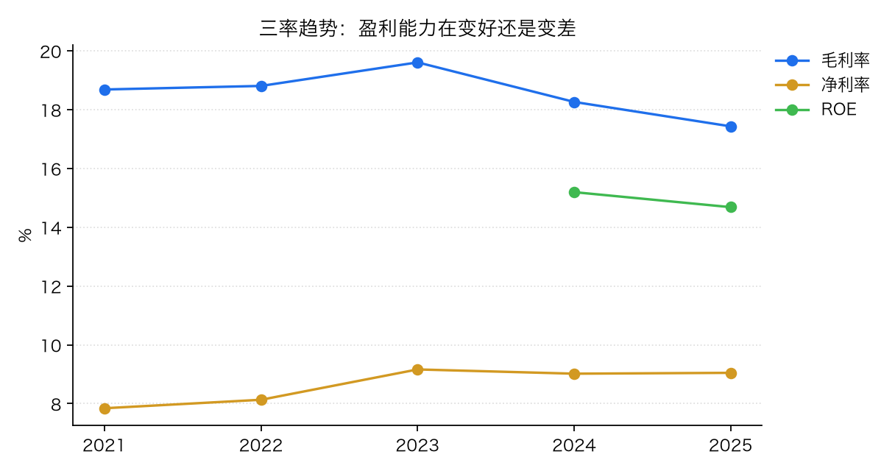
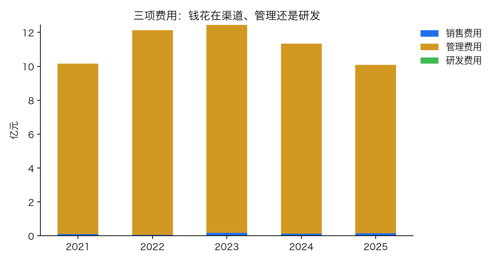
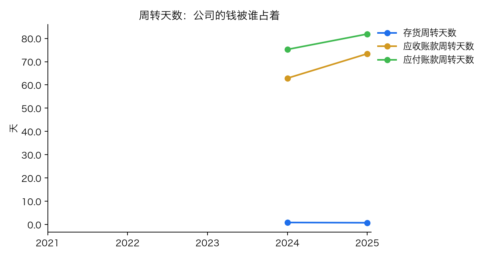
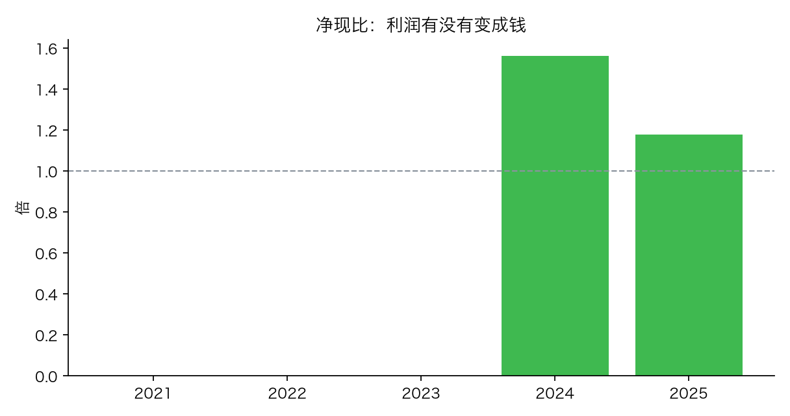

# 保利物业（06049.HK）2025 年报深度解读

## 一页纸

**还在增长，但增量收入基本不创造毛利。** 营业收入 171.26 亿元，上年 163.42 亿元；毛利 29.85 亿元，上年 29.84 亿元（P81）。收入一年多了 7.84 亿元，毛利几乎原地不动，毛利率从 18.26% 降到 17.43%（P81）。这是一家面积和收入仍在扩、单位盈利能力在退的物业公司——读它的第一个动作不是看收入增速，是看毛利为什么不动。

**利润还在增，增的是费用省下来的那一块。** 净利润 15.68 亿元，上年 14.89 亿元；归母净利润 15.49 亿元，上年 14.74 亿元（P81）。同期行政开支从 11.22 亿元降到 9.93 亿元，费用率从 6.87% 降到 5.80%（P81）。把这两个数放在一起就明白了：省下来的钱比多挣的利润还多，毛利以下如果再没有别的贡献，这一年的利润增长就与经营改善无关。

**账上的钱不像一家物业公司，回款却开始变慢。** 货币资金 107.10 亿元、定期存款 21.36 亿元（另 1.03 亿元列作流动）、全年没有银行借款（P82、P85）；但应收账款 34.44 亿元，上年 28.16 亿元，周转天数从 62.89 天拉长到 73.41 天，经营现金流 18.27 亿元，上年 23.03 亿元（P82、P85）。利润向上、现金向下，这是本期最该盯的一处错位。

**三个数决定下一年的读数：毛利率、应收账款、行政开支。** 毛利率 17.43% 已经是五年最低（P171）；应收账款增速是收入增速的四倍多（P82）；行政开支已经低于 2021 年的绝对额（P171）。前两个还在恶化，第三个已接近压无可压——这三条同时指向 2026 年利润增速会掉档，而不是继续稳住 5% 左右。

| 指标 | 2025 | 2024 | 2023 | 2022 | 2021 |
| :--- | ---: | ---: | ---: | ---: | ---: |
| 营业收入（亿元） | 171.26 | 163.42 | 150.62 | 136.87 | 107.83 |
| 归母净利润（亿元） | 15.49 | 14.74 | 13.80 | 11.13 | 8.46 |
| 毛利率 | 17.43% | 18.26% | 19.61% | 18.81% | 18.68% |
| 净利率 | 9.05% | 9.02% | 9.16% | 8.13% | 7.84% |
| ROE | 14.68% | 15.19% | —（不可得） | —（不可得） | —（不可得） |
| ROIC | —（不可得） | —（不可得） | —（不可得） | —（不可得） | —（不可得） |
| 经营活动现金流（亿元） | 18.27 | 23.03 | —（不可得） | —（不可得） | —（不可得） |
| 自由现金流（亿元） | 17.82 | 22.36 | —（不可得） | —（不可得） | —（不可得） |
| 净现比 | 1.18 倍 | 1.56 倍 | —（不可得） | —（不可得） | —（不可得） |
| 资产负债率 | 41.17% | 41.18% | 40.33% | 40.16% | 38.15% |
| 分红率 | 50.03% | 50.01% | —（不可得） | —（不可得） | —（不可得） |

红旗判定：清单共 32 项，命中 0 项，数据不足 8 项，其中 9 项已翻原文核实（数据不足不等于没问题）。

## 生意：钱是怎么赚的

**一句话：把别人的楼盘接过来管，按合同面积收物业费，再把保洁、秩序、绿化分包出去。** 营业收入 171.26 亿元，其中物业管理服务 131.50 亿元、社区增值服务 23.40 亿元、非业主增值服务 16.36 亿元（P122）。规模等于「在管面积 × 单方收费」，成本里占比最大的不是设备折旧，而是人力与分包，所以这门生意的利润率对最低工资、社保基数和分包报价的敏感度，远高于对资本开支的敏感度（P124）。

**三块业务的毛利形状差得很远，看综合毛利率会被平均数骗。** 物业管理服务毛利率 13.39%（上年 14.33%），非业主增值服务 15.80%（上年 16.02%），社区增值服务 41.25%（上年 36.82%）（P26）。社区增值服务占收入不到两成，却贡献了约三分之一的毛利；基础物管占收入七成半，只贡献约六成毛利（P26）。同一个 17.43% 的综合毛利率，在业务结构不同时对应的经营含义完全不一样。

**2025 年长的与缩的正好错位。** 物业管理服务收入 131.50 亿元（上年 116.74 亿元），非业主增值服务 16.36 亿元（上年 19.60 亿元），社区增值服务 23.40 亿元（上年 27.08 亿元）（P122）。增量全部来自毛利率 13.39% 的那条线，缩量的恰恰是毛利率 41.25% 的那条线——这是结构效应，不是某一块内部的管理效率突然变差（P26）。

**高毛利那块缩水时毛利率反而升了，形态良性但证据不足。** 社区增值服务毛利率从 36.82% 升到 41.25%，与「主动退出低毛利品类、保留高毛利品类」的形态一致（P23、P26）。问题在于年报只给一句「宏观消费环境波动及房地产市场深度调整」，没有分品类收入，无法证实收缩是主动选择还是被动丢单（P23）。

**收入确认有总额与净额两套口径，报表只给总额。** 包干制按总额确认、酬金制按净额确认，年报没有拆分两种模式各自的面积、收入与毛利（P98）。这意味着收入增速里混着模式变化，不能直接当作在管面积增速的代理指标；要判断规模，得回到管理层讨论里的面积与单方收费（P16、P21）。

**成本端这一年被重排过，跨年毛利率不能直接比。** 服务成本 141.41 亿元（上年 133.58 亿元），而成本明细里「已售货物成本」大幅缩小、人员结构也在变（P124）。把自有人工和自售货物换成外部采购的服务，会让毛利率的分子与分母同时变口径；报内没有单列分包/外包科目，因此毛利率的降幅里有几分来自重分类、几分是真降，只能定性判断（P124）。

**真正的护城河在续约，而续约率不给。** 年报披露了新拓项目、合同管理面积与在管面积，却不披露存量项目的续约率（P16、P22）。对一家靠存量项目吃饭的公司，这是最该给的经营指标；缺了它，只能从「单方收费在涨、而物管毛利率在降」这个组合反推：涨价被成本吞掉，扩面积靠低价外拓（P21、P27）。

| 品类 | 2025 | 2024 | 占营业收入 |
| :--- | ---: | ---: | ---: |
| 物业管理服务收入 | 131.50 | 116.74 | 76.8% |
| 社区增值服务收入 | 23.40 | 27.08 | 13.7% |
| 非业主增值服务收入 | 16.36 | 19.60 | 9.6% |
| 案场协销服务及其他非业主增值服务收入 | 13.99 | 16.47 | 8.2% |
| 租金收入 | 2.37 | 3.13 | 1.4% |
| **合计** | 171.26 | 163.42 | 100.0% |

| 编号 | 严重度 | 判断 | 依据 | 证据 |
| :--- | :--- | :--- | :--- | :--- |
| F-cb-01 | 中 | 应收账款增速快于收入 | FY2025 应收账款增速 +22.32%，同期收入增速 +4.80%，差 +17.53pp | E-003、E-004 |

## 五年账

**五年账的形状是「收入还在长、毛利已经停、利润靠省」。** 营业收入从 107.83 亿元走到 171.26 亿元（P171），但毛利额 25.74 亿元（2022 年）、29.53 亿元（2023 年）、29.84 亿元（2024 年）、29.85 亿元（2025 年）——2023 年之后两年几乎没动（P171）。收入曲线向上、毛利曲线走平，两条线之间的缝就是毛利率从 19.61% 降到 17.43% 的全部来源（P171）。

**毛利率的顶在 2023 年，之后两年一路下台阶。** 18.68%（2021 年）→ 18.81% → 19.61%（2023 年见顶）→ 18.26% → 17.43%（2025 年，五年最低）（P171）。同一时间服务成本占收入的比重持续上升，2025 年服务成本增速快于收入增速（P81）。这不是某一年的偶发：连续两年单边下行，说明压力来自结构性因素——项目定价、人工与分包成本、以及业务结构向低毛利端倾斜。

**净利润五年还在增，但增速已经换挡，且驱动从毛利换成了费用。** 归母净利润 8.46 亿元（2021 年）→ 11.13 亿元 → 13.80 亿元 → 14.74 亿元 → 15.49 亿元（P171）；净利率 7.84% → 8.13% → 9.16% → 9.02% → 9.05%（P171）。净利率在 2023 年见顶后走平，中间的推力是行政开支：从 10.06 亿元升到 12.26 亿元（2023 年）后回落到 11.22 亿元、9.93 亿元（P171）。2025 年的行政开支绝对额已经低于 2021 年，而收入比 2021 年高出六成以上——一个费用项逆着业务规模下行，要么是效率，要么是重分类。

**杜邦分解显示 ROE 的支撑点已经从周转转向利润率与杠杆。** 总资产周转率 0.97 → 1.04 → 1.01 → 0.97 → 0.94 倍，五年单边下行（P171）；权益乘数 1.73 倍（P81）；ROE 15.19%（2024 年）→ 14.68%（2025 年）（P82）。周转在降、净利率走平，ROE 还能守住 15% 附近，靠的是利润率没有掉、杠杆小幅抬升——这条路已经走到尽头，下一次 ROE 下台阶只会来自净利率。

**资产端 2024 年出现过一次结构断层。** 总资产 111.38 → 131.10 → 148.77 → 167.81 → 182.56 亿元（P171），但 2024 年流动资产 136.36 亿元反而低于 2023 年的 142.28 亿元，增量全部落在非流动资产上（P171、P82）。对照附注，这一跳主要是定期存款改列非流动（21.36 亿元）造成的，不是买资产，也不是并表商誉——商誉只有 0.65 亿元（P135、P140）。

**杠杆五年抬了三个百分点，但性质是经营性的。** 资产负债率 38.15% → 40.16% → 40.33% → 41.18% → 41.17%（P171）。要看的是负债构成：全年没有银行借款，负债侧是应付账款 31.72 亿元、合同负债 20.72 亿元这类经营性项目，利息支出只出现在租赁负债上，与现金流量表里的「已付利息」完全相等（P81、P85）。所以这个 41.17% 不能当偿债压力读，它衡量的是「先收后付」的规模。

**读五年账要小心一个假象：现金越来越厚，收益率却越来越薄。** 货币资金 107.10 亿元、定期存款 21.36 亿元（另 1.03 亿元列作流动）（P82、P140），而其他收入从 1.54 亿元（2021 年）降到 0.94 亿元（P171）。资产越堆越多的同时，非经营性收益在缩——这解释了为什么「净利率走平」不等于「主业走平」（P123、P171）。

| 项目 | 2025 | 2024 | 2023 | 2022 | 2021 |
| :--- | ---: | ---: | ---: | ---: | ---: |
| 营业收入（亿元） | 171.26 | 163.42 | 150.62 | 136.87 | 107.83 |
| 毛利（亿元） | 29.85 | 29.84 | 29.53 | 25.74 | 20.15 |
| 营业利润 | —（不可得） | —（不可得） | —（不可得） | —（不可得） | —（不可得） |
| 归母净利润（亿元） | 15.49 | 14.74 | 13.80 | 11.13 | 8.46 |
| 经营活动现金流（亿元） | 18.27 | 23.03 | —（不可得） | —（不可得） | —（不可得） |
| 自由现金流（亿元） | 17.82 | 22.36 | —（不可得） | —（不可得） | —（不可得） |
| ROE | 14.68% | 15.19% | —（不可得） | —（不可得） | —（不可得） |
| 净利率 | 9.05% | 9.02% | 9.16% | 8.13% | 7.84% |
| 资产负债率 | 41.17% | 41.18% | 40.33% | 40.16% | 38.15% |
| 流动比率 | 2.04 倍 | 1.99 倍 | 2.40 倍 | 2.34 倍 | 2.42 倍 |

*数据来源：公司年度报告原文（页码见正文引用），金额为合并报表口径。*

### 杜邦分解

| 项目 | 2025 | 2024 | 2023 | 2022 | 2021 |
| :--- | ---: | ---: | ---: | ---: | ---: |
| ROE | 14.68% | 15.19% | — | — | — |
| 净利率 | 9.05% | 9.02% | 9.16% | 8.13% | 7.84% |
| 总资产周转率（次） | 0.94 倍 | 0.97 倍 | 1.01 倍 | 1.04 倍 | 0.97 倍 |
| 权益乘数（倍） | 1.73 倍 | 1.73 倍 | —（不可得） | —（不可得） | —（不可得） |

## 利润表：从毛利到归母

**从收入到毛利：多做的生意几乎没留下毛利。** 营业收入 171.26 亿元（上年 163.42 亿元），服务成本 141.41 亿元（上年 133.58 亿元），毛利 29.85 亿元（上年 29.84 亿元），毛利率 17.43%（上年 18.26%）（P81）。服务成本的增速快于收入，等于新接的项目在扣掉人工与分包之后几乎不挣钱；这解释的不是「成本控制变差」，而是「接进来的活本身毛利薄」（P81、P124）。

**毛利以下真正有分量的只有三项。** 销售费用 0.16 亿元（上年 0.12 亿元）、行政开支 9.93 亿元（上年 11.22 亿元）、其他收入 0.94 亿元（上年 1.16 亿元）（P81）。销售费用小到可以忽略，利息支出只出现在租赁负债上（P81、P85）；利润的方向盘就在行政开支与其他收入这两项上。

**行政开支是这一年利润的支点，也是它最大的脆弱点。** 行政开支占收入 5.80%，上年 6.87%（P81）；绝对额 9.93 亿元已经低于 2021 年的 10.06 亿元，而同期收入比 2021 年高出六成以上（P171）。年报把原因归于区域整合后的管理架构调整（P25）——这属于一次性组织红利，不是可以逐年复制的经营改善。把它当成常态，等于假设一家收入 171 亿元的公司在费用上还能再压一轮。

**其他收入在退，且构成不可拆。** 其他收入 0.94 亿元，占利润总额 4.57%（上年 1.16 亿元、5.92%）（P81）。附注里这一项混着政府补助、银行存款利息、罚没与赔偿收入（P123）；其中利息收入与补助的比例没有单列，所以「利润里有多少来自非经营性项目」在这份年报里无法定量，只能定性判断为「规模不大但在缩小」（P123）。

**税与少数股东都没有提供缓冲。** 利润总额 20.66 亿元（上年 19.65 亿元），所得税 4.99 亿元，有效税率 24.13%（上年 24.19%）（P81、P82）。净利润 15.68 亿元，其中归母 15.49 亿元、少数股东损益 0.18 亿元（上年 14.74 亿元与 0.16 亿元）（P81、P82）。税率稳定、少数股东占比很小，意味着利润的归属结构干净，归母增速与整体增速基本同步。

**净利率走平、ROE 下台阶，两个数说的不是一件事。** 净利率 9.05%（上年 9.02%），ROE 14.68%（上年 15.19%）（P82）。净利率能守住，靠的是行政开支；ROE 下滑，是因为分母——归母权益从 97.01 亿元增到 105.53 亿元（P82），而利润只跟着涨了一点点。留存的钱堆在账上，收益率自然被摊薄（P140）。

**人少了、收入多了，但人效改善没有变成毛利。** 员工 28,692 人（上年 30,125 人）（P72）。人数下降而收入上升，说明人均产出在提高；可同期毛利率在降，两者同时成立的唯一解释是「单方收费涨得没有成本快」，或「新增项目以低价换面积」（P21、P27）。这也是为什么这一节看完之后，判断重点不在利润表本身，而在下一节资产负债表里的应收与合同负债（P82）。

### 三项费用与销售投入

| 项目 | 2025 | 2024 | 2023 | 2022 | 2021 |
| :--- | ---: | ---: | ---: | ---: | ---: |
| 销售费用（亿元） | 0.16 | 0.12 | 0.18 | 0.06 | 0.09 |
| 管理费用（亿元） | 9.93 | 11.22 | 12.26 | 12.07 | 10.06 |

*数据来源：公司年度报告原文（页码见正文引用），金额为合并报表口径。*

### 研发与人员

| 项目 | 2025 | 2024 | 2023 | 2022 | 2021 |
| :--- | ---: | ---: | ---: | ---: | ---: |
| 在职员工（人） | 28,692 | 30,125 | —（不可得） | —（不可得） | —（不可得） |
| 关联方采购（亿元） | 0.85 | 2.33 | —（不可得） | —（不可得） | —（不可得） |

研发投入未资本化（附注资本化金额为空），故不列资本化率。

## 资产负债表：钱在哪、欠谁

**资产表像一家现金公司，不像物业公司。** 总资产 182.56 亿元，其中货币资金 107.10 亿元、定期存款 21.36 亿元（另 1.03 亿元列作流动）、应收账款 34.44 亿元（P82）。货币资金占总资产的 58.67%，把定期存款算进来超过七成（P82、P140）。固定资产只有 2.50 亿元、无形资产 0.86 亿元——这门生意不需要花钱建东西，钱是「存」出来的，不是「投」出来的（P82）。

**应收账款是这张表上唯一在恶化的资产。** 34.44 亿元，上年 28.16 亿元；周转天数从 62.89 天拉长到 73.41 天（P82）。收入只增长了个位数，应收却增长两成以上，说明回款速度在系统性变慢，而不是收入规模自然带来的占用（P82、P138）。审计师把「应收账款减值」列为全年唯一的关键审计事项，也印证这里就是风险集中点（P77）。

**账龄在恶化，计提比例却在放松，这是本期最值得警惕的一处估计选择。** 已计提减值 1.79 亿元，整体覆盖率不足 5%（P77、P138）。拨备矩阵里一至两年段的预期损失率被下调，两年以上段也下调，只有一年内基本持平（P153）。账龄越差、假设越乐观，两个方向同时发生，意味着当期利润里含有一部分「少提」带来的空间（P153、P154）。

**应收之外，资产端没有别的雷。** 其他应收款 8.81 亿元（上年 8.43 亿元）、预付款项 0.99 亿元、存货 0.29 亿元（P82）；商誉只有 0.65 亿元，且减值测试的增减不影响大局（P135）。表内没有在建工程、没有大额并购形成的商誉堆，也没有资产抵押（P73）。这是一张「除了应收，没什么可爆」的资产表。

**负债端全是经营性项目，没有一分钱银行借款。** 应付账款 31.72 亿元（上年 27.54 亿元）、合同负债 20.72 亿元（上年 18.24 亿元）、流动负债合计 74.50 亿元（P82）。资产负债率 41.17%（上年 41.18%）（P171），但这个杠杆不是借来的，是「先收物业费、后付分包款」形成的（P82、P142）。

**占用上游的力度在加强，而且开始有拖延的痕迹。** 应付账款周转天数 81.88 天（上年 75.25 天），已经超过应收的 73.41 天（P82）。应付一年以上账龄在增长（P141）。对现金流这是正贡献，对供应链关系是负贡献；它也解释了为什么在应收恶化的情况下，经营现金流仍然是正的（P85）。

**合同负债变厚是这张表上最正面的一条。** 20.72 亿元，上年 18.24 亿元（P82、P142）。预收物业费增加意味着在手订单与收缴节奏没有崩，这是物业公司最接近「订单储备」的科目。它同时是一道缓冲：应收变慢、预收变多，两股力量在营运资本上部分对冲（P82、P142）。

**流动性毫无压力，问题从来不是还不还得上。** 流动比率 2.04 倍（上年 1.99 倍），借款为零，年报在「借款」一节明说概无借款或银行贷款（P29）。所以这张表要读的不是偿债能力，而是「钱放在哪里、放得值不值」：107.10 亿元货币资金里有一部分是代业主收取的款项，综合收益率不足 1%（P129、P140）。资产质量的问题不在坏账，而在资本配置。

**没有借款不等于没有利息。** 财务成本一年 390 万元（上年 450.4 万元），付的全是租赁负债利息，没有一分是银行利息（P81、P150）。所以偿债体检里「利息覆盖 468.50 倍」和「有息负债为零」这两句话并不矛盾：分母是租来的办公室，不是借来的钱。

### 资产端

| 项目 | 2025 | 2024 | 2023 | 2022 | 2021 |
| :--- | ---: | ---: | ---: | ---: | ---: |
| 货币资金（亿元） | 107.10 | 98.91 | —（不可得） | —（不可得） | —（不可得） |
| 应收账款（亿元） | 34.44 | 28.16 | —（不可得） | —（不可得） | —（不可得） |
| 存货（亿元） | 0.29 | 0.32 | —（不可得） | —（不可得） | —（不可得） |
| 流动资产合计（亿元） | 152.21 | 136.36 | 142.28 | 121.33 | 99.91 |
| 固定资产（亿元） | 2.50 | 2.40 | —（不可得） | —（不可得） | —（不可得） |
| 无形资产（亿元） | 0.86 | 0.94 | —（不可得） | —（不可得） | —（不可得） |
| 资产总计（亿元） | 182.56 | 167.81 | 148.77 | 131.10 | 111.38 |

### 负债与权益

| 项目 | 2025 | 2024 | 2023 | 2022 | 2021 |
| :--- | ---: | ---: | ---: | ---: | ---: |
| 应付账款（亿元） | 31.72 | 27.54 | —（不可得） | —（不可得） | —（不可得） |
| 合同负债（亿元） | 20.72 | 18.24 | —（不可得） | —（不可得） | —（不可得） |
| 流动负债合计（亿元） | 74.50 | 68.41 | 59.21 | 51.85 | 41.36 |
| 归母权益（亿元） | 105.53 | 97.01 | —（不可得） | —（不可得） | —（不可得） |
| 少数股东权益（亿元） | 1.87 | 1.70 | —（不可得） | —（不可得） | —（不可得） |
| 所有者权益合计（亿元） | 107.41 | 98.71 | 88.77 | 78.45 | 68.89 |

### 负债与现金口径

| 项目 | 2025 | 2024 | 2023 | 2022 | 2021 |
| :--- | ---: | ---: | ---: | ---: | ---: |
| 货币资金（亿元） | 107.10 | 98.91 | —（不可得） | —（不可得） | —（不可得） |
| 类现金（含存单与定期存款）（亿元） | 129.49 | 118.84 | —（不可得） | —（不可得） | —（不可得） |
| 有息负债（亿元） | 0.00 | 0.00 | —（不可得） | —（不可得） | —（不可得） |
| 其中：一年内到期（亿元） | 0.00 | 0.00 | —（不可得） | —（不可得） | —（不可得） |
| 净有息负债（亿元） | -129.49 | -118.84 | —（不可得） | —（不可得） | —（不可得） |
| EBITDA（亿元） | 24.45 | 23.51 | —（不可得） | —（不可得） | —（不可得） |
| 利息支出（亿元） | 0.04 | 0.05 | —（不可得） | —（不可得） | —（不可得） |
| 负债总额（亿元） | 75.15 | 69.10 | 60.01 | 52.65 | 42.49 |

### 偿债体检

| 步骤 | 口径 | 2025 | 2024 | 档位 | 判读 |
| :--- | :--- | ---: | ---: | :--- | :--- |
| 拆负债率 | 有息负债 / 负债总额 | 0.00% | 0.00% | 占款型 | 负债以无息的经营性占用为主：风险在占款能否持续，不在利息 |
| 查现金藏在哪 | 类现金 / 货币资金 | 1.21 倍 | 1.20 倍 | 含存单 | 年报把存单与定期存款单列在货币资金以外，只数货币资金会低估可动用资金 |
| 算净有息负债 | 净有息负债 / EBITDA | 不适用 | 不适用 | 净现金 | 现金比有息负债还多：没有杠杆风险，不用倍数看 |
| 看现金流覆盖利息 | 经营活动现金流 / 利息支出 | 468.50 倍 | 511.27 倍 | 压力很小 | 经营现金流是利息支出的数倍，利息不构成约束 |
| 对期限 | 类现金 / 一年内到期有息负债 | 不适用 | 不适用 | 无到期债务 | 一年内没有到期的有息负债，不存在滚动与再融资压力 |

*口径提示：原文确认本期没有有息负债，五步按零负债读，不是「数据不可得」；两期取到的明细科目不一致：其他流动资产中的定期存款/大额存单。*

*数据来源：公司年度报告原文（页码见正文引用），金额为合并报表口径。*

## 现金流量表：利润变成了什么

**利润变成了现金，但转换率在下滑。** 经营活动现金流净额 18.27 亿元（上年 23.03 亿元），净利润 15.68 亿元（上年 14.89 亿元），净现比 1.18 倍（上年 1.56 倍）（P85）。1 倍以上说明利润基本是收得到的现金；从 1.56 掉到 1.18，说明每一块钱利润背后撑着的营运资本占用在变多，而这正是应收账款变慢的现金版本（P82、P85）。

**经营现金流的回落不是收入端的，是营运资本端的。** 收入还在增、净利率还在 9.05%，利润没有掉；掉的是「经营所得现金」——年报自己列示的这一项比上年少了两成（P85）。它与应收账款的走势一致：应收账款余额又上一个台阶（P82），这笔钱直接从经营现金流里扣掉，靠应付账款与合同负债两头的占用对冲回去一部分（P141、P142）。

**投资活动今年几乎不花钱，去年花得很多。** 投资活动现金流净额 -2.25 亿元（上年 -28.18 亿元）（P85）。去年的钱主要去买大额存单与定期存款，不是买资产：全年资本开支只有 0.45 亿元（上年 0.67 亿元），资本开支占收入 0.26%（P85）。一家物业公司的现金流之所以好看，原因很朴素——它没有重资产要养（P124）。

**资本开支远低于折旧摊销，是这个商业模式的常态而不是疑点。** 资本开支 0.45 亿元，折旧与摊销 3.79 亿元（P85、P124）。差额意味着账面资产的消耗主要发生在租来的场地与设备上，而不是自有固定资产；只要租约能续、单价能覆盖，这种「轻资产 + 高折旧」的组合就不构成「吃老本」，但它把风险从资产端移到了租约与人工成本端（P124、P167）。

**筹资活动只有一件事：分红。** 筹资活动现金流净额 -7.82 亿元（上年 -6.05 亿元），主要是分配股利支付的现金 7.37 亿元（上年 5.52 亿元）（P85）。全年没有借款、没有还款、没有回购（P82、P145）。这是一家把赚到的钱几乎原样交还给股东的公司的现金流形态。

**自由现金流覆盖分红，安全垫在收窄但没有破。** 经营现金流减去资本开支得到自由现金流 17.82 亿元（上年 22.36 亿元）（P85），拟派年度股利合计 7.75 亿元（P129），派息率 50.03%（上年 50.01%）（P129）。分红是利润的五成，不是自由现金流的全部，账上还留着 107.10 亿元货币资金（P82）。这条线目前安全，但它依赖「利润不再掉、应收不再坏」两个前提。

**现金流量表附注有一处对不上，读的时候要打折。** 间接法里「应付账款增加」的金额，与资产负债表上应付账款的余额变动量级不匹配，应计费用一侧同样不符，且当年唯一一笔收购的规模远不足以解释差额（P141、P155、P156）。这不必然是错报，可能是科目重分类或代收代付的对流；但在解释清楚之前，经营现金流的「质量」只能按方向读，不能按精确额度读（P156）。

| 项目 | 2025 | 2024 | 2023 | 2022 | 2021 |
| :--- | ---: | ---: | ---: | ---: | ---: |
| 经营活动现金流（亿元） | 18.27 | 23.03 | —（不可得） | —（不可得） | —（不可得） |
| 投资活动现金流（亿元） | -2.25 | -28.18 | —（不可得） | —（不可得） | —（不可得） |
| 筹资活动现金流（亿元） | -7.82 | -6.05 | —（不可得） | —（不可得） | —（不可得） |
| 资本性支出（亿元） | 0.45 | 0.67 | —（不可得） | —（不可得） | —（不可得） |
| 自由现金流（亿元） | 17.82 | 22.36 | —（不可得） | —（不可得） | —（不可得） |
| 净现比 | 1.18 倍 | 1.56 倍 | —（不可得） | —（不可得） | —（不可得） |

*数据来源：公司年度报告原文（页码见正文引用），金额为合并报表口径。*

## 附注深挖

**附注优先级。** 32 条附注，按这家公司自己的数字排队：先看金额占收入最大的，再看变动最剧烈的，最后是公司自己措辞最软的那几条。◆ 重点 11 条、◇ 常规 21 条。

| 序 | 附注 | 类型 | 层级 | 涉及金额（亿元） | 占收入 | 判断密度 | 页 |
| ---: | :--- | :--- | :--- | ---: | ---: | ---: | :--- |
| 1 | 18 应收账款及应收票据 | 金额型 | ◆ | 34.44 | 20.1% | 0.0 | P138–P139 |
| 2 | 22 应付账款 | 金额型 | ◆ | 31.72 | 18.5% | 0.0 | P141–P141 |
| 3 | 24 合同负债 | 金额型 | ◆ | 20.72 | 12.1% | 0.0 | P142–P142 |
| 4 | 3 合并财务报表编制基础及重要会计政策 | 政策型 | ◆ | — | — | 4.9 | P88–P119 |
| 5 | 4 重要会计判断与估计的主要来源 | 估计型 | ◆ | — | — | 26.0 | P120–P120 |
| 6 | 29 资本承诺 | 承诺型 | ◆ | — | — | 0.0 | P147–P147 |
| 7 | 33 金融工具 | 风险型 | ◆ | — | — | 2.8 | P150–P155 |
| 8 | 36 重大关联方交易 | 交易型 | ◆ | 0.85 | 0.5% | 0.0 | P166–P169 |
| 9 | 9 所得税费用 | 金额型 | ◆ | 4.99 | 2.9% | 0.7 | P125–P128 |
| 10 | 5 分部信息 | 金额型 | ◆ | — | — | 12.0 | P121–P121 |
| 11 | 15 无形资产 | 金额型 | ◆ | 0.86 | 0.5% | 1.7 | P135–P137 |
| 12 | 26 递延所得税 | 估计型 | ◇ | 0.57 | 0.3% | 0.0 | P144–P144 |
| 13 | 12 每股收益 | 金额型 | ◇ | — | — | 2.2 | P129–P131 |
| 14 | 11 分红 | 金额型 | ◇ | — | — | 2.0 | P129–P129 |
| 15 | 17 存货 | 金额型 | ◇ | 0.29 | 0.2% | 0.0 | P138–P138 |
| 16 | 25 租赁负债 | 金额型 | ◇ | — | — | 1.0 | P143–P143 |
| 17 | 14 租赁资产及投资性房地产 | 政策型 | ◇ | — | — | 4.2 | P132–P134 |
| 18 | 6 收入 | 金额型 | ◇ | — | — | 0.0 | P122–P123 |
| 19 | 8 利润总额 | 金额型 | ◇ | — | — | 0.0 | P124–P124 |
| 20 | 20 定期存款 | 金额型 | ◇ | — | — | 0.0 | P140–P140 |
| 21 | 21 现金及现金等价物 | 金额型 | ◇ | — | — | 0.0 | P140–P140 |
| 22 | 23 其他应付款及应计费用 | 金额型 | ◇ | — | — | 0.0 | P141–P141 |
| 23 | 27 股本 | 金额型 | ◇ | — | — | 0.0 | P145–P145 |
| 24 | 28 限制性股票激励计划 | 交易型 | ◇ | — | — | 0.0 | P145–P146 |
| 25 | 30 收购子公司 | 交易型 | ◇ | — | — | 0.0 | P147–P147 |
| 26 | 31 母公司资产负债表 | 金额型 | ◇ | — | — | 0.0 | P148–P149 |
| 27 | 34 现金流量资料 | 金额型 | ◇ | — | — | 0.0 | P156–P157 |
| 28 | 35 主要子公司明细 | 交易型 | ◇ | — | — | 0.0 | P158–P165 |
| 29 | 2 新订会计准则及修订 | 政策型 | ◇ | — | — | 1.2 | P86–P87 |
| 30 | 1 公司基本情况 | 政策型 | ◇ | — | — | 0.0 | P86–P86 |
| 31 | 32 资本管理 | 风险型 | ◇ | — | — | 0.0 | P150–P150 |
| 32 | 37 资产负债表日后事项 | 风险型 | ◇ | — | — | 0.0 | P170–P170 |

**收入附注是这份年报里信息量最大的一张表，因为它拆开了「唯一一个分部」。** 附注按客户合同把 171.26 亿元拆成四块：物业管理服务 131.50 亿元、案场协销及其他非业主增值服务 13.99 亿元、社区增值服务 23.40 亿元、租金收入 2.37 亿元（P122）。上一年的对应值是 116.74 亿元、16.47 亿元、27.08 亿元、3.13 亿元（P122）。主表只有「收入」一行，分部附注又声明公司只有一个经营分部（P121），所以要看清结构，只能读这张表。

**结构在一年之内明显向低毛利端移动。** 物业管理服务增加，另三项全部减少（P122）。按三块业务各自的毛利率——13.39%、15.80%、41.25%（P26）——这个组合的方向是确定的：低毛利那块变大，高毛利那块变小，综合毛利率必然下行，且与「项目单价在涨」并不矛盾（P26、P122）。这也是判断 2026 年毛利率的关键：只要结构继续这样移，涨价救不了毛利率。

**员工成本是毛利率之外的第二条线索，但它被一次会计冲回修饰过。** 本年员工成本较上年减少，其中一部分来自股份支付：第三批解锁的业绩条件未达成，原先确认的费用被冲回（P124、P146）。这意味着利润里含一块非现金、一次性、不可重复的收益。看成本趋势时要把它剔掉，否则会误判「降本增效」的力度（P124、P146）。

**预期信用损失是公司自己承认的、最敏感的估计，却只给了方法不给数。** 附注把应收账款的减值列为关键会计估计，理由是客户合同的预期信贷损失涉及主观判断（P120）。但披露里没有分客户组的损失率、没有账龄迁徙率、没有量化敏感性（P120、P153）。审计师把它列为唯一关键审计事项时用的措辞也是「评价管理层判断是否合理」，而不是「验证可收回」（P77）。这是全份报告里估计弹性最大的一处。

**几处列报选择共同压低了表外风险的可见度。** 合同资产与合同负债按同一合同净额呈列（P142）；使用权资产并进「固定资产」与「租赁资产及投资性房地产」，不与租赁负债配对展示（P109）；无限年期无形资产不摊销，也不披露判定依据（P135）。单看每一处都合规，合起来的效果是：读者很难从表内直接读出「租来的资产有多少、租约什么时候到期」（P109、P167）。

**关联方附注提供了两个方向的信号，恰好相反。** 一是收入端：来自控股股东体系的非业主增值服务在减少，而基础物管在增加（P167、P168）——对开发商的依赖在退坡，这是好事。二是资金端：对关联方的应收账款净额规模相当于当年归母净利润的三分之一以上，全部无抵押、不计息、「按要求偿还」，最大欠款方就是控股股东（P169）——等于向大股东体系提供免息营运资金，而「按要求偿还」不是贸易账期的语言（P169）。这两件事必须一起看，否则会把「关联收入下降」误读成「关联依赖解除」。

**关联交易只有金额、没有定价政策。** 附注列了三十余行金额，但没有一句说明定价依据、没有年度上限、没有独立董事或审计委员会的意见（P166、P170）。附注还声明对国有背景对手方不区分是否国家控制实体（P170），这意味着这张表不等于关联交易全集。用它证明「定价公允」是不成立的。

**资产负债表日后事项只有一句话，等于没有。** 附注末段称并无重大资产负债表日后事项（P170）。结合审计报告日与年报日之间整整三个月（P80），这句话的可信度依赖于审计师对日后事项执行的程序；而公司自己并没有披露任何期后经营数据、诉讼进展或重大合同（P170）。

**按类型看分布。** 同一类附注问的是同一个问题；哪一类页数多、密度高，说明公司的判断就堆在那里。

| 类型 | 条数 | 页数 | 平均判断密度 | 最该看的一条 |
| :--- | ---: | ---: | ---: | :--- |
| 金额型 | 18 | 29 | 1.1 | 18 应收账款及应收票据（P138） |
| 交易型 | 4 | 15 | 0.0 | 36 重大关联方交易（P166） |
| 政策型 | 4 | 38 | 2.6 | 3 合并财务报表编制基础及重要会计政策（P88） |
| 风险型 | 3 | 8 | 0.9 | 33 金融工具（P150） |
| 估计型 | 2 | 2 | 13.0 | 4 重要会计判断与估计的主要来源（P120） |
| 承诺型 | 1 | 1 | 0.0 | 29 资本承诺（P147） |

## 谁在分钱

**分红是这家公司最确定的股东回报，规则写得很硬：利润的 50%。** 2025 年度每股派 1.401 元（P52），拟派总额 7.75 亿元（P129），占归母净利润的 50.03%（P129）；上一年度派 7.37 亿元，占 50.01%（P129）。连续两年精确落在同一比例上，说明派息政策是「固定比例」而不是「固定金额」，这也让分红金额随利润波动，而不是随管理层意愿波动（P54）。

**年内实际付出的现金少于当年宣派，差额挂在应付上。** 现金流量表里分配股利支付的现金 7.37 亿元（上年 5.52 亿元）（P85）。这解释了为什么筹资活动现金流出只有 7.82 亿元，而账上还留着一笔待付的年度股利（P85、P129）。分红没有靠借钱支付，也没有动用资本公积，全部来自当年利润（P84）。

**控股股东占据绝对多数，公众持股空间已经很薄。** 控股股东合计持股约占七成以上，年报只写「已维持充足公众持股量」，不给具体比例（P57、P58）。这在实务上意味着两件事：一是外部股东对治理的影响力有限；二是未来任何大额增发、换股或回购，都会直接顶到最低公众持股比例的红线（P58、P74）。

**关联交易的重点不是「有没有超上限」，而是资金停在谁的体系里。** 关联采购 0.85 亿元（上年 2.33 亿元），占营业成本 0.60%（上年 1.75%）（P167、P168）；关联交易结构从「向集团买服务」转向「向集团买产品」，量级在缩（P168）。但真正占资金的是另一侧：对关联方的应收账款、以及对集团财务公司的存款（P169、P140）。前者是免息占用，后者把一部分现金留在控股股东的金融平台里（P140、P169）。

**少数股东在这家公司里几乎可以忽略。** 少数股东权益 1.87 亿元（上年 1.70 亿元），少数股东损益 0.18 亿元（上年 0.16 亿元）（P82）。归母权益 105.53 亿元，占所有者权益合计的绝大部分（P82）。并表结构里有一批非全资子公司，但没有一家重要到会改变归母口径（P166）。

**股权激励基本清零，这是「原增长计划没达成」最硬的证据。** 2025 年首批与预留批的部分股份归属，同时第三批因业绩条件未达成被整体没收，没收数量超过归属数量，期末未归属只剩很小一部分（P145、P146）。这件事的意义不在股本，而在它给出了一个外部可验证的判断：公司三年前给自己定的三年增长目标，最后一档没有实现（P146）。

**股东结构这一年发生了一次「身份转换」，不是融资。** 已发行股份总数两年没有变化，变化的是内资股转 H 股的比例，H 股流通盘因此扩大（P145、P129）。这既不摊薄每股收益，也不带来现金，只是把原来不能流通的股份变成了可流通的股份（P145）。

**真正悬而未决的是资本配置。** 归母权益 105.53 亿元（P82），货币资金 107.10 亿元（P82），派息率固定在 50%（P129）。剩下的一半利润年年留在账上，收益率不足 1%（P129、P140）。对股东来说，这比任何一年的利润增速都更重要：钱放在账上不产生回报，等于每年自动折损一部分 ROE。

| 项目 | 2025 | 2024 | 2023 | 2022 | 2021 |
| :--- | ---: | ---: | ---: | ---: | ---: |
| 归母净利润（亿元） | 15.49 | 14.74 | 13.80 | 11.13 | 8.46 |
| 少数股东损益（亿元） | 0.18 | 0.16 | 0.17 | 0.20 | 0.25 |
| 归母权益（亿元） | 105.53 | 97.01 | —（不可得） | —（不可得） | —（不可得） |
| 少数股东权益（亿元） | 1.87 | 1.70 | —（不可得） | —（不可得） | —（不可得） |
| 每股派息（元/股） | 1.401 | —（不可得） | —（不可得） | —（不可得） | —（不可得） |
| 分配股利支付的现金（亿元） | 7.37 | 5.52 | —（不可得） | —（不可得） | —（不可得） |

## 红旗与跟踪清单

**主表层的头号问题是「增收不增毛利」，它已经连续两年出现。** 毛利 29.85 亿元对上年 29.84 亿元，毛利率 17.43% 对 18.26%（P81、P171）。当一家公司的收入还在增长而毛利不增时，增长的性质就变了：它在用越来越薄的单位经济换规模。判断严重程度看三点——是否连续、是否结构性、是否可逆。三项答案都是「偏坏」：连续两年、由业务结构决定、且看不到定价端的修复路径（P26、P122）。

**第二问题是利润的驱动力换成了费用。** 行政开支 9.93 亿元对上年 11.22 亿元，费用率 5.80% 对 6.87%，绝对额已低于 2021 年的水平（P81、P171）。一次性组织调整带来的费用红利只能用一次。2026 年要维持利润增长，就必须在毛利上找回来——而这恰恰是过去两年持续失守的地方（P27）。

**第三问题在附注层：应收账款与它的减值假设。** 应收账款 34.44 亿元对上年 28.16 亿元，周转天数 73.41 天对 62.89 天（P82）。同期账龄结构变差、损失率假设反而下调、整体计提不足 5%（P138、P153）。这三件事叠在一起，最保守的读法是「当期利润里有一块来自估计宽松」（P153、P154）。审计师把它列为唯一关键审计事项，说明这也是职业判断最集中的地方（P77）。

**第四问题是现金流的「质量折扣」。** 净现比 1.18 倍（上年 1.56 倍），经营现金流 18.27 亿元（上年 23.03 亿元）（P85）。更要紧的是间接法里营运资本变动与资产负债表余额变动对不上，差额无法用当年唯一一笔收购解释（P141、P155、P156）。在解释清楚之前，经营现金流的绝对额只能当方向指标用（P156）。

**治理层的红旗有三条，都不涉及违规，但都指向制衡偏弱。** 一是董事长同时担任提名委员会主席，且为授权代表（P37、P40）；二是总经理一年之内更替、中间存在空档（P5、P55）；三是 2025 年 7 月取消监事会后，监督职能并入审计委员会，而该委员会四名成员中有一名来自控股股东方（P36、P42）。每一条单独看都有合规依据，合起来看是「财务监督强、人事与战略监督弱」（P37、P40、P43）。

**审计侧还有两条需要盯着的背景。** 一是本期是变更审计师后的首个年度，前任名称、变更原因、前后任沟通均未披露（P78、P72）；二是新的审计机构为香港立信德豪，全年审计服务费规模明显低于同类公司（P49）。首年审计 + 单一关键审计事项 + 费用偏低，这个组合不构成结论，但足以让「无保留意见」的舒适度降低一档（P77、P78）。

**关联方这条线不是「有没有违规」，而是「钱在谁那里」。** 关联方应收账款无抵押、不计息、按要求偿还，最大欠款方是控股股东体系；同时一部分现金存在集团财务公司（P169、P140）。关联采购在缩（0.85 亿元，上年 2.33 亿元），关联占用在留（P167、P168、P169）。评估关联交易风险时，看资金沉淀比看采购金额更有意义（P169）。

**下一年要盯的五个数，按重要性排序。** 第一是毛利率 17.43% 会不会破 17%（P81）；第二是应收账款周转天数 73.41 天会不会继续往上（P82）；第三是行政开支率 5.80% 还有没有下降空间（P81）；第四是合同负债 20.72 亿元能否继续增厚（P142）；第五是派息率是否仍守在 50.03%（P129）。前两个决定利润质量，第三个决定利润能否维持，后两个决定股东拿到多少现金。

**还有三条只能人工核对、无法从报表算出。** 应收账款前五大欠款方与关联关系、存量项目的续约率、以及关联交易的定价依据与年度上限（P138、P16、P166）。这三项年报都没有给，任何基于它们的结论都只能是「数据不足」，不能读成「没有问题」（P138、P166、P170）。

**先把「没有问题」的那几条说清楚，免得红旗表被误读。** 审计意见是标准无保留，全文没有强调事项段，也没有持续经营重大不确定性的专门段落（P76、P79）。董事会报告逐条否定了对外担保、资产抵押、股权质押、重大诉讼与仲裁（P54、P73）。也就是说，这张红旗表里「数据不足」的含义是「规则层拿不到结构化字段」，不是「公司这几项有疑点」——两者的区别，恰恰是读一份年报与跑一套规则的区别（P76、P73）。

**附注口径的红旗读数。** 下面这几行主表看不到，全部来自附注：它们是「利润里有多少不是主业挣的」「商誉还剩多少没摊」「钱是不是真在账上」的直接答案，缺的那几行就是这家公司没披露、或我们的抽取还没拿下。

| 项目 | 2025 | 2024 |
| :--- | ---: | ---: |
| 关联采购占营业成本比例 | 0.60% | 1.75% |
| 其他收益占利润总额 | 4.57% | 5.92% |
| 折旧率 | 151.64% | 161.42% |

| 严重度 | 红旗 | 状态 | 观测值 |
| :--- | :--- | :--- | :--- |
| 高 | 经营现金流长期低于净利润（净现比 < 0.8） | 数据不足 | 净现比 在最近 3 期数据不全 |
| 高 | 毛利率显著高于同业且无法解释 | 数据不足 | 需人工核对（附注/公告原文） |
| 高 | 商誉减值反复出现（挤牙膏式减值） | 已核实 | 商誉 0.65 亿元、年内未计提减值准备，与上年 0.64 亿元基本持平，减值假设虽放宽但金额不构成风险（P135） |
| 高 | 大存大贷：高额类现金与高额有息负债并存 | 已核实 | 无有息负债：负债侧只有应付账款、应计费用、合同负债、租赁负债与应付所得税；货币资金 107.10 亿元加定期存款 22.39 亿元（P129、P145） |
| 高 | 在建工程长期不转固 | 数据不足 | 在建工程占固定资产 在最近 2 期数据不全 |
| 高 | 研发资本化率异常抬升 | 已核实 | 费用明细与全部附注均无研发费用、开发支出与资本化研发科目，物业服务业不存在研发资本化这条通道（P124） |
| 高 | 非经常性损益占利润过高 | 已核实 | 其他收入 1.35 亿元里政府补贴及税项优惠只有 0.15 亿元且同比降 33.9%，没有大额出售收益或公允价值变动，利润不靠一次性项目（P122、P123） |
| 高 | 审计意见非标准无保留 | 已核实 | 审计报告为标准无保留意见，全文没有强调事项段、保留意见、否定意见或无法表示意见的措辞（P76） |
| 高 | 控股股东高比例质押 | 已核实 | 董事报告 24 页逐条否定：控股股东无股权质押、公司无对外担保与资产抵押、无重大诉讼或仲裁（P52、P54） |
| 高 | 收现比长期低于 1 | 数据不足 | 销售商品、提供劳务收到的现金 / 营业收入 最近 3 期数据不全 |
| 中 | 每年都有大额并购支出 | 已核实 | 年内没有实质并购：唯一子公司股权收购对价 4,670 千元，已订约未计提的资本承诺仅 9,215 千元（P147、P157） |
| 中 | 第四季度利润异常（亏损或占比畸高） | 数据不足 | 需人工核对（附注/公告原文） |
| 中 | 财务总监频繁更换 | 数据不足 | 需人工核对（附注/公告原文） |
| 中 | 递延所得税资产增速远超收入 | 数据不足 | 递延所得税资产 与 营业收入 的同比数据不足 |
| 中 | 短期借款支撑长期资产（短债长投） | 已核实 | 年报没有短期借款与银行借款科目，带息项只有租赁负债 1.02 亿元，长期资产与短债无对应关系（P129、P145） |
| 中 | 资本开支长期低于折旧（吃老本） | 已核实 | 资本开支 0.45 亿元低于折旧摊销 3.79 亿元：折旧主要来自租赁资产与装修的摊销，自有固定资产仅 2.50 亿元且无在建工程，属轻资产结构而非维护性投入欠账（P124、P85） |
| 中 | PE 被一次性收益压低 | 数据不足 | 需人工核对（附注/公告原文） |
