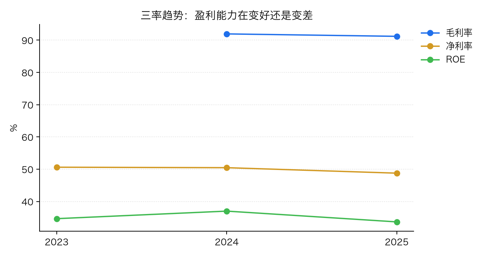
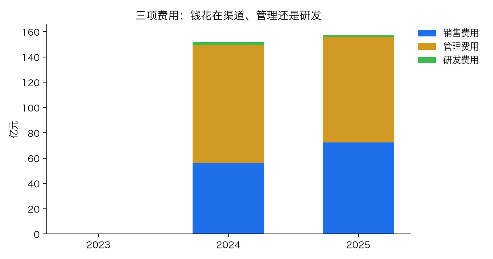
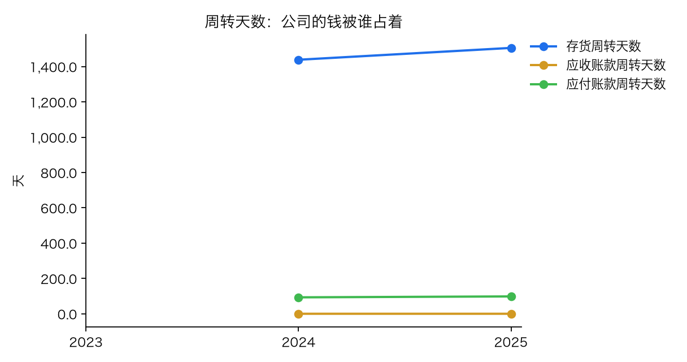
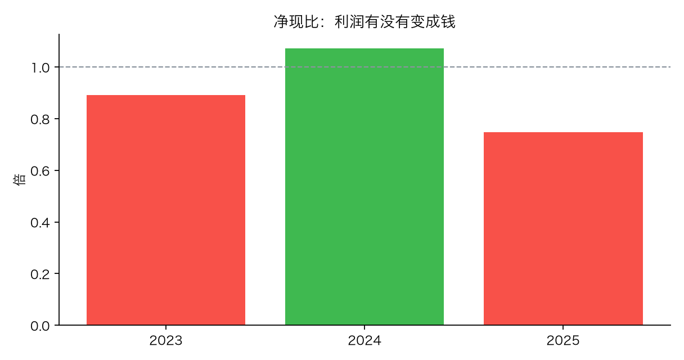

# 贵州茅台（600519.SH）2025 年报深度解读

## 一页纸

**收入掉头，利润掉得比收入多。** 营业收入 1,688.38 亿元，上年 1,708.99 亿元；归母净利润 823.20 亿元，上年 862.28 亿元（P61、P62）。营业总收入 1,720.54 亿元（P61）比营业收入多一口，那是控股子公司财务公司的利息收入，看白酒主业的规模要用营业收入。

**这个组合在茅台身上不常见：收入降、成本升。** 营业成本 148.92 亿元，上年 137.89 亿元（P61）；销售费用 72.53 亿元，上年 56.39 亿元；管理费用反而从 93.16 亿元降到 83.20 亿元（P61）。钱从管理费用挪到销售费用，方向是往渠道和终端推。

**现金流少了三分之一，但主因不在卖酒。** 经营活动现金流量净额 615.22 亿元，上年 924.64 亿元（P65）。年报自己给的解释是控股子公司吸收集团成员单位存款减少、不可随时支取的同业存款增加（P6）——存款科目反转，不是回款恶化：销售商品收到的现金 1,839.90 亿元还比营业收入高出一些（P64）。

**分红第一次超过当年挣出来的自由现金流。** 分配股利、利润或偿付利息支付的现金 672.42 亿元（P66），经营现金流扣掉资本开支 31.28 亿元（P65）之后不足以覆盖。差额由账上的钱补：货币资金 516.91 亿元（P57）。

**渠道端在收缩打款，这是本期最该盯的一行。** 合同负债 80.07 亿元，上年 95.92 亿元（P58）。先收钱后发货是这门生意的常态，蓄水池变浅通常意味着经销商拿货意愿或节奏变了，而不是会计处理变了。

**两个品类走了两个方向。** 茅台酒 1,464.99 亿元，系列酒 222.75 亿元（P107）。茅台酒的吨价基本没动，系列酒则是销量微增而收入下滑，价格往下走——系列酒在让价换量。

**存货又厚了一层。** 存货 614.27 亿元，上年 543.43 亿元（P57）。基酒要放够年份才能卖，这一项涨是产能与节奏的必然，但它同时意味着未来几年的供给已经定好，价格要靠别的手段守。

**下一年只看三个数：合同负债、存货增速、销售费用。** 第一个说渠道还愿不愿意先打款，第二个说公司还愿不愿意继续存酒，第三个说守价格要花多少钱。EPS 65.66 元（P6）这个数已经被注销式回购改过分母，股本 1,252,270,215 股（P6），别拿它直接当经营改善的证据。

| 指标 | 2023 | 2024 | 2025 |
| :--- | ---: | ---: | ---: |
| 营业收入（亿元） | 1,476.94 | 1,708.99 | 1,688.38 |
| 归母净利润（亿元） | 747.34 | 862.28 | 823.20 |
| 毛利率 | —（不可得） | 91.93% | 91.18% |
| 净利率 | 50.60% | 50.46% | 48.76% |
| ROE | 34.65% | 36.99% | 33.65% |
| ROIC | —（不可得） | 36.87% | 33.57% |
| 经营活动现金流（亿元） | 665.93 | 924.64 | 615.22 |
| 自由现金流（亿元） | —（不可得） | 877.85 | 583.95 |
| 净现比 | 0.89 倍 | 1.07 倍 | 0.75 倍 |
| 资产负债率 | —（不可得） | 19.04% | 16.42% |
| 分红率 | —（不可得） | —（不可得） | 42.56% |

红旗判定：清单共 32 项，命中 1 项，数据不足 17 项（数据不足不等于没问题）。

| 严重度 | 红旗 | 状态 | 观测值 |
| :--- | :--- | :--- | :--- |
| 高 | 分红超过自由现金流 | 命中 | FY2025 分配股利、利润或偿付利息支付的现金 672.42 亿元 vs 自由现金流 583.95 亿元 |

## 生意：钱是怎么赚的

**这门生意用一句话说清：把高粱和小麦放几年，装进瓶子，按自己定的价格卖出去。** 营业收入 1,688.38 亿元，对应营业成本 148.92 亿元（P61、P107）。成本里最大的一块是包装物和基酒的人工与能耗，原料本身占比很小，所以销量翻倍也压不垮毛利。

**真正吃利润的不是成本，是税。** 税金及附加 273.54 亿元（P61），比营业成本高出将近一倍。消费税按出厂价与销量计缴，收入下滑时它按产量走，不会同比例退。理解茅台的价格策略，必须先看这一行：提价的收益里有一部分直接进国库。

**两个品类的地位差得很远。** 茅台酒 1,464.99 亿元，系列酒 222.75 亿元（P107）；前者是产能与配额约束下的稀缺品，后者是要在货架上和别的酱酒竞争的商品。系列酒占收入的一小截，却吃掉了营业成本的一大块（P107）。

**渠道结构已经翻到直销略多。** 直销 845.87 亿元，批发代理 842.51 亿元（P107）。同一瓶酒，直销的单价远高于批发，所以渠道占比每上移一格，收入与毛利都会跟着抬一格——这是近几年结构改善的主线，也是价格体系压力的来源：批发端看到直销价，就会要求重定价。

**卖到哪里，仍然高度集中在国内。** 国内 1,639.80 亿元，国外 48.58 亿元（P107）。海外是品牌溢出，不是第二增长曲线，短期不改估值逻辑。

**客户很散、供应商很集中，和多数制造业相反。** 前五名客户销售额占年度销售总额 10.10%，前五名供应商采购额占年度采购总额 38.12%（P11）。散客户说明议价权在公司手里；集中供应商则意味着包材、酒瓶、物流一旦涨价，成本端没有太多腾挪空间。

**关联方是这门生意绕不开的一端。** 关联方采购金额 13.93 亿元（P11），商标使用权费按年支付给控股股东，销售端又通过集团营销公司走一部分量（P131、P132）。定价机制年报只说「参照市场价、协议价」，没有可比的第三方报价——这部分利润留多少在公司、多少留在集团，是股东结构决定的事，不是经营决定的事。

**并表里还有一家金融子公司，读报表时要把它摘出来。** 营业总收入 1,720.54 亿元，比营业收入多出的那块是财务公司的利息收入（P61）。它同时改变了经营现金流的形态：吸收成员单位存款、同业存放都记在经营活动里，所以这家公司的经营现金流不能直接和净利润比。

**员工三万多人在做一件事。** 员工 34,992 人（P31），研发投入 1.90 亿元（P61）——不是技术驱动，是产地、窖池、年份和品牌驱动。这门生意的门槛不在研发，在时间：基酒要存够年份，产能扩张的回报要等好几年才看得见。

| 品类 | 2025 | 占营业收入 |
| :--- | ---: | ---: |
| 国内收入 | 1,639.80 | 97.1% |
| 茅台酒收入 | 1,465.00 | 86.8% |
| 直销收入 | 845.87 | 50.1% |
| 批发代理收入 | 842.51 | 49.9% |
| 系列酒收入 | 222.75 | 13.2% |
| 国外收入 | 48.58 | 2.9% |
| **合计** | 1,688.38 | 100.0% |

| 编号 | 严重度 | 判断 | 依据 | 证据 |
| :--- | :--- | :--- | :--- | :--- |
| F-cb-01 | 低 | 营运资本周期拉长 | 存货+应收-应付天数 FY2024 1345 天 → FY2025 1407 天（+62 天） | D-FY2024-inventory_days、D-FY2024-receivable_days、D-FY2025-inventory_days、D-FY2025-receivable_days |

## 五年账

**能拿到的完整三年是 2023 到 2025，五年表这一份年报没给到底。** 年报「近三年主要会计数据」只列三年（P6），所以这里的轨迹从 FY2023 起算；要看更长周期得另外调取历史年报。

**三年走的是一个完整的起伏：先冲高，再回落。** 营业收入 1,476.94 亿元、1,708.99 亿元、1,688.38 亿元（P6）。FY2024 那个台阶是提价与渠道结构同时发力，FY2025 把多出来的一部分还了回去。

**利润的轨迹比收入陡。** 归母净利润 747.34 亿元、862.28 亿元、823.20 亿元（P6）。从 FY2024 到 FY2025，收入退了一小步，归母退了一大步——收入之外还有一层利润率压缩，主要是销售费用与产品结构。

**现金流是最不稳定的那一行。** 经营活动现金流量净额 665.93 亿元、924.64 亿元、615.22 亿元（P6）。三年里最高与最低差了三成多，而同期净利润只波动一成多。差在财务公司：成员单位存款和同业存款的进出记在经营活动里，把这条线搅得比主业剧烈。

**资产与净资产每年都在长，长得很稳。** 总资产 2,726.99 亿元、2,989.46 亿元、3,038.35 亿元，归母净资产 2,156.69 亿元、2,331.06 亿元、2,446.38 亿元（P6）。没有杠杆，也没有大额并购，增长几乎全部来自留存利润。

**股本三年里只动过一次，是回购注销。** 1,256,197,800 股、1,256,197,800 股、1,252,270,215 股（P6）。FY2025 注销了回购的股份，分母变小，所以每股收益的跌幅小于净利润的跌幅——这是算术，不是经营变好。

**看一眼三年的利润率方向，就知道现在处在哪一段。** FY2023 到 FY2024 是收入与利润率同向上行，FY2024 到 FY2025 是收入下行的同时费用率上行。历史上这家公司每次遇到这段区间，都会用控量保价把吨价托住，代价是收入增速让位。

**三年数据够判断趋势，不够判断周期。** 白酒的库存周期以五年计，基酒从投产到出厂也要五年左右。三年的时间窗能看清方向，看不出这一轮调整在历史里的位置——这是这份年报本身的信息边界，不是分析口径的问题。

| 项目 | 2023 | 2024 | 2025 |
| :--- | ---: | ---: | ---: |
| 营业收入（亿元） | 1,476.94 | 1,708.99 | 1,688.38 |
| 毛利（亿元） | —（不可得） | 1,571.10 | 1,539.46 |
| 营业利润（亿元） | —（不可得） | 1,196.89 | 1,148.09 |
| 归母净利润（亿元） | 747.34 | 862.28 | 823.20 |
| 经营活动现金流（亿元） | 665.93 | 924.64 | 615.22 |
| 自由现金流（亿元） | —（不可得） | 877.85 | 583.95 |
| ROE | 34.65% | 36.99% | 33.65% |
| 净利率 | 50.60% | 50.46% | 48.76% |

*数据来源：公司年度报告原文（页码见正文引用），金额为合并报表口径。*

### 杜邦分解

| 项目 | 2023 | 2024 | 2025 |
| :--- | ---: | ---: | ---: |
| ROE | 34.65% | 36.99% | 33.65% |
| 净利率 | 50.60% | 50.46% | 48.76% |
| 总资产周转率（次） | 0.54 倍 | 0.57 倍 | 0.56 倍 |
| 权益乘数（倍） | 1.26 倍 | 1.28 倍 | 1.24 倍 |

## 利润表：从毛利到归母

**从营业总收入到归母净利润，中间隔着一道税、一道费用和一道少数股东。** 营业总收入 1,720.54 亿元、营业收入 1,688.38 亿元（P61）；后者才是白酒口径，前者多出的是财务公司利息收入。

**第一道是营业成本，几乎不构成压力。** 148.92 亿元（P61），比上年 137.89 亿元多花了 11 亿元，主要是系列酒的销量与包材。成本涨得比收入快，是本期毛利率下移的唯一来源。

**第二道是税金及附加，这才是这家公司最大的一笔「费用」。** 273.54 亿元（P61），上年 269.26 亿元，收入下滑它反而略增。消费税跟着产量和出厂价走，不跟利润走，所以它在收入下行期会显得更重。

**第三道是三项费用，本期方向相反。** 销售费用 72.53 亿元（上年 56.39 亿元），管理费用 83.20 亿元（上年 93.16 亿元），研发费用 1.90 亿元（P61）。销售费用里广告宣传费 18.29 亿元（上年 13.35 亿元，P61），钱花在终端与市场推广上；管理费用被压下来，更像是内部开支的收缩。

**财务费用是负的，公司靠利息挣钱。** 财务费用 -8.15 亿元，其中利息收入 8.43 亿元、利息支出 0.29 亿元（P61）。上年财务费用 -14.70 亿元、利息收入 14.77 亿元——存款利率下行直接压掉了这部分收益，这是利润表上最容易被忽略的一处同比下降。

**走完这几道，剩下营业利润 1,148.09 亿元、利润总额 1,147.55 亿元（P62）。** 两者只差一点点，说明营业外收支可以忽略；有效税率 25.66%（P62 附注、红旗规则同源），与 25% 的法定税率基本吻合，没有明显的税收筹划痕迹。

**净利润 853.10 亿元，归母 823.20 亿元，少数股东损益 29.90 亿元（P62）。** 少数股东拿走近 3.5%，主要来自系列酒与销售体系的非全资子公司。合并利润的成色要看归母那一行，趋势判断也应当用归母。

**研发口径有一处对不上，值得记一笔。** 利润表研发费用 1.90 亿元（P61），而研发投入表里的费用化研发投入是另一个更大的数（P12），差额被解释为「列入生产成本的研发支出」，但没有给出拆分。这类口径差异不影响利润总额，影响的是研发强度的可比性。

### 三项费用与销售投入

| 项目 | 2023 | 2024 | 2025 |
| :--- | ---: | ---: | ---: |
| 销售费用（亿元） | —（不可得） | 56.39 | 72.53 |
| 管理费用（亿元） | —（不可得） | 93.16 | 83.20 |
| 研发费用（亿元） | —（不可得） | 2.18 | 1.90 |
| 财务费用（亿元） | —（不可得） | -14.70 | -8.15 |
| 其中：广告营销费（亿元） | —（不可得） | 13.35 | 18.29 |

*数据来源：公司年度报告原文（页码见正文引用），金额为合并报表口径。*

### 研发与人员

| 项目 | 2023 | 2024 | 2025 |
| :--- | ---: | ---: | ---: |
| 研发费用（亿元） | —（不可得） | 2.18 | 1.90 |
| 在职员工（人） | —（不可得） | —（不可得） | 34,992 |
| 关联方采购（亿元） | —（不可得） | —（不可得） | 13.93 |

广告营销费见销售费用附注（P108）；关联采购额见「主要供应商」段落（P11）。

## 资产负债表：钱在哪、欠谁

**资产 3,038.35 亿元，负债 498.76 亿元，权益 2,539.59 亿元（P59）。** 有息负债基本没有，短期借款、长期借款两栏都是空白（P58）。这家公司的资产负债表问题从来不是能不能还债，而是钱堆在哪、堆得有没有效率。

**最厚的一块不是现金，是存货。** 存货 614.27 亿元，上年 543.43 亿元（P57）；货币资金 516.91 亿元，上年 592.96 亿元（P57）。存货是基酒与半成品，按成本计价，不会跌，但也不能马上变成钱——它是这门生意的产能储备，也是未来五年的销量上限。

**现金少了 76 亿元，不是跑了，是换了形状。** 拆出资金与一年内到期的非流动资产在期内外来回搬（P57、P65），本质上是大额存单在滚动。判断流动性要看「货币资金 + 拆出资金 + 一年内到期存单」合计，只看货币资金会得到错误结论。

**应收几乎不存在，这是强势生意的标志。** 应收账款 0.03 亿元（P57），应收票据 19.84 亿元（P57）。经销商先打款后拿货，公司不需要给别人账期；票据那部分是有银行承兑的，质量比应收账款更好。

**负债端最值得看的是合同负债，不是借款。** 合同负债 80.07 亿元，上年 95.92 亿元（P58）；应付账款 40.07 亿元，上年 35.15 亿元（P58）。预收款下降、应付增加，说明本期公司在渠道端的收款节奏慢了、在供应商端的账期用得更足。

**长期资产在扩张，但速度克制。** 固定资产 224.88 亿元（上年 218.71 亿元）、在建工程 24.72 亿元（上年 21.50 亿元）、无形资产 86.86 亿元（上年 88.50 亿元，P57）。在建工程相对固定资产的比例很低，扩产项目还在早期投入阶段，折旧压力暂时不会上来。

**递延所得税资产 66.02 亿元，比上年 55.20 亿元增了不少（P57）。** 这块主要来自内部交易未实现利润——货在集团内部搬了一遍但没卖出去，税先交了、利润没确认。收入负增长的年份，它能不能转回取决于后面能不能卖出去。

**权益的变化只有两个来源：利润留存与回购注销。** 归母权益 2,446.38 亿元（上年 2,331.06 亿元），少数股东权益 93.21 亿元（上年 89.05 亿元，P59）。FY2025 用 60 亿元回购并注销，冲减股本、资本公积与盈余公积，是净资产增速低于净利润增速的直接原因。

**这份资产负债表的读法是「找错配」，不是「找风险」。** 一家零杠杆、现金与存货占了大半资产的公司，风险不会出在偿债上；能出问题的地方只有两处：存货估值假设是否成立，以及现金的存放形态是否真实可支配。

### 资产端

| 项目 | 2023 | 2024 | 2025 |
| :--- | ---: | ---: | ---: |
| 货币资金（亿元） | —（不可得） | 592.96 | 516.91 |
| 应收账款（亿元） | —（不可得） | 0.19 | 0.03 |
| 存货（亿元） | —（不可得） | 543.43 | 614.27 |
| 流动资产合计（亿元） | —（不可得） | 2,517.27 | 2,525.19 |
| 固定资产（亿元） | —（不可得） | 218.71 | 224.88 |
| 无形资产（亿元） | —（不可得） | 88.50 | 86.86 |
| 资产总计（亿元） | 2,727.00 | 2,989.45 | 3,038.35 |

### 负债与权益

| 项目 | 2023 | 2024 | 2025 |
| :--- | ---: | ---: | ---: |
| 应付账款（亿元） | —（不可得） | 35.15 | 40.07 |
| 合同负债（亿元） | —（不可得） | 95.92 | 80.07 |
| 短期借款 | —（不可得） | —（不可得） | —（不可得） |
| 长期借款 | —（不可得） | —（不可得） | —（不可得） |
| 流动负债合计（亿元） | —（不可得） | 565.16 | 496.10 |
| 归母权益（亿元） | 2,156.69 | 2,331.06 | 2,446.38 |
| 少数股东权益（亿元） | —（不可得） | 89.05 | 93.21 |
| 所有者权益合计（亿元） | —（不可得） | 2,420.11 | 2,539.59 |

*数据来源：公司年度报告原文（页码见正文引用），金额为合并报表口径。*

## 现金流量表：利润变成了什么

**三段现金流的方向很清楚：经营大幅流入、投资大额流出、筹资大额流出。** 经营活动 615.22 亿元，投资活动 -316.42 亿元，筹资活动 -734.27 亿元（P65、P66）。三者相加，账上现金净减少。

**经营现金流的下滑要拆开看，否则会误判主业。** 615.22 亿元，上年 924.64 亿元（P65）。年报把它归因于控股子公司吸收集团成员单位存款减少、不可随时支取的同业存款增加（P6）。这两项都记在经营活动里，与卖酒无关；真正的回款证据是销售商品、提供劳务收到的现金 1,839.90 亿元（P64），比营业收入还高，收现比没有恶化。

**投资活动的流出，是在搬存单。** -316.42 亿元，上年只有 -17.85 亿元（P65）。钱从「拆出资金」搬到「一年内到期的非流动资产」，科目换了、性质没变。资本开支 31.28 亿元（P65），比上年 46.79 亿元还少——产能扩张并没有加速。

**筹资活动几乎只有一件事：分红。** -734.27 亿元（P66），其中分配股利、利润或偿付利息支付的现金 672.42 亿元（P66）。上年这一项是 709.51 亿元，绝对额降了，但相对当年利润的比例没有降。

**自由现金流第一次不够分红。** 经营现金流 615.22 亿元减去资本开支 31.28 亿元，剩下的不够支付 672.42 亿元（P65、P66）。差额由存量现金补上。这在账上有五百多亿现金时不是危机，但它意味着分红政策已经不能靠当年的现金创造自我维持。

**按经营现金流与净利润算出来的净现比，直接拿来当红旗会误判。** 分母里的净利润含财务公司，分子也被存款科目搅动过，两者不同源。要把金融子公司摘出去再算一次，才有意义——这一步需要分部口径的现金流，年报没有披露。

**营运资本的摆动方向，比绝对值更值得记。** 存货增加、合同负债减少，两项同向占用现金；应付账款增加提供了一点对冲。这套组合在白酒行业里通常出现在动销放缓的年份，而不是扩张年份。

**下一年看现金流，只看两个问题。** 一是存款科目还会不会继续反向搅动经营现金流，二是分红相对自由现金流的缺口会不会连续第二年出现。前者决定报表读数，后者决定分红政策要不要改。

| 项目 | 2023 | 2024 | 2025 |
| :--- | ---: | ---: | ---: |
| 经营活动现金流（亿元） | 665.93 | 924.64 | 615.22 |
| 投资活动现金流（亿元） | —（不可得） | -17.85 | -316.42 |
| 筹资活动现金流（亿元） | —（不可得） | -710.68 | -734.27 |
| 资本性支出（亿元） | —（不可得） | 46.79 | 31.28 |
| 自由现金流（亿元） | —（不可得） | 877.85 | 583.95 |
| 净现比 | 0.89 倍 | 1.07 倍 | 0.75 倍 |

*数据来源：公司年度报告原文（页码见正文引用），金额为合并报表口径。*

## 附注深挖

**附注优先级。** 77 条附注，按这家公司自己的数字排队：先看金额占收入最大的，再看变动最剧烈的，最后是公司自己措辞最软的那几条。◆ 重点 52 条、◇ 常规 25 条。

| 序 | 附注 | 类型 | 层级 | 涉及金额（亿元） | 占收入 | 判断密度 | 页 |
| ---: | :--- | :--- | :--- | ---: | ---: | ---: | :--- |
| 1 | 44 营业收入和营业成本 | 金额型 | ◆ | 1,688.38 | 100.0% | 0.0 | P107–P107 |
| 2 | 11 存货 | 金额型 | ◆ | 614.27 | 36.4% | 0.9 | P77–P77 |
| 3 | 58 所得税费用 | 金额型 | ◆ | 294.45 | 17.4% | 0.0 | P111–P111 |
| 4 | 14 固定资产 | 金额型 | ◆ | 224.88 | 13.3% | 0.0 | P78–P78 |
| 5 | 17 无形资产 | 金额型 | ◆ | 86.86 | 5.1% | 1.6 | P80–P80 |
| 6 | 10 金融工具 | 风险型 | ◆ | — | — | 3.5 | P74–P76 |
| 7 | 24 其他重要的会计政策和会计估计 | 政策型 | ◆ | — | — | 4.0 | P83–P83 |
| 8 | 54 信用减值损失 | 估计型 | ◆ | — | — | 0.0 | P110–P110 |
| 9 | 十四、关联方及关联交易 | 交易型 | ◆ | 13.93 | 0.8% | 0.0 | P124–P134 |
| 10 | 十五、承诺及或有事项 | 承诺型 | ◆ | — | — | 0.0 | P135–P135 |
| 11 | 29 合同负债 | 金额型 | ◆ | 80.07 | 4.7% | 0.0 | P102–P102 |
| 12 | 28 应付账款 | 金额型 | ◆ | 40.07 | 2.4% | 0.0 | P102–P102 |
| 13 | 15 在建工程 | 金额型 | ◆ | 24.72 | 1.5% | 0.8 | P79–P79 |
| 14 | 50 财务费用 | 金额型 | ◆ | 8.15 | 0.5% | 0.0 | P109–P109 |
| 15 | 18 长期待摊费用 | 金额型 | ◆ | — | — | 1.6 | P80–P80 |
| 16 | 19 职工薪酬 | 交易型 | ◆ | — | — | 1.6 | P80–P80 |
| 17 | 12 长期股权投资 | 金额型 | ◆ | — | — | 0.9 | P77–P77 |
| 18 | 八、研发支出 | 金额型 | ◆ | 1.90 | 0.1% | 0.0 | P118–P118 |
| 19 | 七、合并财务报表项目注释 | 金额型 | ◆ | — | — | 0.4 | P84–P101 |
| 20 | 十八、母公司财务报表主要项目注释 | 金额型 | ◆ | — | — | 0.4 | P137–P141 |
| 21 | 25 重要会计政策和会计估计的变更 | 政策型 | ◆ | — | — | 4.0 | P83–P83 |
| 22 | 六、税项 | 政策型 | ◆ | — | — | 4.0 | P83–P83 |
| 23 | 20 收入 | 金额型 | ◆ | — | — | 0.0 | P81–P81 |
| 24 | 31 应付职工薪酬 | 交易型 | ◆ | — | — | 0.0 | P103–P103 |
| 25 | 35 其他流动负债 | 金额型 | ◆ | — | — | 0.0 | P105–P105 |
| 26 | 36 租赁负债 | 金额型 | ◆ | — | — | 0.0 | P105–P105 |
| 27 | 37 股本 | 金额型 | ◆ | — | — | 0.0 | P105–P105 |
| 28 | 38 资本公积 | 金额型 | ◆ | — | — | 0.0 | P105–P105 |
| 29 | 39 库存股 | 金额型 | ◆ | — | — | 0.0 | P105–P105 |
| 30 | 40 其他综合收益 | 金额型 | ◆ | — | — | 0.0 | P106–P106 |
| 31 | 41 盈余公积 | 金额型 | ◆ | — | — | 0.0 | P106–P106 |
| 32 | 43 未分配利润 | 金额型 | ◆ | — | — | 0.0 | P106–P106 |
| 33 | 46 税金及附加 | 金额型 | ◆ | — | — | 0.0 | P108–P108 |
| 34 | 47 销售费用 | 金额型 | ◆ | — | — | 0.0 | P108–P108 |
| 35 | 48 管理费用 | 金额型 | ◆ | — | — | 0.0 | P108–P108 |
| 36 | 49 研发费用 | 金额型 | ◆ | — | — | 0.0 | P109–P109 |
| 37 | 51 其他收益 | 金额型 | ◆ | — | — | 0.0 | P109–P109 |
| 38 | 53 公允价值变动收益 | 金额型 | ◆ | — | — | 0.0 | P110–P110 |
| 39 | 55 资产处置收益 | 金额型 | ◆ | — | — | 0.0 | P111–P111 |
| 40 | 56 营业外收入 | 金额型 | ◆ | — | — | 0.0 | P111–P111 |
| 41 | 57 营业外支出 | 金额型 | ◆ | — | — | 0.0 | P111–P111 |
| 42 | 59 其他综合收益 | 金额型 | ◆ | — | — | 0.0 | P112–P112 |
| 43 | 60 现金流量表项目 | 金额型 | ◆ | — | — | 0.0 | P112–P113 |
| 44 | 61 现金流量表补充资料 | 金额型 | ◆ | — | — | 0.0 | P114–P115 |
| 45 | 65 数据资源 | 金额型 | ◆ | — | — | 0.0 | P118–P118 |
| 46 | 九、合并范围的变更 | 交易型 | ◆ | — | — | 0.0 | P119–P119 |
| 47 | 十、在其他主体中的权益 | 交易型 | ◆ | — | — | 0.0 | P120–P120 |
| 48 | 十七、其他重要事项 | 交易型 | ◆ | — | — | 0.0 | P136–P136 |
| 49 | 十九、补充资料 | 金额型 | ◆ | — | — | 0.0 | P142–P143 |
| 50 | 21 政府补助 | 金额型 | ◆ | 0.29 | 0.0% | 0.0 | P81–P81 |
| 51 | 十一、政府补助 | 金额型 | ◆ | 0.29 | 0.0% | 0.0 | P121–P121 |
| 52 | 52 投资收益 | 金额型 | ◆ | 0.01 | 0.0% | 0.0 | P110–P110 |
| 53 | 3 营业周期 | 政策型 | ◇ | — | — | 2.0 | P72–P72 |
| 54 | 4 记账本位币 | 政策型 | ◇ | — | — | 2.0 | P72–P72 |
| 55 | 23 租赁 | 政策型 | ◇ | — | — | 2.0 | P82–P82 |
| 56 | 五、重要会计政策及会计估计 | 政策型 | ◇ | — | — | 2.0 | P72–P72 |
| 57 | 5 重要性标准确定方法和选择依据 | 政策型 | ◇ | — | — | 1.5 | P73–P73 |
| 58 | 7 控制的判断标准和合并财务报表的编制方法 | 政策型 | ◇ | — | — | 1.5 | P73–P73 |
| 59 | 64 租赁 | 政策型 | ◇ | — | — | 1.0 | P117–P117 |
| 60 | 16 借款费用 | 政策型 | ◇ | — | — | 0.8 | P79–P79 |
| 61 | 8 现金及现金等价物的确定标准 | 政策型 | ◇ | — | — | 0.0 | P74–P74 |
| 62 | 9 外币业务和外币报表折算 | 政策型 | ◇ | — | — | 0.0 | P74–P74 |
| 63 | 13 投资性房地产 | 政策型 | ◇ | — | — | 0.0 | P78–P78 |
| 64 | 十二、与金融工具相关的风险 | 风险型 | ◇ | — | — | 1.0 | P122–P122 |
| 65 | 十三、公允价值的披露 | 风险型 | ◇ | — | — | 1.0 | P123–P123 |
| 66 | 十六、资产负债表日后事项 | 风险型 | ◇ | — | — | 0.0 | P136–P136 |
| 67 | 27 其他 | 未归类 | ◇ | — | — | 4.0 | P83–P83 |
| 68 | 1 公司概况 | 未归类 | ◇ | — | — | 2.0 | P72–P72 |
| 69 | 2 持续经营 | 未归类 | ◇ | — | — | 2.0 | P72–P72 |
| 70 | 三、公司基本情况 | 未归类 | ◇ | — | — | 2.0 | P72–P72 |
| 71 | 四、财务报表的编制基础 | 未归类 | ◇ | — | — | 2.0 | P72–P72 |
| 72 | 30 吸收存款及同业存放 | 未归类 | ◇ | — | — | 0.0 | P103–P103 |
| 73 | 32 应交税费 | 未归类 | ◇ | — | — | 0.0 | P104–P104 |
| 74 | 33 其他应付款 | 未归类 | ◇ | — | — | 0.0 | P104–P104 |
| 75 | 42 一般风险准备 | 未归类 | ◇ | — | — | 0.0 | P106–P106 |
| 76 | 62 所有者权益变动表项目注释 | 未归类 | ◇ | — | — | 0.0 | P116–P116 |
| 77 | 63 外币货币性项目 | 未归类 | ◇ | — | — | 0.0 | P116–P116 |

**附注的体量本身就是一个信号：七十多条注释里，绝大多数在交代会计政策与科目明细，真正的判断藏在三处——存货、关联交易、税务。** 前两处决定这家公司值多少钱，第三处决定利润的可持续性。

**第一处：存货几乎不计提跌价准备。** 存货 614.27 亿元（P57），其中自制半成品与在产品占绝大部分（P91），而跌价准备只有百万元量级（P91）。会计政策写的是「按单个项目成本高于可变现净值的差额计提」（P77），但可变现净值的确定依据——哪一年的基酒按什么价格、扣多少税费——一处都没有披露。对一家把利润押在时间上的公司，这是判断依据的缺失，不是计提不足。

**第二处：关联交易的两端都绑在同一个控制方身上。** 关联方采购 13.93 亿元（P11），另外还向控股股东体系支付商标使用权费、通过集团营销公司销售成品酒（P131、P132）。年报的定价表述是「参照独立第三方价格、协议价」，可比报价栏是空的。这意味着集团内利润怎么分，由协议决定，而不是由市场竞争决定——投资者能看到的只是结果，看不到议价过程。

**第三处：财务公司是并表里的另一门生意。** 它吸收集团成员单位存款、向同业存放、给关联方放贷（P127、P128）。存款端规模远大于贷款端，实质是集团资金归集平台。它同时解释了经营现金流的剧烈波动，以及为什么「营业总收入」比「营业收入」多出一块。

**税务一栏的看点不是税率，是口径。** 有效税率与法定税率基本吻合，递延所得税资产 66.02 亿元（P57）主要挂在内部交易未实现利润上（P116）。消费税计缴在附注里只给结果不给过程，白酒行业的从量从价复合计征在这里看不到拆解，只能靠税金及附加与销量的关系倒推。

**审计意见是标准无保留，关键审计事项两项：收入确认、关联方交易（P54）。** 这两项正是上面第一、第二处的镜像——审计师也认为收入与关联交易是本期最容易出错的地方。值得注意的是，存货估值没有进关键审计事项，而它恰好是这家公司最大的会计估计。

**有几处披露对不上，需要回头核对原文。** 一年内到期债权投资的减值明细与三阶段表有几十万元级的差额（P92）；投资收益明细与合计差一笔（P110）；日后事项里把资产负债表日之后的投资与回购放在「其他重要事项」而不是「非调整事项」（P136）。这些都是几十万到几百万量级的差异，不影响结论，但说明附注的编制精度不是无懈可击。

**附注读完的整体感觉：政策的保守方向是对的，披露的颗粒度不够。** 折旧年限偏短、费用化偏多、跌价几乎不提——这些都指向「不美化利润」。反过来，可变现净值依据、关联定价机制、分部现金流三处都缺，读的人只能接受结论，无法验证结论。

**按类型看分布。** 同一类附注问的是同一个问题；哪一类页数多、密度高，说明公司的判断就堆在那里。

| 类型 | 条数 | 页数 | 平均判断密度 | 最该看的一条 |
| :--- | ---: | ---: | ---: | :--- |
| 金额型 | 40 | 64 | 0.2 | 44 营业收入和营业成本（P107） |
| 政策型 | 14 | 14 | 1.8 | 24 其他重要的会计政策和会计估计（P83） |
| 未归类 | 11 | 11 | 1.1 | 27 其他（P83） |
| 交易型 | 6 | 16 | 0.3 | 十四、关联方及关联交易（P124） |
| 风险型 | 4 | 6 | 1.4 | 10 金融工具（P74） |
| 估计型 | 1 | 1 | 0.0 | 54 信用减值损失（P110） |
| 承诺型 | 1 | 1 | 0.0 | 十五、承诺及或有事项（P135） |

## 谁在分钱

**这家公司的分红，本质上是贵州省财政的现金流。** 控股股东是中国贵州茅台酒厂（集团）有限责任公司，实际控制人是贵州省人民政府国有资产监督管理委员会（P51）。集团与关联方合计持股过半，分红的最大受益方是国资，公众股东按比例分享但没有控制权。

**分红要分两个口径看，只看一个会得出相反结论。** 本年度利润分配预案的现金分红 350.33 亿元，对应归母净利润 823.20 亿元（P33、P62），纯派息口径只有四成多；把以现金方式回购并计入分红的 61.20 亿元算进来，合计 711.53 亿元（P33），才到八成以上。两个数的差距就是回购在这套回报体系里的分量。

**回购是第二条回报通道，而且是注销式的。** 报告期内回购 60 亿元并全部注销，股本从 1,256,197,800 股降到 1,252,270,215 股（P6、P105）。注销式回购提高每股收益，与股权激励式回购的性质完全不同：钱落在每股上，不落在员工手里。本期中期已经派过 23.957 元/股，年度预案再派 27.993 元/股（P33）。

**少数股东分走的不多，但来源集中。** 少数股东损益 29.90 亿元（P62），少数股东权益 93.21 亿元（P59）。这部分主要来自系列酒与销售体系的非全资子公司，与集团合资的平台公司是主要载体。

**关联方是另一条「分钱」通道，规模比少数股东大得多。** 关联方采购 13.93 亿元（P11），商标使用权费按年支付给控股股东（P131），销售端通过集团营销公司走量（P132）。这些安排每年都在发生、金额稳定，属于这门生意的结构性成本，不是一次性事项。

**股权结构里没有质押、没有解禁压力。** 控股股东持股无质押、无限售安排，报告期内还有增持（P47、P48）。前十大股东以国资、指数基金与北向资金为主，唯一显著的减持方是香港中央结算（P48）。

**治理上有一处明确的未了事项：股权激励承诺逾期未履行。** 年报治理专项自查承认控股股东尚未履行实施股权激励计划的承诺，承诺履行情况表勾的是「否」，理由写的是上级主管部门未出台相关指导意见（P35、P37）。这是唯一被公司自己承认的实质治理缺陷。

**还有一处需要读者自己判断：报告期后的人事变动。** 年报披露了高级管理人员被留置、免职的公告索引（P39），正文没有交代事由与财务影响，也没有说明对经营的影响。这类事项在年报里的处理方式通常是「只给索引」，读者只能自己去查公告。

| 项目 | 2023 | 2024 | 2025 |
| :--- | ---: | ---: | ---: |
| 归母净利润（亿元） | 747.34 | 862.28 | 823.20 |
| 少数股东损益（亿元） | —（不可得） | 31.07 | 29.90 |
| 归母权益（亿元） | 2,156.69 | 2,331.06 | 2,446.38 |
| 少数股东权益（亿元） | —（不可得） | 89.05 | 93.21 |
| 每股派息（元/股） | —（不可得） | 27.624 | 27.993 |
| 分配股利支付的现金（亿元） | —（不可得） | 709.51 | 672.42 |

## 红旗与跟踪清单

**主表这一层只命中一条红旗：分红超过自由现金流。** 分配股利、利润或偿付利息支付的现金 672.42 亿元，而经营现金流 615.22 亿元减资本开支 31.28 亿元只剩五百多亿（P65、P66）。这不是偿债风险，是分红政策与现金创造能力开始脱钩的第一个信号。

**第二条不是红旗，是读数陷阱：经营现金流的下滑。** 615.22 亿元比上年 924.64 亿元少了三分之一（P65），但拖累来自财务公司的存款科目（P6）。若直接把它当经营恶化，会得出与事实相反的结论；若完全忽略，又会漏掉存款搬家的真实信息。正确做法是把金融子公司摘出来单看，而这需要分部现金流——年报没有给。

**第三条要看渠道：合同负债在减少。** 80.07 亿元，上年 95.92 亿元，同比 -16.53%（P58，红旗规则同源）。预收款是经销商对未来的投票，它连续下降通常先于收入下降出现。同时销售费用 72.53 亿元、广告宣传费 18.29 亿元都在加码（P61），一减一加，指向动销端要靠投入维持。

**第四条要看产品：系列酒在让价。** 茅台酒收入基本持平、销量微增，系列酒销量微增而收入下滑（P11、P107）。系列酒的毛利率本来就低，价格再往下走，它对合并毛利的拖累会被放大。这条趋势如果延续两年，收入结构的故事就要重写。

**第五条要看存货：+13.0% 的增速快过收入（P57，红旗规则同源）。** 存货增加对白酒不是坏事，基酒越存越值钱；但它同时锁定未来几年的供给量。供给已经确定、需求在走弱，价格就只能靠控量与渠道管理来守。

**第六条在附注里：存货跌价准备基本为零。** 六百多亿存货、百万元量级的准备（P91），而可变现净值的确定依据没有披露。基酒不存在过期问题，这一项在正常情况下确实不需要计提；真正的风险不在计提，而在「不需要计提」这个假设本身没有被检验过。

**第七条在治理上：股权激励承诺逾期未履行，且报告期后有人事变动。** 前者是承诺表里唯一勾「否」的一项（P37），后者只有公告索引没有说明（P39）。两条都不改变当年的利润，但都会影响对治理质量的评价。

**下一年盯四个数，其余都是解释。** 合同负债的方向（80.07 亿元这条线还降不降）、销售费用的绝对额（72.53 亿元还加不加）、系列酒的收入（222.75 亿元守不守得住）、以及分红与自由现金流的缺口（672.42 亿元对五百多亿）会不会连续第二年出现。

**数据边界要说清：这份年报只提供三年可比数。** 红旗规则里需要三期的项目已经能跑，需要五年趋势的项目在本次分析里没有数据支撑（P6）。判断「这一轮调整在历史里的位置」，需要另调历史年报，不是这份报告能回答的问题。

**附注口径的红旗读数。** 下面这几行主表看不到，全部来自附注：它们是「利润里有多少不是主业挣的」「商誉还剩多少没摊」「钱是不是真在账上」的直接答案，缺的那几行就是这家公司没披露、或我们的抽取还没拿下。

| 项目 | 2024 | 2025 |
| :--- | ---: | ---: |
| 关联采购占营业成本比例 | —（不可得） | 9.35% |
| 其他收益占利润总额 | 0.02% | 0.02% |
| 存款类资产隐含收益率 | 2.49% | 1.63% |
| 在建工程占固定资产 | 9.83% | 10.99% |

| 严重度 | 红旗 | 状态 | 观测值 |
| :--- | :--- | :--- | :--- |
| 高 | 分红超过自由现金流 | 命中 | FY2025 分配股利、利润或偿付利息支付的现金 672.42 亿元 vs 自由现金流 583.95 亿元 |
| 高 | 毛利率显著高于同业且无法解释 | 数据不足 | 需人工核对（附注/公告原文） |
| 高 | 商誉占归母净资产过高 | 数据不足 | 商誉 / 归母权益 最近 1 期数据不全 |
| 高 | 商誉减值反复出现（挤牙膏式减值） | 数据不足 | 部分子条件数据不足：商誉减值损失 在最近 2 期数据不全，且 商誉减值覆盖率 在最近 1 期数据不全 |
| 高 | 大存大贷：高额类现金与高额有息负债并存 | 数据不足 | 部分子条件数据不足：银行借款 / 资产总计 最近 1 期数据不全，且 FY2025 货币资金/资产总计 = 17.01% |
| 高 | 研发资本化率异常抬升 | 数据不足 | 需人工核对（附注/公告原文） |
| 高 | 非经常性损益占利润过高 | 数据不足 | 需人工核对（附注/公告原文） |
| 高 | 审计意见非标准无保留 | 数据不足 | 需人工核对（附注/公告原文） |
| 高 | 控股股东高比例质押 | 数据不足 | 需人工核对（附注/公告原文） |
| 高 | 收现比长期低于 1 | 数据不足 | 销售商品、提供劳务收到的现金 / 营业收入 最近 3 期数据不全 |
| 中 | 每年都有大额并购支出 | 数据不足 | 需人工核对（附注/公告原文） |
| 中 | 第四季度利润异常（亏损或占比畸高） | 数据不足 | 需人工核对（附注/公告原文） |
| 中 | 财务总监频繁更换 | 数据不足 | 需人工核对（附注/公告原文） |
| 中 | 递延所得税资产增速远超收入 | 数据不足 | 递延所得税资产 与 营业收入 的同比数据不足 |
| 中 | 短期借款支撑长期资产（短债长投） | 数据不足 | 部分子条件数据不足：短期借款 / 银行借款 最近 1 期数据不全，且 货币资金 / 短期借款 最近 1 期数据不全 |
| 中 | 资本开支长期低于折旧（吃老本） | 数据不足 | 资本开支 / 折旧与摊销 最近 3 期数据不全 |
| 中 | 折旧率明显低于同业 | 数据不足 | 折旧率 在最近 1 期数据不全 |
| 中 | PE 被一次性收益压低 | 数据不足 | 需人工核对（附注/公告原文） |
