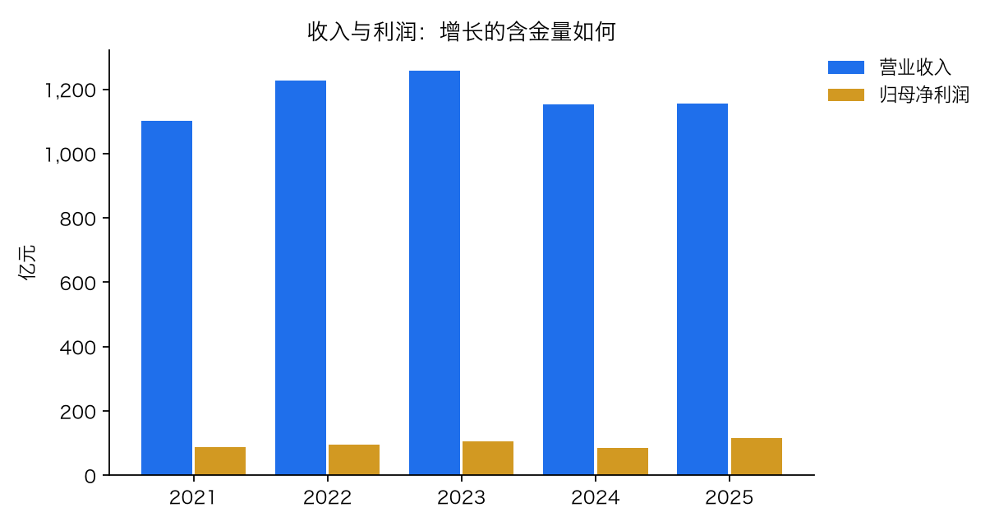

# 伊利股份（600887.SH）公司分析

## 一页纸

**结论一：收入进入平台期，现金释放靠利润率修复与资本开支收缩。** 营业收入 1,156.36 亿元、归母
净利润 115.65 亿元（P86、P87），资本开支已从 FY2023 的 69.56 亿元压缩到 30.37 亿元（P90）。
收入几乎不动而利润创出八年最高，差额来自毛利结构与开支收缩，不是销量。

**结论二：利润创新高有相当比例来自减值出清，而不是主业效率跃升。** 资产减值损失从 FY2024 的
-46.76 亿元收窄到 -7.30 亿元、信用减值损失从 -5.55 亿元收窄到 -2.68 亿元（P86），而毛利只从
390.94 亿元走到 399.82 亿元（P86）。两年之间利润总额的增量主要来自减值项少提，不是毛利放大。

**结论三：资本结构是全篇最容易被误读的一处。** 短期借款 456.31 亿元对货币资金 194.95 亿元
（P82、P83）看似紧绷，但其他非流动资产中的大额存单及定期存款达 281.09 亿元（P183），利息收入
21.70 亿元高于利息支出 13.66 亿元（P202）。这是一套「存大额存单、借短期款」的结构，风险在
再融资条件与利差，不在偿付能力。

**生意拆解的一句话版。** 液体乳 704.22 亿元、奶粉及奶制品 330.78 亿元、冷饮 98.22 亿元、其他
12.22 亿元（P242）。四块业务的收入落差很大，但共用同一套冷链与分销网络——这是理解后面所有成本
与费用结构的起点。

**行业位次。** 公司自述液态类乳品零售额市场份额第一，婴幼儿配方奶粉与成人奶粉份额均较上年提升
（P11、P15、P16）。份额在涨而收入不涨，是这份年报里最值得注意的行业事实：龙头地位没有变成
定价权。

**上下游议价。** 应收账款周转天数 9.43 天、应付账款周转天数 55.38 天（P82、P83、P86）。前者说明
对渠道几乎现款现货，后者说明对上游仍有账期话语权——两条曲线一短一长，是这门生意最好的一面。

**治理底色。** 公司无控股股东、无实际控制人；董事会以独立董事占少数、监事会已按新《公司法》
取消（P39、P40、P71）。股权分散带来的是管理层实际主导，这决定了下文对分红与激励的解读
方式。

**股东回报。** 现金分红总额 87.29 亿元、分红率 75.48%，计入以现金方式回购股份的 2.49 亿元后合计
89.78 亿元（P49）。分配的确定性已经被写进制度安排，而不是逐年相机决定。

**红旗与判断计数。** 红旗检查共 33 条：命中 3 条、未命中 13 条、数据不足 17 条。命中三条分别是
短期借款支撑长期资产、分红超过自由现金流、关联采购占营业成本比例过高。

**当前定价位置。** 现价 33.44 元，总股本 6,325,360,667 股，市值 2,113.30 亿元，滚动市盈率 21.25
倍、市净率 3.72 倍（行情，2026-11-26）。这些数字是后文估值部分的锚，公司篇只做引用。

**最需要盯的一个数字。** 下一个披露窗口里，经营活动现金流量净额的方向比收入更重要：它同时是
分红、资本开支与还债的唯一来源端（P89）。它若继续下滑而资本开支回升，一页纸上的三条结论都要
重新检验。

| 指标 | 2021 | 2022 | 2023 | 2024 | 2025 |
| :--- | ---: | ---: | ---: | ---: | ---: |
| 营业收入（亿元） | 1,101.44 亿元 | 1,226.98 亿元 | 1,257.58 亿元 | 1,153.93 亿元 | 1,156.36 亿元 |
| 归母净利润（亿元） | 87.05 亿元 | 94.31 亿元 | 104.29 亿元 | 84.53 亿元 | 115.65 亿元 |
| 毛利率 | 30.62% | 32.26% | 32.58% | 33.88% | 34.58% |
| 净利率 | 7.90% | 7.69% | 8.29% | 7.33% | 10.00% |
| ROE | 18.25% | 18.76% | 19.48% | 15.89% | 21.16% |
| ROIC | 15.06% | 13.84% | 13.93% | 13.34% | 19.64% |
| 经营活动现金流（亿元） | 155.28 亿元 | 134.20 亿元 | 182.90 亿元 | 217.40 亿元 | 143.44 亿元 |
| 自由现金流（亿元） | 88.45 亿元 | 67.74 亿元 | 113.35 亿元 | 177.61 亿元 | 113.07 亿元 |
| 净现比 | 1.78 倍 | 1.42 倍 | 1.75 倍 | 2.57 倍 | 1.24 倍 |
| 资产负债率 | 52.15% | 58.66% | 62.19% | 62.91% | 61.51% |
| 分红率 | —（不可得） | —（不可得） | —（不可得） | —（不可得） | 75.48% |

红旗判定：清单共 33 项，命中 3 项，数据不足 17 项（数据不足不等于没问题）。

| 严重度 | 红旗 | 状态 | 观测值 |
| :--- | :--- | :--- | :--- |
| 高 | 关联采购占营业成本比例过高 | 命中 | FY2025 关联方采购金额/营业成本 = 20.65% |
| 高 | 分红超过自由现金流 | 命中 | FY2025 分配股利、利润或偿付利息支付的现金 120.25 亿元 vs 自由现金流 113.07 亿元 |
| 中 | 短期借款支撑长期资产（短债长投） | 命中 | FY2025 短期借款/银行借款 = 98.98%，且FY2025 货币资金/短期借款 = 42.72% |

## 生意拆解

**第一层：收入结构。** 液体乳 704.22 亿元、奶粉及奶制品 330.78 亿元、冷饮 98.22 亿元、其他
12.22 亿元（P242）。四块业务的收入体量依次递减，但不是四条独立的生意：共用奶源、共用冷链、共用
经销商。所以真正的结构问题不是「哪块最大」，而是「哪块最赚钱」。

**第二层：毛利结构。** 合并毛利 399.82 亿元、毛利率 34.58%（P86）。分部层面年报未披露分品类
毛利率，只能从定性表述里读方向：液体乳是收入体量最大的业务，同时是竞争最激烈、价格带最透明的
一块；奶粉及奶制品是毛利更高的那一块；冷饮毛利中等但季节性明显（P22）。收入结构向液体乳倾斜，
天然压制综合毛利率的上限。

**第三层：量价分解。** 年报把液体乳主营业务收入的变动拆成销量、结构与价格三项，并明确价格因素
是主要拖累（P21）。这是全篇信息密度最高的一张表：它说明收入下滑不是「卖不动」，而是「卖得动
但卖不上价」——两者的经营含义完全不同，前者是需求问题，后者是竞争问题。

**这一段的读法值得展开。** 如果下滑主要来自销量，公司需要的是渠道与产品创新；如果主要来自价格，
公司需要的是停止用促销换份额。年报的判断指向后者，这与「份额提升、收入下降」的组合一致
（P11、P21）：公司在用价格换份额，而份额没有换回利润。

**第四层：销量与库存的实物验证。** 液体乳的销售量高于生产量、库存量较上年下降（P22）。这排除了
「压货给经销商」这种最常见的收入质量问题：货是真卖出去了，只是卖得便宜。库存下降同时解释了
合同负债从 120.73 亿元降到 105.64 亿元（P83）——渠道不愿意提前打款，因为它手里的货已经够了。

**每元收入怎么留下来。** 营业收入 1,156.36 亿元里，756.54 亿元是营业成本，剩下 399.82 亿元毛利；
再扣掉销售费用与管理费用，才落到 135.28 亿元营业利润（P86、P87）。这条链条里最能说明问题的是
销售费用：它是毛利的过半，也是这门生意真正的门槛所在。

**成本的构成说明它有多重。** 液体乳及乳制品制造业的成本以直接材料为主，直接人工与制造费用占比
很小（P23）。这意味着毛利率的波动几乎完全由原奶价格与产品结构决定，公司能控的部分不多——这也
解释了为什么费用端的一点点变化就能显著影响净利率。

**渠道与地区的结构。** 收入以经销模式为主，直营与其他模式占比很小；地区上以华东、华中、华南等
成熟市场为主（P22、P28）。经销为主的结构决定了公司的现金流节律：先收经销商的钱、后付供应商的
钱，这也是应付账款周转天数长于应收账款周转天数的原因。

**海外与新业务的位置。** 境外资产与境外收入占总体的比重仍然有限，海外业务的主要载体是泰国
Chomthana、印尼与新西兰的子公司（P28、P30）。它现在的角色是增量选项而不是利润支柱，评价其成败
需要看更长的时间序列。

**新品贡献。** 公司披露新品收入占比有明确提升，并累计获得大量国内外发明专利授权（P11、P13）。
在收入平台期，新品是唯一能在不依赖行业增量的前提下抬升结构的杠杆，也是后文费用篇里研发投入
是否值得的对照物。

**生意属性的判断。** 综合以上，伊利的生意本质是：以全国性冷链与分销密度为基础，用销售费用维持
货架与心智，用规模摊薄制造与物流成本，最终赚取的是一份净利率 10.00%（P86）的辛苦钱。它谈不上
暴利，但 ROIC 19.64%（P82、P83、P86、P87）说明这份辛苦钱的资本回报依然可观。

**证伪这套拆解的三个观察点。** 其一，若液体乳的价格因素重新转正而销量继续下滑，说明公司转向
「守价弃量」，收入结构的判断要改写；其二，若销售费用率下降而收入同时下滑，说明减投是被动的而非
主动的；其三，若奶粉及奶制品的收入占比不再提升，说明结构升级的故事已经走完。三个观察点都可以
在半年报里直接读到，不需要额外假设。

| 编号 | 严重度 | 判断 | 依据 | 证据 |
| :--- | :--- | :--- | :--- | :--- |
| F-cb-01 | 中 | 收入进入平台期 | FY2024→FY2025 收入增速 FY2024 -8.24%、FY2025 +0.21%，连续 2 期低于 1% | E-092、E-093 |

## 行业与竞争位次

**行业供需的两个具体事实。** 一是国内生鲜乳价格同比微跌、环比基本平稳；二是乳制品进口额较上年
下降，进口量在部分品类上收缩（P11、P35）。两条合起来说明行业的供给压力主要来自国内原奶过剩，
而不是进口冲击——这决定了价格战的战场在液态奶，而不在奶粉。

**需求端的长期叙事。** 年报给出的依据是我国人均奶类消费量仍低于全球与亚洲平均水平，且消费升级
方向未变（P11）。这是一条正确但难以证伪的长期判断：它决定了十年后的天花板，却解释不了今年的
收入下滑。把它当作行业判断的地基而不是当下的理由，才不会误读 FY2025。

**竞争位次：全线第一，但份额领先没有换来收入增长。** 公司自述位居中国乳业第一、亚洲乳业第一，
液态类乳品零售额市场份额第一；婴幼儿配方奶粉与成人奶粉的份额均较上年提升（P11、P15、P16）。
与此同时营业收入 1,156.36 亿元（P86）与前一年基本持平。份额升、收入平，是这份年报里最值得
警惕的一组事实。

**份额与收入并读才有意义。** 份额提升的代价通常是价格：如果份额是靠促销换来的，那么份额越好看，
毛利率压力越大。FY2025 毛利率 34.58%（P86）反而上行，说明份额的提升至少在当年没有靠全线降价
实现——这与下文「价格因素是液体乳收入下滑主因」的披露构成一对需要持续核对的关系。

**上游议价：正在减弱，这是最容易被忽略的趋势。** 应付账款周转天数从 FY2022 的 69.94 天降到
FY2025 的 55.38 天（P83、P86）。公司占用上游资金的时间缩短了两周以上，说明在原奶过剩、牧场
现金流紧张的背景下，上游的议价地位实际在回升——对上市公司是毛利率的隐性成本。

**上游集中度：这是全篇最需要解释的一组数字。** 前五名供应商采购额占年度采购总额 40.00%，
关联采购 156.26 亿元、占营业成本 20.65%（P24）。采购集中度高本身不是问题，问题在于它与关联度
重叠：最大的对手方是联营的原奶供应商。上游越集中、关联度越高，成本的可比性就越依赖定价机制
是否跟随市场。

**下游议价：渠道占款仍然强，但在退潮。** 应收账款周转天数不足十天（P82、P86），几乎等于现款
现货；但合同负债从 120.73 亿元降到 105.64 亿元（P83），说明经销商提前打款的意愿在下降。渠道愿意为你
压货，是品牌力的体现；渠道不愿意压货了，是品牌力变化的最早信号。

**竞争强度：价格战已经打到报表上。** 年报明确把液体乳收入的下滑归因于价格因素（P21），而销售
费用率仍维持在接近两成的水平（P86）。两者放在一起说明竞争不是「谁的产品更好」，而是「谁更愿意
为货架与心智付费」——这种竞争形态不会因为一家公司退出而结束。

**周期位置的判断。** 把三条曲线叠起来看：毛利率、净利率与 ROIC 都在高位（P86、P82、P83、P86、P87），而收入在低位徘徊。这是典型的「行业底部、公司盈利顶部」组合：它既不是行业复苏的证据，
也不是公司变强的证据，而是成本下行期叠加竞争出清的阶段性结果。

**政策变量。** 需求侧有 2025 年 7 月国务院办公厅印发的《育儿补贴制度实施方案》，公司判断其对
婴配粉需求有正向作用；供给侧则受原奶产能与环保政策的双重约束（P12、P35）。政策的作用是改变
斜率而不是改变方向，把它作为拐点论据需要更长的观察窗口。

**全球化作为第二条腿。** 公司在海外设有泰国 Chomthana、印尼与新西兰的生产与销售主体（P28、P30），
但境外收入占比仍然有限。它的意义不在当下利润，而在给「国内平台期」提供一个可以讲故事的第二
增长曲线——评价它需要看连续三年的境外收入，而不是单年的份额表述。

**这套行业判断的证伪条件。** 第一，若生鲜乳价格重新上行而毛利率仍能维持在当前水平（P86），
说明成本传导能力强于本报告的判断；第二，若应付账款周转天数重新走长，说明上游议价能力回升，
此前的「上游地位减弱」结论要推翻；第三，若合同负债止跌回升且收入同步转正，说明渠道信心恢复、
价格战趋于结束；第四，若前五名供应商占比继续上升而关联采购占比下降，说明集中度问题正在被外部化，
关联风险的判断需要下调。

## 会计质量体检

三表勾稽 8 项全部通过：资产总计 1,520.99 亿元等于负债合计 935.54 亿元加所有者权益合计
585.44 亿元，净利润 115.14 亿元等于归母净利润 115.65 亿元加少数股东损益 -0.51 亿元（P82、P83、P87）。勾稽过得干净，说明报表在内部一致性上没有可挑的错——这不等于没有问题，
只等于问题不在算术上。

**审计意见与审计师。** 信永中和会计师事务所（特殊普通合伙）出具标准无保留意见，认为财务报表在
所有重大方面按照企业会计准则的规定编制，公允反映了合并及母公司财务状况与经营成果（P79）。签字
注册会计师为薛永东（项目合伙人）与邵小军，报告日期为 2026 年 4 月 28 日（P81）。意见类型、审计
机构与签字人均未变化，也没有持续经营重大不确定性段落、强调事项段或内部控制重大缺陷披露
（P79、P81）。

**关键审计事项只有一项，这本身值得记一笔。** 唯一的 KAM 是「营业收入确认」，理由为营业收入是
关键指标且对总体财务报表影响重大（P79）。审计师执行的程序包括了解并测试收入相关内部控制、
复核收入政策一贯性、分板块分析收入成本毛利率变动并与同业对比、对公司信息系统实施 IT 审计、
细节性测试核对业财系统一致性与出入库签收记录、向主要客户函证、收入截止测试（P79、P80）。程序
本身是扎实的。

**但被排除在 KAM 之外的三件事同样重要。** 报告期商誉净额 21.82 亿元、资产减值损失 -7.30 亿元、
关联采购占营业成本 20.65%（P82、P86、P24）——这三项在金额与判断难度上都不低于收入确认，却没有
被列为关键审计事项。审计师的选择可以有两种解释：一是风险已被评估为可控，二是审计资源集中在
收入端。读者无法从报告本身分辨是哪一种，因此这三项应当由使用者自己做交叉验证。

**现金流与利润的背离：方向是健康的，幅度需要解释。** 经营活动现金流量净额 143.44 亿元高于净利润
115.14 亿元、净现比 1.24，而上一年度的净现比是 2.57（P89、P87）。这是本期现金流质量最明显的
一处松动。公司给的三个原因都在原文里：预收经销商货款下降幅度较同期增加、薪酬与税费现金流出
增加、捐赠现金流出增加（P21、P27）。前两条可以直接对上报表——预收的载体是合同负债，它的下降
幅度与公司的解释方向一致（P83）。解释是完整的。

**自由现金流与资本开支。** 自由现金流 113.07 亿元，资本开支 30.37 亿元、资本开支强度 2.63%
（P89、P90）。资本开支已连续两年大幅压缩，这是自由现金流在净利润之上仍有富余的主要原因。需要
注意的是，公司在 2026 年度投资方案里重新上调了投资规模（P36），若按此执行，自由现金流的
「低开支红利」结束，分红与自由现金流的关系会被重新检验。

**利润的构成质量：本期改善的最大来源不是经营。** 营业利润 135.28 亿元、上期 101.82 亿元，资产
减值损失从 -46.76 亿元收窄到 -7.30 亿元、信用减值损失从 -5.55 亿元收窄到 -2.68 亿元，而投资收益
从 24.17 亿元塌到 1.47 亿元（P87、P86）。换句话说：减值少提贡献了绝大部分增量，投资收益的塌陷
抵消了一部分，毛利基本没动——这样的利润修复不可线性外推。

**商誉：包袱已经卸掉大半，但没卸完。** 商誉原值 57.50 亿元、减值准备 35.68 亿元、净额 21.82 亿元，
其中 FY2024 一次性计提 30.75 亿元、FY2025 继续计提 -1.41 亿元（P82、P179、P204）。剩余的商誉仍
完整挂钩于收购标的的未来现金流，商誉减值不是「已经过去的事」，只是「今年提得少」。

**税率这一侧的解释力也不该忽略。** 有效税率明显低于法定税率（P87）。低税率与其他收益一起，
构成了本期净利率中不可持续的那一部分：税率优惠依赖子公司的资质与地方政策，不是经营改善的
结果。

**红旗一（命中）：短期借款支撑长期资产。** 短期借款 456.31 亿元、货币资金 194.95 亿元
（P82、P83），字面含义是「用一年内到期的钱去支撑长期资产」。但它真正意味着什么，取决于资产
负债表另一边：其他非流动资产中的大额存单及定期存款 281.09 亿元（P183），利息收入 21.70 亿元
高于利息支出 13.66 亿元（P202）。这不是「现金不够还债」，而是存贷双高的套利结构。

**这条红旗最该担心的口径被低估了。** 短期融资不止短期借款一项：除短期应付债券 90.43 亿元与
一年内到期的长期借款 42.63 亿元（P190）之外，报告期取得借款与偿还债务的现金规模都在两千亿元
以上（P90），年报批准报出前又发行 9 期超短期融资券、剩余 450.00 亿元未兑付（P240）。这是一台
高速运转的短债滚动机器，风险不在偿付能力，在再融资条件与利差。**怎么
证伪：** 利息收入若被利息支出反超，或大额存单规模下降而短期借款不降，或短期应付债券余额继续
膨胀——三项中任意两项同时出现，本条从结构性特征升级为实质性风险。

**红旗二（命中）：分红超过自由现金流。** 分配股利、利润或偿付利息支付的现金 120.25 亿元，超过
113.07 亿元的自由现金流（P89、P90）——按字面读，公司在用存量现金或借款维持分红。

**但这个比较需要做口径拆解，否则会得出错误结论。** 这个付现数是现金流量表口径，同时包含利息
支出与「上一年度分红 + 本年度中期分红」，并不等于本年度宣告的分红；2025 年度宣告的现金分红
87.29 亿元、分红率 75.48%，计入以现金方式回购股份的 2.49 亿元后合计 89.78 亿元（P49）。正确
读法是：付现确实超过了当期自由现金流，但主要是跨年度分红节奏与利息造成的时点错配，不是派息
能力透支。**怎么证伪：** 若 FY2026 自由现金流低于当年宣告分红，且同时短期借款继续上升，则
「分红由经营现金流支撑」被推翻；若自由现金流覆盖分红且短期借款下降，本条解除。

**红旗三（命中）：关联采购占营业成本比例过高。** 关联采购 156.26 亿元、占营业成本 20.65%（P24），
前五名供应商占年度采购总额 40.00%）——通用含义是公司有五分之一以上的成本可以通过关联方定价
调节。具体到伊利，形状非常集中：采购端最大的对手方是联营的原奶供应商，其余关联对手方的采购额
远小于它（P236）。上游集中度与关联度，是同一件事的两面。

**这意味着什么，取决于三个可观察的量。** 第一，如果关联采购价跟随市场原奶价波动，关联交易只是
把「外部采购」换成「内部协议采购」，对利润没有调节作用；第二，如果关联采购价在原奶下行期下跌得
更慢，成本压力被留在了上市公司体内；第三，如果上市公司向同一关联方的销售增长更快，则存在双向
输送的可能。**怎么证伪：** 一是看关联采购占营业成本比例的走势（若在原奶价格下行期反而上升，
说明采购价没有跟随市场）；二是看联营企业投资收益与关联采购规模是否同向变动——若采购额增长而
投资收益不增，说明定价向联营企业倾斜；三是看年报是否披露关联交易的获批额度与实际发生额的对比
（P236） 该列为空，无法核对）。

**一句话总结会计质量。** 报表的算术是干净的，审计意见是干净的，现金流的方向是健康的；不清白的
地方集中在三处：利润修复的性质（减值出清而非经营改善）、资本结构的形状（存贷双高与短债滚动）、
上游成本的归属。这三处都不构成造假证据，但它们共同决定了 FY2025 的净利率不是一个可以线性外推
的起点。

### 三表勾稽

| 年度 | 检查项 | 结论 | 差异明细 |
| :--- | :--- | :--- | :--- |
| 2024 | 资产 = 负债 + 所有者权益 | 通过 | 左 153,718,003,927.97 vs 右 153,718,003,927.97，差异 0.00（相对 0.0000%） |
| 2024 | 所有者权益 = 归母权益 + 少数股东权益 | 通过 | 左 57,007,650,676.91 vs 右 57,007,650,676.91，差异 0.00（相对 0.0000%） |
| 2024 | 净利润 = 归母净利润 + 少数股东损益 | 通过 | 左 8,463,710,355.65 vs 右 8,463,710,355.65，差异 0.00（相对 0.0000%） |
| 2024 | 净利润 = 利润总额 − 所得税费用 | 通过 | 左 8,463,710,355.65 vs 右 8,463,710,355.65，差异 0.00（相对 0.0000%） |
| 2024 | 毛利率互校（上游 vs 自算） | 跳过 | 上游值或自算值缺失 |
| 2024 | 资产负债率互校（上游 vs 自算） | 跳过 | 上游值或自算值缺失 |
| 2024 | ROE 互校（上游加权口径 vs 自算期末口径） | 跳过 | 上游值或自算值缺失 |
| 2025 | 资产 = 负债 + 所有者权益 | 通过 | 左 152,098,516,632.34 vs 右 152,098,516,632.34，差异 0.00（相对 0.0000%） |
| 2025 | 所有者权益 = 归母权益 + 少数股东权益 | 通过 | 左 58,544,276,678.16 vs 右 58,544,276,678.16，差异 0.00（相对 0.0000%） |
| 2025 | 净利润 = 归母净利润 + 少数股东损益 | 通过 | 左 11,513,910,754.00 vs 右 11,513,910,754.00，差异 0.00（相对 0.0000%） |
| 2025 | 净利润 = 利润总额 − 所得税费用 | 通过 | 左 11,513,910,754.00 vs 右 11,513,910,754.00，差异 0.00（相对 0.0000%） |
| 2025 | 毛利率互校（上游 vs 自算） | 跳过 | 上游值或自算值缺失 |
| 2025 | 资产负债率互校（上游 vs 自算） | 跳过 | 上游值或自算值缺失 |
| 2025 | ROE 互校（上游加权口径 vs 自算期末口径） | 跳过 | 上游值或自算值缺失 |

勾稽结论：14 项检查中 0 项不通过、0 项存疑。

### 红旗逐条判定

| 严重度 | 红旗 | 状态 | 观测值 |
| :--- | :--- | :--- | :--- |
| 高 | 关联采购占营业成本比例过高 | 命中 | FY2025 关联方采购金额/营业成本 = 20.65% |
| 高 | 分红超过自由现金流 | 命中 | FY2025 分配股利、利润或偿付利息支付的现金 120.25 亿元 vs 自由现金流 113.07 亿元 |
| 中 | 短期借款支撑长期资产（短债长投） | 命中 | FY2025 短期借款/银行借款 = 98.98%，且FY2025 货币资金/短期借款 = 42.72% |
| 高 | 毛利率显著高于同业且无法解释 | 数据不足 | 需人工核对（附注/公告原文） |
| 高 | 商誉减值反复出现（挤牙膏式减值） | 数据不足 | 需人工核对（附注/公告原文） |
| 高 | 其他应收款异常膨胀 | 数据不足 | 需人工核对（附注/公告原文） |
| 高 | 在建工程长期不转固 | 数据不足 | 需人工核对（附注/公告原文） |
| 高 | 研发资本化率异常抬升 | 数据不足 | 需人工核对（附注/公告原文） |
| 高 | 非经常性损益占利润过高 | 数据不足 | 需人工核对（附注/公告原文） |
| 高 | 审计意见非标准无保留 | 数据不足 | 需人工核对（附注/公告原文） |
| 高 | 控股股东高比例质押 | 数据不足 | 需人工核对（附注/公告原文） |
| 高 | 收现比长期低于 1 | 数据不足 | 需人工核对（附注/公告原文） |
| 中 | 每年都有大额并购支出 | 数据不足 | 需人工核对（附注/公告原文） |
| 中 | 预付账款异常膨胀 | 数据不足 | 需人工核对（附注/公告原文） |
| 中 | 第四季度利润异常（亏损或占比畸高） | 数据不足 | 需人工核对（附注/公告原文） |
| 中 | 财务总监频繁更换 | 数据不足 | 需人工核对（附注/公告原文） |
| 中 | 递延所得税资产增速远超收入 | 数据不足 | 需人工核对（附注/公告原文） |
| 中 | 资本开支长期低于折旧（吃老本） | 数据不足 | 资本开支 / 折旧与摊销 最近 3 期数据不全 |
| 中 | 折旧率明显低于同业 | 数据不足 | 需人工核对（附注/公告原文） |
| 中 | PE 被一次性收益压低 | 数据不足 | 需人工核对（附注/公告原文） |

## 财务表现与回报

**杜邦分解：三个因子各说一句话。** 净利率 10.00%、总资产周转率 0.76、权益乘数 2.78，三者相乘
即 ROE 21.16%（P82、P83、P86、P87）。净利率与杠杆都处于历史高位，唯独周转率在历史低位，说明
ROE 的抬升不是靠资产效率，而是靠利润率与负债。

**周转率下滑的算术原因很清楚。** 总资产从 FY2018 的 476.06 亿元扩张到 FY2025 的 1,520.99 亿元
（P82），而收入基本停留在 FY2021 的水平，周转率因此从 1.66 降到 0.76（P86）。这些新增资产
主要是产能、并购形成的商誉与无形资产，以及大量类现金资产——它们都不是「今年能变成收入」的东西。

**周转率这个数字还有一个口径问题必须说明。** 上述总资产里包含大量类现金资产：除货币资金（P82）
之外，大额存单及定期存款还分布在其他流动资产与其他非流动资产中（P160、P161、P183）。
如果剔除这部分准现金，经营性资产的周转效率会比表面数字好看得多。换言之，周转率低有一部分是
「钱多没处花」的结果，而不是「资产效率差」。

**ROIC 是比 ROE 更有信息量的指标，而它的形状是一条 V。** ROIC 从 FY2018 的 23.03% 一路降到 FY2024
的 13.34%，FY2025 回升到 19.64%（P82、P83、P86、P87）；前半段的下行对应产能扩张与并购，后半段
的回升对应资本开支收缩与减值出清。这条 V 说明公司的资本回报对「投不投资」高度敏感——它是一家
投得多就回报低、投得少就回报高的公司。

**ROIC 与资本成本的差距是这家公司最硬的一条多头论据。** ROIC 19.64%（P82、P83、P86、P87）远高于
DCF 中采用的 WACC 8.50%。这条差距意味着即使收入零增长，只要资本开支维持在低位，公司依然在创造
经济利润。反过来说，一旦资本开支重新抬头而 ROIC 回落，这条论据会最先失效。

**增长质量的判断：不是增长，是修复。** 营业收入与前一年基本持平，归母净利润从 84.53 亿元跳到
115.65 亿元（P86、P87）——收入零增长而利润大增，只有两种解释：成本费用下降，或者一次性因素。
本篇前面的会计质量部分已经定位到是后者为主。所以这里的结论是：FY2025 的高 ROE 不是一门更好的
生意的回报，而是一次出清之后的报表修复。

**经营杠杆：现在是有利的，未来可能反噬。** 收入零增长而利润大增，说明成本端有大量固定或半固定
支出（产能折旧、广告投放、渠道费用）没有随收入同步上升。这种杠杆在收入企稳时是利润放大器，在
收入下滑时同样是利润放大器——方向相反。资本开支压缩短期释放了现金流，但产能更新的欠账会在未来
以更高的开支补回来。

**ROA 与 ROE 的缺口说明杠杆贡献了多少。** ROA 与 ROE 之间那道明显的缺口（P82、P83、P87），全部
来自权益乘数。这意味着股东回报里有相当比例是借来的：同样的资产回报率，杠杆越高 ROE 越好看，但
ROE 的稳定性越差。

**净负债 266.08 亿元（P82、P83）是这份报表里最需要留意的单一数字。** 它从 FY2022 的 57.27 亿元一路升到
FY2025 的这一水平（P82、P83），且与高分红、资本开支收缩同时发生，说明现金流出结构已经从
「投资驱动」转为「分配驱动」。如果净负债继续以这个速度上升，资本结构会成为估值的主导变量。

**自由现金流的三年形状：高、更高、回落。** 自由现金流 FY2023 113.35 亿元、FY2024 177.61 亿元、
FY2025 113.07 亿元（P89、P90），其中 FY2024 的高点来自资本开支压缩与营运资本释放的叠加，FY2025
的回落对应经营活动现金流量净额从 217.40 亿元降到 143.44 亿元（P89）。三年看下来，百亿元量级的
自由现金流是可持续的，两百亿元不是。

**股东回报的算术：分掉了多少，剩下了多少。** 现金分红 87.29 亿元、分红率 75.48%（P49），
相对当年自由现金流仍有富余，但现金流量表口径的分配支出 120.25 亿元（P90）已经超过了自由现金流。两个口径的差额来自跨年度分红节奏与利息支出。真正的问题不是今年分多了，而是明年
自由现金流如果回落，承诺的分配水平还能不能维持。

**这三年最重要的三个财务事件。** 第一，FY2024 的大额减值把资产负债表洗了一遍，让 FY2025 的利润
在同口径下变得干净；第二，资本开支大幅压缩（P90），把公司从「重资产扩张」切换到「现金回收」；
第三，分红率抬升到宣告口径的四分之三以上（P49），把回收的现金几乎全部分掉。这三件事叠在一起，
构成了一个完整但不可重复的三年。

**这套财务判断的证伪条件。** 第一，若总资产周转率继续下滑而净利率无法对冲，ROE 会快速回落；
第二，若净负债继续以近三年的速度上升且 ROIC 明显回落，「高 ROIC 创造经济利润」的判断不再成立；
第三，若资本开支重新回到历史高位而自由现金流跌回百亿元以下，股东回报的可持续性需要重估；第四，
若权益乘数继续上升，ROE 的改善将越来越依赖杠杆而非经营。

### 收入与利润的十年轨迹

*数据来源：公司年度报告原文（页码见正文引用），金额为合并报表口径。*

*数据来源：公司年度报告原文（页码见正文引用），金额为合并报表口径。*

### 杜邦分解

| 项目 | 2021 | 2022 | 2023 | 2024 | 2025 |
| :--- | ---: | ---: | ---: | ---: | ---: |
| ROE | 18.25% | 18.76% | 19.48% | 15.89% | 21.16% |
| 净利率 | 7.90% | 7.69% | 8.29% | 7.33% | 10.00% |
| 总资产周转率（次） | 1.08 倍 | 0.94 倍 | 0.83 倍 | 0.75 倍 | 0.76 倍 |
| 权益乘数 | 2.14 倍 | 2.61 倍 | 2.83 倍 | 2.89 倍 | 2.78 倍 |

### 现金流与投入

| 项目 | 2021 | 2022 | 2023 | 2024 | 2025 |
| :--- | ---: | ---: | ---: | ---: | ---: |
| 营业收入 | 1,101.44 亿元 | 1,226.98 亿元 | 1,257.58 亿元 | 1,153.93 亿元 | 1,156.36 亿元 |
| 营业利润 | 102.30 亿元 | 108.60 亿元 | 118.73 亿元 | 101.82 亿元 | 135.28 亿元 |
| 归母净利润 | 87.05 亿元 | 94.31 亿元 | 104.29 亿元 | 84.53 亿元 | 115.65 亿元 |
| 经营活动现金流 | 155.28 亿元 | 134.20 亿元 | 182.90 亿元 | 217.40 亿元 | 143.44 亿元 |
| 资本性支出 | 66.83 亿元 | 66.46 亿元 | 69.56 亿元 | 39.78 亿元 | 30.37 亿元 |
| 自由现金流 | 88.45 亿元 | 67.74 亿元 | 113.35 亿元 | 177.61 亿元 | 113.07 亿元 |

*数据来源：公司年度报告原文（页码见正文引用），金额为合并报表口径。*

## 治理与股东回报

**股权结构：没有控股股东，也没有实际控制人。** 年报明确公司不存在控股股东和实际控制人（P71）。
这意味着没有任何一方能单方面决定董事会构成，管理层的稳定性来自制度与股东结构本身，而不是来自
某一个大股东的意志。对一家现金流充沛的公司，这种结构既降低了被掏空的风险，也降低了被纠正的
可能。

**前十大股东：机构与产业资本并存。** 前十大股东中既有地方国资背景的投资平台，也有保险资金、
公募基金与香港中央结算（沪股通）持股（P69、P70）。股权分散带来的直接后果是：股东大会的约束力
弱，管理层的经营自主权强，分红政策因此更容易成为管理层自我约束的工具，而不是股东争取的结果。

**质押：三名前十大股东存在股份质押。** 呼和浩特投资有限责任公司、潘刚、赵成霞的持股均有部分
处于质押状态（P69、P70）。质押不是问题本身，但它把「股价」与「大股东行为」连在了一起：股价
下行时，质押会转化为被动减持的压力。年报就强制披露线答「不适用」（P71），说明整体质押比例
尚未触及监管阈值。

**董事会：11 人，4 名独立董事。** 公司已按新《公司法》取消监事会，监督职能并入审计委员会
（P39、P40）。审计委员会在报告期召开多次会议并审议了定期报告、关联交易与内部控制事项（P46）。
治理形式上完全合规；需要观察的是审计委员会在关联交易定价上是否真的行使了独立判断——这一点
从年报文本里读不出来。

**薪酬：董监高报酬合计 0.29 亿元（P44）。** 这组数字需要与业绩放在一起看：董监高报酬总额相对
归母净利润几乎可以忽略。管理层的激励主要通过股权激励与员工持股计划实现，报酬表本身不构成有效
的激励约束——这也是为什么分红与回购政策更值得盯。

**分红：分配水平已经抬到接近全额。** 按宣告口径，现金分红 87.29 亿元、分红率 75.48%，计入回购
的 2.49 亿元后合计 89.78 亿元（P49）；按现金流量表的分配支出口径则是 120.25 亿元（P90），超过
了当年的自由现金流。两个口径都在说同一件事：公司愿意把当年的利润几乎全部还给股东，甚至动用
存量现金。

**承诺：分配水平已被写进制度。** 董事会于 2025 年 11 月 17 日审议通过《未来三年（2025–2027 年）
股东回报规划》，明确每年现金分红比例不低于当年归母净利润的 75%，且每股派息不低于 2024 年度的
水平（P49）。这条承诺把分红的「下限」写成了硬约束，也把自由现金流的容错空间压到了最小。

**三年累计：分掉的比赚的多。** 最近三个会计年度累计现金分红（含回购并注销）260.92 亿元，占年均
净利润的 257.09%（P50）。这个比例说明过去三年的股东回报不只是「分利润」，而是「分历史积累」。
它是一次性的存量释放，不能当作常态化的分配能力来外推。

**回购：注销式回购是分红之外的第二条通道。** 报告期公司以现金方式回购股份并计入现金分红金额的
部分是 2.49 亿元（P49）。注销式回购的好处是不增加未来的分红负担，同时提升每股收益；它的规模
目前还很小，属于姿态而非主力。

**关联交易与担保：规模可控但需持续核对。** 关联采购 156.26 亿元、占营业成本 20.65%（P24）；
对外担保金额相对净资产的比重较小（P237）。关联交易的核心争议不在规模，而在定价机制是否跟随
市场——这一点在会计质量部分已经展开，此处不重复。

**长期服务计划：管理层与股东的长期利益绑定工具。** 公司通过长期服务计划持有股份，覆盖核心管理
与业务骨干（P50）。它的作用是把管理层的收益与股价和分红绑定，从而在一定程度上替代现金薪酬的
激励功能。评价它的效果需要看计划的持有规模与解锁条件，而不是看它是否存在。

**这套治理判断的证伪条件。** 第一，若分红率跌破当初承诺的下限或每股派息低于上年水平，三年回报
规划的约束力被证伪，此前的「全额分配」判断需要下修；第二，若注销式回购规模不再扩大，说明现金
回收优先用于分红而非股本缩减，每股收益的提升逻辑减弱；第三，若前十大股东的质押比例上升并出现
被动减持，治理折价需要重新计入；第四，若关联交易的获批额度开始披露并与实际发生额出现明显偏离，
定价机制的透明度问题会从「无法核对」变成「可以质疑」。

本期事件流未接入，本节只保留年报附注能覆盖的内容。

## 费用与研发

**三条费用先看总量。** 销售费用 215.45 亿元、管理费用 46.96 亿元、研发费用 9.15 亿元，对应费用率
18.63%、4.06%、0.79%（P86）。三者的相对量级说明这门生意的成本结构：销售费用是管理费用的数倍、
也是研发费用的数倍，渠道与品牌才是这家公司真正的重资产。

**销售费用：广告是第一大项，且在收缩。** 广告宣传费 128.20 亿元，较上期的 136.12 亿元下降
（P201）。广告占销售费用的比重超过一半，这意味着「销售费用率下降」在报表上几乎等同于「广告
投放减少」。这不是一个中性的事实：减投当年增厚利润，减投两年后损伤品牌，时间差正好是投资者
最容易误判的地方。

**销售费用的其余部分刚性较强。** 除广告之外，销售费用主要由职工薪酬、仓储与运输、差旅等构成
（P201）。这些项目与销售人员规模、渠道覆盖广度直接挂钩，短期难以压缩——这也解释了为什么
费用率的弹性主要来自广告这一项，而不是整体费用结构的优化。

**管理费用：增速慢于收入，规模效应在显现。** 管理费用相对上期仅小幅增长，而费用率的小幅抬升
主要是因为收入没有增长（P86）。管理费用里职工薪酬占主要部分，其余是折旧摊销、咨询与办公支出
（P201）——这块费用的可压缩空间不大，也不该被压缩。

**研发投入：绝对额上升，强度仍然很低。** 研发费用从 FY2021 的 6.01 亿元逐年上升到 9.15 亿元
（P86），方向是对的；但 0.79% 的研发费用率（P86）对于一家要做品类创新的龙头来说仍然偏低。
它是「费用」而不是「投资」，因为下文会说明它全部费用化。

**研发的会计处理：全部费用化，没有资本化。** 年报明确研发投入全部计入当期损益，开发支出没有
资本化余额（P25、P217）。这是一个保守且干净的处理：它压低了当期利润，但也消除了「把研发支出
藏进资产」这一最常见的利润调节通道。对报表使用者来说，这是加分项。

**研发的人员与产出：规模不大，专利不少。** 研发人员数量占员工总数的比重很低（P25），而公司
披露的国内外发明专利授权数量可观（P13）。这两个事实放在一起，说明伊利的研发更偏工艺与配方
改进，而不是基础研究——它服务于成本与口感，而不是技术壁垒。

**财务费用：负数，而且是被利息收入撑起来的。** 财务费用 -6.91 亿元，其中利息支出 13.66 亿元、
利息收入 21.70 亿元（P86、P202）。利息收入高于利息支出，是存贷双高结构的直接结果。这个负号
不是「公司没有负债」，而是「存款收益暂时盖过了借款成本」——它的可持续性取决于利差，而不是
取决于经营。

**税金及附加与其他收益。** 税金及附加与营业收入同向变动，规模相对稳定（P200）；其他收益
12.08 亿元（P86），主要来自与日常经营相关的政府补助。这两项对利润的影响都不小，但都不属于
经营性改善，评价净利率时应当单独看待。

**员工规模与结构。** 在职员工 62,666 人（P46）。人员结构上以生产与销售人员为主，技术人员占比
较低（P47）。这个结构决定了公司的人工成本刚性：生产人员随产能走，销售人员随渠道走，两者都
不容易在收入下滑时快速收缩。

**费用的刚性是净利率的隐性上限。** 销售费用率与管理费用率合计已经超过毛利的六成（P86）。
这意味着即使毛利率继续改善，净利率的提升空间也受制于费用端的刚性。FY2025 的净利率之所以
亮眼，很大程度上是因为费用端恰好处在收缩周期。

**关联交易：费用端的影响有限，采购端才是重点。** 关联采购占营业成本 20.65%（P24），落在成本端
而非费用端；费用侧的关联交易金额相对较小（P236）。所以在评价费用效率时，关联因素的影响可以
暂时排除，但在评价毛利率时必须考虑。

**董监高报酬：对利润表几乎没有影响。** 董监高报酬合计 0.29 亿元（P44），相对销售费用与管理费用
可以忽略。管理层激励主要通过股权与分红实现，报酬表不构成有效的成本约束，也不构成有效的激励
约束。

**这套费用判断的证伪条件。** 第一，若广告宣传费继续下降而收入同步走弱，说明减投是收缩而非
优化，品牌损伤的判断成立；第二，若研发费用率长期不上行而新品贡献不增，说明研发投入不足以支撑
结构升级；第三，若财务费用由负转正，说明利差反转，净利率将直接承压；第四，若销售费用率反弹而
收入不增，说明竞争重新加剧，费用端的红利结束。

### 三项费用与销售投入

| 项目 | 2021 | 2022 | 2023 | 2024 | 2025 |
| :--- | ---: | ---: | ---: | ---: | ---: |
| 销售费用 | 193.15 亿元 | 229.08 亿元 | 225.72 亿元 | 219.82 亿元 | 215.45 亿元 |
| 管理费用 | 42.27 亿元 | 53.43 亿元 | 51.54 亿元 | 44.65 亿元 | 46.96 亿元 |
| 研发费用 | 6.01 亿元 | 8.22 亿元 | 8.50 亿元 | 8.70 亿元 | 9.15 亿元 |
| 财务费用 | -0.29 亿元 | -2.55 亿元 | -1.53 亿元 | -5.92 亿元 | -6.91 亿元 |
| 其中：广告营销费 | —（不可得） | —（不可得） | —（不可得） | 136.12 亿元 | 128.20 亿元 |

*数据来源：公司年度报告原文（页码见正文引用），金额为合并报表口径。*

### 研发与人员

| 项目 | 2021 | 2022 | 2023 | 2024 | 2025 |
| :--- | ---: | ---: | ---: | ---: | ---: |
| 研发费用 | 6.01 亿元 | 8.22 亿元 | 8.50 亿元 | 8.70 亿元 | 9.15 亿元 |
| 在职员工（人） | —（不可得） | —（不可得） | —（不可得） | —（不可得） | 62,666 人 |
| 关联方采购 | —（不可得） | —（不可得） | —（不可得） | —（不可得） | 156.26 亿元 |

广告营销费见销售费用附注（P201）；关联采购额见「主要供应商」段落（P24）；研发投入未资本化（附注资本化金额为空），故不列资本化率。

## 风险与跟踪清单

伊利当前的报表是好看的：收入与净利率同时在高位，自由现金流超过百亿元，ROIC 显著高于资本成本。
所以风险清单的重点不是「现在有什么问题」，而是「哪些假设一旦不成立，好看的部分会同时失效」。
以下五条按失效后果的严重程度排序，每条给出下一个披露窗口必须核对的数字，以及可以判定它不成立
的条件。

**风险一：短债滚动的规模与成本，是财务费用的单一开关。** 短期借款 456.31 亿元、银行借款
461.03 亿元，几乎全部是一年内到期的钱，而货币资金只有 194.95 亿元（P82、P83）。利息支出 13.66
亿元、利息收入 21.70 亿元（P202），利润表上这笔钱目前是净收益。风险的要害在于它同时影响利润与流动性：利息
收入高于利息支出的前提是存款端收益率不低于借款端成本，一旦利差反转，财务费用从负数转向正值，
直接扣减利润。

**这件事的量级比短期借款更大。** 短期应付债券 90.43 亿元、一年内到期的长期借款 42.63 亿元
（P190）同样是一年内要还的钱；期后又发行 9 期超短期融资券、剩余 450.00 亿元未兑付（P240），
报告期取得借款与偿还债务的规模都在两千亿元以上（P90）。这是一台高速运转的短债滚动机器。
**下一个披露窗口要盯的数字：** 财务费用是否仍为负、短期应付债券余额的方向、其他非流动资产中
大额存单的规模（P183）。**证伪条件：** 利息支出反超利息收入且短期应付债券余额继续上升，本条
从结构性特征变为实质性风险。

**风险二：收入平台期若被证伪，全部推论要重写；若被证实，费用弹性将耗尽。** 营业收入 1,156.36
亿元（P86）与前一年基本持平，公司自己给出的 2026 年经营计划要求收入重新回到增长轨道（P35）。
这是管理层给出的、事后可以明确打分的承诺，也是全篇唯一一个能判对错的管理层数字。

**为什么这条排第二：它决定了利润改善的性质。** 如果收入真的恢复增长，FY2025 的净利率 10.00%
（P86）可以被解释为「平台期底部 + 结构升级」，后续费用率还有优化空间；如果收入继续持平，净利率
就只能靠继续压广告宣传费来维持，而这条路的尽头是品牌资产损耗。**下一个披露窗口要盯的数字：**
收入的同比方向、合同负债的方向、广告宣传费的方向（P83、P201）。**证伪条件：** 半年报收入同比
转负且合同负债继续下降，则「平台期已见底」不成立。

**风险三：原奶周期与关联采购定价，决定了毛利率的可信度。** 关联采购 156.26 亿元、占营业成本
20.65%（P24），前五名供应商占年度采购总额 40.00%）。采购端最大的对手方是联营的原奶供应商
（P236）。这里的风险不是「关联交易一定有问题」，而是「上游成本的定价权部分在体外」。

**这条风险的传导路径很具体。** 原奶下行期，如果关联采购价跟随市场下跌，上市公司毛利率受益；
如果跌得更慢，成本压力留在上市公司、超额收益留在联营企业，而后者又通过投资收益回流。**下一个
披露窗口要盯的数字：** 关联采购占营业成本比例的方向、毛利率的方向、投资收益的方向（P86）。**证伪条件：** 若在原奶价格下行期关联采购占比反而上升、且投资
收益不增，则「关联采购价跟随市场」的假设被推翻。

**风险四：剩余商誉是利润表上一颗已知的雷。** 商誉原值 57.50 亿元、减值准备 35.68 亿元、净额
21.82 亿元，其中 FY2024 一次性计提 30.75 亿元、FY2025 继续计提 -1.41 亿元（P82、P179、P204）。
资产负债表上的风险敞口已经从「可能很大」缩到净额这一量级，但它没有归零，而且减值测试依赖未来
现金流预测——这是外部无法验证的假设。

**这条风险为什么仍在清单里：因为它的触发条件是外生的。** 商誉主要来自乳制品与营养品的并购标的，
其所处赛道受出生人口与消费力影响最直接。公司披露的婴幼儿配方奶粉份额在提升（P16），但份额涨
不能对冲行业缩量。**下一个披露窗口要盯的数字：** 商誉净额的方向、资产减值损失的方向。**证伪
条件：** 若 FY2026 再次计提亿元级商誉减值，「商誉包袱已基本出清」的判断不成立；若余额不变且
相关业务收入恢复增长，本条可降级。

**风险五：分红承诺是硬约束，而自由现金流不是。** 公司承诺未来三年每年现金分红比例不低于当年
归母净利润的四分之三、每股派息不低于上一年度水平（P49）；FY2025 现金分红 87.29 亿元、分红率
75.48%（P49），自由现金流 113.07 亿元，而现金流量表口径的分配支出已达 120.25 亿元（P89、P90）。
分红从「结果」变成「承诺」之后，公司失去了在坏年份自动收缩分配的能力。

**这条与风险一是同一件事的两头。** 如果自由现金流下滑而分红刚性不动，缺口只能由短期借款填补，
于是分红风险与债务风险绑在一起。**下一个披露窗口要盯的数字：** 经营活动现金流量净额的方向、
净现比的方向、短期借款余额的方向。**证伪条件：** 若自由现金流低于当年宣告分红且
短期借款上升，则「分红由经营现金流支撑」被推翻。

**被列为「次要」但不应忽略的两件事。** 一是广告宣传费的可压缩空间：广告宣传费已连续压缩
（P201），销售费用率继续下行的空间有限，进一步靠减投保利润会伤及品牌。二是治理层面的股份质押：
三名前十大股东存在质押（P69、P70），一旦股价大幅下行，质押会转化为被动减持压力。这两件事都
不会立刻体现在报表上，但都属于「一旦触发就没有缓冲」的类型。

**五条风险的共同结构。** 它们不是五个独立问题，而是同一个问题的五个面：**公司已经把「增长」换成
了「分配」，因此任何让现金流变薄的因素都会直接冲击分红能力，而分红能力一旦受损，公司既没有
留存收益可以缓冲，也没有控股股东可以兜底。** 这解释了为什么伊利最值得跟踪的不是收入增速，而是
经营现金流、资本开支与短债余额三者的相对速度。

**如果只能盯一个数字。** 盯经营活动现金流量净额：FY2025 为 143.44 亿元（P89），较上期 217.40
亿元（P89）明显回落。这个数字同时是分红、资本开支与债务偿还的唯一来源端。它若在 FY2026 继续
下滑而资本开支回升，那么本报告关于「高分红现金牛」的全部正面判断都需要重新评估——这是所有
证伪条件里最容易观察、也最先起作用的一条。
