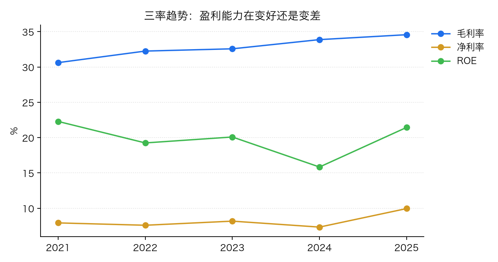
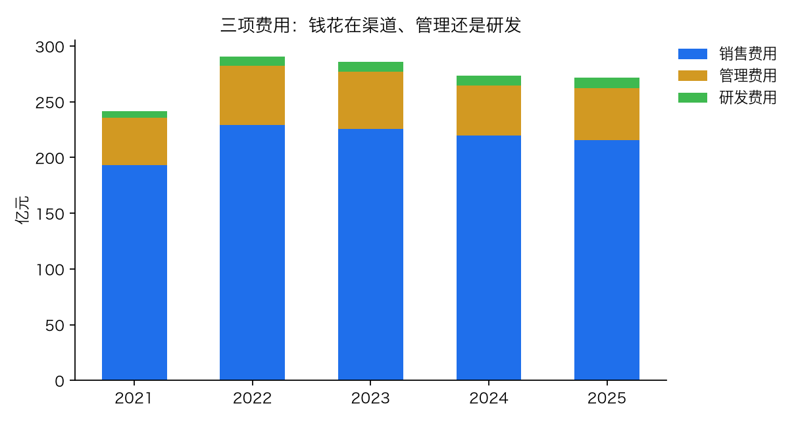
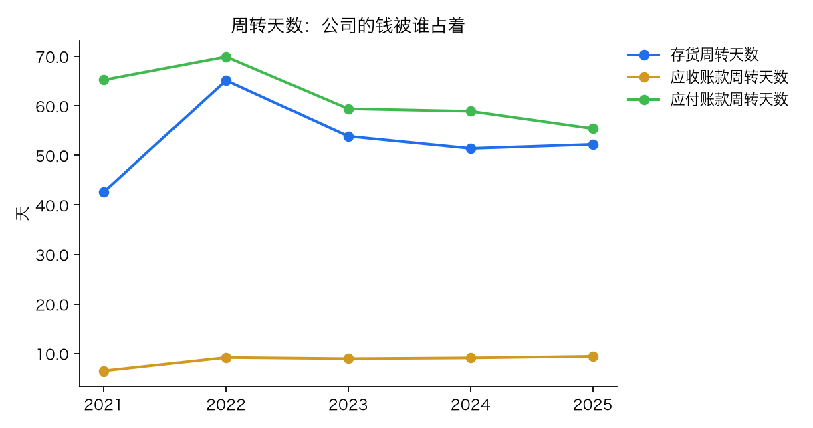
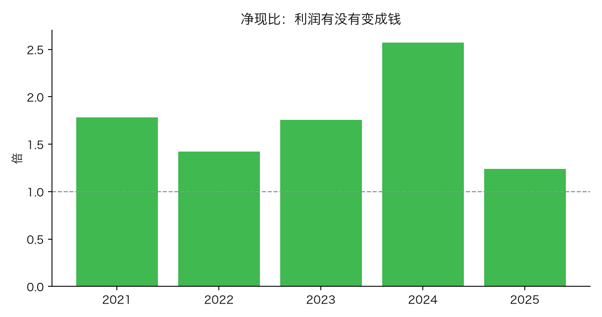

# 伊利股份（600887.SH）2025 年报深度解读

## 一页纸

**归母净利润 115.65 亿元是伊利历史上最高的一年，但这次跳升不是主业赚出来的。** 营业收入 1,156.36 亿元，只比上年的 1,153.93 亿元多了一点；毛利也只是从 390.94 亿元走到 399.82 亿元（P86）。

**把营业利润从 101.82 亿元推到 135.28 亿元的主力，是资产减值损失。** 这一项从 -46.76 亿元收窄到 -7.30 亿元，信用减值损失同时从 -5.55 亿元收窄到 -2.68 亿元（P86）。投资收益则从 24.17 亿元塌到 1.47 亿元（P86），还回去一大半。21.16% 的 ROE 是一次出清之后的报表修复。

**同一份年报里，经营现金流少了三分之一。** 经营活动现金流量净额 143.44 亿元，上年 217.40 亿元，净现比从 2.57 倍掉到 1.24 倍（P89）。这是本期最需要解释的矛盾：利润创新高，现金反而退了一格。

**上年的 217.40 亿元本身也不可重复。** 那一年合同负债从 86.96 亿元升到 120.73 亿元（P83）——先收钱后确认收入，等于向渠道借了一笔无息款。FY2025 这笔钱开始还，合同负债降到 105.64 亿元。1.24 倍才是常态。

**短期要看的是三个数字，不是一个。** 短期借款 456.31 亿元、短期应付债券 90.43 亿元、一年内到期的长期借款 42.63 亿元（P83、P190），而货币资金只有 194.95 亿元（P82）。

**但真实的现金厚度不在货币资金里。** 大额存单分三处：一年内到期 108.73 亿元、其他流动资产 135.54 亿元、其他非流动资产 281.09 亿元（P160、P161、P183）。利息收入 21.70 亿元高于利息支出 13.66 亿元（P202）。风险在利差与再融资条件，不在偿付能力。

**分红是这套结构的另一端。** 经营现金流 143.44 亿元要同时覆盖资本开支 30.37 亿元与分配支出 120.25 亿元（P90），两项合计已超过前者；而分红下限被写成三年不低于归母净利润 75%（P49），它不会自己缩回去。

**下一年只盯两件事：经营现金流的方向，和短期借款与超短融余额的方向。** 前者决定分红能不能自己付，后者决定付不出来时还能滚多久。其他判断都挂在这两条上。

| 指标 | 2021 | 2022 | 2023 | 2024 | 2025 |
| :--- | ---: | ---: | ---: | ---: | ---: |
| 营业收入（亿元） | 1,101.44 亿元 | 1,226.98 亿元 | 1,257.58 亿元 | 1,153.93 亿元 | 1,156.36 亿元 |
| 归母净利润（亿元） | 87.05 亿元 | 94.31 亿元 | 104.29 亿元 | 84.53 亿元 | 115.65 亿元 |
| 毛利率 | 30.62% | 32.26% | 32.58% | 33.88% | 34.58% |
| 净利率 | 7.90% | 7.69% | 8.29% | 7.33% | 10.00% |
| ROE | 18.25% | 18.76% | 19.48% | 15.89% | 21.16% |
| ROIC | 15.06% | 13.84% | 13.93% | 13.34% | 19.64% |
| 经营活动现金流（亿元） | 155.28 亿元 | 134.20 亿元 | 182.90 亿元 | 217.40 亿元 | 143.44 亿元 |
| 自由现金流（亿元） | 88.45 亿元 | 67.74 亿元 | 113.35 亿元 | 177.61 亿元 | 113.07 亿元 |
| 净现比 | 1.78 倍 | 1.42 倍 | 1.75 倍 | 2.57 倍 | 1.24 倍 |
| 资产负债率 | 52.15% | 58.66% | 62.19% | 62.91% | 61.51% |
| 分红率 | —（不可得） | —（不可得） | —（不可得） | —（不可得） | 75.48% |

红旗判定：清单共 32 项，命中 3 项，数据不足 17 项（数据不足不等于没问题）。

| 严重度 | 红旗 | 状态 | 观测值 |
| :--- | :--- | :--- | :--- |
| 高 | 关联采购占营业成本比例过高 | 命中 | FY2025 关联方采购金额/营业成本 = 20.65% |
| 高 | 分红超过自由现金流 | 命中 | FY2025 分配股利、利润或偿付利息支付的现金 120.25 亿元 vs 自由现金流 113.07 亿元 |
| 中 | 短期借款支撑长期资产（短债长投） | 命中 | FY2025 短期借款/银行借款 = 98.98%，且FY2025 货币资金/短期借款 = 42.72% |

## 生意：钱是怎么赚的

**这门生意的骨架，是三条产品线共用一个奶源、一套冷链、一张经销商网。** 液体乳 704.22 亿元、奶粉及奶制品 330.78 亿元、冷饮 98.22 亿元、其他 12.22 亿元（P242），构成 1,156.36 亿元营业收入（P86）的主体。

**四块的体量差得很远，但它们摊的是同一批工厂、同一批送货车、同一批业务员。** 所以结构问题不是哪块最大，而是成本由谁摊、费用由谁背。液体乳占了大头，也正好是价格最透明、竞争最直接的那一块。

**定价权不在公司手里，在货架和经销商手里。** 年报把液体乳收入的下滑拆成销量、产品结构、价格三项，并明确价格是主要拖累（P21）；同期公司液态类乳品零售额份额仍是第一（P11）。

**份额在涨、收入在跌，只有一种解释：份额是拿价格换的。** 这种竞争比的不是谁的产品更好，而是谁更愿意为货架和心智持续付费，所以它不会因为某个对手退出就结束，这也是销售费用率下不去的根本原因。

**成本端能控的部分很少。** 营业成本 756.54 亿元（P86）里直接材料占绝对多数，直接人工与制造费用的比重都很小（P23），原奶一动毛利率就跟着动：这是一门原料决定毛利的生意。

**费用端能控的部分更少。** 销售费用 215.45 亿元、管理费用 46.96 亿元、研发费用 9.15 亿元（P86），销售费用率 18.63%；毛利 399.82 亿元里有超过一半被销售费用拿走，研发费用率只有 0.79%（P86）。门槛不在配方，在这笔钱怎么花。

**对下游几乎现款现货，对上游还留着账期——但两端都在收紧。** 应收账款 29.87 亿元、周转 9.4 天（P82）；应付账款 114.79 亿元、周转 55.4 天（P83）。应付周转从 FY2022 的 69.9 天降到 55.4 天，上游把信用收回去了，缺口只能由短债补。

**底色是一份靠规模与广告费换来的辛苦钱，资本回报却不低。** 净利率 10.00%、ROIC 19.64%（P86、P87），五年毛利率从 30.62% 单向上行到 34.58%（P86）。公司能自主的只有费用节奏：本期广告宣传费从 136.12 亿元压到 128.20 亿元（P201），压出来的利润同时是品牌投入的欠账。

| 品类 | 2025 | 占营业收入 |
| :--- | ---: | ---: |
| 液体乳收入 | 704.22 | 60.9% |
| 奶粉及奶制品收入 | 330.78 | 28.6% |
| 冷饮收入 | 98.22 | 8.5% |
| 其他收入 | 12.22 | 1.1% |
| **合计** | 1,156.36 | 100.0% |

| 编号 | 严重度 | 判断 | 依据 | 证据 |
| :--- | :--- | :--- | :--- | :--- |
| F-cb-01 | 中 | 收入进入平台期 | FY2024→FY2025 收入增速 FY2024 -8.24%、FY2025 +0.21%，连续 2 期低于 1% | E-092、E-093 |

## 五年账

**五年收入是一个平台：FY2023 见顶，此后两年横在 1,150 亿元附近。** 营业收入 FY2021 1,101.44 亿元、FY2022 1,226.98 亿元、FY2023 1,257.58 亿元，然后退到 FY2024 的 1,153.93 亿元与 FY2025 的 1,156.36 亿元（P86）。

**收入停了，毛利率却在涨，这是后面所有数字的起点。** 毛利率 30.62%、32.26%、32.58%、33.88%、34.58%（P86），五年没有回头：不再靠卖得多，开始靠卖得贵。

**毛利的五年轨迹比收入干净。** 毛利 337.27 亿元、395.79 亿元、409.70 亿元、390.94 亿元、399.82 亿元（P86）。FY2024 毛利回落而毛利率从 32.58% 升到 33.88%——两者反向，只能是卖的东西变了，不是价格变了。

**这条抬升来自产品结构与原奶价格，不来自提价能力。** 结构可以年年推，原奶价格会转；当成提价能力的证据，明年就会被打脸。

**利润的五年是一条 V：先滑到 FY2024 的谷底，再跳到历史最高。** 归母净利润 87.05 亿元、94.31 亿元、104.29 亿元、84.53 亿元、115.65 亿元；ROE 18.25%、18.76%、19.48%、15.89%、21.16%（P82、P87）。

**ROE 的抬升靠的是净利率与杠杆，不是资产效率。** 净利率从 7.33% 跳到 10.00%，权益乘数 2.78 倍；总资产周转率只有 0.76 倍，五年里从 1.08 倍一路下滑（P82、P86、P87）。

**真正换了挡的是现金去向：从投产能改成发钱。** 资本开支 66.83 亿元、66.46 亿元、69.56 亿元、39.78 亿元、30.37 亿元（P90），后两年砍掉一半以上；分配股利支付的现金 56.93 亿元、75.00 亿元、84.16 亿元、90.92 亿元、120.25 亿元（P90）。

**但经营现金流没有跟着变多。** 155.28 亿元、134.20 亿元、182.90 亿元、217.40 亿元、143.44 亿元（P89），FY2025 反而是五年里第二低。

| 项目 | 2021 | 2022 | 2023 | 2024 | 2025 |
| :--- | ---: | ---: | ---: | ---: | ---: |
| 营业收入 | 1,101.44 亿元 | 1,226.98 亿元 | 1,257.58 亿元 | 1,153.93 亿元 | 1,156.36 亿元 |
| 毛利 | 337.27 亿元 | 395.79 亿元 | 409.70 亿元 | 390.94 亿元 | 399.82 亿元 |
| 营业利润 | 102.30 亿元 | 108.60 亿元 | 118.73 亿元 | 101.82 亿元 | 135.28 亿元 |
| 归母净利润 | 87.05 亿元 | 94.31 亿元 | 104.29 亿元 | 84.53 亿元 | 115.65 亿元 |
| 经营活动现金流 | 155.28 亿元 | 134.20 亿元 | 182.90 亿元 | 217.40 亿元 | 143.44 亿元 |
| 自由现金流 | 88.45 亿元 | 67.74 亿元 | 113.35 亿元 | 177.61 亿元 | 113.07 亿元 |
| ROE | 18.25% | 18.76% | 19.48% | 15.89% | 21.16% |
| 净利率 | 7.90% | 7.69% | 8.29% | 7.33% | 10.00% |

*数据来源：公司年度报告原文（页码见正文引用），金额为合并报表口径。*

### 杜邦分解

| 项目 | 2021 | 2022 | 2023 | 2024 | 2025 |
| :--- | ---: | ---: | ---: | ---: | ---: |
| ROE | 18.25% | 18.76% | 19.48% | 15.89% | 21.16% |
| 净利率 | 7.90% | 7.69% | 8.29% | 7.33% | 10.00% |
| 总资产周转率（次） | 1.08 倍 | 0.94 倍 | 0.83 倍 | 0.75 倍 | 0.76 倍 |
| 权益乘数 | 2.14 倍 | 2.61 倍 | 2.83 倍 | 2.89 倍 | 2.78 倍 |

## 利润表：从毛利到归母

**毛利这一层是整份报表里最稳的一段，也是最容易被高估的一段。** 营业收入 1,156.36 亿元、营业成本 756.54 亿元、毛利 399.82 亿元、毛利率 34.58%（P86）。

**毛利率比上年的 33.88% 又高了一档，但毛利的绝对额只从 390.94 亿元走到 399.82 亿元。** 规模不动的时候，毛利率的每一个点都必须来自结构或成本，不可能来自卖得更多。这是本期利润表最需要记住的一句。

**费用端是唯一由公司自己决定的部分，而它只挪了一点点。** 销售费用 215.45 亿元、销售费用率 18.63%（上年 19.05%），管理费用 46.96 亿元、管理费用率 4.06%，研发费用 9.15 亿元（P86）。

**销售费用的减少几乎全部来自广告。** 广告宣传费从 136.12 亿元降到 128.20 亿元（P201），降幅比销售费用总额的降幅还大，意味着薪酬、仓储这些项目其实在增（P201）。用减广告换利润，一年有效，两年伤品牌。

**财务费用是 -6.91 亿元，这个负号不是没有负债，是存款收益暂时盖过借款成本。** 利息支出 13.66 亿元、利息收入 21.70 亿元（P202）。它的可持续性取决于利差，不取决于经营。

**营业利润的跳升主要发生在减值那一行。** 营业利润 135.28 亿元，上年 101.82 亿元（P86）；资产减值损失从 -46.76 亿元收窄到 -7.30 亿元，信用减值损失从 -5.55 亿元收窄到 -2.68 亿元（P86）。

**对冲这笔便宜的是投资收益。** 这一项从 24.17 亿元塌到 1.47 亿元（P86）。另有其他收益 12.08 亿元（P86），接近利润总额的十分之一，几乎全部是政府补助（P202）。减值的少提被投资的退潮抵消了一部分，剩下的才是经营改善。

**从营业利润到归母还有四道口子。** 营业利润 135.28 亿元只落到利润总额 129.94 亿元（P86、P87），差额在营业外收支，本期营业外支出被对外捐赠抬高（P206）；所得税 14.80 亿元、有效税率 11.39%（上年 16.42%），低税率来自农产品初加工免税与西部大开发、高新技术企业优惠（P144）；少数股东损益 -0.51 亿元，归母 115.65 亿元（P87）。

### 三项费用与销售投入

| 项目 | 2021 | 2022 | 2023 | 2024 | 2025 |
| :--- | ---: | ---: | ---: | ---: | ---: |
| 销售费用 | 193.15 亿元 | 229.08 亿元 | 225.72 亿元 | 219.82 亿元 | 215.45 亿元 |
| 管理费用 | 42.27 亿元 | 53.43 亿元 | 51.54 亿元 | 44.65 亿元 | 46.96 亿元 |
| 研发费用 | 6.01 亿元 | 8.22 亿元 | 8.50 亿元 | 8.70 亿元 | 9.15 亿元 |
| 财务费用 | -0.29 亿元 | -2.55 亿元 | -1.53 亿元 | -5.92 亿元 | -6.91 亿元 |
| 其中：广告营销费 | —（不可得） | —（不可得） | —（不可得） | 136.12 亿元 | 128.20 亿元 |

*数据来源：公司年度报告原文（页码见正文引用），金额为合并报表口径。*

### 研发与人员

| 项目 | 2021 | 2022 | 2023 | 2024 | 2025 |
| :--- | ---: | ---: | ---: | ---: | ---: |
| 研发费用 | 6.01 亿元 | 8.22 亿元 | 8.50 亿元 | 8.70 亿元 | 9.15 亿元 |
| 在职员工（人） | —（不可得） | —（不可得） | —（不可得） | —（不可得） | 62,666 人 |
| 关联方采购 | —（不可得） | —（不可得） | —（不可得） | —（不可得） | 156.26 亿元 |

广告营销费见销售费用附注（P201）；关联采购额见「主要供应商」段落（P24）；研发投入未资本化（附注资本化金额为空），故不列资本化率。

## 资产负债表：钱在哪、欠谁

**资产端最显眼的不是厂房，是钱和准钱。** 资产总计 1,520.99 亿元（P82），固定资产 343.86 亿元、在建工程 13.57 亿元、无形资产 47.55 亿元、商誉 21.82 亿元（P82），四项长期资产合计不到总资产的三成。

**一家重资产公司，账上最厚的却是存款。** 货币资金 194.95 亿元、一年内到期的大额存单 108.73 亿元、其他流动资产里的存单与定期存款 135.54 亿元、其他非流动资产里的 281.09 亿元（P82、P160、P161、P183）。

**负债端的问题不是总量，是期限。** 负债合计 935.54 亿元、资产负债率 61.51%；流动负债 910.53 亿元，其中短期借款 456.31 亿元、应付账款 114.79 亿元、合同负债 105.64 亿元、应付票据 16.51 亿元（P83）。

**长期负债几乎被清空了。** 长期借款只剩 4.72 亿元（P83），一年内到期的长期借款 42.63 亿元、短期应付债券 90.43 亿元（P190）。有息负债几乎全部在一年内到期，这是主动选择而不是被动结果——短端利率低于长端，是这套安排的直接动机。

**流动比率 0.73 倍不是资不抵债，但它也不是安全垫。** 流动资产 663.70 亿元对流动负债 910.53 亿元（P82、P83），这个比率五年里从 1.16 倍一路降到 0.73 倍。口径还把一年内到期的大额存单 108.73 亿元排在非流动资产里（P160），加回去缺口会小很多，但仍然是缺口。

**真正的缓冲是那几笔存款能随时变现，加上利差还是正的。** 利息收入 21.70 亿元高于利息支出 13.66 亿元（P202）。利差在，滚动就转得动；利差反转，同一套结构立刻变成成本。

**资产负债表上仅有的两处需要靠假设读，是商誉与受限资金。** 商誉原值 57.50 亿元、已计提减值准备 35.68 亿元、净额 21.82 亿元，本期又计提 -1.41 亿元（P82、P179、P204）；剩下的商誉几乎全部挂在澳优乳业一个资产组上（P179）。

**受限资金金额不大，但没有被单独解释。** 主要是子公司财务公司存放央行的法定存款准备金与担保保证金（P145、P183），用途与解限条件年报没有展开。

### 资产端

| 项目 | 2021 | 2022 | 2023 | 2024 | 2025 |
| :--- | ---: | ---: | ---: | ---: | ---: |
| 货币资金 | 317.42 亿元 | 338.53 亿元 | 433.72 亿元 | 254.04 亿元 | 194.95 亿元 |
| 应收账款 | 19.59 亿元 | 30.88 亿元 | 30.85 亿元 | 28.78 亿元 | 29.87 亿元 |
| 存货 | 89.17 亿元 | 148.36 亿元 | 125.12 亿元 | 107.45 亿元 | 108.23 亿元 |
| 流动资产合计 | 501.55 亿元 | 614.63 亿元 | 693.55 亿元 | 666.19 亿元 | 663.70 亿元 |
| 固定资产 | 293.79 亿元 | 337.35 亿元 | 352.42 亿元 | 346.19 亿元 | 343.86 亿元 |
| 无形资产 | 16.09 亿元 | 46.48 亿元 | 47.29 亿元 | 47.80 亿元 | 47.55 亿元 |
| 资产总计 | 1,019.62 亿元 | 1,309.65 亿元 | 1,516.20 亿元 | 1,537.18 亿元 | 1,520.99 亿元 |

### 负债与权益

| 项目 | 2021 | 2022 | 2023 | 2024 | 2025 |
| :--- | ---: | ---: | ---: | ---: | ---: |
| 应付账款 | 136.60 亿元 | 159.26 亿元 | 137.99 亿元 | 123.13 亿元 | 114.79 亿元 |
| 合约负债 | 78.91 亿元 | 89.13 亿元 | 86.96 亿元 | 120.73 亿元 | 105.64 亿元 |
| 短期借款 | 125.96 亿元 | 267.99 亿元 | 397.55 亿元 | 363.55 亿元 | 456.31 亿元 |
| 长期借款 | 53.80 亿元 | 92.98 亿元 | 117.05 亿元 | 46.87 亿元 | 4.72 亿元 |
| 流动负债合计 | 432.96 亿元 | 621.70 亿元 | 768.60 亿元 | 899.25 亿元 | 910.53 亿元 |
| 归母权益 | 477.08 亿元 | 502.68 亿元 | 535.39 亿元 | 531.80 亿元 | 546.56 亿元 |
| 少数股东权益 | 10.83 亿元 | 38.75 亿元 | 37.81 亿元 | 38.28 亿元 | 38.89 亿元 |
| 所有者权益合计 | 487.91 亿元 | 541.43 亿元 | 573.20 亿元 | 570.08 亿元 | 585.44 亿元 |

*数据来源：公司年度报告原文（页码见正文引用），金额为合并报表口径。*

## 现金流量表：利润变成了什么

**三段现金放在一起，才看得出这家公司这一年到底在做什么。** 经营活动 143.44 亿元、投资活动 -77.96 亿元、筹资活动 -134.73 亿元（P89、P90），货币资金从 254.04 亿元降到 194.95 亿元（P82）。

**投资端的流出不是买设备，是买存单。** 资本开支只有 30.37 亿元、占收入 2.63%（P90），五年里最低。真正占钱的是大额存单与定期存款的净买入，所以资本开支这个指标已经描述不了这家公司的投资行为。

**筹资端的流出主要是分配。** 筹资活动净流出 134.73 亿元（P90）里，分配股利与利息占了 120.25 亿元。同一栏里取得借款 2,344.71 亿元、偿还债务 2,355.60 亿元（P90）——借进来的与还出去的基本打平，靠的是高频滚动的短债维持余额。

**净现比从 2.57 倍掉到 1.24 倍，方向比幅度更重要。** 经营现金流 143.44 亿元、归母净利润 115.65 亿元（P89、P87），五年净现比 1.78、1.42、1.75、2.57、1.24 倍（P89）。利润仍有现金支撑，只是支撑的厚度回到常态。

**2.57 倍那一年的异常值，是合同负债造出来的。** 那一年合同负债从 86.96 亿元升到 120.73 亿元（P83）——先收钱后确认收入，等于向渠道借了一笔无息款。到 FY2025 合同负债降到 105.64 亿元，这笔钱开始还。

**营运资本的摆动不可重复，这是判断现金流能不能外推的关键。** 合同负债从 120.73 亿元降到 105.64 亿元、应付账款从 123.13 亿元降到 114.79 亿元（P83），存货却只从 107.45 亿元升到 108.23 亿元（P82）。上游和渠道同时收回信用。

**存货没涨这件事，反过来是收入质量的证据。** 货是真卖出去了，不是压给经销商；变差的只是钱回来的路。这排除了最常见的收入质量问题。

**自由现金流够养分红，但不够同时养分红和资本开支。** 自由现金流 113.07 亿元（P89、P90），当年宣告的现金分红 87.29 亿元、计入回购后 89.78 亿元（P49），覆盖得住；但现金流量表口径的分配支出 120.25 亿元加上资本开支 30.37 亿元，已经超过经营现金流。

| 项目 | 2021 | 2022 | 2023 | 2024 | 2025 |
| :--- | ---: | ---: | ---: | ---: | ---: |
| 经营活动现金流 | 155.28 亿元 | 134.20 亿元 | 182.90 亿元 | 217.40 亿元 | 143.44 亿元 |
| 投资活动现金流 | -77.97 亿元 | -195.14 亿元 | -160.44 亿元 | -327.09 亿元 | -77.96 亿元 |
| 筹资活动现金流 | 119.45 亿元 | 87.81 亿元 | 72.58 亿元 | -72.78 亿元 | -134.73 亿元 |
| 资本性支出 | 66.83 亿元 | 66.46 亿元 | 69.56 亿元 | 39.78 亿元 | 30.37 亿元 |
| 自由现金流 | 88.45 亿元 | 67.74 亿元 | 113.35 亿元 | 177.61 亿元 | 113.07 亿元 |
| 净现比 | 1.78 倍 | 1.42 倍 | 1.75 倍 | 2.57 倍 | 1.24 倍 |

*数据来源：公司年度报告原文（页码见正文引用），金额为合并报表口径。*

## 附注深挖

**附注 16 的存货余额几乎没动，跌价准备却明显变薄。** 存货 108.23 亿元、上年 107.45 亿元（P82），占收入 9.4%；结构上以库存商品、原材料、半成品为主（P158）。跌价准备这一栏，本期转销的金额大于计提的金额（P159）。

**这条附注里最要紧的一句话是“可以转回”。** 期末按成本与可变现净值孰低、按单个项目计提（P119），而“以前减记存货价值的影响因素已经消失的，减记的金额予以恢复”（P119）。这给存货跌价留了一个冲回利润的口子。

**本期存货跌价是资产减值里与卖货直接相关的那一项。** 资产减值损失 -7.30 亿元（P86）按科目拆开（P204），其中商誉只占 -1.41 亿元。存货周转 52.2 天、上年 51.4 天（P82），略慢。

**下一期盯两件事：计提能不能重新盖住转销，以及余额会不会继续变薄。** 本期转销的原因是“存货出售或报废”（P159）；余额越薄，未来毛利率能靠转回撑住的空间越小。

**附注 13 的 29.87 亿元应收账款，真正的信息在两套计提规则。** 应收账款 29.87 亿元（P82），周转 9.4 天、上年 9.1 天。账龄组合里，3 个月以内、4 至 6 个月、7 至 12 个月、1 年以上各有比例（P148）。

**单项计提的那一部分，理由只有五个字：“收回难度较大”（P148）。** 账龄表里 1 至 2 年、2 至 3 年、3 年以上的余额都在增（P147），而计提对象与依据没有披露。下一期看单项计提的余额是否继续变大。

**它改变了对“渠道强势”的理解。** 周转不到十天看起来强势，但决定风险的从来不是平均账龄，而是那一小撮被单独拎出来的余额：平均数好听，尾部要付钱。

**附注 31 是一个“有政策、没余额”的科目，这一点比任何金额都值得记一笔。** 会计政策把确认标准写得很完整：现时义务、很可能流出、金额可计量，三条同时满足才确认（P133）。

**但主表上两栏都是空白，附注 50 直接勾“不适用”。** 合并资产负债表“预计负债”两栏皆空（P83），附注 50 勾“不适用”（P195）。一家有 62,666 名员工（P46）、做担保与小贷业务的企业，这个科目连续两年为零。

**只有两种解释，指向完全不同的结论。** 要么或有义务真的不存在，要么被记在别的科目——其他流动负债下另有担保赔偿准备金与未到期责任准备金（P190）。两处不能相加。下一期看它是否仍是零。

**附注 40 的结论只有一句“本期没有变更”，这句话是整份年报可比性的前提。** 附注 40 把“重要会计政策和会计估计的变更”指向“重要事项”一节（P143），那一节三问——政策与估计变更、重大差错更正、与前任会计师沟通——全部勾“不适用”（P58），调整期初未分配利润的五项原因也都是零（P199）。

**所以净利率从 7.33% 跳到 10.00% 不是口径变更造出来的（P86、P87）。** 反过来说，明年只要出现任何一项政策或估计变更，今年的高利润率就不能直接拿来比。这一节枯燥，但它是所有跨年比较的地基。

**附注 12 只剩 0.07 亿元，一个几乎消失的科目，却在讲渠道结算方式的变化。** 应收票据从 2.51 亿元掉到 0.07 亿元（P82），银行承兑与商业承兑都在，量都缩到可以忽略（P146）。银行承兑的预期信用损失率为零、商业承兑按违约风险敞口计提（P116），归零消掉的是几乎全部票据敞口。

**票据清零、预收下降、应收微升，三件事同向。** 合同负债从 120.73 亿元降到 105.64 亿元、应收账款从 28.78 亿元升到 29.87 亿元（P82、P83）。渠道不再预付也不再给票，改成挂账：可以是结算方式变了，也可以是话语权变了。下一期看票据是否仍为零。

| 附註 | 类型 | 页码范围 | 页数 | 要回答的问题 |
| :--- | :--- | :--- | ---: | :--- |
| 12 应收票据 | 金额型 | P116–P116 | 1 | 这个合并数拆开是什么结构，结构变了吗？ |
| 16 存货 | 金额型 | P118–P118 | 1 | 这个合并数拆开是什么结构，结构变了吗？ |
| 31 预计负债 | 估计型 | P133–P133 | 1 | 这个数字建立在哪些假设上，假设松不松？ |
| 32 股份支付 | 交易型 | P133–P133 | 1 | 和谁做生意、按什么价、有没有对价之外的东西？ |
| 40 重要会计政策和会计估计的变更 | 政策型 | P143–P143 | 1 | 今年改了什么口径，改完之后还跟去年可比吗？ |

**与上一年相比的附注增删。**
- 今年新增：会计期间、数据资源、遵循企业会计准则的声明
- 今年没有：持有待售负债、持续经营、编制基础

## 谁在分钱

**分红这件事给了两个数，差得很远，必须分开看。** 当年宣告的现金分红 87.29 亿元、分红率 75.48%，计入以现金回购股份的 2.49 亿元后合计 89.78 亿元（P49）；现金流量表里“分配股利、利润或偿付利息支付的现金”是 120.25 亿元（P90）。

**120.25 亿元不是当年的分红，而是两年的分红加一年的利息。** 它含上一年度分红 77.17 亿元（P48）与利息支出 13.66 亿元（P202），剩下的是中期分红。两个口径都真实，但只有一个能判断派息能力。

**按宣告口径，分红没有超过自由现金流。** 自由现金流 113.07 亿元（P89、P90），89.78 亿元的分红与回购仍覆盖得住。

**按付现口径，它超过了。** 120.25 亿元的付现高于 113.07 亿元，加上资本开支 30.37 亿元之后，经营现金流 143.44 亿元就不够了。缺口由短期借款补：短期借款从 363.55 亿元加到 456.31 亿元（P83），货币资金从 254.04 亿元降到 194.95 亿元（P82）。这不是派息能力透支，是分红节奏与债务期限被绑在一起。

**三年累计分红已经分掉了历史积累的一部分。** 最近三个会计年度累计现金分红与回购注销合计 260.92 亿元，占三年年均净利润的 257.09%（P50）；同期经营现金流最好的一年是 217.40 亿元（P89）。超过 100%，分的不只是当年利润。

**承诺把这条路锁死了。** 董事会把未来三年每年现金分红比例不低于当年归母净利润 75% 写成规划（P49），公司在坏年份没有自动收缩的余地：分红从结果变成义务。

**少数股东损益五年里三年为负，赚钱的主体是全资业务。** 0.27 亿元、-1.13 亿元、-1.44 亿元、0.11 亿元、-0.51 亿元（P87）。这不是造假信号，是并表结构：非全资子公司整体微亏，归母 115.65 亿元主要由全资业务贡献。

**关联方与质押是另外两条分钱通道。** 关联采购 156.26 亿元、占营业成本 20.65%（P24），几乎全部来自优然牧业一家（P236）。质押方面，呼和浩特投资有限责任公司 2.05 亿股、潘刚 2.28 亿股、赵成霞 0.76 亿股（P69、P70），年报没有解释自然人质押的用途与平仓条件。

| 项目 | 2021 | 2022 | 2023 | 2024 | 2025 |
| :--- | ---: | ---: | ---: | ---: | ---: |
| 归母净利润 | 87.05 亿元 | 94.31 亿元 | 104.29 亿元 | 84.53 亿元 | 115.65 亿元 |
| 少数股东损益 | 0.27 亿元 | -1.13 亿元 | -1.44 亿元 | 0.11 亿元 | -0.51 亿元 |
| 归母权益 | 477.08 亿元 | 502.68 亿元 | 535.39 亿元 | 531.80 亿元 | 546.56 亿元 |
| 少数股东权益 | 10.83 亿元 | 38.75 亿元 | 37.81 亿元 | 38.28 亿元 | 38.89 亿元 |
| 每股派息（元） | —（不可得） | —（不可得） | —（不可得） | —（不可得） | 1.38 |
| 分配股利支付的现金 | 56.93 亿元 | 75.00 亿元 | 84.16 亿元 | 90.92 亿元 | 120.25 亿元 |

## 红旗与跟踪清单

**第一风险不是债务规模，是分红刚性撞上现金流回落。** 经营现金流 143.44 亿元（P89）要覆盖资本开支 30.37 亿元与分配 120.25 亿元（P90），不够；分红下限又被写成三年不低于归母净利润 75%（P49）。现金流再降一档，缺口只能靠短债补。

**第二风险是短债滚动的利差，它同时决定利润与流动性。** 短期借款 456.31 亿元（P83）、短期应付债券 90.43 亿元、一年内到期的长期借款 42.63 亿元（P190）；利息收入 21.70 亿元高于利息支出 13.66 亿元（P202），财务费用因此是 -6.91 亿元（P86）。利差一反转，它直接扣利润。

**这个口子已经开到了下一年。** 资产负债表日后至报告批准报出日之间又发行 9 期超短期融资券、合计 900.00 亿元，已兑付 450.00 亿元、剩余 450.00 亿元未兑付（P240）。盯财务费用的符号、大额存单 281.09 亿元（P183）是否续作。

**第三风险是商誉，缓冲已经很薄。** 商誉净额 21.82 亿元、原值 57.50 亿元、已计提减值 35.68 亿元（P82、P179），剩下的几乎全挂在澳优乳业一个资产组上；减值测试的可收回金额只比该资产组账面价值高出很薄一档，折现率与稳定期增长率都不宽松（P180）。婴配粉再缩一年就会再提。

**第四风险在成本端的定价权，它比收入下滑更难看见。** 关联采购 156.26 亿元、占营业成本 20.65%，前五名供应商占年度采购总额 40.00%（P24），最大的关联方就是原奶供应商（P236）。原奶下行期若关联采购价跌得更慢，成本压力留在上市公司。

**这条无法核对。** 附注里“获批的交易额度”一列为空（P236），实际发生额是否在授权范围内，没有可对照的数。

**第五风险是收入平台期本身，它决定上面四条会不会同时发生。** 营业收入 1,156.36 亿元、连续两年停在 1,150 亿元附近（P86），而 2026 年经营计划要求收入与利润总额都重新向上，投资方案也把资本开支抬起来（P35、P36）。收入不动而开支回升，自由现金流被两头夹。

**跟踪清单只有六个方向：经营现金流、资本开支、分配付现、短期借款、合同负债、资产减值损失。** 方向比绝对值重要，其中三个已在 FY2025 转向不利的一边。

| 严重度 | 红旗 | 状态 | 观测值 |
| :--- | :--- | :--- | :--- |
| 高 | 关联采购占营业成本比例过高 | 命中 | FY2025 关联方采购金额/营业成本 = 20.65% |
| 高 | 分红超过自由现金流 | 命中 | FY2025 分配股利、利润或偿付利息支付的现金 120.25 亿元 vs 自由现金流 113.07 亿元 |
| 中 | 短期借款支撑长期资产（短债长投） | 命中 | FY2025 短期借款/银行借款 = 98.98%，且FY2025 货币资金/短期借款 = 42.72% |
| 高 | 毛利率显著高于同业且无法解释 | 数据不足 | 需人工核对（附注/公告原文） |
| 高 | 商誉减值反复出现（挤牙膏式减值） | 数据不足 | 需人工核对（附注/公告原文） |
| 高 | 其他应收款异常膨胀 | 数据不足 | 需人工核对（附注/公告原文） |
| 高 | 在建工程长期不转固 | 数据不足 | 需人工核对（附注/公告原文） |
| 高 | 研发资本化率异常抬升 | 数据不足 | 需人工核对（附注/公告原文） |
| 高 | 非经常性损益占利润过高 | 数据不足 | 需人工核对（附注/公告原文） |
| 高 | 审计意见非标准无保留 | 数据不足 | 需人工核对（附注/公告原文） |
| 高 | 控股股东高比例质押 | 数据不足 | 需人工核对（附注/公告原文） |
| 高 | 收现比长期低于 1 | 数据不足 | 需人工核对（附注/公告原文） |
| 中 | 每年都有大额并购支出 | 数据不足 | 需人工核对（附注/公告原文） |
| 中 | 预付账款异常膨胀 | 数据不足 | 需人工核对（附注/公告原文） |
| 中 | 第四季度利润异常（亏损或占比畸高） | 数据不足 | 需人工核对（附注/公告原文） |
| 中 | 财务总监频繁更换 | 数据不足 | 需人工核对（附注/公告原文） |
| 中 | 递延所得税资产增速远超收入 | 数据不足 | 需人工核对（附注/公告原文） |
| 中 | 资本开支长期低于折旧（吃老本） | 数据不足 | 资本开支 / 折旧与摊销 最近 3 期数据不全 |
| 中 | 折旧率明显低于同业 | 数据不足 | 需人工核对（附注/公告原文） |
| 中 | PE 被一次性收益压低 | 数据不足 | 需人工核对（附注/公告原文） |
