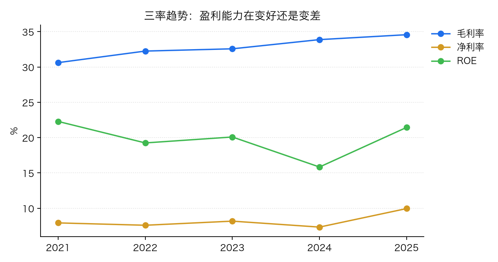

# 伊利股份（600887.SH）估值分析

## 一页纸

**一句话结论：现价大致等于「永续 3.3% 现金流增长」的定价，比基准情景低约 6.2%，处于合理区间
的偏低位置，但还称不上显著低估。**

读这份估值只需要抓住三件事：

1. **区间比单点更有信息量。** 熊市 22.65 元、基准 35.61 元、牛市 50.40 元。区间宽度不是
   精确度不够，而是行业不确定性的真实映射——它与下面「三法交叉」里的敏感性网格是同一件事
   的两种表达。
2. **现价隐含的均匀增速 3.3% 是最可操作的数字。** 它把「贵不贵」翻译成「未来五年现金流能
   不能年均增长 3.3% 以上」。对一家收入走平、资本开支收缩、ROIC 回升的公司，这个门槛不算
   苛刻，但也不便宜。
3. **终值占企业价值的 75.6% 必须与结论一起读。** 结论的四分之三来自第 6 年以后的假设，所以
   它的作用是给出「合理区间」，不是给出「目标价」。任何把基准价当成目标价的用法都丢了这层
   信息。

安全边际只有个位数百分点，远小于 DCF 的建模误差——所以更准确的说法是「现价基本合理」，
而不是「便宜」。想要有意义的安全边际，要么价格继续下移，要么基准情景的假设被新数据上修
（例如收入止跌得到半年报证实）。

| 项目 | 数值 |
| :--- | ---: |
| 当前股价（元） | 33.41 |
| 熊 / 基准 / 牛（元/股） | 22.65 / 35.61 / 50.40 |
| 安全边际（基准，%） | +6.2 |
| 结论 | 合理 |
| 终值占企业价值（%） | 75.6 |
| 现价隐含的均匀增速（%） | +3.3 |

口径提示：

- 终值占企业价值 75.6%，结论对远期假设高度敏感
- 区间来自三套情景假设，不对应任何单点目标价

证伪条件：

- 连续两年经营活动现金流低于归母净利润的 0.8 倍（净现比恶化），说明利润含金量下降。
- 液态奶收入连续两年两位数下滑，且毛利率同步走低，说明基准情景的收入假设不成立。
- 有息负债继续上升而货币资金下降，净负债超过 600 亿元，资本结构成为估值的主导变量。
- 现金分红比例长期高于自由现金流（FY2025 已出现），且靠新增借款维持，股东回报不可持续。
- 出现大额商誉或无形资产减值（单年超过归母净利润的 15%），使历史 ROIC 失去参考意义。

## 能不能估值

先说结论：**伊利是能做估值的公司，而且应该用现金流折现作为主方法。** 理由是三条：

1. **现金流稳定、可预测。** 近三年自由现金流 113 亿元、178 亿元、113 亿元，波动来自
   营运资本而不是盈利质量；资本开支已经从 67 亿元压到 30 亿元，未来两三年的资本开支
   强度可以合理估计（这是 DCF 最脆弱的一环，而伊利这一环恰好处于低投入期）。
2. **收入虽进入平台期，但利润率有下限。** 十年间净利率最低 7.3%（2024 年）、最高 10.0%，
   区间窄；这意味着即使给零增长假设，现金流也不会崩塌，DCF 的输入不会因为「增速不确定」
   而失去意义。
3. **资本结构简单可拆。** 有息负债就是短期借款 + 长期借款（应付债券本期无余额），
   净负债 266 亿元可以精确算出，企业价值到股权价值的桥不需要猜。

不适合的部分也要说清楚：

- **不适合用股利折现（DDM）。** 2025 年分红率 104%、分红规模靠短债支撑，历史股利不代
  表可持续现金流，用 DDM 会把「借来的分红」当成永久年金。
- **不适合分部估值（SOTP）。** 上游只给合并口径，分品类/分业务的收入与资本占用没有取数，
  SOTP 需要的分部数据缺失，硬拆等于编数字。
- **不适合高增长假设。** 收入 2024 年下滑、2025 年走平，把显式期增速定在 5% 左右已经是
  乐观口径；任何两位数增长的假设都需要先看到品类结构改善的证据。

因此本报告的估值骨架是：**三情景 DCF 为主（FCF 口径、5 年显式期 + 永续），反向 DCF 回答
「现价隐含了什么」，PE/PB 只作交叉验证，不参与定价。** 这是一个可以被证伪的结构——
它的每一个假设都写在 `spec.valuation.yaml` 里，且都挂着证据编号。

## 历史基本面还原

做估值之前先把「历史给了什么」还原清楚。十年数据看下来，伊利的经营轨迹可以分成三段：

**扩张期（2016–2023）。** 收入从 603 亿元到 1258 亿元，总资产从 393 亿元到 1516 亿元。
这是典型的「用资产换规模」：产能持续投入，资本开支在 2019 年达到峰值 92 亿元，ROIC 从
24.2% 一路降到 13.9%。规模上去了，资本回报下来了。

**阵痛期（2024）。** 收入下滑、资产减值 47 亿元、ROIC 见底 13.3%、ROE 掉到 15.8%。这一年
是过去十年最差的一年，但它同时完成了两件事：把商誉从 52 亿元减到 23 亿元（风险出清），
并把资本开支压到 40 亿元（投入收缩）。

**收成期（2025–）。** 收入走平在 1156 亿元，资本开支只有 30 亿元，FCF 稳定在百亿元以上，
ROIC 回到 19.6%，ROE 回到 21.4%。这是一个「低增长、高现金、低投入」的稳态。

对估值而言，这三段历史给出的关键输入是：

1. **基期现金流不该取单年。** 三段的 FCF 分别是 34–113 亿元（扩张期，波动大）、178 亿元
   （阵痛期，开支低）、113 亿元（收成期）。用三年均值 134.68 亿元最接近「稳态水平」。
2. **ROIC 的底部已经可见。** 13.3% 是十年最低，若维持当前资本开支强度，ROIC 大概率在
   15%–20% 区间波动；这决定了对增长假设的容忍度——回报率不再下降，永续增长给 2.5% 才
   站得住。
3. **资本开支强度 2.6% 是新的常态。** 扩张期这个数字一度超过 10%，现在回到个位数低位，
   是 FCF 释放的直接原因，也是本次估值能给出正安全边际的基础。

| 项目 | 2021 | 2022 | 2023 | 2024 | 2025 |
| :--- | ---: | ---: | ---: | ---: | ---: |
| 营业收入 | 1,101.44 亿元 | 1,226.98 亿元 | 1,257.58 亿元 | 1,153.93 亿元 | 1,156.36 亿元 |
| 归母净利润 | 87.05 亿元 | 94.31 亿元 | 104.29 亿元 | 84.53 亿元 | 115.65 亿元 |
| ROIC | 15.06% | 13.84% | 13.93% | 13.34% | 19.64% |
| 自由现金流 | 88.45 亿元 | 67.74 亿元 | 113.35 亿元 | 177.61 亿元 | 113.07 亿元 |
| 资本开支强度 | 6.07% | 5.42% | 5.53% | 3.45% | 2.63% |

*数据来源：同花顺问财，经本库勾稽与口径复核；金额为年报口径。*

## 三法交叉

### 现金流口径

基准情景取 2023–2025 年自由现金流均值 134.68 亿元作为起点，而不是直接拿 2025 年的
113.07 亿元。理由是单年 FCF 会被资本开支节奏放大：2024 年资本开支只有 40 亿元，FCF 冲
到 178 亿元；2025 年回升到 30 亿元资本开支、FCF 回落到 113 亿元。取三年均值可以削掉
这种「开支小年」造成的虚高。

显式期 5 年，增速路径 5.0% → 4.5% → 4.0% → 3.5% → 3.0%，逐级回落到永续增长率附近。
折现率 8.5%（无风险利率约 2.0%、股权风险溢价 6.0%、贝塔约 0.8 折算权益成本 6.8%，
再按有息负债占比加权），永续增长 2.5%。

### 企业价值到股权价值

| 项目 | 金额（亿元） |
| :--- | ---: |
| 显式期现值 | 599.92 |
| 终值现值 | 1,861.39 |
| 企业价值 | 2,461.31 |
| 减：净负债 | 266.08 |
| 股权价值 | 2,195.23 |
| 每股价值（63.25 亿股） | 34.71 |

**必须提醒：终值占企业价值的 75.6%。** 这意味着 34.71 元里有四分之三来自第 6 年以后的
假设，任何对永续增长或折现率的微调都会显著改变结果——敏感性表（下表之外，报告正文中
另有 WACC × 永续增长的完整网格）显示，WACC 从 7.5% 走到 9.5%、永续增长从 1.5% 走到
3.5% 时，每股价值在 25.9 元到 52.2 元之间摆动。

### 反向 DCF：现价隐含了什么

把每股价值反解为「均匀增速」：当自由现金流每年均匀增长 **3.3%**、其余假设不变时，每股
价值恰好等于现价 33.41 元。换句话说，**市场当前给伊利定价的隐含假设是「永续 3.3% 的现金
流增长」**——比本报告的基准路径（5 年 5% 递减到 3%）略保守，比熊市情景（1%–2%）乐观。

这个数字是本次估值最有用的输出：它把「贵不贵」变成一句可验证的话——如果你认为伊利未来
五年的现金流增速能超过 3.3%，当前价格就便宜；反之则贵。

### 交叉验证

倍数只用来问一个问题：**现金流折现的结论有没有和市场的定价方式打架？** 当前 PE(TTM)
21.26 倍、PB 3.72 倍、股息率 4.83%（见下方相对估值表）。基准情景的合理价对应约 25.6 倍
PE，高于当前 21.26 倍——也就是市场给的价格比本报告的现金流假设更保守；PB 与股息率指向
同一方向。三个指标不打架，但也都不便宜。

需要说明：**同业中位数与自身历史分位本轮没有取数**（缺可比公司清单与十年估值序列），
所以这张表只能做纵向（与自身现金流结论）比对，不能做横向（与同行估值）比对。这是一个
明确的缺口，不影响主结论，但会影响「贵不贵」的说服力。

### 反向 DCF：现价已经假设了什么

- 预测期 5 年，WACC 8.5%，永续增长 2.5%
- 现价隐含的自由现金流均匀增速：+3.3%

### 相对估值

| 指标 | 当前 | 同业中位 | 自身历史分位 | 说明 |
| :--- | ---: | ---: | ---: | :--- |
| PE(TTM) | 21.25 | — | — | 情景加权合理价 35.61 元对应 PE 25.6x |
| PB | 3.72 | — | — | 情景加权合理价对应 PB 3.96x |
| 股息率 | 4.83 | — | — | 上游给出的是最近年度口径；估值结论不依赖该指标，仅作参照 |

## 假设与敏感性

七条假设全部写在 `spec.valuation.yaml` 里，每条都挂着证据编号或方法出处——这是 G2 闸门的
硬要求，没有豁免。下面的表由模型自动生成（含依据与理由），这里只讨论**敏感度**：哪几条
真正决定结论，动一下会发生什么。

**为什么 WACC 取 8.5%：** 无风险利率按长期国债 2.0%、股权风险溢价 6.0%、贝塔 0.8
折算权益成本约 6.8%；公司有息负债 461 亿元、权益 547 亿元，税后债务成本按 3% 计，
加权后落在 8.5% 附近。若把无风险利率上调到 2.5%，WACC 会升到 9% 左右，每股价值下降
约 3 元——这个幅度就是「宏观利率假设」对本次结论的定价。

**为什么永续增长取 2.5%：** 长期名义 GDP 增速的保守下沿。乳制品行业总量见顶，2.5% 已经
包含结构升级与提价的贡献；给到 3.5% 就隐含「份额继续扩张」，而 2024–2025 年的收入表现
不支持这个假设。

**为什么基期 FCF 用三年均值：** 见「历史基本面还原」。单年值会把资本开支的周期性误读为
盈利能力的变化——2024 年 FCF 178 亿元看起来很美，但它对应的是「当年几乎不投产能」，不
是可持续水平。

**假设表里没有的东西，本报告不会偷偷用：** 没有市占率、没有分部毛利、没有 2026 年之后的
业绩指引。这三项缺失都写进了报告附录的缺口表，读者可以据此判断结论的证据强度。

| 编号 | 假设 | 取值 | 依据 | 理由 |
| :--- | :--- | :--- | :--- | :--- |
| A-01 | 基期自由现金流（FY2023–FY2025 均值） | 134.68亿元 | D-FY2023-fcf、D-FY2024-fcf、D-FY2025-fcf | 单年 FCF 会被资本开支节奏与营运资本摆动放大：FY2024 因资本开支骤降而虚高、 FY2025 又回落。取三年均值作为起点，比直接拿最新一年更接近可持续水平。 |
| A-02 | 净负债（有息负债 − 货币资金，FY2025） | 266.08亿元 | D-FY2025-net_debt、D-FY2025-interest_bearing_debt | 有息负债取短期借款 + 长期借款 + 应付债券；应付债券本期科目无余额，按 0 计入。 高额短期借款与账面货币资金并存，是本标的最主要的资本结构特征。 |
| A-03 | 总股本 | 63.25亿股 | E-442 | 用于把股权价值折成每股价值；无回购注销与增发时视为不变。 |
| A-04 | 折现率 WACC | 8.5% | 方法设定（WACC = 权益成本 × 权益权重 + 税后债务成本 × 债务权重） | 无风险利率取长期国债 2.0% 附近，股权风险溢价 6.0%，食品饮料龙头的贝塔约 0.8， 折算权益成本约 6.8%；考虑公司有息负债占比不低，加权后取 8.5%。 |
| A-05 | 永续增长率 | 2.5% | 方法设定（长期通胀 + 行业量增的保守估计） | 长期名义 GDP 增速的保守下沿。乳制品行业总量已进入低速期，给到 2.5% 已包含 结构升级与提价的贡献，不给份额扩张。 |
| A-06 | 显式期自由现金流增速（首年） | 5% | E-010、D-FY2025-roic | 五年路径 5.0% → 4.5% → 4.0% → 3.5% → 3.0%，递减到永续增长率附近。 依据是 FY2025 收入几乎零增长而 ROIC 回升到 19.6%，利润端修复快于收入端， 但行业量的天花板决定了增速不宜线性外推。 |
| A-07 | 估值基准价 | 33.41元 | E-441 | 快照日最新价，仅用于计算安全边际与反向 DCF，不代表目标价。 |

### 敏感性：WACC × 永续增长（元/股）

| 永续增长 \ WACC | 7.50% | 8.00% | 8.50% | 9.00% | 9.50% |
| :--- | ---: | ---: | ---: | ---: | ---: |
| 1.50% | 36.06 | 32.93 | 30.26 | 27.93 | 25.90 |
| 2.00% | 39.00 | 35.37 | 32.31 | 29.68 | 27.41 |
| 2.50% | 42.52 | 38.26 | 34.71 | 31.70 | 29.12 |
| 3.00% | 46.83 | 41.72 | 37.54 | 34.05 | 31.10 |
| 3.50% | 52.22 | 45.95 | 40.94 | 36.83 | 33.41 |

基准情形每股价值 34.71 元；显式期现值 599.92 亿元，终值现值 1,861.39 亿元。

## 情景与概率加权

三套情景不是「乐观/中性/悲观」的修辞，而是三组可以分别被验证的假设组合。概率加权
（25% / 50% / 25%）后得到基准结论。

**熊市（概率 25%，每股 22.65 元）：需求继续走弱。** 增速路径 1.0% → 2.0%，WACC 上调到
9.5%，永续增长 1.5%。触发条件是液态奶量继续双位数下滑、费用率被动抬升。这个情景下
股价相对现价有三成以上的下行空间——它衡量的是「行业继续下行」的代价。

**基准（概率 50%，每股 34.71 元）：低速修复。** 增速路径 5.0% → 3.0%，WACC 8.5%，
永续增长 2.5%。这是本报告认为最可能的情形：收入零增长到微增，毛利率维持 34% 附近，
资本开支 30 亿元左右，FCF 稳定在百亿元以上。

**牛市（概率 25%，每股 50.40 元）：结构升级带动利润率上台阶。** 增速路径 9.0% → 5.0%，
WACC 7.8%，永续增长 3.0%。需要看到高毛利品类占比持续提升、净利率站上两位数以上并稳住。

加权后得到 **35.61 元**。请注意这里的口径：加权价（35.61 元）高于基准情景单价
（34.71 元），因为牛市情景的幅度大于熊市情景的幅度——概率相同、幅度不同，期望值自然
偏上。这不是算错，而是提示结论对「上行尾部」比较敏感：如果认为牛市情景的概率不到
25%，加权价会立刻回落到接近基准情景的水平。

**情景概率怎么定：** 25/50/25 是研究判断，不是模型输出。它反映「行业下行尚未结束、
但公司现金流已经很稳」这两件事的权重。读者如果不同意，改 `spec.valuation.yaml` 里的
`probability` 就能得到自己的加权价——这正是把假设外置成文件的意义。

| 情景 | 关键假设 | 每股价值（元） | 概率 | 说明 |
| :--- | :--- | :--- | ---: | :--- |
| 熊市：需求继续走弱 | 显式期增速 1.0%、1.0%、1.5%、1.5%、2.0%；WACC 9.50%；永续增长 1.50%；显式期现值 535.17 亿元；终值现值 1,163.53 亿元 | 22.65 | 25% | 液态奶需求继续下滑、费用率被动抬升，FCF 仅随品类结构缓慢修复；折现率上调 50bp 反映增长能见度下降。 |
| 基准：低速修复 | 显式期增速 5.0%、4.5%、4.0%、3.5%、3.0%；WACC 8.50%；永续增长 2.50%；显式期现值 599.92 亿元；终值现值 1,861.39 亿元 | 34.71 | 50% | 收入零增长但盈利质量改善（毛利率回升、资本开支收缩），FCF 稳定在百亿元以上并 温和增长。 |
| 牛市：结构升级带动利润率上台阶 | 显式期增速 9.0%、8.0%、7.0%、6.0%、5.0%；WACC 7.80%；永续增长 3.00%；显式期现值 670.88 亿元；终值现值 2,783.10 亿元 | 50.40 | 25% | 高毛利品类（奶粉、奶酪、低温）占比提升带动净利率上台阶，资本开支维持低位， FCF 释放快于收入。 |

## 结论与纪律

**一句话结论：现价 33.41 元大致等于「永续 3.3% 现金流增长」的定价，比本报告的基准情景
（35.61 元）低约 6.2%，属于合理区间的偏低位置，但不构成显著低估。**

三个层次递进：

1. **绝对估值（三情景 DCF，概率加权）35.61 元。** 熊市 22.65 元、基准 34.71 元、牛市
   50.40 元。终值占企业价值的 75.6%——这个比例必须和结论一起读：结论的三分之二来自第
   6 年以后的假设，所以它的作用是给出「合理区间」，不是给出「目标价」。
2. **反向 DCF 给出的对照线是 3.3%。** 这是本次估值最可操作的数字：把「贵不贵」变成
   「未来五年现金流能不能年均增长 3.3% 以上」。对一家收入走平、资本开支收缩、ROIC 回升
   的公司来说，3.3% 不算苛刻，但也不便宜。
3. **相对估值不参与定价。** PE(TTM) 21.26 倍、PB 3.72 倍、股息率 4.83%，三个指标只能说明
   「没被高估」，无法说明「被低估」，因为缺少可比公司与历史分位的取数。

## 操作纪律

- **不做单点判断。** 结论是一个区间（22.65–50.40 元），基准 35.61 元。任何「目标价 35.61」
  的说法都丢掉了区间信息。
- **安全边际 6.2% 不足以支撑重仓。** 对一家资产负债表有短债滚动风险的公司，6% 的安全边际
  需要更高的确定性才值得下注；如果价格跌到熊市价与基准价的中间位置附近，赔率才明显改善。
- **先把证伪条件挂上去。** 下列任一条成立时，本结论应当作废并重算，而不是微调参数：

  1. 连续两年经营现金流低于归母净利润的 0.8 倍；
  2. 液态奶收入连续两年两位数下滑且毛利率同步走低；
  3. 净负债超过 600 亿元；
  4. 分红与付息支出长期高于自由现金流且靠新增借款维持；
  5. 单年减值超过归母净利润的 15%。

- **下一次重算的时点。** 2026 年年报（拿到完整年度数据）之后；若期间出现分红率下调、
  短融发行受阻或重大减值，提前重算。

- 基准每股价值 35.61 元，区间 22.65–50.40 元，当前价 33.41 元。
- 安全边际 +6.2%。

推翻结论的条件：

- 连续两年经营活动现金流低于归母净利润的 0.8 倍（净现比恶化），说明利润含金量下降。
- 液态奶收入连续两年两位数下滑，且毛利率同步走低，说明基准情景的收入假设不成立。
- 有息负债继续上升而货币资金下降，净负债超过 600 亿元，资本结构成为估值的主导变量。
- 现金分红比例长期高于自由现金流（FY2025 已出现），且靠新增借款维持，股东回报不可持续。
- 出现大额商誉或无形资产减值（单年超过归母净利润的 15%），使历史 ROIC 失去参考意义。
