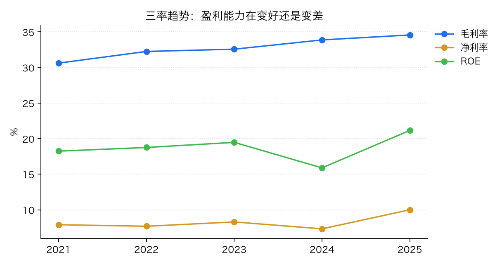
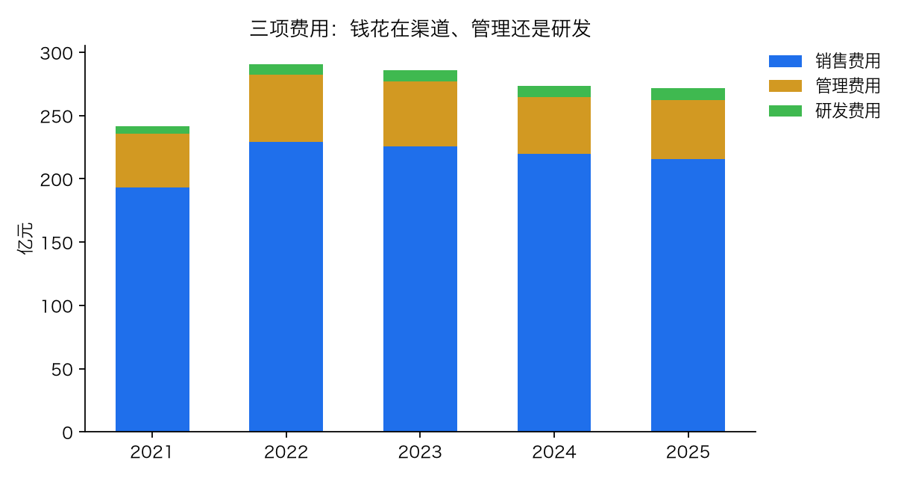
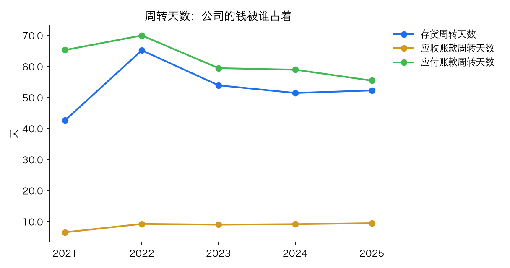
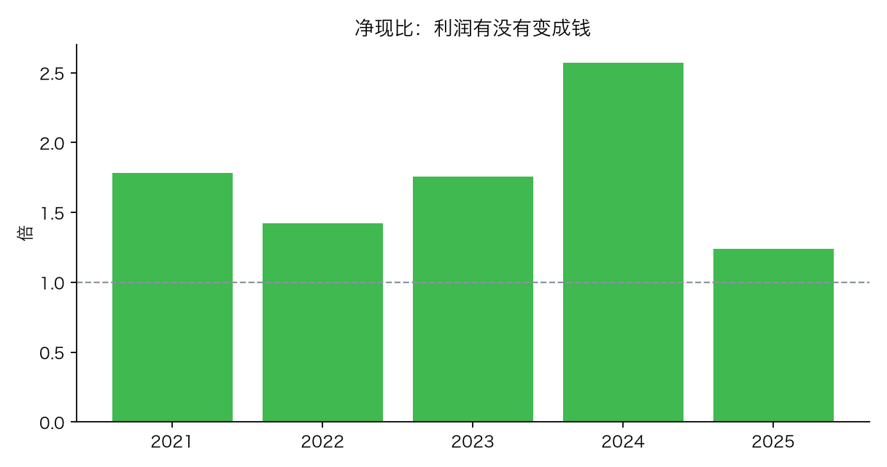

# 伊利股份（600887.SH）2025 年报深度解读

## 一页纸

**归母净利润 115.65 亿元是伊利历史上最高的一年，但这次跳升不是主业赚出来的。** 营业收入 1,156.36 亿元，只比上年的 1,153.93 亿元多了一点；毛利也只是从 390.94 亿元走到 399.82 亿元（P86）。

**把营业利润从 101.82 亿元推到 135.28 亿元的主力，是资产减值损失。** 这一项从 -46.76 亿元收窄到 -7.30 亿元，信用减值损失同时从 -5.55 亿元收窄到 -2.68 亿元（P86）。投资收益则从 24.17 亿元塌到 1.47 亿元（P86），还回去一大半。21.16% 的 ROE 是一次出清之后的报表修复。

**同一份年报里，经营现金流少了三分之一。** 经营活动现金流量净额 143.44 亿元，上年 217.40 亿元，净现比从 2.57 倍掉到 1.24 倍（P89）。这是本期最需要解释的矛盾：利润创新高，现金反而退了一格。

**上年的 217.40 亿元本身也不可重复。** 那一年合同负债从 86.96 亿元升到 120.73 亿元（P83）——先收钱后确认收入，等于向渠道借了一笔无息款。FY2025 这笔钱开始还，合同负债降到 105.64 亿元。1.24 倍才是常态。

**短期要看的是三个数字，不是一个。** 短期借款 456.31 亿元、短期应付债券 90.43 亿元、一年内到期的长期借款 42.63 亿元（P83、P190），而货币资金只有 194.95 亿元（P82）。

**但真实的现金厚度不在货币资金里。** 大额存单分三处：一年内到期 108.73 亿元、其他流动资产 135.54 亿元、其他非流动资产 281.09 亿元（P160、P161、P183）。利息收入 21.70 亿元高于利息支出 13.66 亿元（P202）。风险在利差与再融资条件，不在偿付能力。

**分红是这套结构的另一端。** 经营现金流 143.44 亿元要同时覆盖资本开支 30.37 亿元与分配支出 120.25 亿元（P90），两项合计已超过前者；而分红下限被写成三年不低于归母净利润 75%（P49），它不会自己缩回去。

**下一年只盯两件事：经营现金流的方向，和短期借款与超短融余额的方向。** 前者决定分红能不能自己付，后者决定付不出来时还能滚多久。其他判断都挂在这两条上。

| 指标 | 2021 | 2022 | 2023 | 2024 | 2025 |
| :--- | ---: | ---: | ---: | ---: | ---: |
| 营业收入（亿元） | 1,101.44 | 1,226.98 | 1,257.58 | 1,153.93 | 1,156.36 |
| 归母净利润（亿元） | 87.05 | 94.31 | 104.29 | 84.53 | 115.65 |
| 毛利率 | 30.62% | 32.26% | 32.58% | 33.88% | 34.58% |
| 净利率 | 7.90% | 7.69% | 8.29% | 7.33% | 10.00% |
| ROE | 18.25% | 18.76% | 19.48% | 15.89% | 21.16% |
| ROIC | 15.06% | 13.84% | 13.93% | 13.34% | 19.64% |
| 经营活动现金流（亿元） | 155.28 | 134.20 | 182.90 | 217.40 | 143.44 |
| 自由现金流（亿元） | 88.45 | 67.74 | 113.35 | 177.61 | 113.07 |
| 净现比 | 1.78 倍 | 1.42 倍 | 1.75 倍 | 2.57 倍 | 1.24 倍 |
| 资产负债率 | 52.15% | 58.66% | 62.19% | 62.91% | 61.51% |
| 分红率 | —（不可得） | —（不可得） | —（不可得） | —（不可得） | 75.48% |

红旗判定：清单共 32 项，命中 4 项，数据不足 12 项（数据不足不等于没问题）。

| 严重度 | 红旗 | 状态 | 观测值 |
| :--- | :--- | :--- | :--- |
| 高 | 商誉减值反复出现（挤牙膏式减值） | 命中 | FY2025 商誉减值损失 = -1.41 亿元；FY2024 商誉减值损失 = -30.75 亿元（阈值 < 0.00 亿元），且 FY2025 商誉减值覆盖率 = 62.06%（阈值 < 70.00%） |
| 高 | 关联采购占营业成本比例过高 | 命中 | FY2025 关联方采购金额/营业成本 = 20.65% |
| 高 | 分红超过自由现金流 | 命中 | FY2025 分配股利、利润或偿付利息支付的现金 120.25 亿元 vs 自由现金流 113.07 亿元 |
| 中 | 短期借款支撑长期资产（短债长投） | 命中 | FY2025 短期借款/银行借款 = 98.98%，且 FY2025 货币资金/短期借款 = 42.72% |

## 生意：钱是怎么赚的

**这门生意的骨架，是三条产品线共用一个奶源、一套冷链、一张经销商网。** 液体乳 704.22 亿元、奶粉及奶制品 330.78 亿元、冷饮 98.22 亿元、其他 12.22 亿元（P242），构成 1,156.36 亿元营业收入（P86）的主体。

**四块的体量差得很远，但它们摊的是同一批工厂、同一批送货车、同一批业务员。** 所以结构问题不是哪块最大，而是成本由谁摊、费用由谁背。液体乳占了大头，也正好是价格最透明、竞争最直接的那一块。

**定价权不在公司手里，在货架和经销商手里。** 年报把液体乳收入的下滑拆成销量、产品结构、价格三项，并明确价格是主要拖累（P21）；同期公司液态类乳品零售额份额仍是第一（P11）。

**份额在涨、收入在跌，只有一种解释：份额是拿价格换的。** 这种竞争比的不是谁的产品更好，而是谁更愿意为货架和心智持续付费，所以它不会因为某个对手退出就结束，这也是销售费用率下不去的根本原因。

**成本端能控的部分很少。** 营业成本 756.54 亿元（P86）里直接材料占绝对多数，直接人工与制造费用的比重都很小（P23），原奶一动毛利率就跟着动：这是一门原料决定毛利的生意。

**费用端能控的部分更少。** 销售费用 215.45 亿元、管理费用 46.96 亿元、研发费用 9.15 亿元（P86），销售费用率 18.63%；毛利 399.82 亿元里有超过一半被销售费用拿走，研发费用率只有 0.79%（P86）。门槛不在配方，在这笔钱怎么花。

**对下游几乎现款现货，对上游还留着账期——但两端都在收紧。** 应收账款 29.87 亿元、周转 9.4 天（P82）；应付账款 114.79 亿元、周转 55.4 天（P83）。应付周转从 FY2022 的 69.9 天降到 55.4 天，上游把信用收回去了，缺口只能由短债补。

**底色是一份靠规模与广告费换来的辛苦钱，资本回报却不低。** 净利率 10.00%、ROIC 19.64%（P86、P87），五年毛利率从 30.62% 单向上行到 34.58%（P86）。公司能自主的只有费用节奏：本期广告宣传费从 136.12 亿元压到 128.20 亿元（P201），压出来的利润同时是品牌投入的欠账。

| 品类 | 2025 | 占营业收入 |
| :--- | ---: | ---: |
| 液体乳收入 | 704.22 | 60.9% |
| 奶粉及奶制品收入 | 330.78 | 28.6% |
| 冷饮收入 | 98.22 | 8.5% |
| 其他收入 | 12.22 | 1.1% |
| **合计** | 1,156.36 | 100.0% |

| 编号 | 严重度 | 判断 | 依据 | 证据 |
| :--- | :--- | :--- | :--- | :--- |
| F-cb-01 | 中 | 收入进入平台期 | FY2024→FY2025 收入增速 FY2024 -8.24%、FY2025 +0.21%，连续 2 期低于 1% | E-106、E-107 |

## 五年账

**五年收入是一个平台：FY2023 见顶，此后两年横在 1,150 亿元附近。** 营业收入 FY2021 1,101.44 亿元、FY2022 1,226.98 亿元、FY2023 1,257.58 亿元，然后退到 FY2024 的 1,153.93 亿元与 FY2025 的 1,156.36 亿元（P86）。

**收入停了，毛利率却在涨，这是后面所有数字的起点。** 毛利率 30.62%、32.26%、32.58%、33.88%、34.58%（P86），五年没有回头：不再靠卖得多，开始靠卖得贵。

**毛利的五年轨迹比收入干净。** 毛利 337.27 亿元、395.79 亿元、409.70 亿元、390.94 亿元、399.82 亿元（P86）。FY2024 毛利回落而毛利率从 32.58% 升到 33.88%——两者反向，只能是卖的东西变了，不是价格变了。

**这条抬升来自产品结构与原奶价格，不来自提价能力。** 结构可以年年推，原奶价格会转；当成提价能力的证据，明年就会被打脸。

**利润的五年是一条 V：先滑到 FY2024 的谷底，再跳到历史最高。** 归母净利润 87.05 亿元、94.31 亿元、104.29 亿元、84.53 亿元、115.65 亿元；ROE 18.25%、18.76%、19.48%、15.89%、21.16%（P82、P87）。

**ROE 的抬升靠的是净利率与杠杆，不是资产效率。** 净利率从 7.33% 跳到 10.00%，权益乘数 2.78 倍；总资产周转率只有 0.76 倍，五年里从 1.08 倍一路下滑（P82、P86、P87）。

**真正换了挡的是现金去向：从投产能改成发钱。** 资本开支 66.83 亿元、66.46 亿元、69.56 亿元、39.78 亿元、30.37 亿元（P90），后两年砍掉一半以上；分配股利支付的现金 56.93 亿元、75.00 亿元、84.16 亿元、90.92 亿元、120.25 亿元（P90）。

**但经营现金流没有跟着变多。** 155.28 亿元、134.20 亿元、182.90 亿元、217.40 亿元、143.44 亿元（P89），FY2025 反而是五年里第二低。

| 项目 | 2021 | 2022 | 2023 | 2024 | 2025 |
| :--- | ---: | ---: | ---: | ---: | ---: |
| 营业收入（亿元） | 1,101.44 | 1,226.98 | 1,257.58 | 1,153.93 | 1,156.36 |
| 毛利（亿元） | 337.27 | 395.79 | 409.70 | 390.94 | 399.82 |
| 营业利润（亿元） | 102.30 | 108.60 | 118.73 | 101.82 | 135.28 |
| 归母净利润（亿元） | 87.05 | 94.31 | 104.29 | 84.53 | 115.65 |
| 经营活动现金流（亿元） | 155.28 | 134.20 | 182.90 | 217.40 | 143.44 |
| 自由现金流（亿元） | 88.45 | 67.74 | 113.35 | 177.61 | 113.07 |
| ROE | 18.25% | 18.76% | 19.48% | 15.89% | 21.16% |
| 净利率 | 7.90% | 7.69% | 8.29% | 7.33% | 10.00% |

*数据来源：公司年度报告原文（页码见正文引用），金额为合并报表口径。*

### 杜邦分解

| 项目 | 2021 | 2022 | 2023 | 2024 | 2025 |
| :--- | ---: | ---: | ---: | ---: | ---: |
| ROE | 18.25% | 18.76% | 19.48% | 15.89% | 21.16% |
| 净利率 | 7.90% | 7.69% | 8.29% | 7.33% | 10.00% |
| 总资产周转率（次） | 1.08 倍 | 0.94 倍 | 0.83 倍 | 0.75 倍 | 0.76 倍 |
| 权益乘数（倍） | 2.14 倍 | 2.61 倍 | 2.83 倍 | 2.89 倍 | 2.78 倍 |

## 利润表：从毛利到归母

**毛利这一层是整份报表里最稳的一段，也是最容易被高估的一段。** 营业收入 1,156.36 亿元、营业成本 756.54 亿元、毛利 399.82 亿元、毛利率 34.58%（P86）。

**毛利率比上年的 33.88% 又高了一档，但毛利的绝对额只从 390.94 亿元走到 399.82 亿元。** 规模不动的时候，毛利率的每一个点都必须来自结构或成本，不可能来自卖得更多。这是本期利润表最需要记住的一句。

**费用端是唯一由公司自己决定的部分，而它只挪了一点点。** 销售费用 215.45 亿元、销售费用率 18.63%（上年 19.05%），管理费用 46.96 亿元、管理费用率 4.06%，研发费用 9.15 亿元（P86）。

**销售费用的减少几乎全部来自广告。** 广告宣传费从 136.12 亿元降到 128.20 亿元（P201），降幅比销售费用总额的降幅还大，意味着薪酬、仓储这些项目其实在增（P201）。用减广告换利润，一年有效，两年伤品牌。

**财务费用是 -6.91 亿元，这个负号不是没有负债，是存款收益暂时盖过借款成本。** 利息支出 13.66 亿元、利息收入 21.70 亿元（P202）。它的可持续性取决于利差，不取决于经营。

**营业利润的跳升主要发生在减值那一行。** 营业利润 135.28 亿元，上年 101.82 亿元（P86）；资产减值损失从 -46.76 亿元收窄到 -7.30 亿元，信用减值损失从 -5.55 亿元收窄到 -2.68 亿元（P86）。

**对冲这笔便宜的是投资收益。** 这一项从 24.17 亿元塌到 1.47 亿元（P86）。另有其他收益 12.08 亿元（P86），接近利润总额的十分之一，几乎全部是政府补助（P202）。减值的少提被投资的退潮抵消了一部分，剩下的才是经营改善。

**从营业利润到归母还有四道口子。** 营业利润 135.28 亿元只落到利润总额 129.94 亿元（P86、P87），差额在营业外收支，本期营业外支出被对外捐赠抬高（P206）；所得税 14.80 亿元、有效税率 11.39%（上年 16.42%），低税率来自农产品初加工免税与西部大开发、高新技术企业优惠（P144）；少数股东损益 -0.51 亿元，归母 115.65 亿元（P87）。

### 三项费用与销售投入

| 项目 | 2021 | 2022 | 2023 | 2024 | 2025 |
| :--- | ---: | ---: | ---: | ---: | ---: |
| 销售费用（亿元） | 193.15 | 229.08 | 225.72 | 219.82 | 215.45 |
| 管理费用（亿元） | 42.27 | 53.43 | 51.54 | 44.65 | 46.96 |
| 研发费用（亿元） | 6.01 | 8.22 | 8.50 | 8.70 | 9.15 |
| 财务费用（亿元） | -0.29 | -2.55 | -1.53 | -5.92 | -6.91 |
| 其中：广告营销费（亿元） | —（不可得） | —（不可得） | —（不可得） | 136.12 | 128.20 |

*数据来源：公司年度报告原文（页码见正文引用），金额为合并报表口径。*

### 研发与人员

| 项目 | 2021 | 2022 | 2023 | 2024 | 2025 |
| :--- | ---: | ---: | ---: | ---: | ---: |
| 研发费用（亿元） | 6.01 | 8.22 | 8.50 | 8.70 | 9.15 |
| 在职员工（人） | —（不可得） | —（不可得） | —（不可得） | —（不可得） | 62,666 |
| 关联方采购（亿元） | —（不可得） | —（不可得） | —（不可得） | —（不可得） | 156.26 |

广告营销费见销售费用附注（P201）；关联采购额见「主要供应商」段落（P24）；研发投入未资本化（附注资本化金额为空），故不列资本化率。

## 资产负债表：钱在哪、欠谁

**资产端最显眼的不是厂房，是钱和准钱。** 资产总计 1,520.99 亿元（P82），固定资产 343.86 亿元、在建工程 13.57 亿元、无形资产 47.55 亿元、商誉 21.82 亿元（P82），四项长期资产合计不到总资产的三成。

**一家重资产公司，账上最厚的却是存款。** 货币资金 194.95 亿元、一年内到期的大额存单 108.73 亿元、其他流动资产里的存单与定期存款 135.54 亿元、其他非流动资产里的 281.09 亿元（P82、P160、P161、P183）。

**负债端的问题不是总量，是期限。** 负债合计 935.54 亿元、资产负债率 61.51%；流动负债 910.53 亿元，其中短期借款 456.31 亿元、应付账款 114.79 亿元、合同负债 105.64 亿元、应付票据 16.51 亿元（P83）。

**长期负债几乎被清空了。** 长期借款只剩 4.72 亿元（P83），一年内到期的长期借款 42.63 亿元、短期应付债券 90.43 亿元（P190）。有息负债几乎全部在一年内到期，这是主动选择而不是被动结果——短端利率低于长端，是这套安排的直接动机。

**流动比率 0.73 倍不是资不抵债，但它也不是安全垫。** 流动资产 663.70 亿元对流动负债 910.53 亿元（P82、P83），这个比率五年里从 1.16 倍一路降到 0.73 倍。口径还把一年内到期的大额存单 108.73 亿元排在非流动资产里（P160），加回去缺口会小很多，但仍然是缺口。

**真正的缓冲是那几笔存款能随时变现，加上利差还是正的。** 利息收入 21.70 亿元高于利息支出 13.66 亿元（P202）。利差在，滚动就转得动；利差反转，同一套结构立刻变成成本。

**资产负债表上仅有的两处需要靠假设读，是商誉与受限资金。** 商誉原值 57.50 亿元、已计提减值准备 35.68 亿元、净额 21.82 亿元，本期又计提 -1.41 亿元（P82、P179、P204）；剩下的商誉几乎全部挂在澳优乳业一个资产组上（P179）。

**受限资金金额不大，但没有被单独解释。** 主要是子公司财务公司存放央行的法定存款准备金与担保保证金（P145、P183），用途与解限条件年报没有展开。

### 资产端

| 项目 | 2021 | 2022 | 2023 | 2024 | 2025 |
| :--- | ---: | ---: | ---: | ---: | ---: |
| 货币资金（亿元） | 317.42 | 338.53 | 433.72 | 254.04 | 194.95 |
| 应收账款（亿元） | 19.59 | 30.88 | 30.85 | 28.78 | 29.87 |
| 存货（亿元） | 89.17 | 148.36 | 125.12 | 107.45 | 108.23 |
| 流动资产合计（亿元） | 501.55 | 614.63 | 693.55 | 666.19 | 663.70 |
| 固定资产（亿元） | 293.79 | 337.35 | 352.42 | 346.19 | 343.86 |
| 无形资产（亿元） | 16.09 | 46.48 | 47.29 | 47.80 | 47.55 |
| 资产总计（亿元） | 1,019.62 | 1,309.65 | 1,516.20 | 1,537.18 | 1,520.99 |

### 负债与权益

| 项目 | 2021 | 2022 | 2023 | 2024 | 2025 |
| :--- | ---: | ---: | ---: | ---: | ---: |
| 应付账款（亿元） | 136.60 | 159.26 | 137.99 | 123.13 | 114.79 |
| 合同负债（亿元） | 78.91 | 89.13 | 86.96 | 120.73 | 105.64 |
| 短期借款（亿元） | 125.96 | 267.99 | 397.55 | 363.55 | 456.31 |
| 长期借款（亿元） | 53.80 | 92.98 | 117.05 | 46.87 | 4.72 |
| 流动负债合计（亿元） | 432.96 | 621.70 | 768.60 | 899.25 | 910.53 |
| 归母权益（亿元） | 477.08 | 502.68 | 535.39 | 531.80 | 546.56 |
| 少数股东权益（亿元） | 10.83 | 38.75 | 37.81 | 38.28 | 38.89 |
| 所有者权益合计（亿元） | 487.91 | 541.43 | 573.20 | 570.08 | 585.44 |

*数据来源：公司年度报告原文（页码见正文引用），金额为合并报表口径。*

## 现金流量表：利润变成了什么

**三段现金放在一起，才看得出这家公司这一年到底在做什么。** 经营活动 143.44 亿元、投资活动 -77.96 亿元、筹资活动 -134.73 亿元（P89、P90），货币资金从 254.04 亿元降到 194.95 亿元（P82）。

**投资端的流出不是买设备，是买存单。** 资本开支只有 30.37 亿元、占收入 2.63%（P90），五年里最低。真正占钱的是大额存单与定期存款的净买入，所以资本开支这个指标已经描述不了这家公司的投资行为。

**筹资端的流出主要是分配。** 筹资活动净流出 134.73 亿元（P90）里，分配股利与利息占了 120.25 亿元。同一栏里取得借款 2,344.71 亿元、偿还债务 2,355.60 亿元（P90）——借进来的与还出去的基本打平，靠的是高频滚动的短债维持余额。

**净现比从 2.57 倍掉到 1.24 倍，方向比幅度更重要。** 经营现金流 143.44 亿元、归母净利润 115.65 亿元（P89、P87），五年净现比 1.78、1.42、1.75、2.57、1.24 倍（P89）。利润仍有现金支撑，只是支撑的厚度回到常态。

**2.57 倍那一年的异常值，是合同负债造出来的。** 那一年合同负债从 86.96 亿元升到 120.73 亿元（P83）——先收钱后确认收入，等于向渠道借了一笔无息款。到 FY2025 合同负债降到 105.64 亿元，这笔钱开始还。

**营运资本的摆动不可重复，这是判断现金流能不能外推的关键。** 合同负债从 120.73 亿元降到 105.64 亿元、应付账款从 123.13 亿元降到 114.79 亿元（P83），存货却只从 107.45 亿元升到 108.23 亿元（P82）。上游和渠道同时收回信用。

**存货没涨这件事，反过来是收入质量的证据。** 货是真卖出去了，不是压给经销商；变差的只是钱回来的路。这排除了最常见的收入质量问题。

**自由现金流够养分红，但不够同时养分红和资本开支。** 自由现金流 113.07 亿元（P89、P90），当年宣告的现金分红 87.29 亿元、计入回购后 89.78 亿元（P49），覆盖得住；但现金流量表口径的分配支出 120.25 亿元加上资本开支 30.37 亿元，已经超过经营现金流。

| 项目 | 2021 | 2022 | 2023 | 2024 | 2025 |
| :--- | ---: | ---: | ---: | ---: | ---: |
| 经营活动现金流（亿元） | 155.28 | 134.20 | 182.90 | 217.40 | 143.44 |
| 投资活动现金流（亿元） | -77.97 | -195.14 | -160.44 | -327.09 | -77.96 |
| 筹资活动现金流（亿元） | 119.45 | 87.81 | 72.58 | -72.78 | -134.73 |
| 资本性支出（亿元） | 66.83 | 66.46 | 69.56 | 39.78 | 30.37 |
| 自由现金流（亿元） | 88.45 | 67.74 | 113.35 | 177.61 | 113.07 |
| 净现比 | 1.78 倍 | 1.42 倍 | 1.75 倍 | 2.57 倍 | 1.24 倍 |

*数据来源：公司年度报告原文（页码见正文引用），金额为合并报表口径。*

## 附注深挖

**附注优先级。** 96 条附注，按这家公司自己的数字排队：先看金额占收入最大的，再看变动最剧烈的，最后是公司自己措辞最软的那几条。◆ 重点 60 条、◇ 常规 36 条。

| 序 | 附注 | 类型 | 层级 | 涉及金额（亿元） | 占收入 | 判断密度 | 页 |
| ---: | :--- | :--- | :--- | ---: | ---: | ---: | :--- |
| 1 | 61 营业收入和营业成本 | 金额型 | ◆ | 1,156.36 | 100.0% | 0.0 | P199–P199 |
| 2 | 16 存货 | 金额型 | ◆ | 108.23 | 9.4% | 11.0 | P118–P118 |
| 3 | 21 固定资产 | 金额型 | ◆ | 343.86 | 29.7% | 2.0 | P125–P125 |
| 4 | 26 无形资产 | 金额型 | ◆ | 47.55 | 4.1% | 6.4 | P128–P129 |
| 5 | 29 合同负债 | 金额型 | ◆ | 105.64 | 9.1% | 2.0 | P131–P131 |
| 6 | 13 应收账款 | 金额型 | ◆ | 29.87 | 2.6% | 10.0 | P116–P116 |
| 7 | 十四、关联方及关联交易 | 交易型 | ◆ | 156.26 | 13.5% | 0.0 | P235–P238 |
| 8 | 11 金融工具 | 风险型 | ◆ | — | — | 3.5 | P108–P115 |
| 9 | 31 预计负债 | 估计型 | ◆ | — | — | 9.0 | P133–P133 |
| 10 | 39 其他重要的会计政策和会计估计 | 政策型 | ◆ | — | — | 13.9 | P141–P142 |
| 11 | 十六、承诺及或有事项 | 承诺型 | ◆ | — | — | 0.0 | P239–P239 |
| 12 | 36 政府补助 | 金额型 | ◆ | 12.08 | 1.0% | 4.9 | P136–P137 |
| 13 | 62 利息收入 | 金额型 | ◆ | 21.70 | 1.9% | 0.0 | P200–P200 |
| 14 | 12 应收票据 | 金额型 | ◆ | 0.07 | 0.0% | 10.0 | P116–P116 |
| 15 | 22 在建工程 | 金额型 | ◆ | 13.57 | 1.2% | 1.0 | P126–P126 |
| 16 | 14 应收款项融资 | 金额型 | ◆ | — | — | 11.5 | P117–P117 |
| 17 | 15 其他应收款 | 金额型 | ◆ | — | — | 11.0 | P118–P118 |
| 18 | 32 股份支付 | 交易型 | ◆ | — | — | 9.0 | P133–P133 |
| 19 | 77 所得税费用 | 金额型 | ◆ | 14.80 | 1.3% | 0.0 | P206–P206 |
| 20 | 十一、政府补助 | 金额型 | ◆ | 12.08 | 1.0% | 0.0 | P227–P227 |
| 21 | 八、研发支出 | 金额型 | ◆ | 9.15 | 0.8% | 0.0 | P217–P217 |
| 22 | 17 合同资产 | 金额型 | ◆ | — | — | 5.0 | P119–P119 |
| 23 | 45 长期借款 | 金额型 | ◆ | 4.72 | 0.4% | 1.0 | P192–P192 |
| 24 | 67 财务费用 | 金额型 | ◆ | 6.91 | 0.6% | 0.0 | P202–P202 |
| 25 | 34 收入 | 金额型 | ◆ | — | — | 3.8 | P134–P134 |
| 26 | 40 重要会计政策和会计估计的变更 | 政策型 | ◆ | — | — | 7.0 | P143–P143 |
| 27 | 六、税项 | 政策型 | ◆ | — | — | 7.0 | P143–P143 |
| 28 | 27 长期资产减值 | 估计型 | ◆ | — | — | 2.0 | P130–P130 |
| 29 | 28 长期待摊费用 | 金额型 | ◆ | — | — | 2.0 | P131–P131 |
| 30 | 50 预计负债 | 估计型 | ◆ | — | — | 2.0 | P195–P195 |
| 31 | 51 递延收益 | 金额型 | ◆ | — | — | 2.0 | P195–P195 |
| 32 | 52 其他非流动负债 | 金额型 | ◆ | — | — | 2.0 | P195–P195 |
| 33 | 53 股本 | 金额型 | ◆ | — | — | 2.0 | P195–P195 |
| 34 | 30 职工薪酬 | 交易型 | ◆ | — | — | 1.6 | P131–P132 |
| 35 | 十八、其他重要事项 | 交易型 | ◆ | — | — | 1.5 | P240–P241 |
| 36 | 46 应付债券 | 金额型 | ◆ | — | — | 1.0 | P192–P192 |
| 37 | 84 数据资源 | 金额型 | ◆ | — | — | 1.0 | P216–P216 |
| 38 | 69 投资收益 | 金额型 | ◆ | 1.47 | 0.1% | 0.0 | P203–P203 |
| 39 | 19 长期股权投资 | 金额型 | ◆ | — | — | 0.7 | P121–P123 |
| 40 | 十九、母公司财务报表主要项目注释 | 金额型 | ◆ | — | — | 0.5 | P242–P257 |
| 41 | 七、合并财务报表项目注释 | 金额型 | ◆ | — | — | 0.3 | P144–P189 |
| 42 | 1 遵循企业会计准则的声明 | 政策型 | ◆ | — | — | 4.0 | P101–P101 |
| 43 | 2 会计期间 | 政策型 | ◆ | — | — | 4.0 | P101–P101 |
| 44 | 3 营业周期 | 政策型 | ◆ | — | — | 4.0 | P101–P101 |
| 45 | 4 记账本位币 | 政策型 | ◆ | — | — | 4.0 | P101–P101 |
| 46 | 5 重要性标准确定方法和选择依据 | 政策型 | ◆ | — | — | 4.0 | P101–P101 |
| 47 | 8 合营安排分类及共同经营会计处理方法 | 交易型 | ◆ | — | — | 0.0 | P106–P106 |
| 48 | 44 其他流动负债 | 金额型 | ◆ | — | — | 0.0 | P190–P191 |
| 49 | 47 租赁负债 | 金额型 | ◆ | — | — | 0.0 | P193–P193 |
| 50 | 48 长期应付款 | 金额型 | ◆ | — | — | 0.0 | P193–P193 |
| 51 | 49 长期应付职工薪酬 | 交易型 | ◆ | — | — | 0.0 | P193–P194 |
| 52 | 55 资本公积 | 金额型 | ◆ | — | — | 0.0 | P196–P196 |
| 53 | 56 库存股 | 金额型 | ◆ | — | — | 0.0 | P196–P196 |
| 54 | 57 其他综合收益 | 金额型 | ◆ | — | — | 0.0 | P197–P197 |
| 55 | 58 专项储备 | 金额型 | ◆ | — | — | 0.0 | P198–P198 |
| 56 | 59 盈余公积 | 金额型 | ◆ | — | — | 0.0 | P198–P198 |
| 57 | 60 未分配利润 | 金额型 | ◆ | — | — | 0.0 | P198–P198 |
| 58 | 63 税金及附加 | 金额型 | ◆ | — | — | 0.0 | P200–P200 |
| 59 | 64 销售费用 | 金额型 | ◆ | — | — | 0.0 | P201–P201 |
| 60 | 65 管理费用 | 金额型 | ◆ | — | — | 0.0 | P201–P201 |
| 61 | 66 研发费用 | 金额型 | ◇ | — | — | 0.0 | P202–P202 |
| 62 | 68 其他收益 | 金额型 | ◇ | — | — | 0.0 | P202–P202 |
| 63 | 70 净敞口套期收益 | 金额型 | ◇ | — | — | 0.0 | P203–P203 |
| 64 | 71 公允价值变动收益 | 金额型 | ◇ | — | — | 0.0 | P203–P203 |
| 65 | 72 信用减值损失 | 估计型 | ◇ | — | — | 0.0 | P204–P204 |
| 66 | 73 资产减值损失 | 估计型 | ◇ | — | — | 0.0 | P204–P204 |
| 67 | 74 资产处置收益 | 金额型 | ◇ | — | — | 0.0 | P205–P205 |
| 68 | 75 营业外收入 | 金额型 | ◇ | — | — | 0.0 | P205–P205 |
| 69 | 76 营业外支出 | 金额型 | ◇ | — | — | 0.0 | P205–P205 |
| 70 | 78 其他综合收益 | 金额型 | ◇ | — | — | 0.0 | P207–P207 |
| 71 | 79 现金流量表项目 | 金额型 | ◇ | — | — | 0.0 | P207–P209 |
| 72 | 80 现金流量表补充资料 | 金额型 | ◇ | — | — | 0.0 | P210–P211 |
| 73 | 九、合并范围的变更 | 交易型 | ◇ | — | — | 0.0 | P217–P220 |
| 74 | 十、在其他主体中的权益 | 交易型 | ◇ | — | — | 0.0 | P221–P226 |
| 75 | 十五、股份支付 | 交易型 | ◇ | — | — | 0.0 | P239–P239 |
| 76 | 二十、补充资料 | 金额型 | ◇ | — | — | 0.0 | P258–P259 |
| 77 | 18 持有待售的非流动资产或处置组 | 政策型 | ◇ | — | — | 2.9 | P119–P120 |
| 78 | 五、重要会计政策及会计估计 | 政策型 | ◇ | — | — | 2.1 | P101–P102 |
| 79 | 35 合同成本 | 政策型 | ◇ | — | — | 1.9 | P135–P135 |
| 80 | 7 控制的判断标准和合并财务报表的编制方法 | 政策型 | ◇ | — | — | 1.0 | P103–P105 |
| 81 | 23 借款费用 | 政策型 | ◇ | — | — | 1.0 | P126–P126 |
| 82 | 25 油气资产 | 政策型 | ◇ | — | — | 1.0 | P128–P128 |
| 83 | 38 租赁 | 政策型 | ◇ | — | — | 0.4 | P138–P140 |
| 84 | 9 现金及现金等价物的确定标准 | 政策型 | ◇ | — | — | 0.0 | P107–P107 |
| 85 | 10 外币业务和外币报表折算 | 政策型 | ◇ | — | — | 0.0 | P107–P107 |
| 86 | 20 投资性房地产 | 政策型 | ◇ | — | — | 0.0 | P124–P124 |
| 87 | 24 生物资产 | 政策型 | ◇ | — | — | 0.0 | P127–P127 |
| 88 | 83 租赁 | 政策型 | ◇ | — | — | 0.0 | P215–P215 |
| 89 | 十三、公允价值的披露 | 风险型 | ◇ | — | — | 1.8 | P232–P234 |
| 90 | 十七、资产负债表日后事项 | 风险型 | ◇ | — | — | 1.0 | P240–P240 |
| 91 | 42 其他 | 未归类 | ◇ | — | — | 7.0 | P143–P143 |
| 92 | 十二、与金融工具相关的风险 | 风险型 | ◇ | — | — | 0.5 | P228–P231 |
| 93 | 54 其他权益工具 | 未归类 | ◇ | — | — | 0.0 | P196–P196 |
| 94 | 81 所有者权益变动表项目注释 | 未归类 | ◇ | — | — | 0.0 | P212–P212 |
| 95 | 82 外币货币性项目 | 未归类 | ◇ | — | — | 0.0 | P213–P214 |
| 96 | 85 其他 | 未归类 | ◇ | — | — | 0.0 | P217–P217 |

**附注 61 营业收入和营业成本：收入几乎全靠液体乳一门生意撑住，成本降得比收入快，利润是靠结构换来的。** 收入 1,156.36 亿元（P86），营业成本 756.54 亿元（P86）。液体乳 704.22 亿元、奶粉及奶制品 330.78 亿元、冷饮 98.22 亿元（P242），液体乳一份独大，增长和利润的边际都在它身上。收入确认这一条，履约义务说明和分摊至剩余履约义务两栏都标不适用（P200），说明公司按发货即控制权转移确认，没有按履约进度分段的余地。下一期盯季度收入与合同负债的错位，以及渠道返利结算的时点。

**附注 16 存货：存货体量不小，但跌价准备只按单个项目算，披露里看不到按库龄分档的可变现净值。** 存货 108.23 亿元（P118），相当于收入的 9.4%。政策上发出按加权平均法、永续盘存，跌价准备按单个项目计提、影响因素消失可转回；组合计提和库龄组合两栏都标不适用（P119），等于不分档披露可变现净值。减值的唯一出口是资产减值损失 -7.30 亿元（P86），里面还夹着固定资产和无形资产，拆不出存货这一块。下一期要的是存货分类余额表，看原材料和库存商品谁在堆。

**附注 21 固定资产：成本模式、按结构分档折旧、年终只复核不重估，重估增值这条路彻底关着。** 固定资产 343.86 亿元（P125），相当于收入的 29.7%。房屋及建筑物按框架、砖混、轻钢分档定年限，机器设备统一一个年限，残值率同一档，全部年限平均法（P125）。年度终了只复核使用寿命和净残值，估计变了未来适用调整，不做评估增值。购建长期资产支出 30.37 亿元（P90），在建工程 13.57 亿元（P82），扩张是收着做的。下一期盯资产减值损失 -7.30 亿元（P86）里固定资产分到多少。

**附注 26 无形资产：摊销年限的依据是合同与同业比较，但分类年限表没列出来，这是该补的一页。** 无形资产 47.55 亿元（P128），相当于收入的 4.1%。公司按合同性权利期限定年限，无合同的靠同业比较和专家论证，定不了的按寿命不确定处理、不摊销只做减值测试（P129）。关键缺口是没有分类年限表，无法判断哪一块该加速摊。商誉 21.82 亿元（P82）同期计提减值 -1.41 亿元（P204），收购来的资产已经开始吞减值。下一期盯无形资产明细里商标和土地使用权的到期结构。

**附注 29 合同负债：余额 105.64 亿元回落，不等于渠道不打款，净额列示先把余额压薄了一层。** 合同负债 105.64 亿元（P131），相当于收入的 9.1%。政策只有一句：同一合同下的合同资产和合同负债以净额列示（P131），报表上的余额是抵完之后的数，同比向下不能直接读成经销商停止预付。另一条线索是结算方式，应收票据只剩 0.07 亿元（P82），下游用票据抵账的通道在收窄。下一期盯季末合同负债与收入的缺口，以及预付货款政策的松紧。

**附注 13 应收账款：规模小是好事，说明生意仍是先款后货，但账龄往长端走的迹象要看表才知道。** 应收账款 29.87 亿元（P116），只相当于收入的 2.6%。坏账走两条线：合并范围内子公司按关联组合、外部客户按账龄组合建模，另设单项认定标准（P117），政策本身不松。信用减值损失 -2.68 亿元（P86），比应收余额的量级不算轻。下一期要的是账龄表，看组合一（内部关联）占多少、账龄往长端挪了多少。

**附注十四 关联方及关联交易：关联采购 156.26 亿元，几乎全部押在一家联营的原奶上，这是单向依赖。** 关联采购 156.26 亿元（P235），相当于收入的 13.5%。结构上极度集中，主要是向联营企业 China Youran 采购原材料，其余几家牧场、检测和贸易公司都是零星数；销售方向反过来只有几笔小额，不存在对倒做大收入。定价随行就市，缺少独立第三方比价，这是要看的关键。下一期盯原奶价格下行时采购价能否同步下调，以及财务公司吸收关联方存款的规模。

**附注 11 金融工具：带息负债几乎全靠短债滚动，明年利息多掏多少全看这批短债的重定价。** 短期借款 456.31 亿元（P83）、短期应付债券 90.43 亿元（P190）、一年内到期长期借款 42.63 亿元（P190），长期借款只剩 4.72 亿元（P83），几乎全是短期。利息支出 13.66 亿元（P202）被利息收入 21.70 亿元（P202）对冲，财务费用是 -6.91 亿元（P86）。取得借款 2,344.71 亿元、偿还 2,355.60 亿元（P90），一年内基本全额换手。下一期盯大额存单 281.09 亿元（P183）的重定价。

**附注 31 预计负债：只有确认标准，没有余额、没有对应义务、没有到期时间，这一栏等于没披露。** 政策写清了三条确认条件和最佳估计数的取法，区间内取中间值、单项取最可能金额（P133），但全篇没有一笔具体负债。资产负债表上这一行列着，金额却是空的（P83），等于没有余额。真正需要盯的是子公司融资担保业务计提的担保赔偿和未到期责任准备金，代偿一升会先在这里冒头。下一期要的是预计负债明细表，不是政策文字。

**附注 39 其他重要的会计政策和会计估计：口径今年没动，可比性成立，但估计风险集中在两处。** 这一节实际是三块：回购股份计入库存股、套期关系的指定与失效处理、运输子公司按净额提取安全生产费（P142）。期初未分配利润的五项追溯调整都没有金额（P199），会计政策变更和差错更正都是空的，跨年可比。真正的估计风险在折旧摊销年限与商誉减值：商誉 21.82 亿元（P82），本期计提 -1.41 亿元（P204）。下一期若原奶周期见底，商誉测试假设会是最先被调的地方。

**附注十六 承诺及或有事项：重要承诺与或有事项两栏都标不适用，表外没有需要量化的担保和诉讼。** 这在重资产加高负债的组合里算干净，没有对外担保池、没有未决诉讼的金额敞口。唯一露头的是关联方章节里对一家参股奶业投资中心的一笔担保，金额和期限都小（P237）。空着不等于没有：为经销商和上下游安排的担保、保理、回购义务如果走了别的科目，这里就看不到。下一期盯年报其他章节的担保额度公告与这里的口径对不对得上。

**附注 36 政府补助：其他收益 12.08 亿元进的是当期损益，补助一退坡就是直接减利润，中间没有缓冲垫。** 其他收益 12.08 亿元（P136），相当于收入的 1.0%，但对着利润总额 129.94 亿元（P87）就不能忽略。政策上资产相关补助冲减资产账面价值、与收益相关的先进递延收益再按期间转入其他收益（P137），能全额落到当期其他收益的，只能是补偿已发生费用的那部分，靠当年批复兑现。下一期盯补助项目随产业政策退坡的幅度，以及它与其他收益在季度间的分布。

**附注 62 利息收入：利息收入 21.70 亿元盖过利息支出，存贷差是正的，这是被低估的一块利润来源。** 附注 62 单列的那一行只是打进财务费用的一小块，真正的利息收入在大额存单和定期存款上，合计 281.09 亿元（P183）的盘子撑起了这部分收益。利息支出 13.66 亿元（P202），财务费用最终是 -6.91 亿元（P86）。风险在存款利率下行：大额存单到期重存，收益率会被直接削掉。下一期盯一年内到期的大额存单 108.73 亿元（P160）的重定价。

**附注 12 应收票据：票据余额几乎清零，下游不再用票据抵账，这块信用敞口可以忽略。** 应收票据 0.07 亿元（P116），对方是收入的万分之几，等于没有。政策上银行承兑汇票按零预期信用损失率处理、商业承兑汇票才建模计提（P116），余额这么小说明剩下的基本都是银票。票据池腾空也意味着贴现这条融资路今年没被用到，回款结构更干净。下一期盯应收款项融资是不是承接了本该进票据的银承。

**附注 22 在建工程：余额 13.57 亿元明显收缩，说明有项目转固落地，转固时点的话术值得留一手。** 在建工程 13.57 亿元（P126），相对固定资产 343.86 亿元（P82）不大，但比年初明显下降，本期有工程完工转入固定资产。原文的转固标准写得干脆：达到预定可使用状态就按暂估价转固并开始计提折旧，不必等竣工决算，决算后再调成本但不调已提折旧（P126）。这套写法两头都能用，节奏可以往后压，也可以提前吃掉折旧。下一期要的是在建工程明细表的项目名称、预算数与工程进度。

**附注 14 应收款项融资：这个科目从零起步新增，是票据背书贴现的中转站，不是资产在沉淀。** 表内应收票据只剩 0.07 亿元（P82），票据结算几乎全装进了应收款项融资，原文写明增加原因是新增用于背书或贴现的票据（P151）。它按公允价值计量、变动进其他综合收益，不进利润表，规模变大只影响票据流转的灵活度，不影响当期利润。真正要看的是已背书或贴现但未到期的那部分，票据出手了、风险没完全转移。下一期盯背书规模的扩张速度。

**附注 15 其他应收款：结构以内部往来为主，外部敞口不是问题。** 口径只给了三阶段模型和四类组合：应收利息、应收股利、合并范围内子公司往来、外部账龄组合（P118）。合并数拆开看，主体是子公司资金往来与股利，对外部的真实敞口很小。坏账计提落在组合层面，单项重要性门槛挂在附注里，没有单独细说的项目。结构没变，这条科目仍是内部资金归集通道。下期盯外部账龄组合是否新增，以及单项计提是否被启动。

**附注 32 股份支付：没有在存续的激励安排，摊销为零。** 政策把权益结算与现金结算两条路都写全了，可行权数量按最新估计调整，取消则加速行权（P133、P134）。但股份支付专章各表一律标为不适用（P239），说明报告期内既无等待期摊销，也无资本公积里的股份支付余额。好处是费用端干净，坏处是管理层与股东的利益绑定没有用这个工具。下期盯是否重启新一期激励，一旦启动，等待期费用会以非现金方式连吃几期利润。

**附注 77 所得税费用：税负低于法定水平，差额靠结构而非一次性事项。** 所得税费用 14.80 亿元（P87），占收入 1.3%，利润总额 129.94 亿元（P87）配出来的实际税负明显低于名义水平。调整表显示差异主要来自子公司适用不同税率与免税项目所得，两者方向相反，都依赖税务判断的最终认定。递延所得税资产要转回来，靠的是未来实际盈利与未来适用税率，减值准备和可抵扣亏损两块都压在这个前提上。下期盯免税项目能否延续，以及未确认递延资产的可抵扣亏损是否继续加厚。

**附注十一 政府补助：一笔能改变利润增速的钱。** 其他收益 12.08 亿元（P86），占收入 1.0%，其中绝大部分是政府补助，对着净利润 115.14 亿元（P87）看，这不是可以忽略的量级。结构上分两层：与资产相关的补助留在递延收益里按资产寿命逐年结转，形成稳定底仓；与收益相关的补助当年新增当年结转，取决于科研项目批复节奏（P228）。明年大概率还能延续，但难有增量，新增补助已经小于当年结转额。下期盯递延收益余额与本期新增补助，这决定明后两年的底仓厚度。

**附注八 研发支出：全部费用化，不存在后续摊销压力。** 研发费用 9.15 亿元（P86），占收入 0.8%，研发支出专章里资本化研发支出与开发支出两项都是空白，投入当期全额进损益（P217）。这意味着未来几年没有一块无形资产摊销来吃利润，研发不构成利润表的递延负担。反面也很清楚：投入强度偏低，且全部一次性进当期，可调节的只有确认时点。下期盯资本化口径是否放开，一旦有项目转无形资产，摊销压力才开始显现。

**附注 17 合同资产：科目空着，回款风险落在经销商信用端。** 合同资产一项标为不适用（P119），资产负债表对应行次同样空白，说明公司没有那种除时间流逝之外还有其他条件的收款权。销售在交付、客户取得控制权时点确认，信用期内直接进应收账款 29.87 亿元（P82），同时账上还压着合同负债 105.64 亿元（P83）的先收款。风险不在合同资产这一层，而在客户信用本身。下期盯应收账款余额与合同负债的此消彼长。

**附注 45 长期借款：长端缩、短端撑，期限结构偏紧。** 长期借款 4.72 亿元（P83），占收入 0.4%，且全部是信用借款，无质押无抵押（P192）。对照另一头，一年内到期的长期借款 42.63 亿元（P190）、短期借款 456.31 亿元（P83），负债明显压在短期一侧。这意味着偿付靠续发短债与经营现金流接力，利息重定价也更快，利率一上行就立刻反映到财务费用。下期盯短期借款与短期应付债券的续发成本，以及一年内到期部分能否重新长期化。

**附注 67 财务费用：净收益是利润的隐性垫子。** 财务费用为 -6.91 亿元（P86），占收入 0.6%，结构上是利息收入 21.70 亿元（P202）压过利息支出 13.66 亿元（P202）。等于用账上存款与存单的收益压掉了利息支出，这一块是利润里最容易被忽略的垫子。结构变化在两头：利息收入随存款规模回落而减少，汇兑由收益转为损失。下期盯利息收入与利息支出的收窄节奏，净收益一旦转负，就是利润的直接减项。

**附注 34 收入：确认口径干净，提前确认空间有限。** 政策写得很克制：交付、客户取得控制权时点确认，信用期与行业惯例一致，不存在重大融资成分（P135）。经销与直营两种模式适用同一口径，没有分模式给不同的确认方式。这基本堵住了提前确认的口子，收入节奏跟着发货走。真正的观察点在合同负债 105.64 亿元（P83）与应收账款 29.87 亿元（P82）的组合，前者下降意味着预收在消化。下期盯季末发货集中度与退货政策是否变化。

**附注 40 重要会计政策和会计估计的变更：今年没动口径，去年数据直接可比。** 附注把变更事项推给重要事项章节，而那一节的会计政策变更、会计估计变更、重大会计差错更正三项全部标为不适用（P58）。首次执行新准则或准则解释同样标为不适用（P143），不需要做追溯调整的还原。这对读数是好事：增速就是增速，不用在口径转换上找解释。下期盯是否出现新的准则解释或估计变更，一旦动口径，先看对年初未分配利润的调整。

**附注六 税项：多档税率是结构性的，不是一次性事件。** 税项章节只列税种与税率，增值税多档并行，企业所得税按纳税主体分档，境外子公司适用更高税率（P143）。这与所得税调整表里子公司适用不同税率的影响方向一致，说明税负差异来自主体结构，而非某一笔特殊事项。优惠税率与免税项目所得是实际税负偏低的主要来源，最终判断落在税务事项的认定结果上。下期盯优惠政策的延续性，以及税务争议的最终处理是否改变已确认金额。

**附注 27 长期资产减值：减值不可转回，松的假设只在商誉资产组。** 政策写得很硬：长期资产减值一经确认，以后期间不予转回，商誉同样按这一条处理（P131）。可收回金额取公允价值减处置费用与未来现金流现值孰高，后者全靠折现率和现金流预测，松紧空间就在商誉资产组这一层。实际计提上，商誉减值 -1.41 亿元（P204），商誉账面 21.82 亿元（P82），累计减值准备 35.68 亿元（P179）对原值 57.50 亿元（P179）。下期盯商誉资产组的折现率假设与被投单位的业绩兑现。

**附注 28 长期待摊费用：余额小，摊销节奏可控。** 政策是按受益期直线摊销，租赁资产装修按剩余租期与尚可使用年限孰短处理（P131）。余额由租赁资产装修安装费、代理权转让费、广告营销费三块构成，本期新增投入超过摊销额，期末余额小幅回落（P181）。单笔规模都很小，谈不上资产质量问题，对利润的影响可以忽略。下期盯代理权转让费是否一次性摊完，以及广告营销费的递延是否存在跨期调节。

**附注 50 预计负债：账上没有计提，风险挪到了表外披露。** 预计负债表标为不适用（P195），承诺及或有事项章节的重要承诺和或有事项也一并标为不适用（P239），等于没有为诉讼、担保、重组留任何缓冲。敞口并没有消失，只是换了地方披露：子公司对外担保余额单列在金融工具风险附注里（P229）。这类敞口一旦出问题，损失是当期一次性冲击，不经过预计负债的平滑。下期盯对外担保余额与被担保方偿付能力。

**附注 51 递延收益：稳定但增长转弱的政府补助底仓。** 递延收益余额几乎全是政府补助，且以与资产相关为主，随资产达到可使用状态分期结转（P195、P228）。本期新增补助小于当期结转额，余额小幅下降，说明老项目在摊、新批项目补得不够。这块钱是其他收益里最稳的部分，但增量已经转弱。下期盯本期新增补助金额，它决定明后两年其他收益底仓的厚度。

**附注 52 其他非流动负债：一条靠排除法读的附注。** 该项只剩合伙企业少数权益持有人份额，期初期末完全一致（P195），金额小到不影响任何判断。这条附注的价值在于排除：既没有长期应付款性质的隐性融资，也没有跨期挂账的递延项目。下期不必再花篇幅，除非出现新的合伙企业结构或长期挂账事项。

**附注 53 股本：只减不增，回购走完了注销这一步。** 本期没有新增发行，减少部分全部来自回购股份注销，资本公积的股本溢价同额冲减，归属母公司所有者权益 546.56 亿元（P83）并未因注销缩水。回报方式从单纯派现延伸到回购加注销，合计分红金额 89.78 亿元（P49）里有 2.49 亿元（P49）以回购形式计入现金分红。盯：下期是否重启回购，注销后每股口径的连续性能否维持。

**附注 30 职工薪酬：只有政策没有余额，人均成本藏在费用里。** 这条只写短期薪酬、离职后福利、辞退福利的确认与计量规则，没有应付职工薪酬的余额表，人均成本无法从附注直接读出。人数 62,666 人（P46），同期销售费用 215.45 亿元（P86）、管理费用 46.96 亿元（P86）、研发费用 9.15 亿元（P86）仍在增加，产出不是靠压人头撑起来的。盯：辞退福利与内退的一次性计提，若真在减员，会先在长期应付职工薪酬里露头。

**附注十八 其他重要事项：一次性事项全线归零，利润没靠重组垫。** 债务重组、资产置换、非货币性资产交换、终止经营、年金计划逐项均不适用，报告期没有靠处置和置换做利润，也没有借置换把资产挪出表。分部口径下液体乳 704.22 亿元、奶粉及奶制品 330.78 亿元、冷饮 98.22 亿元、其他 12.22 亿元（P242），增量仍由奶粉承担。盯：前期会计差错更正只给了指向，需回重要事项核对是否追溯调整。

**附注 46 应付债券：长期债券清零，债务结构整体短期化。** 应付债券的明细项逐条不适用，长期债券余额为零，可转债与永续债等工具也没有发行在外。融资全压在短端：短期借款 456.31 亿元（P83）、短期应付债券 90.43 亿元（P190），长期借款只剩 4.72 亿元（P83）。对照货币资金 194.95 亿元（P82），短债对现金的覆盖偏紧。盯：超短融的发行节奏与滚续成本，是财务费用最大的变量。

**附注 84 数据资源：没有入表，摊销年限的问题不存在。** 该附注明细选择不适用，说明公司没有把数据资源单独确认为资产，无形资产 47.55 亿元（P82）仍以传统科目为主。研发支出 9.15 亿元（P86）全额费用化，开发支出为零，报表没有靠资本化垫利润。盯：若下期开始确认数据资源，先看成本归集依据和摊销假设，那是利润表的软档。

**附注 69 投资收益：占比极小，利润成色回到主业。** 投资收益 1.47 亿元（P86），只占收入 0.1%，对利润的贡献可以忽略。结构上权益法核算的收益由负转正，处置长期股权投资类收益大幅退潮，上期靠转让子公司股权堆出的高基数今年不再。盯：权益法这块能否延续转正，手上还有多少可处置的子公司股权。

**附注 19 长期股权投资：讲的是判断标准，不是余额。** 附注通篇在定边界，重大影响靠表决权比例加派董事、参与决策过程等实质证据认定，共同控制要靠一致同意，成本法与权益法的分界决定损益确认时点。合并口径下这块不构成利润支点，权益法收益才刚转正，投资收益合计 1.47 亿元（P86）。盯：联营合营名单的增减与减值测试，权益法转公允价值的处置会一次性放大损益。

**附注十九 母公司财务报表主要项目注释：差在少数股东，且少数股东在亏。** 合并所有者权益 585.44 亿元（P83）比归属母公司 546.56 亿元（P83）多出少数股东权益 38.89 亿元（P83），差额是非全资子公司的外部股权。利润端方向相反，归属母公司净利润 115.65 亿元（P87）高于净利润 115.14 亿元（P87），少数股东损益 -0.51 亿元（P87），非全资子公司整体亏损。盯：母公司利润高度依赖子公司分红，这部分现金流质量比合并数更值得追。

**附注七 合并财务报表项目注释：现金挪进存单，扩产已经收尾。** 货币资金 194.95 亿元（P82），存单分置在流动 135.54 亿元（P161）、短期到期 108.73 亿元（P160）、非流动 281.09 亿元（P183），钱没消失只是换了科目。固定资产 343.86 亿元（P82）、在建工程 13.57 亿元（P82），产能投放进入尾声。商誉原值 57.50 亿元、减值准备 35.68 亿元（P179），水分挤掉大半。盯：合同负债 105.64 亿元（P83）与应付账款 114.79 亿元（P83）的占用是否还在扩。

**附注 1 遵循企业会计准则的声明：没有附加限定就是好消息。** 声明口径完整、未加例外条款，说明本期不存在准则适用上的保留事项，与审计意见能够对上。口径变更的真正线索不在这条，而在会计政策与会计估计变更段落。盯：一旦声明出现除外的措辞，等于自认可比性断裂。

**附注 2 会计期间：整年连续，同比口径成立。** 会计年度就是公历整年，没有缩短、延长，也没有因重组把报告期切断。合并范围的进出只在合并层面处理，不改期间。盯：期间一致不等于数据可比，若中途有并表，要回合并范围变更那条看并表起点。

**附注 3 营业周期：按整年定流动性，把期限错配放大了。** 营业周期以整年为准，并直接作为资产、负债流动性的划分标准，短期到期的长期借款也会被划进流动负债。结果是流动负债 910.53 亿元（P83）几乎等于负债合计 935.54 亿元（P83），流动资产 663.70 亿元（P82）明显盖不住。盯：营运资金缺口靠短债滚续填补，这条口径让偿债压力看起来更紧，实际上也确实紧。

**附注 4 记账本位币：人民币为纲，汇率波动主要落在权益。** 境内主体以人民币记账，境外子公司按各自经营环境定币种，合并时折算，差额进其他综合收益而不穿损益。海外资产的汇兑影响先动权益、不动利润表。盯：境外收入占比抬升后，折算差额的累积规模要与商誉的汇率调整一起看。

**附注 5 重要性标准确定方法和选择依据：门槛是公司自己划的，披露颗粒度因此可调。** 坏账准备、账龄款项、在建工程各设一条金额占比线，线画在哪里，直接决定哪些明细被单独摆出来。门槛偏松时，单项减值很容易压在线下，报表上看到的不重大是选择的结果，不是事实。盯：单项计提与组合计提的切换点，以及在建工程按总资产比例设线是否让大额项目隐形。

**附注 8 合营安排分类及共同经营会计处理方法：分类一改，收入成本同时变。** 判断依据是安排的结构、法律形式与合同条款三条证据，共同经营按份额并表资产负债，合营企业只走权益法。同一笔生意落在哪一类，会同时改变收入规模和毛利结构。这条没有余额表，说明本期没有新增需要单独披露的共同经营。盯：一旦有安排从合营企业重分类为共同经营，收入口径会被动放大。

**附注 44 其他流动负债：主体是短融，不是经营性欠款。** 该科目的主要构成是短期应付债券 90.43 亿元（P190），其余为待转销项税和担保业务计提的准备金，跟采购、渠道占款无关。结构在收缩，短融到期兑付后新发规模跟不上，余额被动下降，但仍在流动负债 910.53 亿元（P83）里占一席。盯：子公司担保赔偿准备金的计提比例是否随代偿上升而上调。

**附注 47 租赁负债：体量可以忽略，关店赔付的敞口在表内看不到。** 该科目只列应付租赁款扣除已划入流动负债后的余额，相对 935.54 亿元（P83）的负债总额几乎不构成分量。报表没有披露剩余租期和违约赔偿条款，能推断的只是租金义务随门店滚动短租走，不是长期锁定。这也意味着关店时的赔付不在这张表里，只能等实际发生时进损益。下一期盯应付租赁款是否随门店收缩而下降，若逆势上行，说明扩张仍在继续。

**附注 48 长期应付款：整张表全勾不适用，长期资金只靠银行。** 按款项性质列示的子表和专项应付款子表都是空的，说明既没有分期付款购置资产的欠款，也没有政府专项拨款挂账。长期负债的构成退回到最朴素的一种，长期借款 4.72 亿元（P83），而划入流动负债的那部分已达 42.63 亿元（P190），长债的实际剩余期限偏短。结构上没有藏着的类债务工具，这一栏可以略过。下一期只需确认长期借款不重新膨胀，否则短债长投的压力会回来。

**附注 49 长期应付职工薪酬：金额微小，没有裁员的会计痕迹。** 该项目只挂着离职后福利的设定受益计划净负债和其他长期福利，绝对额对 585.44 亿元（P83）的所有者权益合计毫无影响。辞退福利一栏空着，说明本期没有为精简人员预提成本。在职员工 62,666 人（P46），人数与产出的匹配靠单产抬升而不是减员，人均成本的压力被效率挡住。设定受益计划的精算差额走其他综合收益、不进损益，下一期要盯这块精算损失会不会累积到需要摊销。

**附注 55 资本公积：不是外部融资，是回购注销与少数股东增资的反向对冲。** 期末比期初缩小，减项远大于增项，减项来自注销回购股份，增项来自控股子公司少数股东增资带来的净资产份额增加。这一栏的变动是股东回报的会计落点，不是外部输血。少数股东权益 38.89 亿元（P83）与之呼应，说明子公司股权结构在动、母公司持股被稀释。下一期盯增项是否持续：少数股东增资一旦常态化，归母权益 546.56 亿元（P83）会被慢慢摊薄。

**附注 56 库存股：期初挂账本期全部注销，期末清零。** 表内只看到回购增加和注销减少，余额收在零，说明回购方案执行完毕且没留下待注销的股份。以现金方式回购计入现金分红的金额 2.49 亿元（P49），这部分在分红口径里算股东回报，实际现金流出比单纯派息更重。清零之后若再启回购会重新形成余额，届时要看回购股是继续注销还是留给股权激励，后者才是要费用化的真压力。

**附注 57 其他综合收益：累计负数大幅收窄，主要靠权益工具公允价值回升。** 改善集中在其他权益工具投资的公允价值变动，外币报表折算差额同步收敛，现金流量套期储备由负转正，说明锁汇的浮盈开始回补。这些都不经过利润表，净利润里看不到这层修复，但净资产被垫高了。下一期盯这些：权益工具浮盈能否兑现成股利或处置收益，外币折算差额会不会因汇率反向再退回去。

**附注 58 专项储备：只剩交通运输子公司的安全生产费，合规科目，不是经营信号。** 本期没有实质增减，来源只有从事交通运输的子公司按规定提取的部分。它在 585.44 亿元（P83）的所有者权益合计里不构成分量，也不构成可分配资源，主业安全投入强度看这一栏会失真。下一期不必单独跟踪，除非提取范围扩到生产型子公司。

**附注 59 盈余公积：法定项原地不动，本期没有再提。** 表内只有法定盈余公积，任意盈余公积、储备基金、企业发展基金全为空，本期增减均为零。累计到一定规模后不再按年强制提取，这是规则内的正常停提，不是利润质量问题。但它意味着归母净利润 115.65 亿元（P87）几乎全额留在未分配利润，可分配空间被放大。下一期盯是否有转增股本安排，法定盈余公积一旦被动用，多半对应送转方案。

**附注 60 未分配利润：滚存继续加厚，派息吃掉了当年利润的绝大部分。** 期初到期末的加项是归母净利润 115.65 亿元（P87），减项几乎全是应付普通股股利，本期没有提取盈余公积。现金分红金额 87.29 亿元（P49），上一年度实际派发 77.17 亿元（P48），派现节奏在加快。留存与派现的天平已经偏向股东回报一侧，靠利润滚存做内生资本的余地变窄。下一期盯分红率是否见顶，若继续抬升，滚存增速会明显慢于净利润。

**附注 63 税金及附加：税目结构本身说明主业不缴消费税。** 明细以城市维护建设税、教育费附加、房产税、土地使用税为主，消费税一栏为空，印证收入来自增值税链条下的乳制品而非应税消费品。本期合计比上年下降，主因是城建税随流转税基回落，房产税和土地使用税则刚性上行。占 1,156.36 亿元（P86）收入的比重很低，税负扰动有限。下一期盯房产税和土地使用税，二者跟土地厂房扩张绑定，是唯一有粘性的部分。

**附注 64 销售费用：总额小幅回落，广告营销费主动收缩是主因。** 销售费用 215.45 亿元（P86），其中广告营销费 128.20 亿元（P201），仍是最大单项，但比上年减少，投放从铺量转向控费。职工薪酬和折旧修理费没有同步下降，费用刚性还在。费用率的改善来自可裁量的广告预算，而不是组织瘦身。下一期盯广告营销费是否继续压缩：继续压能保住利润，收入端的支撑也会跟着变弱。

**附注 65 管理费用：增幅被无形资产摊销推着走，不是人头扩张。** 管理费用 46.96 亿元（P86），结构上职工薪酬占大头但基本持平，真正上台阶的是无形资产摊销和咨询审计费。摊销抬升对应前期收购形成的软件商标进入摊销期，是已发生支出的确认，不是新增投入。可压缩的口子在差旅、办公、物耗，空间已经不大。下一期盯摊销斜率，它会随并购节奏继续走高。

**附注 66 研发费用：总额 9.15 亿元（P86），结构偏外部合作。** 明细里调研试验设计费是最大项，职工薪酬占比不高，说明研发更多借助外部机构而非自建团队；对收入的占比仍然很低，投入强度看不到拐点。下一期看职工薪酬能否补上。

**附注 68 其他收益：12.08 亿元（P86）几乎全靠政府补助，可持续性跟着补贴政策走。** 个税手续费返还和税收减免占比很小，利润对补助的依赖没有减轻。下一期盯补助的项目性质，与产能建设挂钩的部分到期后会直接掉出利润表。

**附注 70 净敞口套期收益：科目为空，套期只走了现金流量套期的口径。** 公司没有适用净敞口套期会计，锁汇效果都沉在其他综合收益的套期储备里，这里不单独体现。下一期若启动净敞口套期，才说明套保从单边锁价升级为资产负债双向对冲。

**附注 71 公允价值变动收益：由负转正，来自交易性金融资产的浮盈。** 增项是持有权益工具估值回升，交易性金融负债端仍是小额负数，整体对 135.28 亿元（P86）营业利润的贡献很小。下一期盯这块浮盈能否落袋，未变现的部分随时会反向。

**附注 72 信用减值损失：损失收窄主要来自计提假设，而非业务质量改善。** 本期信用减值损失 -2.68 亿元，其中保理风险准备、小额贷款损失准备、应收代位追偿款坏账准备合计占去大半，这三项都依赖管理层对违约率与回收率的自行估计，没有可观测市价支撑。应收账款坏账损失本期反而多提、其他应收款转为转回，单项与组合计提的边界由公司自己划，账龄迁徙率假设一放松，这个数字就变软。（P204）

**附注 73 资产减值损失：大头从商誉减值换成了存货跌价，判断权仍在公司手上。** 本期资产减值损失 7.30 亿元，其中存货跌价及合同履约成本减值占绝对多数，商誉减值只剩 -1.41 亿元，而上期商誉减值是主要来源，同时商誉原值 57.50 亿元对应 35.68 亿元减值准备，存量池子已经很薄。存货可变现净值按估计售价减去估计销售费用与税费倒算，售价预期与至完工成本都是自定参数，总额缩水更像估计口径放松，而不是资产质量实质改善。（P204）

**附注 74 资产处置收益：亏损几乎全部来自固定资产处置，结构未变。** 本期固定资产处置亏损是唯一实质来源，无形资产与使用权资产处置金额可以忽略，与上期相比只是机器设备处置亏损收窄，科目结构没有变化。也就是说这一项的改善来自处置标的变干净，而不是会计口径调整，可比性反而更硬。（P205）

**附注 75 营业外收入：全额计入非经常性损益，时点上没有提前确认的空间。** 本期营业外收入以违约金赔偿款收入与经批准无法支付的应付款项为主体，政府补助与报废利得金额很小，且整张表都标注为计入当期非经常性损益。无法支付的应付款项要等债权人放弃追索的证据齐备才能转销，违约金赔偿款要等收到或确定可收，两项都是被动确认，公司难以主动提前。（P205）

**附注 76 营业外支出：结构从报废损失切换为对外捐赠，性质变了。** 本期对外捐赠占绝对多数，非流动资产报废损失退居其次，上期则是报废损失为主、捐赠很小，公司自己给的说明也指向捐赠增加。捐赠能否税前扣除取决于受赠方资质，且全额计入当期非经常性损益，等于把一笔一次性支出挡在营业利润之外，利润总额的降幅因此比经营层面更突兀。（P206）

**附注 78 其他综合收益：结构从外币折算主导转成其他权益工具投资公允价值主导。** 本期其他综合收益净额仍为负值，但缺口明显收窄，主要推手是被划入不可重分类的其他权益工具投资公允价值变动大幅转正，外币报表折算差额依旧为负、只是幅度缩小。不可重分类的部分涨得再多也进不了净利润，结构这样调整后，这个科目与利润表的距离更远了。（P207）

**附注 79 现金流量表项目：投资活动被大额存单主导，经营口径没有被动过。** 其他与经营活动有关的现金中，政府补助与利息收入是主要来源，利息收入一项本期明显缩水；投资活动两侧则是购买与收回大额存单两头都极大，投资现金流净额基本由存款滚动决定，看不懂这一层就会误读投资扩张。筹资侧取得借款与偿还债务金额几乎相等，负债在借新还旧中滚动，现金流的真实弹性要看经营活动那一栏。（P208）

**附注 80 现金流量表补充资料：净利润到经营现金流的桥主要靠折旧摊销撑着。** 净利润 115.14 亿元调节到经营活动现金流 143.44 亿元，加回项里固定资产折旧、无形资产摊销与两项减值准备合计是主力，而经营性应付项目转为大幅减少、经营性应收项目小幅减少，说明现金超收不是靠压占供应商。减值加回属于非付现项目，扣掉这层调节后利润与现金的差距其实很薄，现金流的质量是实打实的。（P210）

**附注九 合并范围的变更：新并进来的两家都是买来的服务型公司，一分钱商誉都没形成。** 本期非同一控制下企业合并只有伊顺供应链与众拓营销两笔，合并成本恰好等于取得的可辨认净资产公允价值份额，商誉栏为空，另外还有一批新设的投资类子公司和一家注销的乳业子公司。两家标的体量相对 1156.36 亿元营业收入微不足道，增长仍以自建为主，但合并成本与净资产份额分毫不差，这种巧合背后的评估依据值得追问。（P218）

**附注十 在其他主体中的权益：少数股东整体在亏，归母净利润反而高于净利润。** 少数股东损益为负 0.51 亿元，净利润 115.14 亿元中归属于母公司股东的是 115.65 亿元，说明非全资子公司合起来亏钱，不归上市公司股东的那一部分是负数。少数股东权益 38.89 亿元对 585.44 亿元总权益只占很小一块，重要非全资子公司一栏又勾了不适用，等于承认没有一家够得上披露门槛，亏损散在若干小体量主体里。（P224）

**附注十五 股份支付：各栏齐刷刷勾选不适用，摊销负担为零。** 以权益结算与以现金结算的股份支付、本期股份支付费用、修改终止情况同样勾选不适用，说明报告期内没有在摊销的股权激励计划，也就没有往后几年要逐年确认的费用。这与现金流量表里股票回购、限制性股票回购仍有小额支出形成对照，激励更多走二级市场回购而非股份支付，费用端压力被移出了利润表。（P239）

**附注二十 补充资料：非经常性损益的最大正项是政府补助，扣掉之后主体利润仍在。** 明细表里计入当期损益的政府补助是最大正项，最大负项是除政府补助等之外的其他营业外收支，一正一负相抵后总额远小于归母净利润 115.65 亿元，说明利润并不依赖一次性项目。扣非后的加权平均净资产收益率只比未扣非低一点，基本每股收益与稀释每股收益也几乎贴着，利润的经常性成分扎实，调节余地主要留在政府补助的确认时点上。（P259）

**附注 18 持有待售的非流动资产或处置组：条文照抄准则，报告期内没有被真正用上。** 划分为持有待售要同时满足可立即出售与出售极可能发生，后者要求已获批准并拿到含严厉违约惩罚的确定购买承诺，门槛写得很硬，且划入后不再计提折旧摊销、按公允价值减出售费用孰低计量。资产负债表上没有持有待售资产，附注里也没有终止经营项目，这套标准今年空转，口径没变也就天然可比，代价是处置损益只能走营业外与资产处置收益，藏在哪一行由公司自己挑。（P120）

**附注五 重要会计政策及会计估计：真有判断余地的只有存货、固定资产折旧和收入确认三处。** 公司自己点明具体政策集中在存货、固定资产折旧与收入确认，重要性标准把披露门槛统一压到期末余额的一成，在建工程按总资产的半成计，门槛定得低意味着该披露的都披露了。这三处里，存货 108.23 亿元的可变现净值靠估计售价倒推，固定资产 343.86 亿元的折旧年限由公司自定，收入 1156.36 亿元在交付时点确认、信用期称与行业惯例一致，判断空间依次递减。（P101）

**附注 35 合同成本：口径没有改，但“是否超过一个完整营业周期”这条界线由公司自己把握。** 合同履约成本要同时满足与合同直接相关、增加未来履约资源、预期可收回三条才资本化，合同取得成本里摊销期限不超过一个完整营业周期的增量成本直接进当期损益，这条界线是全篇唯一需要自行划定的参数。报表里没有单列合同成本资产，说明相关金额不重大或已被并入存货与其他非流动资产，与去年相比口径未变，可比性没有问题，真正的影响只在毛利与费用的切分位置上。（P135）

**附注 7 控制的判断标准和合并财务报表的编制方法：口径照旧，但控制的标准被用到了边界上。** 条文是准则原文，控制按权力、可变回报与运用权力影响回报三个要素判断，合并范围以控制为基础；实务中出现了持股过半却不合并、持股极少却合并的案例，靠的是合伙协议里的一致同意条款与日常经营管理权约定。同口径下这些判断每年都要重估，可比性成立，但少数股东权益 38.89 亿元对归母权益 546.56 亿元的比例说明合并边界对报表影响有限，真正敏感的是结构化主体的进出。（P104）

**附注 23 借款费用：政策不松，压力在负债端结构。** 资本化条款把专门借款和一般借款都写进资本化率，可在建工程只挂 13.57 亿元（P82），能资本化的利息盘子有限；反观短期借款 456.31 亿元、长期借款 4.72 亿元（P83），利息支出 13.66 亿元（P202）说明债务几乎全压在短端。下期盯短期借款的滚续节奏和利息资本化占比。

**附注 25 油气资产：整条勾不适用，等于没有判断余地。** 资产端是厂房、设备与生物资产，油气类资产的折耗口径和减值假设都不涉及，与上年不存在可比性缺口；下期只需确认它保持不适用，一旦开始填列，就说明业务结构或合并范围动了。

**附注 38 租赁：政策留下自选空间，租约期限却没有披露。** 短期租赁和低价值资产租赁可以做简化处理、不进表，折现率又用自家增量借款利率，租赁负债的厚度基本由公司自己定，本条只讲分类与计量，租约剩余年限和终止租赁的赔付标准都没量化，关店要赔多少算不出来。下期该盯它是否补上到期分布。

**附注 9 现金及现金等价物的确定标准：口径没动，关键在“可随时支取”这条线。** 现金等价物按购买日起期限很短、价值变动风险很小来划，货币资金 194.95 亿元（P82）与现金流量表期末现金的差额就出在这里，保证金和存款准备金被剔在外面。下期盯受限资金的剔除口径是否前后一致。

**附注 10 外币业务和外币报表折算：口径沿用即期汇率法，余地藏在“近似汇率”。** 利润表的收入和费用允许用交易发生日的近似汇率折算，折算差额又分清进损益与进其他综合收益两条路，境外子公司以新西兰元、欧元、泰铢、印尼盾记账，汇率一摆，两条路的分配就会改利润表。下期盯其他综合收益里折算差额的增减。

**附注 20 投资性房地产：继续走成本模式，等于把估值判断省掉。** 折旧年限直接沿用自用房屋的口径，用途转换按账面价值平移，口径与上年一致，这条附注既不会产生公允价值变动、也成不了利润调节阀，代价是账面价值和真实租金回报脱钩。下期盯有无自用转出租的动作。

**附注 24 生物资产：成本模式叠加不可转回的减值，约束是硬的。** 成熟生产性生物资产按直线法折旧、未成熟的不计提，残值率和折旧年限都由公司自定且与上年一致，直接落在原奶成本里，而减值一经计提不得转回，跌价只能往后消化不能回冲。下期盯生物资产头数与原奶单产是否匹配。

**附注 83 租赁：给出的是现金流出口径，看不到租约期限。** 承租人一侧有短期租赁与低价值租赁费用、租赁相关现金流出总额，出租人一侧有经营租赁收入，但租约剩余年限、终止租赁选择权赔付都没量化，关店要赔多少算不出来，与收入规模比租赁现金流出体量不大。下期盯是否补到期分布。

**附注十三 公允价值的披露：承认了不确定，但只承认到方法层面。** 可观察输入值的那两个层次靠交易所和银行报价，不可观察的一层是非上市股权，估值依据写成“最近一轮融资估值或市场法”，没有不可观察参数的敏感性分析，层级之间也没有转换。下期盯不可观察那一层的估值依据能否换成可核对的口径。

**附注十七 资产负债表日后事项：重头是滚到年后的短融。** 报告期后成功发行超短期融资券、融资 900.00 亿元（P240），已兑付 450.00 亿元、剩余 450.00 亿元未兑付（P240），是年后短债滚动继续而非先清后借，利润分配与销售退回无异常。下期盯短融余额与短期借款的合计口径。

**附注 42 其他：一条空条，宣告政策清单没有藏东西。** 这条勾不适用，说明重要会计政策里没有无法归类的兜底条款，前面那些判断余地已全部摆在各条下面，下期只需复核它继续保持不适用。

**附注十二 与金融工具相关的风险：利率敞口被短端放大，客户集中度在往上走。** 未折现合同现金流几乎全压在短端，短期借款 456.31 亿元（P83）、短期应付债券 90.43 亿元（P190）构成负债主体，利息支出 13.66 亿元（P202）随短端重定价，对着 1,520.99 亿元（P82）的总资产，带息比例不低。信用风险这侧前五大客户应收占比同比抬升，比利率更该盯。

**附注 54 其他权益工具：没有永续债和优先股，权益结构干净。** 发行在外优先股、永续债及其变动三项全部勾不适用，归母权益 546.56 亿元（P83）里不含明股实债性质的层级，少数股东权益 38.89 亿元（P83）占比也低，下期只需确认这条继续空白。

**附注 81 所有者权益变动表项目注释：没有对上年余额做“其他”调整。** 勾不适用意味着前期差错更正和准则追溯调整都没发生，所有者权益合计 585.44 亿元（P83）的变动全部来自当期利润、分红与回购注销，权益变动表可以顺着读，不必再猜重述，下期盯是否冒出调整项。

**附注 82 外币货币性项目：敞口集中在澳新与欧洲两个经营圈，且有自然对冲。** 资产端是外币货币资金和应收账款，负债端列了欧元、新西兰元短期借款与租赁负债，收付币种基本对得上，净敞口不至于单独放大，短期借款 456.31 亿元（P83）里就含这部分外币负债。下期盯欧元借款规模与远期合约覆盖比例。

**附注 85 其他：合并项目注释收尾勾不适用，未归类事项为零。** “其他”历来是装非常规损益的口袋，这条空着说明本期没往里塞东西，利润表里的其他收益 12.08 亿元（P86）也就不必再往下拆，下期仍要复核它保持空白。

**按类型看分布。** 同一类附注问的是同一个问题；哪一类页数多、密度高，说明公司的判断就堆在那里。

| 类型 | 条数 | 页数 | 平均判断密度 | 最该看的一条 |
| :--- | ---: | ---: | ---: | :--- |
| 金额型 | 52 | 121 | 1.7 | 61 营业收入和营业成本（P199） |
| 政策型 | 20 | 27 | 2.9 | 39 其他重要的会计政策和会计估计（P141） |
| 交易型 | 9 | 23 | 1.3 | 十四、关联方及关联交易（P235） |
| 估计型 | 5 | 5 | 2.6 | 31 预计负债（P133） |
| 未归类 | 5 | 6 | 1.4 | 42 其他（P143） |
| 风险型 | 4 | 16 | 1.7 | 11 金融工具（P108） |
| 承诺型 | 1 | 1 | 0.0 | 十六、承诺及或有事项（P239） |

## 谁在分钱

**分红这件事给了两个数，差得很远，必须分开看。** 当年宣告的现金分红 87.29 亿元、分红率 75.48%，计入以现金回购股份的 2.49 亿元后合计 89.78 亿元（P49）；现金流量表里“分配股利、利润或偿付利息支付的现金”是 120.25 亿元（P90）。

**120.25 亿元不是当年的分红，而是两年的分红加一年的利息。** 它含上一年度分红 77.17 亿元（P48）与利息支出 13.66 亿元（P202），剩下的是中期分红。两个口径都真实，但只有一个能判断派息能力。

**按宣告口径，分红没有超过自由现金流。** 自由现金流 113.07 亿元（P89、P90），89.78 亿元的分红与回购仍覆盖得住。

**按付现口径，它超过了。** 120.25 亿元的付现高于 113.07 亿元，加上资本开支 30.37 亿元之后，经营现金流 143.44 亿元就不够了。缺口由短期借款补：短期借款从 363.55 亿元加到 456.31 亿元（P83），货币资金从 254.04 亿元降到 194.95 亿元（P82）。这不是派息能力透支，是分红节奏与债务期限被绑在一起。

**三年累计分红已经分掉了历史积累的一部分。** 最近三个会计年度累计现金分红与回购注销合计 260.92 亿元，占三年年均净利润的 257.09%（P50）；同期经营现金流最好的一年是 217.40 亿元（P89）。超过 100%，分的不只是当年利润。

**承诺把这条路锁死了。** 董事会把未来三年每年现金分红比例不低于当年归母净利润 75% 写成规划（P49），公司在坏年份没有自动收缩的余地：分红从结果变成义务。

**少数股东损益五年里三年为负，赚钱的主体是全资业务。** 0.27 亿元、-1.13 亿元、-1.44 亿元、0.11 亿元、-0.51 亿元（P87）。这不是造假信号，是并表结构：非全资子公司整体微亏，归母 115.65 亿元主要由全资业务贡献。

**关联方与质押是另外两条分钱通道。** 关联采购 156.26 亿元、占营业成本 20.65%（P24），几乎全部来自优然牧业一家（P236）。质押方面，呼和浩特投资有限责任公司 2.05 亿股、潘刚 2.28 亿股、赵成霞 0.76 亿股（P69、P70），年报没有解释自然人质押的用途与平仓条件。

| 项目 | 2021 | 2022 | 2023 | 2024 | 2025 |
| :--- | ---: | ---: | ---: | ---: | ---: |
| 归母净利润（亿元） | 87.05 | 94.31 | 104.29 | 84.53 | 115.65 |
| 少数股东损益（亿元） | 0.27 | -1.13 | -1.44 | 0.11 | -0.51 |
| 归母权益（亿元） | 477.08 | 502.68 | 535.39 | 531.80 | 546.56 |
| 少数股东权益（亿元） | 10.83 | 38.75 | 37.81 | 38.28 | 38.89 |
| 每股派息（元）（元/股） | —（不可得） | —（不可得） | —（不可得） | —（不可得） | 1.380 |
| 分配股利支付的现金（亿元） | 56.93 | 75.00 | 84.16 | 90.92 | 120.25 |

## 红旗与跟踪清单

**第一风险不是债务规模，是分红刚性撞上现金流回落。** 经营现金流 143.44 亿元（P89）要覆盖资本开支 30.37 亿元与分配 120.25 亿元（P90），不够；分红下限又被写成三年不低于归母净利润 75%（P49）。现金流再降一档，缺口只能靠短债补。

**第二风险是短债滚动的利差，它同时决定利润与流动性。** 短期借款 456.31 亿元（P83）、短期应付债券 90.43 亿元、一年内到期的长期借款 42.63 亿元（P190）；利息收入 21.70 亿元高于利息支出 13.66 亿元（P202），财务费用因此是 -6.91 亿元（P86）。利差一反转，它直接扣利润。

**这个口子已经开到了下一年。** 资产负债表日后至报告批准报出日之间又发行 9 期超短期融资券、合计 900.00 亿元，已兑付 450.00 亿元、剩余 450.00 亿元未兑付（P240）。盯财务费用的符号、大额存单 281.09 亿元（P183）是否续作。

**第三风险是商誉，缓冲已经很薄。** 商誉净额 21.82 亿元、原值 57.50 亿元、已计提减值 35.68 亿元（P82、P179），剩下的几乎全挂在澳优乳业一个资产组上；减值测试的可收回金额只比该资产组账面价值高出很薄一档，折现率与稳定期增长率都不宽松（P180）。婴配粉再缩一年就会再提。

**第四风险在成本端的定价权，它比收入下滑更难看见。** 关联采购 156.26 亿元、占营业成本 20.65%，前五名供应商占年度采购总额 40.00%（P24），最大的关联方就是原奶供应商（P236）。原奶下行期若关联采购价跌得更慢，成本压力留在上市公司。

**这条无法核对。** 附注里“获批的交易额度”一列为空（P236），实际发生额是否在授权范围内，没有可对照的数。

**附注里还有一处转向，红旗看不出来但值得记。** 销售商品、提供劳务收到的现金 1,257.76 亿元，高于营业收入 1,156.36 亿元（P89、P86），这一年的收入是拿回了现金的。但存货跌价准备从 8.43 亿元降到 2.95 亿元（P159），降的是账面数而不是风险：本期计提仍在，减少主要来自转回或转销——原文写的是库存商品、半成品等存货本期出售或报废，等于把去年计提的窟窿随货卖掉了；同期应收账款坏账准备从 1.15 亿元升到 1.96 亿元（P148），计提比例在抬。两处同向：存货的减值被出售消化，应收的减值在慢慢补。

**第五风险是收入平台期本身，它决定上面四条会不会同时发生。** 营业收入 1,156.36 亿元、连续两年停在 1,150 亿元附近（P86），而 2026 年经营计划要求收入与利润总额都重新向上，投资方案也把资本开支抬起来（P35、P36）。收入不动而开支回升，自由现金流被两头夹。

**跟踪清单只有六个方向：经营现金流、资本开支、分配付现、短期借款、合同负债、资产减值损失。** 方向比绝对值重要，其中三个已在 FY2025 转向不利的一边。

**附注口径的红旗读数。** 下面这几行主表看不到，全部来自附注：它们是「利润里有多少不是主业挣的」「商誉还剩多少没摊」「钱是不是真在账上」的直接答案，缺的那几行就是这家公司没披露、或我们的抽取还没拿下。

| 项目 | 2024 | 2025 |
| :--- | ---: | ---: |
| 关联采购占营业成本比例 | —（不可得） | 20.65% |
| 商誉减值覆盖率 | —（不可得） | 62.06% |
| 其他收益占利润总额 | —（不可得） | 9.30% |
| 存款类资产隐含收益率 | —（不可得） | 3.01% |
| 在建工程占固定资产 | 8.54% | 3.95% |
| 折旧率 | 11.72% | 11.83% |

| 严重度 | 红旗 | 状态 | 观测值 |
| :--- | :--- | :--- | :--- |
| 高 | 商誉减值反复出现（挤牙膏式减值） | 命中 | FY2025 商誉减值损失 = -1.41 亿元；FY2024 商誉减值损失 = -30.75 亿元（阈值 < 0.00 亿元），且 FY2025 商誉减值覆盖率 = 62.06%（阈值 < 70.00%） |
| 高 | 关联采购占营业成本比例过高 | 命中 | FY2025 关联方采购金额/营业成本 = 20.65% |
| 高 | 分红超过自由现金流 | 命中 | FY2025 分配股利、利润或偿付利息支付的现金 120.25 亿元 vs 自由现金流 113.07 亿元 |
| 中 | 短期借款支撑长期资产（短债长投） | 命中 | FY2025 短期借款/银行借款 = 98.98%，且 FY2025 货币资金/短期借款 = 42.72% |
| 高 | 毛利率显著高于同业且无法解释 | 数据不足 | 需人工核对（附注/公告原文） |
| 高 | 研发资本化率异常抬升 | 数据不足 | 需人工核对（附注/公告原文） |
| 高 | 非经常性损益占利润过高 | 数据不足 | 需人工核对（附注/公告原文） |
| 高 | 审计意见非标准无保留 | 数据不足 | 需人工核对（附注/公告原文） |
| 高 | 控股股东高比例质押 | 数据不足 | 需人工核对（附注/公告原文） |
| 高 | 收现比长期低于 1 | 数据不足 | 销售商品、提供劳务收到的现金 / 营业收入 最近 3 期数据不全 |
| 中 | 每年都有大额并购支出 | 数据不足 | 需人工核对（附注/公告原文） |
| 中 | 第四季度利润异常（亏损或占比畸高） | 数据不足 | 需人工核对（附注/公告原文） |
| 中 | 财务总监频繁更换 | 数据不足 | 需人工核对（附注/公告原文） |
| 中 | 递延所得税资产增速远超收入 | 数据不足 | 递延所得税资产 与 营业收入 的同比数据不足 |
| 中 | 资本开支长期低于折旧（吃老本） | 数据不足 | 资本开支 / 折旧与摊销 最近 3 期数据不全 |
| 中 | PE 被一次性收益压低 | 数据不足 | 需人工核对（附注/公告原文） |
