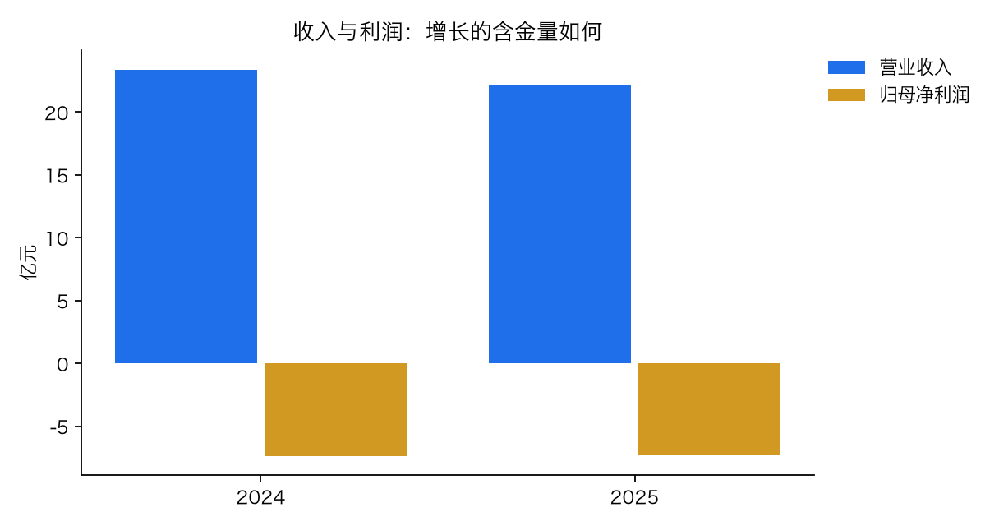

# 汇贤产业信托（87001.HK）2025 年报深度解读

## 一页纸

**2025 年这门生意收了 22.09 亿元租金与房费、比上年少收 5.5%，账面亏了 7.41 亿元，却仍派出 0.28 亿元——三个数字分别来自收益表、估值重估和分派表，任何一张读反了，整家房托就都读反了。** 收益从 23.37 亿元降到 22.09 亿元（P159）；年内亏损 7.41 亿元里，12.91 亿元是投资物业公允价值减少，这一项不进现金（P159）。分派 0.28 亿元、每基金单位 0.0043 元，报告自己在管理层讨论里写明这笔分派「包括若干资本性质的溢利元素」、金额恰好等于全部分派（P26），也就是 2025 年派出去的是资本与储备，不是当年租金赚出来的利润。

**收益少 1.28 亿元、物业收入净额少 1.57 亿元，降幅 5.5% 对 12.0%，净额的跌幅是收益跌幅的两倍以上，这就是这门生意在 2025 年真正恶化的地方（P159、P190）。** 分业态看，商场分部收益 6.40→5.74 亿元、分部溢利 3.84→2.74 亿元；写字楼 10.29→9.51 与 7.44→6.85；酒店 5.05→5.25 与 0.87→1.04；公寓 1.63→1.59 与 0.88→0.83（P190）。酒店多赚的 0.17 亿元只抵掉全部降幅的 11%，商场少赚的 1.10 亿元占全部降幅 70%，写字楼少赚的 0.59 亿元也超过总降幅的三分之一（P190）。

**12.91 亿元的公允价值减少一分现金也没有流出，经营现金流仍是净流入 7.76 亿元，但它把可分派的基础吃掉了，所以「巨亏」与「派不出钱」是同一件事的两面（P159、P165、P160）。** 这笔减值不是估值师调高了回报率：四块投资物业的年期与复归回报率两年一字不差（6.00%/6.50%、6.25%/6.75%），动的是月租金与复归租金（P198、P201）。投资物业账面值从 260.57 亿元降到 248.46 亿元，占总资产 326.83 亿元的 76.02%（P162），估值假设是这张表里唯一能解释大半减值的东西。

**债务在缩、成本在降，但到期结构在往一年内挤：总债务 57.77→50.38 亿元，借贷对资产总值 16.8%→15.4%，一年内到期却从 12.96 亿元升到 20.76 亿元、占总债务 41.21%（P207、P210）。** 实际利率区间由 3.50%–6.05% 下移到 2.94%–4.17%，利息开支 3.40→2.40 亿元（P207、P165）。代价在流动性上：流动资产 28.35 亿元减流动负债 28.01 亿元，净值只剩 0.34 亿元（上年 10.12 亿元），20.76 亿元短期债要靠再融资续上（P162）。

**每基金单位净值 3.1737 元、每基金单位分派 0.0043 元，后者只相当于前者的 0.14%，持有人一年从每单位资产里拿到的现金不到千分之一点五（P163、P160）。** 净值比上年 3.3141 元少 0.1404 元、减 4.24%（P163）；年末收市价 0.51 元，报告把它表述为净值「溢价 522.3%」，即市价只有净值的 16.07%（P28）。分派与净值朝两个方向走，而两者都由同一个估值数字决定，这是房托报表最容易误读的一处。

**下一年要盯的三件事全部写在 2025 年的账面里：2026 年到期的租约、重庆商场的装修竣工、20.76 亿元短期债的再融资（P106、P122、P207）。** 北京零售 2026 年到期面积占已出租面积 34.56%、占月租金 30.23%（P106）；重庆商场装修预期 2026 年 9 月竣工，估值日出租率只有 52.0%（P122）；一年内到期银行贷款 20.76 亿元，占全部债务 41.21%（P207）。三件事任何一件落空，0.28 亿元这个数字都续不上。

| 指标 | 2024 | 2025 |
| :--- | ---: | ---: |
| 收益（亿元） | 23.37 | 22.09 |
| 物业收入净额（亿元） | 13.03 | 11.46 |
| 投资物业公允价值变动（亿元） | -10.98 | -12.91 |
| 年内净利润（亏损）（亿元） | -7.57 | -7.41 |
| 可分派收入（亿元） | 0.26 | 0.28 |
| 每基金单位分派（元/单位） | 0.0041 | 0.0043 |
| 物业收入净额率 | 55.76% | 51.88% |
| 派分率 | 100.00% | 100.00% |
| 经营活动现金流（亿元） | 8.73 | 7.76 |
| 投资物业（亿元） | 260.57 | 248.46 |
| 资产总计（亿元） | 344.74 | 326.83 |
| 归属基金单位持有人的资产净值（亿元） | 214.20 | 207.03 |
| 每基金单位资产净值（元/单位） | 3.3141 | 3.1737 |
| 杠杆率（有息负债/总资产） | 16.76% | 15.41% |

红旗判定：清单共 32 项，命中 2 项，数据不足 10 项，其中 17 项已翻原文核实（数据不足不等于没问题）。

| 严重度 | 红旗 | 状态 | 观测值 |
| :--- | :--- | :--- | :--- |
| 中 | 资本开支长期低于折旧（吃老本） | 命中 | 命中（两年均已成立，第三年数据不在本块）：资本开支 2025 年 119 百万元（51＋68）对折旧 318 百万元 = 37.4%，2024 年 124 百万元（77＋47）对折旧 315 百万元 = 39.4%，连续两年低于 70% 阈值。对房托而言这可能是把翻新维护放在租户装修里、或物业已进入低投入期，但 2025 年投资性房地产公允价值同时下跌 4.65%，「欠维护」与「估值下调」两条线索方向一致，不能只当会计口径问题（P165、P159、P162）。 |
| 中 | 有效税率异常 | 命中 | 有效税率 2025 年为 −9.0%（61 ÷ −680）、2024 年为 −15.7%（103 ÷ −654），连续两年偏离 25% 逾 30 个百分点，命中；原因是亏损年份仍须就中国子公司利润计税，并加回不可扣税开支 95 与未确认税项亏损 124。（P196） |

## 生意：资产包怎么收租

**这门生意是把五处中国物业切成四类业态出租：写字楼 9.51 亿元收益、商场 5.74 亿元、酒店 5.25 亿元、服务式公寓 1.59 亿元，合计 22.09 亿元（P190）。** 主力是北京东方广场，建筑面积 787,059 平方米，含 132,515 平方米购物中心、八座甲级写字楼、三座服务式公寓与一家五星级酒店（P28）；重庆大都会东方广场建筑面积 164,360 平方米，含购物中心与一座甲级写字楼（P27）；另有三家酒店分布在重庆、成都、沈阳（P28）。进投资物业科目（248.46 亿元）的只有北京零售、北京写字楼、北京地库与重庆大都会，酒店与服务式公寓按成本列在楼宇及使用权资产里（P156、P162）。

**四个业态的转化率差三倍以上，写字楼 9.51 亿元收益留下 6.85 亿元、72.03%，公寓 1.59 留 0.83、52.20%，商场 5.74 留 2.74、47.74%，酒店 5.25 只留 1.04、19.81%（P190）。** 组合层面 22.09 亿元收益留下 11.46 亿元，物业收入净额率 51.88%，比上年 13.03 对 23.37 的 55.75% 低 3.87 个百分点（P190、P26）。酒店是收益第三大、留下最少的一块：2025 年它多收 0.20 亿元、多留 0.17 亿元，等于每多收 1 元只多留 0.85 元，但它的存量部分仍只有两成的转化率（P190、P14）。

**拖累全部来自商场：它的分部溢利一年少 1.10 亿元，占全部降幅 1.57 亿元的 70.06%，写字楼少 0.59 亿元占 37.58%，酒店与公寓合计反过来贡献 0.12 亿元（P190）。** 商场收益降 0.66 亿元而溢利降 1.10 亿元，说明降的不只是租金还有出租率与让利：北京东方新天地平均现收月租从 631 元降到 559 元、降 11.41%，平均占用率从 92.4% 降到 91.1%（P19）。写字楼是另一种走法：东方经贸城续租率 80%、占用率 81.8%（上年 84.5%），现收月租 247 元（上年 260 元），而当年新签平均成交月租只有 223 元，比现收低 9.72%（P22）。

**出租率与月租金的错配才是这门生意真正的软处：北京零售出租率 90.9%、月租 459 元/平方米/月，重庆零售出租率 52.0%、月租 41 元/平方米/月，而复归租金是 1,009 元与 168 元（P105、P122、P199、P201）。** 459 元是按已出租面积与月租金总额倒算的口径，管理层讨论另给 559 元（P19），两者差 21.79%、报告没有给桥，但两个口径都离复归租金差一倍以上。重庆现收 41 元对复归 168 元是四倍空间，它空置 45.1%、业主自用 2.9%，估值日仍在装修、预计 2026 年 9 月竣工（P122）。

**估值师这两年调的是租金而不是回报率：四块投资物业的年期回报率与复归回报率完全相同，被下调的是月租金与复归租金（P198–P201）。** 物业2 商场月租金（元/平方米/月）559→459、复归 1,030→1,009；物业4 重庆商场月租金 34→41 元、但复归 193→168 元、降 12.95%；物业1 写字楼 243→241 元、复归 323→320 元；物业3 重庆写字楼 89→81 元、复归 96→86 元（P198–P201）。四块的复归回报率一律比年期回报率高 0.50 个百分点，这个结构两年没动，所以账面少掉的 12.91 亿元基本全部可以归到租金与出租率上（P198–P201、P159）。

**租约是每年都要重签一次的现金流：作为出租人，未来未贴现最低租赁付款合计 35.56 亿元，其中一年内 11.65 亿元、第二年 8.61 亿元，到期即按届时的市场租金重定价（P216）。** 北京零售的到期表最集中：2026 年到期面积 21,854 平方米、占已出租面积 34.56%，对应月租金占总额 30.23%，共 126 份租约；2027 年还有 22.84% 的面积到期（P106）。北京写字楼租约最后到期日为 2036 年 10 月、零售为 2033 年 12 月，商场部分租约另带按销售额 1%–23% 计算的或然租金，所以商场的实际收租还挂着租户生意的强弱（P108、P105、P216）。

**成本侧没有销售费用、没有研发费用：2025 年只有物业营运、员工、存货、折旧与两项受托管理收费六类，这就是房托与工商企业在利润表上的结构差别（P159）。** 2025 年列支其他营运开支 8.42 亿元、员工成本 1.61 亿元、存货消耗 0.35 亿元、折旧 3.18 亿元、管理人费用 1.04 亿元、房托基金开支 0.12 亿元（P159）。其中投资物业的直接营运开支 5.67 亿元，比上年 5.41 亿元反增 4.81%：收入降 5.5% 时成本没跟着降（P193）；管理人费用按物业价值 0.3%/年与物业收入净额 3%/年计费，1.04 亿元相当于物业收入净额 11.46 亿元的 9.08%（P168、P190）。

| 品类 | 2024 | 2025 | 占营业收入 |
| :--- | ---: | ---: | ---: |
| 写字楼收入 | 10.29 | 9.51 | 43.1% |
| 写字楼物业组合收入 | — | 9.51 | 43.1% |
| 北京东方广场东方经贸城收入 | — | 9.13 | 41.3% |
| 商场收入 | 6.40 | 5.74 | 26.0% |
| 零售物业组合收入 | — | 5.74 | 26.0% |
| 北京东方广场东方新天地收入 | — | 5.56 | 25.2% |
| 酒店收入 | 5.05 | 5.25 | 23.8% |
| 酒店物业组合收入 | — | 5.25 | 23.8% |
| 公寓收入 | 1.63 | 1.59 | 7.2% |
| 服务式公寓物业组合收入 | — | 1.59 | 7.2% |
| **合计** | 23.37 | 22.09 | 100.0% |

本次没有触发结构化判断。

## 五年账

**五年收益从 25.60 亿元降到 22.09 亿元、只降 13.71%，分派从 5.70 亿元掉到 0.28 亿元、降 95.09%，两条曲线从 2023 年起彻底分叉（P224）。** 收益五年是 25.60、22.02、23.45、23.37、22.09 亿元，年复合增速 -3.62%；分派是 5.70、5.17、2.27、0.26、0.28 亿元，每基金单位分派 0.0935、0.0834、0.0361、0.0041、0.0043 元（P224）。分派占收益的比例从 22.27% 一路压到 1.27%，收益还在两成上下的波动里，分派已经掉到几乎为零（P224）。

**两条曲线的缺口不在收租，而在「收入到可分派」这一段：投资物业公允价值 2024 与 2025 年合计减少 23.89 亿元、递延所得税负债仍挂 57.96 亿元，分派的基础是被重估与税负一层层吃掉的（P159、P163）。** 2025 年从 11.46 亿元物业收入净额走到 0.28 亿元可分派收入，中间要过公允价值减少 12.91 亿元、折旧 3.18 亿元、财务费用 1.82 亿元、所得税 0.61 亿元（P190、P159）；这一年这座桥的另一端是 10.47 亿元「额外可供动用金额」，靠它才凑出 0.28 亿元的可供分派金额，上年同一项是 9.14 亿元（P160）。

**亏得最深的是 2022 年，年内亏损 13.61 亿元，此后三年是 5.87、7.57、7.41 亿元；2025 年比 2022 年少亏 6.20 亿元，但分派没有跟着回来（P224）。** 分派在同一个三年里是 2.27、0.26、0.28 亿元：2023 年砍掉 56.09%，2024 年再砍 88.55%，2025 年只回升 7.69%（P224）。每基金单位分派 0.0043 元对 0.0041 元只多 4.88%，而账面少亏了 0.16 亿元（P224）——亏损收窄与分派修复之间没有稳定的转换关系，等亏损收窄就会恢复分派，是一个不成立的假设。

**每基金单位净值从 3.9900 元降到 3.1737 元、五年少 20.47%，与分派的崩塌同源：两者都是投资物业估值与被累积亏损压下来的结果（P225、P224）。** 归属基金单位持有人的资产净值五年是 244.55、227.28、220.84、214.20、207.03 亿元，每单位 3.9900、3.6480、3.4762、3.3141、3.1737 元（P225）。五年累计每基金单位分派 0.2214 元（0.0935+0.0834+0.0361+0.0041+0.0043），而每单位净值少掉 0.8163 元（3.9900−3.1737），派掉的只占其中的 27.12%（P224、P225）。

**五年的收入结构自己反转了：投资物业租金总收入从 20.18 亿元降到 14.78 亿元、降 26.76%，酒店收入从 2.71 亿元升到 5.25 亿元、增 93.73%，高转化的租金被低转化的酒店替掉（P224、P190）。** 租金类收入占收益比重从 78.83% 降到 66.91%，酒店从 10.59% 升到 23.77%（P224）；酒店分部溢利率 19.81%，写字楼 72.03%（P190）。收益表看起来只降了一成四，里面的成分已经换掉一大块，这也是同样的收益能撑起的分派越来越薄的原因之一。

**收缩发生在资产与债务两端：资产总值从 410.86 亿元降到 326.83 亿元、降 20.45%，负债总额从 164.26 亿元降到 118.86 亿元、降 27.64%，债务对资产总值从 20.6% 降到 15.4%（P225、P224）。** 负债降得比资产快，所以杠杆在缩表过程中反而改善（P224）；但净值同时从 244.55 亿元降到 207.03 亿元，缩表没有换来每单位净值上升——五年看下来，资产少了约两成、分派少了九成五、每单位净值少了约两成，三件事是同一个方向（P225、P224）。

| 项目 | 2024 | 2025 |
| :--- | ---: | ---: |
| 收益（亿元） | 23.37 | 22.09 |
| 物业收入净额（亿元） | 13.03 | 11.46 |
| 投资物业公允价值变动（亿元） | -10.98 | -12.91 |
| 年内净利润（亏损）（亿元） | -7.57 | -7.41 |
| 可分派收入（亿元） | 0.26 | 0.28 |
| 分派总额（亿元） | 0.26 | 0.28 |
| 每基金单位分派（元/单位） | 0.0041 | 0.0043 |
| 经营活动现金流（亿元） | 8.73 | 7.76 |
| 投资物业（亿元） | 260.57 | 248.46 |
| 每基金单位资产净值（元/单位） | 3.3141 | 3.1737 |

*数据来源：公司年度报告原文（页码见正文引用），金额为合并报表口径。*

### 四个房托比率

| 项目 | 2024 | 2025 |
| :--- | ---: | ---: |
| 物业收入净额率 | 55.76% | 51.88% |
| 派分率 | 100.00% | 100.00% |
| 杠杆率 | 16.76% | 15.41% |
| 分派对资产净值 | 0.12% | 0.14% |

## 分派表：从物业收入净额到每单位分派

**房托的第一档利润是物业收入净额 11.46 亿元，既没有毛利，也没有归母净利润。** 租金收入减掉物业营运开支剩下的 11.46 亿元就是这一层的经营成绩（P190），上年为 13.03 亿元，同比下降 12.0%（P190）；合并利润表里没有一行叫营业成本或毛利，把工商企业的三层利润结构套上来，只会多出一道并不存在的计算。

**物业收入净额的分部结构是写字楼占大头，酒店与公寓加起来不到两成。** 写字楼分部收入 9.51 亿元、净额 6.85 亿元，商场 5.74 亿元与 2.74 亿元，酒店 5.25 亿元与 1.04 亿元，服务式公寓 1.59 亿元与 0.83 亿元，合计 22.09 亿元与 11.46 亿元（P190）；商场是收入第二大、净额却只有写字楼四成的分部，酒店 5.25 亿元营收只转化为 1.04 亿元净额，因为酒店的人工与消耗都留在营运开支里（P190）。

**从物业收入净额 11.46 亿元走到年内亏损 7.41 亿元，吃掉利润的主项是投资物业公允价值减少 12.91 亿元。** 这一个数超过物业收入净额本身，单独一项就把经营成绩全部抵掉（P159）；其余的扣项是其他营运开支 8.42 亿元、折旧 3.18 亿元、财务费用 1.82 亿元、管理人费用 1.04 亿元、员工成本 1.61 亿元与所得税 0.61 亿元（P159、P165）。要说明的是，这些成本有一部分已经在物业营运开支里扣过一次，所以能完整加总的起点是收益 22.09 亿元，不是净额 11.46 亿元。

**持有人那一层的亏损是 7.29 亿元，比年内亏损 7.41 亿元少 0.12 亿元，差额由少数股东权益承担。** 报表先列年内亏损 7.41 亿元，再减少数股东权益承担的 0.12 亿元，得到基金单位持有人亏损 7.29 亿元（P159、P160）；上年这两个数是 7.57 亿元与 7.37 亿元（P160），亏损绝对额收窄 0.16 亿元，但收窄来自投资物业公允价值跌幅比去年略小，不是经营转好。

**把亏损调回可分派口径的五项调整合计 -2.90 亿元，方向基本都是继续往下减。** 递延所得税 -0.06 亿元、未变现汇兑收益 -0.62 亿元、已变现汇兑亏损 -1.52 亿元、现金与会计财务费用差异 +0.01 亿元、分配至中国法定储备 -0.71 亿元（P160、P161）；五项合计 -2.90 亿元，把 7.29 亿元的持有人亏损推成经调整亏损总额 10.19 亿元（P160）。这些调整里没有一项是把亏损改小，唯一为正的 0.01 亿元可以忽略。

**真正把 10.19 亿元经调整亏损拉回正数的是 10.47 亿元额外可供动用金额，由此得到可分派金额 0.28 亿元。** 报告把这笔金额单列一行，附注只说管理人依据信托契约第 11.4.2 条「厘定」它可增补本年可分派金额，没有交代来源、是否要补回（P160、P161），上年同项为 9.14 亿元（P160）；0.28 亿元正好等于 10.47 亿元减 10.19 亿元（P160），所以当年的分派在账面上不是赚来的，是从一笔管理人裁量的增补额里切出来的。

**全年 0.28 亿元分派被报告自己认定为 100% 资本性质，这是整节最要紧的一条。** 管理层讨论写全年分派「包括若干资本性质的溢利元素，该资本性质项目的金额为人民币 2,800 万元」（P26），与全年分派 2,800 万元（P160）一分不差，也就是说持有人拿到的钱全部不是当年物业租金赚出来的；同页印的分派比率 100%（P160）另有问题——分母就是管理人厘定的 0.28 亿元，分子也是它，这个 100% 是同义反复，不能读成「把赚到的钱全分了」。

**费用侧解释了为什么现金流量表里的分派只有 0.17 亿元，而宣告口径是 0.28 亿元。** 管理人基本费用为物业价值 0.3%、浮动费用为物业收入净额的 3%（P168）；管理人自 2025 年 1 月 6 日起两项费用 100% 收现金，2024 年是 50% 现金加 50% 基金单位（P168），于是 2025 年不再有基金单位抵付当年费用这条通道，本年 5 月发行的 59,825,279 个单位结清上年下半年费用（P209）；现金流量表的已付分派 0.17 亿元只含本年中期 0.10 亿元与上年末期 0.07 亿元（P166、P164），与宣告的 0.28 亿元之差在末期分派 2026 年 5 月才付（P161）。

**每基金单位分派 0.0043 元，比上年 0.0041 元只是微升，但结构从「中期为主」翻成「末期为主」。** 本年中期 0.0016 元、末期 0.0027 元，上年中期 0.0030 元、末期 0.0011 元（P160），中期几乎减半、末期翻倍多，分派的时点被推到次年 5 月（P161）；按 6,523,199,235 个已发行基金单位计（P161），每单位分派是精确分派金额 28,213,811 元除以单位数后的四舍五入值，乘回去与总额对不上，不能反推分派总额。

### 从收益到每基金单位分派

| 项目 | 2024 | 2025 |
| :--- | ---: | ---: |
| 收益（亿元） | 23.37 | 22.09 |
| 物业收入净额（亿元） | 13.03 | 11.46 |
| 投资物业公允价值变动（亿元） | -10.98 | -12.91 |
| 财务费用（含汇兑差额）（亿元） | -5.05 | -1.82 |
| 管理人费用（亿元） | 1.09 | 1.04 |
| 年内净利润（亏损）（亿元） | -7.57 | -7.41 |
| 可分派收入（亿元） | 0.26 | 0.28 |
| 分派总额（亿元） | 0.26 | 0.28 |
| 每基金单位分派（元/单位） | 0.0041 | 0.0043 |

*数据来源：公司年度报告原文（页码见正文引用），金额为合并报表口径。*

## 资产负债表：资产在哪、借了多少

**资产几乎全是投资物业：248.46 亿元占总资产 326.83 亿元的 76.0%，负债 118.86 亿元，基金单位持有人资产净值 207.03 亿元。** 资产总值 326.83 亿元减负债总额 118.86 亿元，等于基金单位持有人资产净值 207.03 亿元加少数股东权益 0.94 亿元（P162、P163）；这是一张重资产、低杠杆的表，但 76.0% 的资产压在同一类需要评估的标的上，资产端的可靠性取决于评估假设，而不是取决于账款能不能收回。

**248.46 亿元可以逐项加出来，四块正好对上。** 北京零售 94.60 亿元、北京写字楼 130.11 亿元、北京车位 2.93 亿元（P104），重庆的零售、写字楼与车位合计 20.82 亿元（P121）；94.60 加 130.11 加 2.93 加 20.82 等于 248.46 亿元，与资产负债表上的投资物业一分不差（P162），报表与附注、评估报告三处口径在这里是闭合的。

**最容易误读的是：五份评估报告合计 307.89 亿元，比报表上的投资物业多 59.43 亿元，因为酒店与服务式公寓按成本列账，根本不进投资物业。** 五份评估是北京东方广场 271.70 亿元（P104）、重庆大都会 20.82 亿元（P121）、重庆凯悦 3.46 亿元（P141）、成都 5.63 亿元（P134）、沈阳 6.28 亿元（P149）；多出的 59.43 亿元就是北京的服务式公寓 21.60 亿元、酒店 22.46 亿元（P104）与三家酒店，账面上只记固定资产 18.05 亿元加使用权资产 31.80 亿元、合计 49.85 亿元（P162），两套口径差 9.58 亿元，且酒店按成本模式不随公允价值浮动。

**现金 27.00 亿元里只有 14.67 亿元是随时可动用的。** 银行结余及现金 27.00 亿元由现金及等价物 14.67 亿元与三个月以上定期存款 12.33 亿元组成，受限现金为零（P205、P162）；上年这两块是 22.78 亿元与 6.62 亿元（P205），一年之间把 5.71 亿元搬到三个月以上的定期里，名义现金从 29.77 亿元降到 27.00 亿元，可即时动用的部分却从 22.78 亿元降到 14.67 亿元。

**债务 50.38 亿元，其中 20.76 亿元一年内到期，占 41.2%，短期化是这张表最硬的变化。** 短期借款 20.76 亿元、长期借款 29.62 亿元（P162、P163），到期结构为一年内 20.76 亿元、一至两年 16.49 亿元、两至五年 13.13 亿元，五年以上没有（P207）；上年一年内到期只有 12.96 亿元、占债务的 22.4%（P162、P207），一年之内多了 7.80 亿元，比重接近翻倍。

**利率区间 2.94%–4.17% 是这轮债务置换唯一确定的收益，全部借款无抵押、由受托人与子公司担保。** 浮息借款实际利率由上年的 3.50%–6.05% 降到 2.94%–4.17%（P207），债务总额由 57.77 亿元降到 50.38 亿元（P163），杠杆率 15.4%（P210）；所有银行贷款均为无抵押定期贷款，由受托人及若干子公司提供担保（P208），资产没有被抵押出去，融资空间留在集团层面，代价是 41.2% 的债务明年要重做。

**负债端真正的隐形大头是递延所得税负债 57.96 亿元，占总负债 118.86 亿元的 48.8%，而它一年只释放 2.29 亿元。** 递延所得税负债由 60.25 亿元降到 57.96 亿元（P208），其中与投资物业公允价值有关的 25.54 亿元、其他 31.95 亿元、将分派保留溢利的预提税 0.47 亿元（P208）；按一年 2.29 亿元的速度，靠物业公允价值下跌自然释放要二十多年，它事实上是资产净值的一项长期扣减，而不是一笔马上要付的钱。

**持有人资产净值 207.03 亿元、每基金单位 3.1737 元，只相当于上年 3.3141 元的 95.76%，跌幅小于投资物业。** 基金单位持有人资产净值由 214.20 亿元降至 207.03 亿元（P163），少 7.17 亿元，而同期持有人亏损 7.29 亿元，差额在于当年以 59,825,279 个新基金单位结清上年下半年管理人费用 0.29 亿元、分派实付只有 0.17 亿元（P209、P166）；单位数由 6,463,373,956 个增到 6,523,199,235 个，每单位 3.1737 元的跌幅里有一部分是分母变大摊出来的。

### 资产端

| 项目 | 2024 | 2025 |
| :--- | ---: | ---: |
| 投资物业（亿元） | 260.57 | 248.46 |
| 货币资金（亿元） | 29.77 | 27.00 |
| 应收账款（亿元） | 0.20 | 0.19 |
| 其他应收款（亿元） | 0.42 | 0.41 |
| 预付款项（亿元） | 0.31 | 0.43 |
| 资产总计（亿元） | 344.74 | 326.83 |

### 负债与权益

| 项目 | 2024 | 2025 |
| :--- | ---: | ---: |
| 一年内到期银行贷款（亿元） | 12.96 | 20.76 |
| 一年后到期银行贷款（亿元） | 44.81 | 29.62 |
| 应付账款及其他应付款（亿元） | 5.00 | 4.60 |
| 负债总额（亿元） | 129.48 | 118.86 |
| 归属基金单位持有人的资产净值（亿元） | 214.20 | 207.03 |
| 少数股东权益（亿元） | 1.06 | 0.94 |
| 所有者权益合计（亿元） | 215.26 | 207.97 |

## 现金流量表：分派的钱从哪来

**经营现金流 7.76 亿元，与 7.41 亿元的年内亏损方向相反，一个为正一个为负。** 经营活动所得现金净额由上年的 8.73 亿元降到 7.76 亿元（P165），只剩上年的 88.89%，同期报表上是 7.41 亿元的年内亏损（P159）；同一家公司、同一年度出现两个符号相反的大数，差额全部落在非现金项目上，不在收租能力上。

**把亏损拉回现金的是三笔加回：投资物业公允价值减少 12.91 亿元、折旧 3.18 亿元、利息开支 2.40 亿元。** 起点是除税前亏损 6.80 亿元，加回公允价值减少 12.91 亿元、折旧 3.18 亿元、利息开支 2.40 亿元，再减利息收入 0.48 亿元与汇兑收益 0.58 亿元，扣掉已付所得税及预提税 2.92 亿元，才落到 7.76 亿元（P165）。这条链说明经营现金流之所以好看，一半是公允价值损失的回拨，不是多收了租。

**投资活动这一年主要是把钱存进银行，真正的资产投入只有 1.19 亿元，是折旧的 37.4%。** 添置投资物业 0.68 亿元与购买物业机器设备 0.51 亿元合计 1.19 亿元，同期折旧 3.18 亿元（P165），资本开支只覆盖折旧的三成多；投资活动净流出 6.49 亿元的主体是存入银行存款 30.83 亿元、提取 25.12 亿元、净存 5.71 亿元（P165），不是买资产。一家 248.46 亿元投资物业的房托一年只花 1.19 亿元维护与改造，这个数字与当年投资物业账面值由 260.57 亿元降到 248.46 亿元（P162）是同一件事的两面。

**融资活动净流出 9.38 亿元，主线是借新还旧加缩表：新筹 13.18 亿元、偿还 20.00 亿元。** 已付利息 2.32 亿元、已付分派 0.17 亿元、贷款安排费 0.07 亿元（P166）；净偿还 6.82 亿元，与债务总额从 57.77 亿元降到 50.38 亿元方向一致，差额来自港元借款折算（P163）；现金及等价物因此从 22.78 亿元降到 14.67 亿元，一年少了 8.11 亿元（P166）。

**已付分派 0.17 亿元与宣告的 0.28 亿元不是同一个年度的方案，两个口径不能互相验证。** 现金流量表只记录年内实际付出去的 0.17 亿元，即 2025 年中期 0.10 亿元与 2024 年末期 0.07 亿元（P166、P164）；2025 年末期 0.18 亿元要到 2026 年 5 月才派付（P161），而管理人费用 2025 年全额现金支付、不再以基金单位抵付（P168），所以现金口径里既少了一笔非现金费用，又多了一笔跨年分派。

**回答分派的钱从哪来：不是经营现金流不够，而是自由现金几乎不存在，0.28 亿元只能靠那 10.47 亿元增补额付出去。** 7.76 亿元经营现金流对 0.28 亿元分派看起来绰绰有余，但 20.76 亿元一年内到期（P162），现金及等价物只有 14.67 亿元、不足七成覆盖（P205），流动资产净值只剩 0.34 亿元（P214），另有 12.33 亿元三个月以上定期存款与 3.00 亿元未动用额度（P205、P207）；在这些约束下，能拿来分派的钱接近于零，真正让分派成立的是管理人厘定的 10.47 亿元额外可供动用金额（P160）。

| 项目 | 2024 | 2025 |
| :--- | ---: | ---: |
| 经营活动现金流（亿元） | 8.73 | 7.76 |
| 投资活动现金流（亿元） | -7.11 | -6.49 |
| 筹资活动现金流（亿元） | -13.54 | -9.38 |
| 资本性支出（亿元） | 0.77 | 0.51 |
| 新筹集银行贷款（亿元） | 19.92 | 13.18 |
| 偿还银行贷款（亿元） | 29.84 | 20.00 |
| 已付利息（亿元） | 3.40 | 2.40 |
| 已付分派（亿元） | 0.27 | 0.17 |

## 附注深挖

**附注优先级。** 29 条附注，按这家公司自己的数字排队：先看金额占收入最大的，再看变动最剧烈的，最后是公司自己措辞最软的那几条。◆ 重点 11 条、◇ 常规 18 条。

| 序 | 附注 | 类型 | 层级 | 涉及金额（亿元） | 占收入 | 判断密度 | 页 |
| ---: | :--- | :--- | :--- | ---: | ---: | ---: | :--- |
| 1 | 18 货币资金 | 金额型 | ◆ | 27.00 | 122.2% | 0.0 | P205–P205 |
| 2 | 13 投资性房地产 | 政策型 | ◆ | 248.46 | 1124.8% | 2.7 | P197–P202 |
| 3 | 19 应付账款及其他应付款 | 金额型 | ◆ | 4.60 | 20.8% | 0.0 | P206–P206 |
| 4 | 29 关连人士及关联方交易 | 交易型 | ◆ | 2.40 | 10.8% | 0.0 | P217–P220 |
| 5 | 8 财务费用（包括汇兑差额） | 金额型 | ◆ | 1.82 | 8.2% | 0.0 | P195–P195 |
| 6 | 3 关键会计判断及估计不明朗因素之主要来源 | 估计型 | ◆ | — | — | 25.1 | P187–P188 |
| 7 | 25 金融工具 | 风险型 | ◆ | — | — | 2.2 | P210–P214 |
| 8 | 28 资本承诺 | 承诺型 | ◆ | — | — | 0.0 | P216–P216 |
| 9 | 11 所得税费用 | 金额型 | ◆ | 0.61 | 2.8% | 2.0 | P196–P196 |
| 10 | 4 分部报告 | 金额型 | ◆ | — | — | 4.0 | P189–P191 |
| 11 | 15 使用权资产 | 金额型 | ◆ | — | — | 4.0 | P203–P203 |
| 12 | 2 财务报表编制基础及主要会计政策资料 | 政策型 | ◇ | — | — | 6.0 | P169–P186 |
| 13 | 6 其他收入 | 金额型 | ◇ | — | — | 0.0 | P194–P194 |
| 14 | 21 递延所得税 | 估计型 | ◇ | — | — | 0.0 | P208–P208 |
| 15 | 30 子公司一览 | 交易型 | ◇ | — | — | 0.0 | P221–P222 |
| 16 | 1 公司基本情况 | 政策型 | ◇ | — | — | 0.0 | P167–P168 |
| 17 | 27 经营租赁承担 | 政策型 | ◇ | — | — | 0.0 | P216–P216 |
| 18 | 24 资本管理 | 风险型 | ◇ | — | — | 0.0 | P210–P210 |
| 19 | 12 每基金单位亏损 | 未归类 | ◇ | — | — | 2.0 | P197–P197 |
| 20 | 5 收益 | 未归类 | ◇ | — | — | 0.0 | P192–P193 |
| 21 | 7 其他营运开支 | 未归类 | ◇ | — | — | 0.0 | P194–P194 |
| 22 | 9 管理人费用 | 未归类 | ◇ | — | — | 0.0 | P195–P195 |
| 23 | 10 房地产投资信托基金开支 | 未归类 | ◇ | — | — | 0.0 | P195–P195 |
| 24 | 17 应收利息款项 | 未归类 | ◇ | — | — | 0.0 | P204–P204 |
| 25 | 20 银行贷款 | 未归类 | ◇ | — | — | 0.0 | P207–P207 |
| 26 | 22 已发行基金单位 | 未归类 | ◇ | — | — | 0.0 | P209–P209 |
| 27 | 23 基金单位持有人归属于每基金单位净资产 | 未归类 | ◇ | — | — | 0.0 | P209–P209 |
| 28 | 26 离职后福利 | 未归类 | ◇ | — | — | 0.0 | P215–P215 |
| 29 | 31 融资活动所产生负债的对账 | 未归类 | ◇ | — | — | 0.0 | P223–P223 |

**投资物业 248.46 亿元全部落在第三级公允价值，一年净减 12.11 亿元，四个分项的计量方法一个都没换。** 期初 260.57 亿元，年内添置 0.80 亿元、于损益确认的公允价值减少 12.91 亿元，期末 248.46 亿元（P197）；四处分项是北京写字楼 130.11 亿元、北京商场及停车位 97.53 亿元、重庆写字楼 5.40 亿元、重庆商场及停车位 15.42 亿元（P198–P201），与估值报告按用途披露的金额逐项吻合（P104、P121）。全部归第三级，年内无转入转出，方法一律收益法（P201）。估值师是 Kroll，委聘与管理判断都在管理人（P156、P197）。

**减值的开关不在回报率而在租金：四处物业的回报率两年一字未改，北京商场现租一年就跌了 100 元/平方米/月。** 年期回报率仍是 6.00%、6.00%、6.25%、6.25%，复归回报率仍是 6.50%、6.50%、6.75%、6.75%，与 2024 年逐位相同（P198–P201）；北京商场月租由 559 元降到 459 元/平方米/月（-17.89%）、复归租金由 1,030 元降到 1,009 元，重庆写字楼现租由 89 元降到 81 元（-8.99%）（P199、P200）。把回报率按住、只砍现金流，等于报告自己承认这次 12.91 亿元减值是「租不出去、租不起价」，不是「要求变严」（P197、P199）。

**估值里装着一大笔「租金涨回去」的钱：重庆商场现值只有复归租金的 24.40%，北京商场是 45.49%。** 重庆商场及停车位现租 41 元/平方米/月、复归租金 168 元（P201）；北京商场及停车位现租 459 元、复归租金 1,009 元（P199）。报告自述复归租金取自新签租赁协议的平均单价，等于用少量新约的价格去外推全部存量面积（P199、P201）。而重庆零售在估值日出租率只有 52.0%，另有 2.9% 为业主自用（P122）。

**同一处北京商场，年报给了两个相差 100 元/平方米/月的 2025 年月租，跌幅一个写 11.41%、一个写 17.89%。** 管理层讨论的年度平均现收月租是 559 元（2024 年 631 元，P19）；附注 13 的月租是 459 元（2024 年 559 元，P199），估值报告按租赁明细表倒算也是 459 元（月租 2,905 万元 ÷ 6.32 万平方米，P105）。附注 13 的 2024 年数字恰好等于管理层讨论的 2025 年数字，两套口径的边界报告没有交代（P19、P199）。

**银行贷款 50.38 亿元全部无抵押，一年内到期 20.76 亿元，同比占比从 22.43% 跳到 41.21%。** 无抵押定期贷款 5,049 百万元扣借贷手续费 11 百万元后账面 5,038 百万元（P207）；到期结构为一年内 2,076、一至两年 1,649、两至五年 1,313，五年以上为零（P207）。浮息实际利率 2.94%–4.17%，上年 3.50%–6.05%（P207）。物业并未抵押，担保由受托人及若干子公司提供（P28、P208）。债务对资产总值 15.4%，房托守则上限 50%（P210）。

**流动资产净值只剩 0.34 亿元，而表外还有 1.32 亿元已订约资本承诺与 35.56 亿元出租人应收租金。** 银行结余及现金 27.00 亿元，其中现金及等价物 14.67 亿元、受限现金为零、三个月以上定期存款 12.33 亿元（P205）；对一年内到期 20.76 亿元覆盖面仅 0.71 倍（P205、P207）。流动资产净值 0.34 亿元，上年 10.12 亿元；未动用额度只余 3.00 亿元（P207、P214）。资本承诺 1.32 亿元已订约未拨备，出租人未贴现租金 35.56 亿元里一年内 11.65 亿元、第二年 8.61 亿元（P216）。

**递延所得税负债 57.96 亿元一年只减 2.29 亿元，公允价值每跌 1 元只换到 0.19 元税项释放。** 投资物业项下的递延所得税负债由 34.39 亿元降到 31.95 亿元，减 2.44 亿元；另一半 25.54 亿元是业务合并公允价值调整与加速折旧，从 25.32 亿元几乎没动（P208）。同期公允价值减 12.91 亿元，按 25% 税率本应释放 3.23 亿元（P196、P208）。附注 3 驳回了「按出售全数收回」的税基假设，这条判断一变，31.95 亿元的计量基础就变（P188）。

**关联方一年拿走 2.40 亿元，相当于物业收入净额 11.46 亿元的 20.94%，是当年分派的 8.57 倍。** 支出侧：管理人费用 1.04 亿元、付给北京汇贤企业管理的物业管理人费用 0.69 亿元、三家关联物业公司管理费合计 0.61 亿元、受托人费用 0.03 亿元、员工成本补偿 0.02 亿元（P217、P218）。管理人费用中基本费用 0.91 亿元、浮动费用 0.13 亿元，合计只比上年 1.09 亿元少 0.05 亿元（P195）。费用对业务量的弹性接近于零（P159、P195）。

**所得税 0.61 亿元是在亏损 6.80 亿元的年份缴出去的，当期税项 2.51 亿元、预提税 0.39 亿元按 5%，靠 2.29 亿元递延抵减压回正数。** 中国子公司按 25% 计提当期所得税（P196）；预提税率 5%，且期末就已全额计提递延（P196）。报告同时不确认 7.31 亿元税项亏损与 21.99 亿元可扣税暂时差额对应的递延所得税资产，理由是「无法预测未来溢利来源」，7.31 亿元税项亏损五年内到期（P208）。

**把 12.91 亿元公允价值减少拿开，损益表上最大的支出是 8.42 亿元其他营运开支，而不是 3.18 亿元折旧或 1.61 亿元员工成本。** 其他营运开支里其他杂项 2.40 亿元、城镇房产税 2.09 亿元、水电能源 0.91 亿元、物业管理费 0.74 亿元、物业管理人费用 0.69 亿元、维修保养 0.62 亿元（P194）。22.09 亿元收益加 0.56 亿元其他收入，减存货 0.35 亿元、员工 1.61 亿元、折旧 3.18 亿元、其他营运开支 8.42 亿元、财务费用 1.82 亿元、管理人费用 1.04 亿元、房托开支 0.12 亿元，正好是 6.80 亿元税前亏损（P159、P194）。

**按类型看分布。** 同一类附注问的是同一个问题；哪一类页数多、密度高，说明公司的判断就堆在那里。

| 类型 | 条数 | 页数 | 平均判断密度 | 最该看的一条 |
| :--- | ---: | ---: | ---: | :--- |
| 未归类 | 11 | 12 | 0.2 | 12 每基金单位亏损（P197） |
| 金额型 | 7 | 9 | 1.4 | 18 货币资金（P205） |
| 政策型 | 4 | 27 | 2.2 | 13 投资性房地产（P197） |
| 交易型 | 2 | 6 | 0.0 | 29 关连人士及关联方交易（P217） |
| 估计型 | 2 | 3 | 12.5 | 3 关键会计判断及估计不明朗因素之主要来源（P187） |
| 风险型 | 2 | 6 | 1.1 | 25 金融工具（P210） |
| 承诺型 | 1 | 1 | 0.0 | 28 资本承诺（P216） |

## 谁在分钱

**管理人与受托人分属两家持牌机构，但管理人已经回到长实手里：2026 年 1 月 22 日完成收购后，长实间接持有管理人 100%。** 汇贤房托管理有限公司是按《证券及期货条例》第 116 条获证监会发牌的法团，受托人是德意志信托（香港）有限公司，负责为持有人保管资产并持有信托资产（P74）。管理人股权在年结日是长实 70%、ESR 30%，收购余下 30% 的交割在 2026 年 1 月 22 日完成，此后长实持有 100%（P80）。决策、保管、收费三权在这一天并回了同一个集团（P74、P80）。

**收费方同时是最大的出资方：长实系持有 35.36% 基金单位，其中管理人自己就持 65,052,813 个。** 已发行 6,523,199,235 个单位，长实系子公司持 35.36%（其中 Noblecrown 持 1,091,083,328 个、管理人持 65,052,813 个）、中国人寿系 13.26%、Fortune Enrichment 6.01%（P91）。管理人自持的 65,052,813 个相当于 1.00% 的份额（P91）。同一主体一边按物业价值收取管理费，一边按持有份额参与分派（P91、P168）。

**收费结构有三道口子：基本费用 0.3%/年物业价值、浮动费用 3%/年物业收入净额、受托人费用不超过 0.02%/年。** 基本费用按各财政年末物业价值的 0.3% 计（P168）；按五份估值报告合计 307.89 亿元（271.70+20.82+3.46+5.63+6.28）算，0.3% 是 0.92 亿元，与实际基本费用 0.91 亿元几乎相同——费用基数用的是含酒店与公寓的估值，而不是 248.46 亿元账面的投资物业，后者 0.3% 只有 0.75 亿元（P99–P153、P195）。

**受托人费用上限可以从 0.02% 单方面抬到 0.06%，管理费的调整要特别决议案，但整份契约里没有下调机制。** 受托人费用不超过物业价值 0.02%/年，无须持有人批准即可升至 0.06%/年，只需提前一个月书面通知（P168）；实际 2025 年只收了 0.03 亿元（P195）。基本费用与浮动费用调高于上限或改变结构须经特别决议案（P84）。持有人能用特别决议案罢免审计师与受托人、用普通决议案罢免管理人，但不能选举董事——董事会 10 人（含 4 名独立非执行董事）全部由管理人委任（P74、P84）。

**2025 年实际付出的钱：关联方合计 2.40 亿元，主要是管理人费用 1.04 亿元、物业管理人费用 0.69 亿元、三家关联物业公司 0.61 亿元、受托人费用 0.03 亿元。** 附注 29 明细为管理人费用 104,277 千元、北京汇贤企业管理（物业管理人）69,069 千元、物业管理费 61,211 千元、受托人费用 3,043 千元、员工成本补偿 1,714 千元（P217、P218）。管理人费用由基本费用 0.91 亿元与浮动费用 0.13 亿元构成，合计只比上年 1.09 亿元少 0.05 亿元（P195）。物业收入净额跌 12.05%，管理人收费只跌 4.59%（P159、P195）。

**对比持有人拿到的：分派 0.28 亿元、每基金单位 0.0043 元，管理人费用 1.04 亿元是分派 0.28 亿元的 3.71 倍。** 可供分派金额 0.28 亿元，分派比率 100%，中期 0.10 亿元、末期 0.18 亿元（P160、P161）。关联方支出 2.40 亿元意味着每分给持有人 1 元、同时付给关联方 8.57 元（2.40 ÷ 0.28）（P160、P218）。而这 0.28 亿元本身来自 10.47 亿元「额外可供动用金额」，报告自认全额属资本性质（P26、P161）。

**分派又顺着持股比例流回收费方：长实系按 35.36% 拿走约 0.10 亿元，管理人按自持 1.00% 拿走 28 万元。** 以 0.28 亿元分派总额乘持股比例，长实系约 0.10 亿元、中国人寿系约 0.04 亿元、Fortune Enrichment 约 0.02 亿元（P91、P160）。管理人 2025 年选择基本费用 100% 现金收取（2024 年为 50% 现金加 50% 基金单位），年内仍按 0.475 元发行 59,825,279 个单位、入账 0.29 亿元结清 2024 年下半年费用，此后收费将全额转为现金流出（P168、P209）。

| 项目 | 2024 | 2025 |
| :--- | ---: | ---: |
| 归母净利润（亿元） | -7.37 | -7.29 |
| 少数股东损益（亿元） | -0.20 | -0.12 |
| 归母权益（亿元） | 214.20 | 207.03 |
| 少数股东权益（亿元） | 1.06 | 0.94 |
| 每股派息（元/股） | 0.004 | 0.004 |
| 分配股利支付的现金（亿元） | 0.27 | 0.17 |

## 红旗与跟踪清单

**规则层只命中两条：资本开支 1.19 亿元对折旧 3.18 亿元只有 37.42%、有效税率 -8.97%，真正要紧的问题都不在规则覆盖范围里。** 上年资本开支 1.24 亿元对折旧 3.15 亿元为 39.37%，连续两年低于阈值（P159、P165）。有效税率 2025 年为 -8.97%（0.61 亿元 ÷ -6.80 亿元），2024 年为 -15.75%，原因是亏损年份仍须就中国子公司利润缴税，还要加回 0.95 亿元不可扣税开支与 1.24 亿元未确认税项亏损（P196）。两条命中的共同点是：它们标出的是症状，不是病灶（P196、P165）。

**分派不是从当年的钱里出的：0.28 亿元全靠 10.47 亿元「额外可供动用金额」，报告自己承认这 0.28 亿元全额属资本性质。** 经调整亏损 10.19 亿元，加回管理人年末厘定的额外可供动用金额 10.47 亿元（上年 9.14 亿元），才有 0.28 亿元可分派（P160、P161）。P26 明写分派金额「包括若干资本性质的溢利元素，该资本性质项目的金额为人民币 2,800 万元」，即 100% 是资本（P26）。分派比率 100% 在这里不代表赚钱能力，只代表把能动的储备动了（P161）。

**估值假设两年一字未改，而重庆零售出租率只有 52.0%、现租 41 元对复归租金 168 元。** 四处物业的年期与复归回报率 6.00%/6.50%、6.00%/6.50%、6.25%/6.75%、6.25%/6.75%，与上年逐位相同（P198–P201）。跌的是租金：北京商场 559 元降到 459 元/平方米/月（-17.89%）、重庆写字楼 89 元降到 81 元（-8.99%）（P199、P200）。重庆商场现租仅为复归租金的 24.40%，估值日出租率 52.0%、业主自用 2.9%（P122、P201）。

**债务短期化：一年内到期占 41.21%，流动资产净值只剩 0.34 亿元，现金及等价物对短期债务 0.71 倍，且没有任何对冲。** 一年内到期 20.76 亿元，上年 12.96 亿元，占比由 22.43% 升到 41.21%（P207）。流动资产净值 0.34 亿元，上年 10.12 亿元（P214）；现金及等价物 14.67 亿元对短期债务 0.71 倍，另有 12.33 亿元锁在三个月以上定期存款（P205）。报告明言现无利率对冲与外汇对冲政策，利率变动 50 个基点影响 0.25 亿元（P211）。

**递延所得税负债 57.96 亿元相当于资产净值 28.00%、总负债 48.76%，按今年的释放速度要 25 年才能消化完。** 递延所得税负债由 60.25 亿元降到 57.96 亿元，一年只减 2.29 亿元（P163、P208）。其中投资物业项下 31.95 亿元，年内减 2.44 亿元，而这项资产的公允价值跌了 12.91 亿元（P208）。附注 3 已驳回「按出售全数收回」的税基假设，改用持有收租口径计量（P188）。资产净值 207.03 亿元里，这是最大的一笔扣减（P163）。

**报告内部至少 3 处数字对不上，每一处都直接改变可分派金额或成本口径。** 已变现汇兑亏损：附注 8 是 0.04 亿元（上年 0.84 亿元），分派表是 1.52 亿元（上年 2.83 亿元），差 1.48 亿元，相当于全年分派的 5.29 倍（P160、P195）。员工人数：管理层讨论 891 人（P28）、环境社会及管治报告 1,108 人（P52），差 217 人。零售分部：组合收益 5.74 亿元与东方新天地 5.56 亿元只差 0.18 亿元，组合物业收入净额 2.74 亿元却比东方新天地的 3.66 亿元低 0.92 亿元，反推重庆零售营运开支 1.10 亿元，是其收益的 6.11 倍（P19）。

**下一年要盯的 5 个数：可分派收入与「额外可供动用金额」的余额、投资物业回报率是否调整、重庆零售出租率、一年内到期债务的再融资价格、递延所得税负债的释放速度。** 10.47 亿元额外可供动用金额是可分派金额的唯一来源，余额见底则 0.28 亿元分派无以为继（P161）。回报率只需看下一年报附注 13 那套百分数是否变化（P198–P201）。重庆零售 52.0% 的出租率对应 3.35 亿元装修预算、已发生 1.48 亿元、尚欠 1.87 亿元、2026 年 9 月竣工（P122）。再融资对应 20.76 亿元、递延所得税对应每年 2.29 亿元（P207、P208）。

**附注口径的红旗读数。** 下面这几行主表看不到，全部来自附注：它们是「利润里有多少不是主业挣的」「商誉还剩多少没摊」「钱是不是真在账上」的直接答案，缺的那几行就是这家公司没披露、或我们的抽取还没拿下。

| 项目 | 2024 | 2025 |
| :--- | ---: | ---: |
| 其他收益占利润总额 | -10.24% | -8.24% |
| 存款类资产隐含收益率 | 2.15% | 1.78% |
| 折旧率 | 16.20% | 17.62% |

| 严重度 | 红旗 | 状态 | 观测值 |
| :--- | :--- | :--- | :--- |
| 中 | 资本开支长期低于折旧（吃老本） | 命中 | 命中（两年均已成立，第三年数据不在本块）：资本开支 2025 年 119 百万元（51＋68）对折旧 318 百万元 = 37.4%，2024 年 124 百万元（77＋47）对折旧 315 百万元 = 39.4%，连续两年低于 70% 阈值。对房托而言这可能是把翻新维护放在租户装修里、或物业已进入低投入期，但 2025 年投资性房地产公允价值同时下跌 4.65%，「欠维护」与「估值下调」两条线索方向一致，不能只当会计口径问题（P165、P159、P162）。 |
| 中 | 有效税率异常 | 命中 | 有效税率 2025 年为 −9.0%（61 ÷ −680）、2024 年为 −15.7%（103 ÷ −654），连续两年偏离 25% 逾 30 个百分点，命中；原因是亏损年份仍须就中国子公司利润计税，并加回不可扣税开支 95 与未确认税项亏损 124。（P196） |
| 高 | 经营现金流长期低于净利润（净现比 < 0.8） | 数据不足 | 净现比 在最近 3 期数据不全 |
| 高 | 毛利率显著高于同业且无法解释 | 数据不足 | 需人工核对（附注/公告原文） |
| 高 | 商誉减值反复出现（挤牙膏式减值） | 数据不足 | 部分子条件数据不足：商誉减值损失 在最近 2 期数据不全，且 商誉减值覆盖率 在最近 1 期数据不全 |
| 高 | 大存大贷：高额类现金与高额有息负债并存 | 已核实 | 按披露的债务对资产总值比率 15.4% 与现金 27.00 亿元反推，现金约占资产总计 8.3%（15.4%×27.00/50.38），远低于 15% 的一半；债务一项过线、现金一项不到线，不构成大存大贷形态。（P9） |
| 高 | 其他应收款异常膨胀 | 已核实 | 其他应收款项 41 百万元占资产总计 32,683 的 0.13%（2024 年：42 / 34,474 = 0.12%），远低于 5%，未命中其他应收款异常膨胀。（P191、P204） |
| 高 | 在建工程长期不转固 | 已核实 | 在建工程 62 百万元只占物业机器及设备帐面值 1,805 的 3.4%（2024 年：55 / 1,944 = 2.8%），连续两期远低于 30% 门槛，未命中在建工程长期不转固。（P202） |
| 高 | 研发资本化率异常抬升 | 数据不足 | 需人工核对（附注/公告原文） |
| 高 | 非经常性损益占利润过高 | 数据不足 | 需人工核对（附注/公告原文） |
| 高 | 审计意见非标准无保留 | 已核实 | 标准无保留意见：德勤• 关黄陈方会计师行认为合并财务报表真实而中肯地反映集团财务状况、财务表现及现金流量（P155），并另就信托契约与《房地产投资信托基金守则》附录C的披露条文出具无保留结论（P158）；无保留意见、无强调事项段、无持续经营重大不确定性段落、无其他事项段。 |
| 高 | 关联采购占营业成本比例过高 | 已核实 | 向关联方支付的物业管理费合计 61,211 千元、物业管理人费 69,069 千元，合计 130,280 千元，相对其他营运开支 842 百万元约 15.5%、相对分部利润 1,146 百万元约 11.4%；因 REIT 无「营业成本」科目，按最接近口径未达 15% 的双重门槛，未命中（但关连服务费总额已达分部利润的两成，仍需留意定价）。（P190、P194、P218） |
| 高 | 控股股东高比例质押 | 已核实 | P91–P92 逐个披露 5% 以上持有人与董事的持股，全部以子公司直接持股或实益拥有人身分列示，未披露任何基金单位质押、押记或冻结，故控股股东系（35.36%）的质押比例未见异常。 |
| 高 | 应付账款周转天数大幅拉长 | 已核实 | 应付账款由 178 降至 161 百万元，同期其他营运开支由 830 升至 842，应付帐款周转天数由约 78 天缩短至约 70 天（−10%），未出现帐期拉长一半以上的情形。（P194、P206） |
| 高 | 三表勾稽不平 | 已核实 | 分部收入合计 2,209 等于收益附注总收益 2,209；投资性房地产 24,846 与附注 3 一致；四处物业 13,011 + 9,753 + 540 + 1,542 = 24,846；税前亏损 680 − 所得税 61 = 年内亏损 741，与分派表起点一致，主要勾稽关系均可对上。（P188、P190、P196、P197、P198、P199） |
| 高 | 少数股东损益与少数股东权益不匹配 | 已核实 | 少数股东权益归属于亏损 12 百万元（沈阳 30% 分得 6、成都 31% 分得 6），与两家子公司合计亏损 41 百万元的比例 29.3% 相符，且累计 NCI 94 百万元与 106 − 12 勾稽一致，未见少数股东损益与权益错配。（P222） |
| 高 | 分红超过自由现金流 | 已核实 | 不命中：经营现金流 776 百万元、资本开支（购买物业机器设备 51 ＋ 添置投资性房地产 68）119 百万元，自由现金流约 657 百万元；年内实际支付分派只有 17 百万元、宣派 28 百万元，覆盖倍数 23 倍以上。分派对现金流毫无压力，真正的问题是可分派金额本身只有 28 百万元（P165、P166、P160）。 |
| 高 | 收现比长期低于 1 | 数据不足 | 销售商品、提供劳务收到的现金 / 营业收入 最近 3 期数据不全 |
| 中 | 存货周转天数明显拉长 | 数据不足 | 存货周转天数（期末存货 / 营业成本 × 365） 的同比数据不足以判断 1 期 |
| 中 | 每年都有大额并购支出 | 已核实 | 2025 年没有收购披露：资金动作全部是再融资与偿还旧贷，资本性支出限于北京东方君悦、成都喜来登与重庆资产提升三项（P28），不存在靠并购维持收入的形态。 |
| 中 | 预付账款异常膨胀 | 已核实 | 按金及预付款项 43 百万元仅占资产总计 32,683 的 0.13%，对供应商垫款 7 百万元（2024 年：17）且在下降，未命中预付款项异常膨胀。（P191、P204） |
| 中 | 第四季度利润异常（亏损或占比畸高） | 数据不足 | 需人工核对（附注/公告原文） |
| 中 | 财务总监频繁更换 | 数据不足 | 需人工核对（附注/公告原文） |
| 中 | 递延所得税资产增速远超收入 | 已核实 | 集团对 731 百万元税项亏损与 2,199 百万元可扣税暂时差额一概不确认递延所得税资产（2024 年：727 与 1,868），DTL 反而由 6,025 降到 5,796 百万元，不存在递延所得税资产膨胀。（P207、P208） |
| 中 | 短期借款支撑长期资产（短债长投） | 已核实 | 2025 年新提用的四笔贷款全部为三年期无抵押（浦发 5.68 亿、华夏 3.50 亿、华侨 4.00 亿、星展 3.00 亿），年内偿还的是 2021/2022/2024 年提用的旧定期贷款，年末总债务 50.38 亿元中无一年内到期的短期借款披露，不构成短债长投。（P26、P27） |
| 中 | 合同负债异动：收入下滑而预收大增 | 已核实 | 合同负债由 65 降至 58 百万元（−10.8%），同期收入由 2,337 降至 2,209（−5.5%），是「收入跌、预收也跌」的同向收缩，不符合「收入下滑而预收大增」的形态。（P192、P206） |
| 中 | PE 被一次性收益压低 | 数据不足 | 需人工核对（附注/公告原文） |
